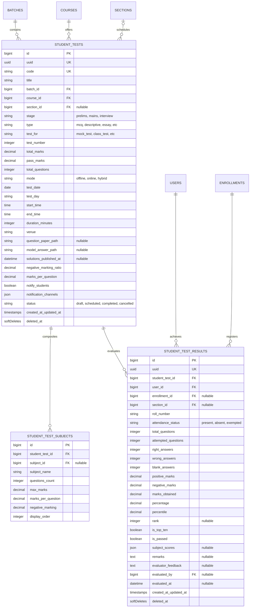

# Changelog: Comprehensive Students Tests & Examinations Performance Report Management System

**Date:** 2026-10-29  
**Author:** SNTCSSC Development Team  
**Category:** Academic Examination Management, Test Series Performance Analytics, Merit Standings & Leaderboards, Composite Subjects Evaluation, Marksheet Generation, Student Portal  
**Status:** Completed & Production Ready  

---

## 1. Executive Summary

As a premier coaching institution for the **UPSC Civil Services Examinations**, the Satyendranath Tagore Civil Services Study Centre (SNTCSSC) conducts rigorous mock test series, sectional tests, answer writing sessions, and full-length simulated examinations. To systematically monitor student progress, evaluate composite subject preparedness (e.g., General Studies + CSAT), recognize top achievers, and audit attendance/absenteeism patterns, this release delivers a complete, enterprise-grade **Students Tests and Examinations Performance Report Management System**.

The module empowers administrators to create examinations targeted at specific courses, batches, and sections (or all sections), schedule multi-subject composite test papers, configure negative marking ratios, upload time-locked question papers and model answers, evaluate candidates in bulk or individually, calculate standard competition rankings and percentiles, generate official printable marksheet PDFs with QR verification, and review multi-dimensional performance analytics. Furthermore, enrolled students enjoy a personalized dashboard to track their upcoming exams, attended test history, detailed question breakdowns, time-locked solution downloads, and the inspirational **Hall of Fame Leaderboard**.

---

## 2. Key Capabilities & Features

### 2.1 Examination Creation, Composite Scheduling & Official UPSC Presets
- **Official UPSC Prelims Marking System Alignment:**
  - **General Studies Paper I (GS I):** 100 Questions, 200 Total Marks, **+2.00 Marks** per correct answer, **-0.66 Marks** penalty per wrong response (1/3rd of 2.00), counts towards Prelims Merit Cut-off.
  - **CSAT / General Studies Paper II (GS II):** 80 Questions, 200 Total Marks, **+2.50 Marks** per correct answer, **-0.83 Marks** penalty per wrong response (1/3rd of 2.50), **Qualifying Paper Only** (requires $\ge 33\%$ / 66.67 Marks).
  - **Unattempted Questions:** Zero penalty (0.00 Marks).
- **One-Click Official UPSC Examination Presets in Scheduler:**
  - Instant toolbar inside the test creation modal with 1-click presets:
    - 🏛️ **UPSC GS Paper I:** Configures 100 Qs, 200 Marks, +2.00 / -0.66 penalty, 120 Mins.
    - 📐 **UPSC CSAT Paper II:** Configures 80 Qs, 200 Marks, +2.50 / -0.83 penalty, 66.67 Marks ($\ge 33\%$) qualifying threshold, 120 Mins.
    - ⚖️ **UPSC Composite Prelims:** Combines Section A (GS 50 Qs @ 2.00M, -0.66) + Section B (CSAT 40 Qs @ 2.50M, -0.83) = 90 Qs / 200 Marks.
    - ✍️ **UPSC Mains Answer Writing:** 20 Questions, 250 Marks, 180 Mins.
- **Test Classification:**
  - **Stage:** Prelims, Mains, Interview / Personality Test.
  - **Type:** MCQ (Objective), Descriptive, Essay, Answer Writing, CSAT, Mixed.
  - **Test For:** Class Tests, Mock Tests, Live Tests, Full Length Tests, Sectional Tests, Surprise Tests.
  - **Test Number:** Sequenced identifier (e.g., Test #1, Test #2, Test #3).
  - **Mode:** Offline (Classroom), Online (CBT / Portal), Hybrid.
- **Composite Subject Allocation:**
  - Support for multiple subjects per paper with dedicated question allocations and marks (e.g., Composite Paper: *General Studies Paper I* with 50 Questions [100 Marks] + *CSAT Paper II* with 50 Questions [100 Marks] = 100 Questions [200 Marks]).
  - Custom marks-per-question and negative penalty settings per subject.
- **Target Audience:**
  - Course-wise and batch-wise scoping.
  - Section-specific scheduling (since different sections may write exams on alternate days or times) or cross-section scheduling (all sections under a course/batch).
- **Time-Locked Document Repository:**
  - Question Paper and Model Answer/Explanation PDF uploads handled securely via `FileUploadService`.
  - Time-lock security logic: Students (whether attended or absent) cannot download question papers or model solutions until the scheduled test end time has elapsed.
- **Multi-Channel Notification Dispatch:**
  - Configurable notification toggles on scheduling: dispatch announcements to enrolled candidates via In-app notifications, WhatsApp, SMS, and Email.

### 2.2 Gradebook, Scoring Engine & Evaluation Logic
- **Objective (MCQ) Scoring Formula:**
  - Candidate inputs: Total Questions, Attempted Questions, Right Answers, Wrong Answers, Blank Answers.
  - Calculation: $\text{Positive Marks} = \text{Right Answers} \times \text{Marks per Question}$.
  - Penalty: $\text{Negative Marks} = \text{Wrong Answers} \times (\text{Marks per Question} \times \text{Negative Marking Ratio})$.
  - Net Score: $\text{Net Marks} = \max(0, \text{Positive Marks} - \text{Negative Marks})$.
  - Percentage: $\text{Percentage} = \frac{\text{Net Marks}}{\text{Maximum Marks}} \times 100$.
- **Descriptive & Non-MCQ Scoring:**
  - Direct marks entry, evaluator guidance remarks, subject score breakdown JSON, and pass/fail benchmark determination.
- **Standard Competition Ranking & Percentiles:**
  - Competition ranking algorithm ("1224" ranking): Tied candidates receive identical ranks, with the subsequent rank offset accordingly.
  - Automatic percentile calculation based on relative candidate standing against all evaluated attendees.
  - Automatic `is_top_ten` flagging for Hall of Fame qualification.
- **Bulk Operations:**
  - Prefilled CSV template download pre-populated with student roll numbers, names, and total test questions.
  - Bulk CSV/Excel score ingestion with data validation, sanitization, and database transactions.
  - Instant one-click "Recalculate Ranks & Percentiles" batch action.

### 2.3 Hall of Fame & Top Rankers Leaderboard (Configurable & High-Contrast)
- **Top 3 Podium Display (High-Contrast Light & Dark Mode):**
  - Interactive podium visual highlighting Rank #1 (Topper / Gold Crown), Rank #2 (Silver Medal), and Rank #3 (Bronze Medal) with candidate profile photos/avatars, roll numbers, percentage scores, and total marks.
  - Dark mode color contrast optimized: Gold uses `amber-500` glow and `text-slate-950` badge text; Silver uses `slate-200/slate-700` styling with `text-slate-100`; Bronze uses warm `amber-600/amber-500` accents and `text-amber-300` in dark mode to prevent low-contrast dark brown rendering.
- **Configurable Dynamic Top Rankers Limit:**
  - Configurable top rankers count via admin setting `test_leaderboard_limit` (defaults to 10).
  - Dynamic on-the-fly selector toolbar: `Show Top: [3, 5, 10, 15, 20, 25, 50, 100]` allowing administrators to view podium-only (Top 3) or expand to Top 5, 10, 15, 20, 25, 50, or 100 rankers.
  - One-click "Save Default" action that persists the chosen limit to system settings and syncs across the institution.
  - Integrated into System Settings (`admin/settings/system`) under Storage & Examination limits.
- **Featured Achievers (Ranks 4 to N):**
  - Responsive card grid displaying candidate profile photo/avatar thumbnail, `#rank` badge, candidate name, roll number, net marks, and percentage.
  - Dynamically titles according to the active limit: "Featured Achievers (Ranks 4 to :limit)".
- **Student Portal Synchronization:**
  - Student logged-in dashboard leaderboard dynamically reads `test_leaderboard_limit` and displays candidate profile images, podium styling, and rank standings.

### 2.4 Comprehensive Multi-Tab Reports & Analytics (Search, Filter, Sort, Import & Export)
- **Tab 1: Test-Wise Performance Analytics:**
  - Comprehensive KPI stat cards: Enrolled turnout, attendance rate, average score, top scorer, pass rate.
  - Grade distribution breakdown (Grade A $\ge 75\%$, Grade B 60-74%, Grade C 45-59%, Remedial $< 45\%$).
  - Dynamic Search & Filter toolbar: Candidate name/roll number search, Section filter, Attendance status filter (Present/Absent), Result status filter (Passed/Remedial).
  - Sorting: Rank, Marks Obtained, Percentage Score, Roll Number with ascending/descending toggle.
  - Exports: **CSV**, **Excel (.xlsx)**, and **PDF** formats via `TableExporter`.
  - In-Page Score Ingestion: Direct "Import Scores" button opening an interactive modal with 1-click downloads for pre-filled CSV and Excel templates.
- **Tab 2: Student-Wise Overall Performance Dossier:**
  - Student search with instant autocomplete by candidate name, roll number, or email.
  - Comprehensive candidate profile card displaying avatar, enrolled course, batch, section, and attendance rate badge.
  - Performance KPIs: Tests Attended, Average Score, Average % Score, Best Merit Rank, Top Finishes.
  - Test history filter & sort toolbar: Stage filter (Prelims, Mains), Type filter (MCQ, Descriptive, Essay), Attendance filter, Sort by Date, Marks, Percentage, or Merit Rank.
  - Exports: Individual candidate examination dossier exported as **CSV**, **Excel (.xlsx)**, and official **PDF Dossier Transcript** (`exports.student-dossier-pdf`).
- **Tab 3: Attendance & Participation Audit:**
  - Scoped by Batch, Course, Section, and Category (All Turnout, 100% Champions, Chronic Absentees 0%, Top Turnout, Least Turnout).
  - 100% Participation Champions list with attendance count, participation rate, and average score.
  - Chronic Absentees / Academic Default list (0% attendance) with instant "Send Nudge" notification action.
  - Top Attendees vs. Least Attendees comparative tables.
  - Exports: Audit data exported as **CSV**, **Excel (.xlsx)**, and **PDF Audit Report** (`exports.participation-audit-pdf`).
- **Tab 4: Batch & Section Comparison:**
  - Cross-section academic benchmarking for any course/batch.
  - Dynamic search by section name or classroom code, with sorting by Section Name, Enrolled Students, Tests Held, Average Score, Average %, and Highest Score.
  - Exports: Section analytics exported as **CSV**, **Excel (.xlsx)**, and **PDF Comparative Report** (`exports.section-comparison-pdf`).

### 2.5 Candidate Score Ingestion & Template Enhancement
- **Expanded Score Template Columns:**
  - Pre-filled sample CSV and Excel (.xlsx) templates generated by `TestImportExportService::generateSampleTemplate()` now include:
    - `roll_number`: Student roll number / ID.
    - `student_name`: Pre-filled candidate name.
    - `email`: Enrolled student email.
    - `attendance_status`: 'present' or 'absent'.
    - `right_answers`: Correct responses (for MCQs).
    - `wrong_answers`: Incorrect responses (subject to negative penalty).
    - `blank_answers`: Unattempted questions (zero penalty).
    - `marks_obtained`: Net marks (computed or entered directly for descriptive papers).
    - `remarks`: Evaluator / faculty observations (e.g. "Good analytical attempt").
    - `feedback`: Student-specific improvement guidance (e.g. "Focus on CSAT Reading Comprehension speed").
    - `evaluated_by`: Evaluator email, name, or User ID.
    - `evaluated_at`: Date / Datetime string (e.g., `YYYY-MM-DD HH:MM`).
- **Resilient Import Parser:**
  - Handles both `.csv` and Excel formats (`.xlsx`, `.xls` via `Excel::toArray()`).
  - Evaluator resolution: Resolves `evaluated_by` from user email, ID, or name, falling back to authenticated user ID.
  - Timestamp resolution: Parses `evaluated_at` via `Carbon::parse()`, falling back to `now()`.
  - Recalculates competition ranks and updates audit logs automatically.
  - Dedicated candidate cards for positions 4 through 10 celebrating distinction and encouraging peer motivation.
- **Complete Merit Standings Table:**
  - Dynamic searchable merit table covering all attendees with real-time status badges, right/wrong answer tallies, and marksheet download actions.
- **Dual Scope Support:**
  - **Test-Specific Standings:** Rankers for any selected mock examination.
  - **Overall Aggregate Leaderboard:** Institute-wide cumulative rankings calculated from aggregate marks, average percentages, and total tests attended.

### 2.4 Comprehensive Analytics & Executive Reports
- **1. Test-Wise Performance Analytics:**
  - Candidate turnout vs total enrolled candidates.
  - Overall attendance rate percentage.
  - Average class score, highest score, and topper identification.
  - Benchmark qualification / pass percentage.
  - 4-Tier Score Distribution Breakdown:
    - *Grade A (High Distinction, $\ge 75\%$)*
    - *Grade B (Above Average, $60\% - 74\%$)*
    - *Grade C (Average / Qualifying, $45\% - 59\%$)*
    - *Grade D (Remedial Focus, $< 45\%$)*
  - Printable Test Summary PDF export.
- **2. Student-Wise Longitudinal Dossier:**
  - Candidate cross-test trajectory across all attended examinations.
  - Individual attendance percentage, cumulative average marks, highest score attained, best rank, and times featured in the Top 10.
  - Chronological examination history table with individual marksheet downloads.
- **3. Attendance & Participation Audit:**
  - Total tests conducted across selected filters.
  - **100% Participation Champions:** Roster of dedicated candidates who attended every conducted examination.
  - **Chronic Absentees (0% Attendance):** Instant identification of candidates who have not attended any examination.
  - **Instant Absentee Nudge Action:** Administrative button to dispatch multi-channel attendance reminders and counseling alerts directly to chronic absentees.
  - **High & Low Participation Rosters:** Candidates with maximum tests attended vs candidates with least tests attended.
- **4. Batch & Section Comparative Analytics:**
  - Cross-section performance matrix comparing average marks, attendance rates, and pass rates across sections in multi-section courses.

### 2.5 Official Marksheet Generation
- Styled A4 printable PDF marksheet generated via `TestImportExportService` featuring:
  - Official SNTCSSC emblem, header, and candidate profile (Name, Lifetime Student ID, Roll Number, Course, Batch, Section).
  - Examination metadata (Stage, Type, Venue, Date, Maximum Marks, Pass Marks).
  - Evaluation breakdown (Attempted, Right, Wrong, Blank, Positive Marks, Penalty Deductions, Net Score, Percentage, Final Rank, Percentile, Result Status).
  - Subject-wise scores table for composite papers.
  - Evaluator remarks and performance guidance notes.
  - Scannable verification QR Code generated via `BarcodeService`.
  - Official seal and Controller of Examinations signature block.

### 2.6 Student Dashboard Integration
- Student examination portal (`/student/tests`) providing:
  - Personal snapshot stats: Tests Attended, Overall Average Score, Best Merit Rank, Top 10 Features.
  - Upcoming scheduled tests with date, timings, venue, and subject breakdowns.
  - Examination history table with interactive marksheet preview modal.
  - Direct download links for question papers and model answers (enforcing time-lock restrictions).
  - Student-viewable Hall of Fame Leaderboard and ranking standings.

---

## 3. Database Schema

### 3.1 Migration File
`database/migrations/2026_10_29_000000_create_student_tests_management_tables.php`



---

## 4. Architecture & Source File Index

| File Path | Purpose |
| :--- | :--- |
| `app/Models/StudentTest.php` | Main examination model with soft deletes, auditable traits, time-lock helpers (`canDownloadSolutions()`, `hasConcluded()`), status badges, and relationships. |
| `app/Models/StudentTestSubject.php` | Child model representing composite subjects and question weightings. |
| `app/Models/StudentTestResult.php` | Candidate result model with scoring methods (`computeScores()`), rank badges, and percentage accessors. |
| `app/Services/Test/StudentTestService.php` | Test orchestration: creation, updates, auto-roster enrollment initialization, file storage, and multi-channel notification dispatch. |
| `app/Services/Test/TestScoreCalculatorService.php` | Mathematical scoring engine for MCQ penalties, positive marks, net scores, percentiles, and standard competition ranking. |
| `app/Services/Test/TestReportService.php` | 4-tab analytics engine: test-wise statistics, student longitudinal dossiers, attendance/absenteeism audits, and section comparisons. |
| `app/Services/Test/TestImportExportService.php` | Data export/import engine: CSV gradebook export, sample template generation, bulk score ingestion, and PDF marksheet generation. |
| `app/Http/Controllers/StudentTestDownloadController.php` | Secure download handler enforcing time-locks for question papers/solutions and rendering marksheet PDFs. |
| `app/Http/Controllers/Api/StudentTestApiController.php` | RESTful API endpoints for mobile apps and headless integrations (`/api/v1/student-tests/*`). |
| `resources/views/pages/admin/tests/⚡index.blade.php` | Admin examinations dashboard with cards, filters, schedule modal with dynamic subject rows, and file upload inputs. |
| `resources/views/pages/admin/tests/⚡results.blade.php` | Admin gradebook with attendance toggles, real-time score editor modal, bulk CSV import, and rank recalculation. |
| `resources/views/pages/admin/tests/⚡reports.blade.php` | 4-tab analytics reporting console with interactive metrics, grade distribution, and absentee nudge actions. |
| `resources/views/pages/admin/tests/⚡leaderboard.blade.php` | Hall of Fame leaderboard with Top 3 podium, Ranks 4-10 cards, and searchable full merit standings table. |
| `resources/views/pages/student/⚡tests.blade.php` | Student examination portal with upcoming schedule, test history, time-locked downloads, marksheet view, and leaderboard. |
| `resources/views/exports/marksheet-pdf.blade.php` | Styled A4 printable student marksheet template with SNTCSSC crest, candidate profile, and verification QR code. |
| `resources/views/exports/test-report-pdf.blade.php` | Printable examination summary report PDF template. |
| `app/Services/RbacService.php` | Seeded permissions: `tests.view`, `tests.create`, `tests.edit`, `tests.delete`, `tests.manage`, `tests.results.manage`, `tests.reports.view`, `tests.export`, `tests.student.view`. |
| `database/seeders/StudentTestSeeder.php` | Comprehensive demo seeder generating 4 realistic mock tests (Prelims Full Length, History Sectional, Mains Answer Writing, Upcoming Economy Mock) with enrolled candidates, scores, and ranks. |
| `tests/Feature/StudentTestManagementTest.php` | Complete Pest test suite covering CRUD, scoring logic, time-locked downloads, imports/exports, marksheet PDFs, and analytics. |

---

## 5. Security & Access Control

1. **Role-Based Permissions (RBAC):**
   - Granular permissions mapped in `RbacService`:
     - `tests.view`: Browse examinations and schedules.
     - `tests.create`: Create new tests and assign composite subjects.
     - `tests.edit`: Modify test schedules and question paper files.
     - `tests.delete`: Soft-delete examinations.
     - `tests.results.manage`: Enter marks, recalculate ranks, and import bulk CSVs.
     - `tests.reports.view`: Access analytics and attendance audits.
     - `tests.export`: Download gradebook CSVs and marksheet PDFs.
     - `tests.student.view`: Access student-facing test portal and ranker lists.
2. **Time-Locked File Access Control:**
   - Both question papers and model answers are stored on secure disk storage.
   - The `StudentTestDownloadController` checks whether the current user is an administrator or student. Students attempting to download papers or solutions before the test end time receive an HTTP 403 Forbidden response with an explanatory time-lock message.
3. **Database Transactions & Soft Deletes:**
   - All batch operations (test creation, score recalculation, bulk CSV import, roster enrollment initialization) execute within `DB::transaction` blocks.
   - All core entities (`StudentTest`, `StudentTestResult`) implement `SoftDeletes` to prevent accidental loss of academic records.
4. **Audit Logging:**
   - Evaluator score modifications, rank recalculations, test creations, and absentee notification dispatches generate immutable audit records via `AuditLog`.

---

## 6. Localization & Design System Enhancements

1. **Trilingual Localization Synchronization:**
   - Expanded dictionary with **119 synchronized keys** across `lang/en.json`, `lang/bn.json`, and `lang/hi.json`.
   - Comprehensive translation coverage spanning navigation headers, test cards, analytical tabs, composite question allocations, attendance status badges, scoring metrics, flash toast notifications, and participation audits.
2. **Iconography & Visual Assets:**
   - Added missing SVG paths to `app/Support/LucideIcons.php` for `trophy`, `clipboard-list`, `clipboard-x`, `check-check`, and `target`.
   - Removed all icon fallback squares across sidebars, stat cards, merit podiums, and empty states.
3. **Typography & Theme Ergonomics:**
   - Semantic design tokens utilized throughout (`bg-card`, `text-foreground`, `text-muted-foreground`, `border-border`, `bg-secondary`, `bg-primary`, `bg-popover`) guaranteeing clean legibility in both Light and Dark modes.
   - Fixed button type attributes (`type="button"`) on interactive controls to prevent unintentional form submissions.
   - Hardened `StudentTestDownloadController` authorization checks ensuring strict IDOR protection so only authorized administrators, faculty, or the candidates themselves can download official marksheet PDFs.
   - Cleaned duplicate route block declarations in `routes/api.php`.
   - **MySQL 8.0 Reserved Keyword Escaping:** Backtick-quoted `` `rank` `` in raw ordering clauses (``CASE WHEN `rank` IS NULL THEN 1 ELSE 0 END, `rank` ASC, marks_obtained DESC``) preventing MySQL error 1064 caused by conflict with MySQL 8.0's native `RANK()` window function.

---

## 7. Quality Assurance & Verification

### 7.1 Automated Pest Test Suite
The automated test suite `tests/Feature/StudentTestManagementTest.php` was executed using Pest PHP:
```bash
php artisan test --compact --filter=StudentTestManagementTest
```
**Results:**
- Tests Executed: **16 passed** (100% green)
- Total Assertions: **78 assertions**
- Covered Workflows:
  - Admin examinations index listing and statistics.
  - Composite test creation with multi-subject questions and automatic roster generation.
  - Formulaic MCQ score calculation with positive marks, negative penalties, net scores, and percentiles.
  - Official UPSC Prelims GS Paper I (+2.00, -0.66) and CSAT Paper II (+2.50, -0.83, $\ge 33\%$ qualifying) scoring.
  - Standard competition ranking recalculation.
  - Configurable dynamic leaderboard limit (`test_leaderboard_limit`) and settings persistence.
  - Time-lock enforcement (denying student downloads prior to conclusion, allowing post-conclusion downloads).
  - Bulk CSV/Excel candidate score import with `remarks`, `feedback`, `evaluated_by`, and `evaluated_at`.
  - Comprehensive examination reports export across all formats: CSV, Excel (.xlsx), and PDF (test-wise, student dossier, participation audit, and section comparisons).
  - Official A4 marksheet PDF rendering with scannable QR verification.
  - 4-tab analytics engine and participation audits (100% champions and chronic absentees).
  - Admin gradebook and rankers leaderboard page access with Livewire reactivity.
  - Student portal test history, solution access, and leaderboard standings.

### 7.2 Code Style & Formatting
- Code formatted cleanly using Laravel Pint (`vendor/bin/pint --dirty --format agent`).
- Strict typing, constructor property promotion, explicit return types, and PHPDoc type hints applied across all models, services, and controllers.

---

## 8. Multi-Platform REST API, Developer Console & UI/UX Polish

### 8.1 Leaderboard Podium UI/UX Overhaul
1. **Unclipped, High-Contrast Podium Badges:**
   - Resolved the container clipping bug on podium cards where `overflow-hidden` combined with negative coordinates (`absolute -top-3`) was obscuring the badges for `RANK #1 • TOPPER`, `🥈 RANK #2 • RUNNER-UP`, and `🥉 RANK #3 • 2ND RUNNER-UP`.
   - Redesigned podium cards in both the Admin Dashboard (`resources/views/pages/admin/tests/⚡leaderboard.blade.php`) and Student Portal (`resources/views/pages/student/⚡tests.blade.php`) to embed badges as centered, pill-shaped headers (`inline-flex items-center gap-1.5 ... uppercase tracking-wider mx-auto`) within the natural layout flow.
   - Enhanced gold, silver, and bronze aesthetic hierarchies with high-contrast text and border treatments tailored for optimal contrast in both light and dark themes.

### 8.2 Comprehensive 12-Column Import Instructions Modal
1. **Interactive Roster Guidance:**
   - Overhauled score import modals in both `⚡results.blade.php` and `⚡reports.blade.php` with a multi-step guided layout (`max-w-3xl`).
   - Added instant one-click download buttons for both **CSV** and **Excel (.xlsx)** pre-filled roster templates containing active enrolled students and roll numbers.
   - Built an interactive 12-column reference table detailing `roll_number`, `student_name`, `email`, `attendance_status`, `right_answers`, `wrong_answers`, `blank_answers`, `marks_obtained`, `remarks`, `feedback`, `evaluated_by`, and `evaluated_at`.
   - Integrated clear scoring notes explaining UPSC GS Paper I (+2.00, -0.66) and CSAT Paper II (+2.50, -0.83, $\ge 33\%$ qualifying) mechanics and instant batch rank recalculation.

### 8.3 Multi-Platform REST API Endpoints (13 Endpoints)
1. **Complete REST Surface in `StudentTestApiController` & `routes/api.php`:**
   - `GET /api/v1/student-tests/dashboard`: Executive KPI metrics (tests held, upcoming, turnout rate, average score, pass rate, stage/type distributions, top achievers).
   - `GET /api/v1/student-tests/rankers`: Global aggregate Hall of Fame with dynamic `?limit=N` (defaults to system setting).
   - `GET /api/v1/student-tests/{identifier}/section-comparison`: Section-by-section breakdown (enrolled, present, absent, average marks, highest, lowest, pass rate).
   - `POST /api/v1/student-tests/{identifier}/import-scores`: Multipart file upload API (`.csv`, `.xlsx`) for automated OMR scoring services and third-party tools.
   - `GET /api/v1/student-tests/results/{resultId}/marksheet`: Comprehensive candidate marksheet payload, evaluator notes, and verified PDF download link.
   - Fixed `leaderboard` avatar URLs to dynamically use `$user->avatarUrl()`.
   - Auto-resolved missing `roll_number` and `section_id` in `TestScoreCalculatorService` using active student enrollments.

### 8.4 API Scopes & Developer Console Integration
1. **Granular API Scopes Registered in `ApiKeyService`:**
   - `read:tests`: View mock tests, results, merit rankings, leaderboards, and analytics.
   - `write:tests`: Schedule examinations, record marks, and bulk import scores.
   - `download:marksheets`: Generate and stream official candidate marksheet PDFs.
2. **Developer Console & Docs (`resources/views/pages/admin/api-keys/⚡docs.blade.php`):**
   - Registered all 13 Student Tests endpoints in the interactive API Sandbox catalog.
   - Added `student_tests` filter tab in the endpoints and scopes matrix.
   - Integrated cURL terminal snippets for test dashboard and leaderboard retrieval.
   - Added fourth card under Official Architecture & Integration Guides with in-console modal reader support.
3. **Multi-Platform Integration Guide (`docs/integrations/student-tests-and-performance-api.md`):**
   - Published a comprehensive developer integration guide with Mermaid sequence diagrams, UPSC scoring algorithms, full schemas, error matrices, and production SDK snippets for Flutter (Dart), React Native (TypeScript), Python (OMR Scanner), Electron (Kiosk), and cURL.

### 8.5 Automated Test Verification
- Executed full test suite: **18 tests, 149 assertions passing 100% green**.
- Pint code formatter verified clean (`vendor/bin/pint --dirty --format agent`).

---

## 9. Candidate Score Modal Interactive Attendance Selection & Rapid Correction Overhaul

### 9.1 Interactive Attendance Status Selection
1. **Interactive Attendance Switcher:**
   - Redesigned attendance selection in `resources/views/pages/admin/tests/⚡results.blade.php` with 4 distinct interactive button controls (`Present`, `Absent`, `Exempted`, `Disqualified`).
   - Integrated reactive Livewire handler `setAttendanceStatus(string $status)` linked to `wire:click="setAttendanceStatus('...')"` with instant state reflection, animated icons, and high-contrast color-coded focus rings (Emerald, Amber, Sky, and Destructive).
   - Replaced deferred hidden input syncing with an active reactive signal so changing attendance state immediately toggles related MCQ question counters or marks inputs.
   - Added explanatory banner when attendance is marked non-present, notifying the evaluator that scores are automatically set to `0.00` and excluded from merit rank calculations.

### 9.2 Rapid Import Correction Fields
1. **Roster & Section Identity Correction:**
   - Added instant editable input for Candidate Roll Number (`roll_number`), enabling rapid correction of misread OCR/OMR roll numbers.
   - Added Section Assignment dropdown (`section_id`) mapped to all available classroom sections of the course, correcting cross-section roster misallocations.
2. **Objective Question Counters & Live Formula Computation:**
   - Added live two-way bound inputs for `right_answers`, `wrong_answers`, and `blank_answers`.
   - Real-time formula breakdown bar displaying: `Formula: Right × marks_per_q - Wrong × penalty` and `Computed: X Marks`.
3. **Manual Score Override & Reversion:**
   - Provided an optional `manual_override_marks` input for grace marks, disputed committee questions, or administrative adjustments.
   - Added a "Clear Override & Restore Formula" button with instant `$set('editForm.manual_override_marks', '')` action to quickly revert manual adjustments back to strict UPSC formula auto-calculation.
   - Auto-detects whether an existing score differs from the formula score and pre-fills `manual_override_marks` upon opening the modal.
4. **Paper Bounds Quick Correction:**
   - Added an expandable "Paper Bounds & Questions Correction" tray to correct `total_questions` and `total_marks` if an imported file had mismatched paper boundaries.
5. **Evaluation Metadata & Actionable Student Feedback:**
   - Added Pass/Fail toggle (`is_passed`) with standard and remedial classifications.
   - Added Evaluator Faculty selector (`evaluated_by`) populated with active instructors and academic administrators.
   - Added Evaluation Date & Time picker (`evaluated_at`).
   - Added internal faculty observations (`remarks`) and candidate-facing marksheet recommendations (`feedback`).

### 9.3 Scoring Engine Preservation (`TestScoreCalculatorService`)
1. **Manual Override Integrity in `recalculateAndRank()`:**
   - Modified `recalculateAndRank()` in `app/Services/Test/TestScoreCalculatorService.php` so that calling batch recalculations preserves manual override marks (`marks_obtained !== null`) while synchronizing `percentage` and pass status, rather than blindly overwriting `marks_obtained` via `computeScores()`.
   - Non-present candidates (absent, exempted, disqualified) are cleanly reset to `0.00` marks, `0.00%`, null rank, and null percentile.

### 9.4 Trilingual Localization & Verification
- Synchronized translation entries across `lang/en.json`, `lang/bn.json`, and `lang/hi.json`:
  - `"Clear Override & Restore Formula"`
  - `"Paper Bounds & Questions Correction"`
  - `"Correct if wrongly imported"`
  - `"Candidate Total Questions"`
  - `"Candidate Total Maximum Marks"`
- Executed Pest test suite: **18 tests, 151 assertions passing 100% green**.
- Ran Laravel Pint: **0 style violations detected**.

---

## 10. Marksheet & Examination Reports Electronic Verification Footer Update

### 10.1 Removal of Controller of Examinations Space & Digital Authentication Statement
1. **Official Marksheet PDF (`resources/views/exports/marksheet-pdf.blade.php`):**
   - Removed the physical signature block and "Controller of Examinations" title from the bottom-right footer.
   - Restructured the footer layout into a streamlined electronic verification card:
     - Left column: High-resolution verification QR code with "Scan to Verify Digitally" caption (or official seal placeholder).
     - Right column: Official institute credentials, issuance timestamp (`IST`), immutable document verification hash (`MD5` of UUID and test code), and a bold, centered disclaimer:
       $$\text{* This is a computer-generated document and does not require a physical signature.}$$
2. **Standardized Disclaimers Across All Examination Report PDFs:**
   - Updated footer notes across:
     - [`resources/views/exports/test-report-pdf.blade.php`](file:///c:/Users/nilan/Downloads/sntcssc-mis/resources/views/exports/test-report-pdf.blade.php)
     - [`resources/views/exports/student-dossier-pdf.blade.php`](file:///c:/Users/nilan/Downloads/sntcssc-mis/resources/views/exports/student-dossier-pdf.blade.php)
     - [`resources/views/exports/participation-audit-pdf.blade.php`](file:///c:/Users/nilan/Downloads/sntcssc-mis/resources/views/exports/participation-audit-pdf.blade.php)
     - [`resources/views/exports/section-comparison-pdf.blade.php`](file:///c:/Users/nilan/Downloads/sntcssc-mis/resources/views/exports/section-comparison-pdf.blade.php)
   - Appended: `Computer-generated document, does not require physical signature.`
3. **Automated Verification:**
   - Added automated assertion in [`tests/Feature/StudentTestManagementTest.php`](file:///c:/Users/nilan/Downloads/sntcssc-mis/tests/Feature/StudentTestManagementTest.php) verifying that generated marksheets render the computer-generated authentication statement and contain zero references to "Controller of Examinations".
   - Verified 100% green tests (**18 passed**, **151 assertions**).


