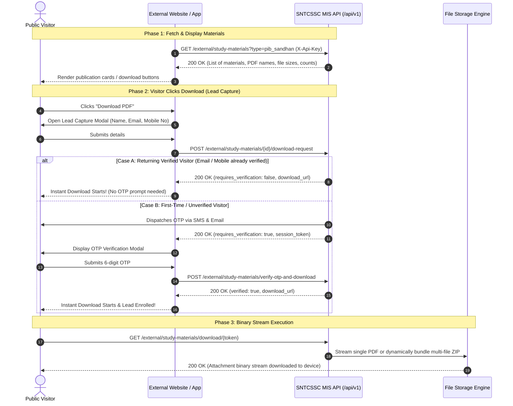

# SNTCSSC MIS — External Study Materials API Integration Guide
### Dynamic Fetching & Public Lead Capture with Smart OTP Verification (Current Affairs & PIB Sandhan)

---

## 1. Executive Summary & Flow Overview

This guide provides step-by-step instructions for integrating study materials from the **Satyendranath Tagore Civil Services Study Centre (SNTCSSC) MIS** into an external website, landing page, portal, or mobile application (e.g., WordPress, Next.js, React, Vue, PHP, or custom HTML/JS).

### Key Features of this Integration:
1. **Public Material Fetching:** Query and display dynamic publications such as **Current Affairs** (`type=current_affairs`) and **PIB Sandhan - An In-House Initiative of SNTCSSC** (`type=pib_sandhan`) without exposing restricted student materials.
2. **Lead Acquisition & Validation:** When a visitor clicks **Download**, they submit their **Name**, **Email**, and **Mobile Number**.
3. **Smart OTP Verification Bypass:**
   - **First-time / Unverified Visitor:** The MIS issues high-priority Email and SMS OTPs to verify the visitor's genuineness. Upon entering the OTP, the lead is stored in the MIS `subscribers` database, and a secure download link is granted.
   - **Returning / Already-Verified Visitor:** If the visitor's email or mobile number has already been verified in the past (in the `subscribers` or `users` database), the MIS **automatically bypasses OTP verification** and grants an instant download token immediately.
4. **Token-Secured Direct Binary Streaming:** Download links use short-lived cryptographic tokens (`/api/v1/external/study-materials/download/{token}`) that stream single PDFs or dynamically compiled ZIP archives directly to the user's device.

---

## 2. Architecture & Sequence Flow



---

## 3. Step 1: Generate an API Key in SNTCSSC MIS

Before writing code on your external website, generate a dedicated API Key in the SNTCSSC MIS Admin Panel:

1. Log in to the MIS as **Super Administrator** or **Administrator**.
2. Navigate to **Developer & API Keys** (`/admin/api-keys`).
3. Click **+ Generate New API Key**.
4. Configure the key:
   - **Key Name / Client:** `Main Public Website` (or your external site domain).
   - **Application Type:** `External App` or `Service`.
   - **Environment:** `Production` (or `Sandbox` for staging).
   - **Required Scopes (Check both):**
     - `read:materials` — Required to query study materials and categories.
     - `download:materials` — Required to initiate download requests and OTP sessions.
   - **Rate Limit:** Set to `120` or `300` requests/minute according to your expected traffic.
   - **IP Allowlist:** *(Optional)* If your external website calls the API through a backend server (e.g. Node.js/PHP proxy), enter your web server's static IP address for enhanced security.
5. Click **Create Key** and copy the secret key immediately (e.g., `sntc_live_9f8c1b2a...`). Keep it confidential.

---

## 4. Step 2: REST API Endpoints Reference

All requests must include the API Key either in the `X-Api-Key` header or as a Bearer token in the `Authorization` header.

```http
X-Api-Key: sntc_live_YOUR_ACTUAL_API_KEY
Accept: application/json
Content-Type: application/json
```

### 4.1. List Public Material Types
Retrieve all active public material categories with published publication counts.

- **Method:** `GET`
- **URL:** `https://mis.sntcssc.in/api/v1/external/study-materials/types`
- **Response `200 OK`:**
```json
{
  "success": true,
  "data": [
    {
      "id": 1,
      "name": "Current Affairs",
      "code": "current_affairs",
      "description": "Daily & Monthly National and International Current Affairs compilations",
      "icon": "newspaper",
      "badge_color": "emerald",
      "materials_count": 42
    },
    {
      "id": 2,
      "name": "PIB Sandhan",
      "code": "pib_sandhan",
      "description": "An In-House Initiative of SNTCSSC synthesizing Press Information Bureau bulletins",
      "icon": "book-marked",
      "badge_color": "blue",
      "materials_count": 28
    }
  ]
}
```

---

### 4.2. Query Study Materials (Current Affairs & PIB Sandhan)
Search, filter, and paginate publications for external display.

- **Method:** `GET`
- **URL:** `https://mis.sntcssc.in/api/v1/external/study-materials`
- **Query Parameters:**
  | Parameter | Type | Required | Description |
  | :--- | :--- | :--- | :--- |
  | `type` | string | Optional | Filter by publication code: `current_affairs` or `pib_sandhan` |
  | `search` | string | Optional | Keyword search against title, subject, topic, and summary |
  | `year` | integer| Optional | Filter by publication year (e.g., `2026`) |
  | `month` | integer| Optional | Filter by publication month (e.g., `10` for October) |
  | `sort` | string | Optional | `order` (default, sequence ordered by admin), `class_date`, `latest`, `downloads`, `views`, `title`, `oldest` |
  | `page` | integer| Optional | Current page number (default: `1`) |
  | `per_page` | integer| Optional | Items per page (default: `12`, max: `50`) |

- **Sample Request:**
```bash
curl -X GET "https://mis.sntcssc.in/api/v1/external/study-materials?type=pib_sandhan&sort=order&per_page=10" \
     -H "X-Api-Key: sntc_live_YOUR_ACTUAL_API_KEY" \
     -H "Accept: application/json"
```

- **Response `200 OK`:**
```json
{
  "success": true,
  "data": [
    {
      "id": 15,
      "uuid": "4c9e887d-413d-4c31-92b0-f04bf459381c",
      "title": "PIB Sandhan - October 2026 (Vol. IV)",
      "slug": "pib-sandhan-october-2026-vol-iv",
      "subject": "Current Affairs & Government Schemes",
      "topic": "Cabinet Approvals & Economic Trends",
      "material_type": {
        "code": "pib_sandhan",
        "name": "PIB Sandhan"
      },
      "description": "In-depth summary of government policies, bilateral agreements, and ministerial releases.",
      "thumbnail_url": "https://mis.sntcssc.in/storage/study-materials/thumbnails/cover-oct26.jpg",
      "class_date": "2026-10-26",
      "display_order": 1,
      "published_at": "2026-10-25T14:30:00+05:30",
      "view_count": 842,
      "download_count": 319,
      "files_count": 1,
      "files": [
        {
          "id": 34,
          "file_name": "PIB_Sandhan_October_2026.pdf",
          "file_size": 4404019,
          "file_size_formatted": "4.2 MB",
          "file_type": "pdf",
          "icon": "file-text"
        }
      ]
    }
  ],
  "meta": {
    "current_page": 1,
    "last_page": 3,
    "per_page": 10,
    "total": 28
  }
}
```

---

### 4.3. Initiate Download Request (Lead Capture)
When a visitor attempts to download a material, submit their identification. The system automatically inspects whether this email or mobile is already verified.

- **Method:** `POST`
- **URL:** `https://mis.sntcssc.in/api/v1/external/study-materials/{id_or_uuid}/download-request`
- **Headers:** `X-Api-Key`, `Content-Type: application/json`
- **Request Body:**
```json
{
  "first_name": "Subhash",
  "last_name": "Bose",
  "email": "subhash.bose@example.com",
  "phone": "+919876543210",
  "file_id": 34
}
```
*(Note: `file_id` is optional. If omitted, the system defaults to the primary file or bundles all attachments into a ZIP).*

#### Response Scenario A: Returning / Already Verified Visitor
If the email or mobile number has been verified before, **no OTP is dispatched**, and an immediate download URL is returned:

```json
{
  "success": true,
  "requires_verification": false,
  "message": "Your information has been verified. You can download the study material now.",
  "download_token": "k8X9mP2LqR5vT7wY1zC4bN6jH3dF0sA9eG8hJ1kL3mN5pQ7r",
  "download_url": "https://mis.sntcssc.in/api/v1/external/study-materials/download/k8X9mP2LqR5vT7wY1zC4bN6jH3dF0sA9eG8hJ1kL3mN5pQ7r",
  "subscriber": {
    "id": 142,
    "name": "Subhash Bose",
    "email": "subhash.bose@example.com",
    "phone": "+919876543210"
  }
}
```
*Your application should directly trigger the download using `download_url`.*

#### Response Scenario B: First-Time / Unverified Visitor
If the visitor is new, OTPs are sent to their mobile and email, and a 15-minute verification session token is returned:

```json
{
  "success": true,
  "requires_verification": true,
  "session_token": "sntc_dl_sess_498f8b820cd3a28ef729d3810283e74b910a391c",
  "message": "Verification code(s) have been dispatched to your email and mobile number. Please enter the OTP to verify your request and access the download.",
  "channels": {
    "email": {
      "dispatched": true,
      "target": "s*****e@example.com"
    },
    "phone": {
      "dispatched": true,
      "target": "+91*****3210"
    }
  },
  "expires_in_seconds": 900
}
```
*Your application should display an OTP input modal to the user.*

---

### 4.4. Verify OTP and Grant Download
Submit the OTP entered by the first-time visitor.

- **Method:** `POST`
- **URL:** `https://mis.sntcssc.in/api/v1/external/study-materials/verify-otp-and-download`
- **Headers:** `X-Api-Key`, `Content-Type: application/json`
- **Request Body:**
```json
{
  "session_token": "sntc_dl_sess_498f8b820cd3a28ef729d3810283e74b910a391c",
  "otp_code": "481920"
}
```

- **Response `200 OK`:**
```json
{
  "success": true,
  "verified": true,
  "message": "Verification successful! You can now download the study material.",
  "download_token": "z1C4bN6jH3dF0sA9eG8hJ1kL3mN5pQ7rk8X9mP2LqR5vT7wY",
  "download_url": "https://mis.sntcssc.in/api/v1/external/study-materials/download/z1C4bN6jH3dF0sA9eG8hJ1kL3mN5pQ7rk8X9mP2LqR5vT7wY",
  "subscriber": {
    "id": 143,
    "name": "Subhash Bose",
    "email": "subhash.bose@example.com",
    "phone": "+919876543210"
  }
}
```
*Once verified, this visitor is permanently stored as a verified subscriber. Every future download attempt using this email or mobile number will instantly resolve to Scenario A without requiring an OTP.*

---

### 4.5. Resend Verification OTP
If the visitor does not receive the code, resend it within the active session.

- **Method:** `POST`
- **URL:** `https://mis.sntcssc.in/api/v1/external/study-materials/resend-otp`
- **Headers:** `X-Api-Key`, `Content-Type: application/json`
- **Request Body:**
```json
{
  "session_token": "sntc_dl_sess_498f8b820cd3a28ef729d3810283e74b910a391c"
}
```

---

### 4.6. Binary File Download Endpoint
- **Method:** `GET`
- **URL:** `https://mis.sntcssc.in/api/v1/external/study-materials/download/{token}`
- **Authentication:** **None required.** The download token in the URL is single-session, cryptographic, and valid for 2 hours.
- **Behavior:**
  - If a single PDF is associated, streams the PDF with proper `Content-Disposition: attachment; filename="PIB_Sandhan_October_2026.pdf"`.
  - If multiple files exist and no specific `file_id` was selected, streams a dynamically packaged `.zip` file.
  - Automatically records download telemetry and increments the material's download count.

---

## 5. Step 3: Complete Frontend Implementation (HTML + Tailwind / Vanilla JS)

Below is a complete, drop-in HTML/JavaScript widget with Tailwind CSS that you can paste directly into your external website or web application.

```html
<!DOCTYPE html>
<html lang="en">
<head>
  <meta charset="UTF-8">
  <meta name="viewport" content="width=device-width, initial-scale=1.0">
  <title>SNTCSSC Study Materials Portal</title>
  <!-- Tailwind CSS CDN -->
  <script src="https://cdn.tailwindcss.com"></script>
</head>
<body class="bg-slate-50 text-slate-800 antialiased p-4 sm:p-8">

  <div class="max-w-6xl mx-auto space-y-6">
    <!-- Header -->
    <div class="flex flex-col sm:flex-row sm:items-center justify-between gap-4 border-b border-slate-200 pb-5">
      <div>
        <h1 class="text-2xl sm:text-3xl font-extrabold text-slate-900">Study Materials & Publications</h1>
        <p class="text-sm text-slate-500 mt-1">Official Current Affairs & PIB Sandhan bulletins from SNTCSSC.</p>
      </div>
      <!-- Tab Filter -->
      <div class="inline-flex p-1 bg-slate-200/80 rounded-xl text-xs font-semibold">
        <button onclick="switchTab('current_affairs')" id="tab-current_affairs" class="px-4 py-2 rounded-lg bg-white text-slate-900 shadow-sm transition-all">Current Affairs</button>
        <button onclick="switchTab('pib_sandhan')" id="tab-pib_sandhan" class="px-4 py-2 rounded-lg text-slate-600 hover:text-slate-900 transition-all">PIB Sandhan</button>
      </div>
    </div>

    <!-- Search & Filters -->
    <div class="flex items-center gap-3">
      <input type="text" id="searchInput" oninput="debounceSearch()" placeholder="Search publications (e.g., October, Economy, Budget)..."
             class="w-full sm:max-w-md px-4 py-2.5 text-sm bg-white border border-slate-300 rounded-xl shadow-xs focus:ring-2 focus:ring-emerald-500 focus:outline-none">
    </div>

    <!-- Grid Container -->
    <div id="materialsGrid" class="grid grid-cols-1 md:grid-cols-2 lg:grid-cols-3 gap-5">
      <!-- Dynamic Material Cards rendered here -->
    </div>
  </div>

  <!-- MODAL: Lead Capture & Verification -->
  <div id="downloadModal" class="fixed inset-0 z-50 bg-slate-900/60 backdrop-blur-xs flex items-center justify-center p-4 hidden">
    <div class="bg-white rounded-2xl shadow-2xl border border-slate-200 max-w-md w-full overflow-hidden animate-in fade-in zoom-in duration-150">
      
      <!-- Modal Header -->
      <div class="px-6 py-4 border-b border-slate-100 flex items-center justify-between bg-slate-50/50">
        <div>
          <h3 class="font-bold text-slate-900 text-base" id="modalTitle">Download Study Material</h3>
          <p class="text-xs text-slate-500 line-clamp-1" id="modalMaterialName"></p>
        </div>
        <button onclick="closeModal()" class="text-slate-400 hover:text-slate-700 p-1 rounded-lg">&times;</button>
      </div>

      <!-- Step 1: User Information Form -->
      <div id="stepLeadForm" class="p-6 space-y-4 text-sm">
        <p class="text-xs text-slate-600">Please provide your details below. Verified visitors receive instant access.</p>
        
        <div class="grid grid-cols-2 gap-3">
          <div>
            <label class="block text-xs font-semibold text-slate-700 mb-1">First Name *</label>
            <input type="text" id="firstNameInput" required class="w-full px-3 py-2 border border-slate-300 rounded-lg text-xs focus:ring-2 focus:ring-emerald-500 focus:outline-none">
          </div>
          <div>
            <label class="block text-xs font-semibold text-slate-700 mb-1">Last Name</label>
            <input type="text" id="lastNameInput" class="w-full px-3 py-2 border border-slate-300 rounded-lg text-xs focus:ring-2 focus:ring-emerald-500 focus:outline-none">
          </div>
        </div>

        <div>
          <label class="block text-xs font-semibold text-slate-700 mb-1">Email Address *</label>
          <input type="email" id="emailInput" required class="w-full px-3 py-2 border border-slate-300 rounded-lg text-xs focus:ring-2 focus:ring-emerald-500 focus:outline-none">
        </div>

        <div>
          <label class="block text-xs font-semibold text-slate-700 mb-1">Mobile Number (with country code) *</label>
          <input type="tel" id="phoneInput" placeholder="+919876543210" required class="w-full px-3 py-2 border border-slate-300 rounded-lg text-xs focus:ring-2 focus:ring-emerald-500 focus:outline-none">
        </div>

        <div id="leadError" class="text-xs text-red-600 hidden font-medium"></div>

        <button onclick="submitLeadForm()" id="btnSubmitLead" class="w-full py-2.5 bg-emerald-600 hover:bg-emerald-700 text-white font-semibold rounded-xl text-xs shadow-sm transition-colors cursor-pointer">
          Continue to Download
        </button>
      </div>

      <!-- Step 2: OTP Verification Form (Only shown if unverified) -->
      <div id="stepOtpForm" class="p-6 space-y-4 text-sm hidden">
        <div class="text-center space-y-1">
          <div class="w-10 h-10 rounded-full bg-emerald-100 text-emerald-700 mx-auto flex items-center justify-center font-bold">OTP</div>
          <h4 class="font-bold text-slate-900 text-sm">Verify Mobile / Email</h4>
          <p class="text-xs text-slate-500" id="otpHelpText">A 6-digit verification code has been dispatched to your mobile and email.</p>
        </div>

        <div>
          <label class="block text-xs font-semibold text-slate-700 mb-1 text-center">Enter 6-Digit OTP</label>
          <input type="text" id="otpCodeInput" maxlength="6" placeholder="123456" class="w-full text-center tracking-widest text-lg font-bold py-2 border border-slate-300 rounded-xl focus:ring-2 focus:ring-emerald-500 focus:outline-none">
        </div>

        <div id="otpError" class="text-xs text-red-600 text-center hidden font-medium"></div>

        <button onclick="submitOtpVerification()" id="btnSubmitOtp" class="w-full py-2.5 bg-emerald-600 hover:bg-emerald-700 text-white font-semibold rounded-xl text-xs shadow-sm transition-colors cursor-pointer">
          Verify & Download PDF
        </button>

        <div class="text-center">
          <button onclick="resendOtpCode()" class="text-xs text-emerald-700 hover:underline">Didn't receive code? Resend OTP</button>
        </div>
      </div>

    </div>
  </div>

  <script>
    // ==========================================
    // CONFIGURATION
    // ==========================================
    const MIS_BASE_URL = 'https://mis.sntcssc.in/api/v1'; // Replace with your MIS domain
    const API_KEY = 'sntc_live_YOUR_ACTUAL_API_KEY';     // Replace with your generated API Key

    let currentTab = 'current_affairs';
    let currentMaterial = null;
    let activeSessionToken = null;
    let searchTimer = null;

    // Load saved details from localStorage (if user has already verified before on this browser)
    document.addEventListener('DOMContentLoaded', () => {
      fetchMaterials();
      const savedUser = JSON.parse(localStorage.getItem('sntc_user_lead') || '{}');
      if (savedUser.email) {
        document.getElementById('firstNameInput').value = savedUser.first_name || '';
        document.getElementById('lastNameInput').value = savedUser.last_name || '';
        document.getElementById('emailInput').value = savedUser.email || '';
        document.getElementById('phoneInput').value = savedUser.phone || '';
      }
    });

    // 1. Fetch Materials from API
    async function fetchMaterials() {
      const grid = document.getElementById('materialsGrid');
      grid.innerHTML = '<div class="col-span-full py-12 text-center text-slate-400">Loading study materials...</div>';

      const search = document.getElementById('searchInput').value;
      const url = `${MIS_BASE_URL}/external/study-materials?type=${currentTab}&search=${encodeURIComponent(search)}&sort=latest`;

      try {
        const res = await fetch(url, {
          headers: {
            'X-Api-Key': API_KEY,
            'Accept': 'application/json'
          }
        });
        const data = await res.json();

        if (!data.success || !data.data.length) {
          grid.innerHTML = '<div class="col-span-full py-12 text-center text-slate-400">No publications found.</div>';
          return;
        }

        grid.innerHTML = data.data.map(item => `
          <div class="bg-white rounded-2xl border border-slate-200 p-5 shadow-xs hover:shadow-md transition-shadow flex flex-col justify-between">
            <div class="space-y-2">
              <div class="flex items-center justify-between text-[11px] font-semibold">
                <span class="px-2.5 py-0.5 rounded-full ${item.material_type.code === 'pib_sandhan' ? 'bg-blue-50 text-blue-700' : 'bg-emerald-50 text-emerald-700'}">
                  ${item.material_type.name}
                </span>
                <span class="text-slate-400">${new Date(item.published_at).toLocaleDateString('en-IN', { month: 'short', year: 'numeric' })}</span>
              </div>
              <h3 class="font-bold text-slate-900 text-base leading-snug">${item.title}</h3>
              <p class="text-xs text-slate-500 line-clamp-2">${item.description || 'Comprehensive exam reference material compiled by SNTCSSC.'}</p>
            </div>

            <div class="pt-4 border-t border-slate-100 flex items-center justify-between mt-4">
              <span class="text-xs text-slate-400 font-medium">${item.files[0]?.file_size_formatted || 'PDF Document'}</span>
              <button onclick='openDownloadModal(${JSON.stringify(item)})' class="px-4 py-2 bg-emerald-600 hover:bg-emerald-700 text-white rounded-xl text-xs font-semibold shadow-xs transition-colors cursor-pointer">
                Download PDF
              </button>
            </div>
          </div>
        `).join('');
      } catch (err) {
        grid.innerHTML = `<div class="col-span-full py-12 text-center text-red-500">Failed to load publications. Please check API Key configuration.</div>`;
      }
    }

    // 2. Open Download Modal
    function openDownloadModal(material) {
      currentMaterial = material;
      document.getElementById('modalMaterialName').innerText = material.title;
      document.getElementById('stepLeadForm').classList.remove('hidden');
      document.getElementById('stepOtpForm').classList.add('hidden');
      document.getElementById('leadError').classList.add('hidden');
      document.getElementById('downloadModal').classList.remove('hidden');
    }

    function closeModal() {
      document.getElementById('downloadModal').classList.add('hidden');
    }

    // 3. Submit Lead Form (Checks whether verification is required)
    async function submitLeadForm() {
      const firstName = document.getElementById('firstNameInput').value.trim();
      const lastName = document.getElementById('lastNameInput').value.trim();
      const email = document.getElementById('emailInput').value.trim();
      const phone = document.getElementById('phoneInput').value.trim();
      const errBox = document.getElementById('leadError');
      const btn = document.getElementById('btnSubmitLead');

      if (!firstName || !email || !phone) {
        errBox.innerText = 'Please fill in all required fields (First Name, Email, Mobile).';
        errBox.classList.remove('hidden');
        return;
      }

      errBox.classList.add('hidden');
      btn.disabled = true;
      btn.innerText = 'Checking verification status...';

      try {
        const res = await fetch(`${MIS_BASE_URL}/external/study-materials/${currentMaterial.id}/download-request`, {
          method: 'POST',
          headers: {
            'X-Api-Key': API_KEY,
            'Content-Type': 'application/json',
            'Accept': 'application/json'
          },
          body: JSON.stringify({
            first_name: firstName,
            last_name: lastName,
            email: email,
            phone: phone,
            file_id: currentMaterial.files[0]?.id
          })
        });

        const data = await res.json();

        if (!data.success) {
          errBox.innerText = data.error?.message || 'Download request failed.';
          errBox.classList.remove('hidden');
          return;
        }

        // Cache lead details locally for future auto-fill
        localStorage.setItem('sntc_user_lead', JSON.stringify({ first_name: firstName, last_name: lastName, email: email, phone: phone }));

        // CASE A: User is ALREADY verified -> Immediate Direct Download!
        if (data.requires_verification === false && data.download_url) {
          closeModal();
          triggerFileDownload(data.download_url);
          return;
        }

        // CASE B: First-Time User -> Prompt for OTP
        if (data.requires_verification === true) {
          activeSessionToken = data.session_token;
          document.getElementById('otpHelpText').innerText = data.message;
          document.getElementById('stepLeadForm').classList.add('hidden');
          document.getElementById('stepOtpForm').classList.remove('hidden');
        }
      } catch (e) {
        errBox.innerText = 'Network error contacting verification server.';
        errBox.classList.remove('hidden');
      } finally {
        btn.disabled = false;
        btn.innerText = 'Continue to Download';
      }
    }

    // 4. Submit OTP Verification
    async function submitOtpVerification() {
      const otpCode = document.getElementById('otpCodeInput').value.trim();
      const errBox = document.getElementById('otpError');
      const btn = document.getElementById('btnSubmitOtp');

      if (!otpCode || otpCode.length < 4) {
        errBox.innerText = 'Please enter a valid verification code.';
        errBox.classList.remove('hidden');
        return;
      }

      errBox.classList.add('hidden');
      btn.disabled = true;
      btn.innerText = 'Verifying code...';

      try {
        const res = await fetch(`${MIS_BASE_URL}/external/study-materials/verify-otp-and-download`, {
          method: 'POST',
          headers: {
            'X-Api-Key': API_KEY,
            'Content-Type': 'application/json',
            'Accept': 'application/json'
          },
          body: JSON.stringify({
            session_token: activeSessionToken,
            otp_code: otpCode
          })
        });

        const data = await res.json();

        if (!data.success) {
          errBox.innerText = data.error?.message || 'Invalid OTP code. Please check and re-enter.';
          errBox.classList.remove('hidden');
          return;
        }

        // Verification successful -> Start direct download!
        closeModal();
        triggerFileDownload(data.download_url);
      } catch (e) {
        errBox.innerText = 'Network error verifying OTP code.';
        errBox.classList.remove('hidden');
      } finally {
        btn.disabled = false;
        btn.innerText = 'Verify & Download PDF';
      }
    }

    // 5. Trigger File Download
    function triggerFileDownload(url) {
      const a = document.createElement('a');
      a.href = url;
      a.download = '';
      document.body.appendChild(a);
      a.click();
      document.body.removeChild(a);
    }

    // 6. Resend OTP Code
    async function resendOtpCode() {
      if (!activeSessionToken) return;
      try {
        await fetch(`${MIS_BASE_URL}/external/study-materials/resend-otp`, {
          method: 'POST',
          headers: { 'X-Api-Key': API_KEY, 'Content-Type': 'application/json', 'Accept': 'application/json' },
          body: JSON.stringify({ session_token: activeSessionToken })
        });
        alert('A new verification code has been dispatched.');
      } catch (e) {
        alert('Could not resend OTP at this time.');
      }
    }

    // Tab Switcher
    function switchTab(tab) {
      currentTab = tab;
      document.getElementById('tab-current_affairs').className = tab === 'current_affairs' ? 'px-4 py-2 rounded-lg bg-white text-slate-900 shadow-sm transition-all' : 'px-4 py-2 rounded-lg text-slate-600 hover:text-slate-900 transition-all';
      document.getElementById('tab-pib_sandhan').className = tab === 'pib_sandhan' ? 'px-4 py-2 rounded-lg bg-white text-slate-900 shadow-sm transition-all' : 'px-4 py-2 rounded-lg text-slate-600 hover:text-slate-900 transition-all';
      fetchMaterials();
    }

    function debounceSearch() {
      clearTimeout(searchTimer);
      searchTimer = setTimeout(fetchMaterials, 300);
    }
  </script>
</body>
</html>
```

---

## 6. Step 4: Recommended Server-Side Proxy Pattern (Node.js / Next.js / Express)

For high security, you can keep the `X-Api-Key` secret on your backend rather than embedding it into frontend JavaScript.

### Node.js / Express Example:
```javascript
// server.js
const express = require('express');
const axios = require('axios');
const app = express();
app.use(express.json());

const MIS_API = 'https://mis.sntcssc.in/api/v1/external/study-materials';
const API_KEY = process.env.SNTCSSC_API_KEY; // Kept secure in server environment

const client = axios.create({
  headers: {
    'X-Api-Key': API_KEY,
    'Accept': 'application/json'
  }
});

// 1. Fetch materials for external frontend
app.get('/api/materials', async (req, res) => {
  try {
    const response = await client.get(MIS_API, { params: req.query });
    res.json(response.data);
  } catch (error) {
    res.status(error.response?.status || 500).json(error.response?.data || { error: 'Failed' });
  }
});

// 2. Initiate Download Request
app.post('/api/materials/:id/download-request', async (req, res) => {
  try {
    const response = await client.post(`${MIS_API}/${req.params.id}/download-request`, req.body);
    res.json(response.data);
  } catch (error) {
    res.status(error.response?.status || 500).json(error.response?.data || { error: 'Failed' });
  }
});

// 3. Verify OTP & Grant Download
app.post('/api/materials/verify-otp', async (req, res) => {
  try {
    const response = await client.post(`${MIS_API}/verify-otp-and-download`, req.body);
    res.json(response.data);
  } catch (error) {
    res.status(error.response?.status || 500).json(error.response?.data || { error: 'Failed' });
  }
});

app.listen(3000, () => console.log('Proxy listening on port 3000'));
```

---

## 7. Step 5: Verification & Quality Assurance Checklist

| Checkpoint | Expected Result | Verified? |
| :--- | :--- | :---: |
| **API Key Generation** | Key has `read:materials` and `download:materials` scopes. | [x] |
| **Material Querying** | `GET /external/study-materials?type=pib_sandhan` returns 200 OK with material and file list. | [x] |
| **New Lead First Download** | Submitting unverified Name/Email/Mobile returns `requires_verification: true` and dispatches OTP. | [x] |
| **OTP Submission** | Submitting the 6-digit code returns `verified: true` with a direct `download_url`. | [x] |
| **Lead Ingestion** | Lead immediately appears under **Subscribers Hub** in MIS Admin (`/admin/subscribers`) tagged with `study_materials_lead`. | [x] |
| **Returning Visitor Bypass** | Submitting the same email or mobile on another document returns `requires_verification: false` and downloads instantly without asking for OTP. | [x] |
| **Direct Binary Stream** | Opening `download_url` downloads the PDF file with the correct name and incremented download count. | [x] |

---

## 8. Support & Security Notes
- **HTTPS Enforced:** All production API calls must use HTTPS.
- **Token Expiry:** Download tokens expire automatically after 2 hours.
- **OTP Session Expiry:** OTP verification sessions expire after 15 minutes (900 seconds).
- **Audit Logs:** All external API hits, requests, IP addresses, and lead captures are continuously logged in the MIS under **Developer & API Keys -> Request Logs** (`/admin/api-keys/logs`).
