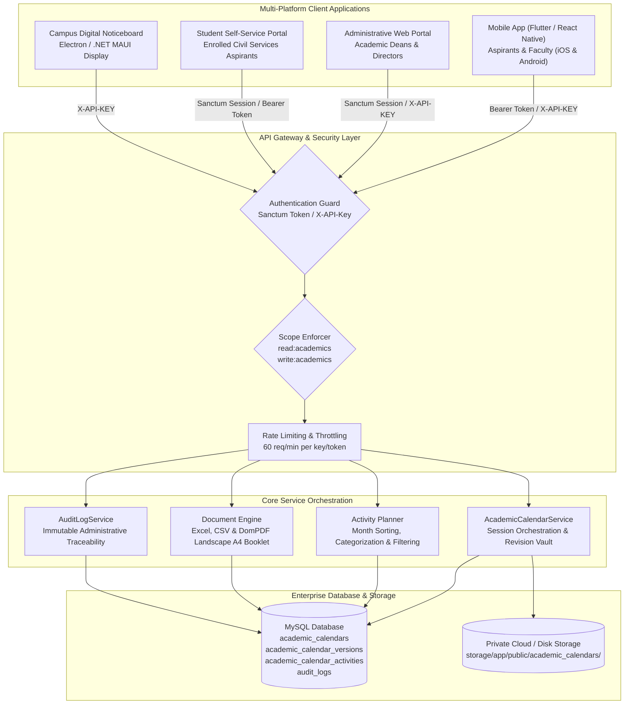
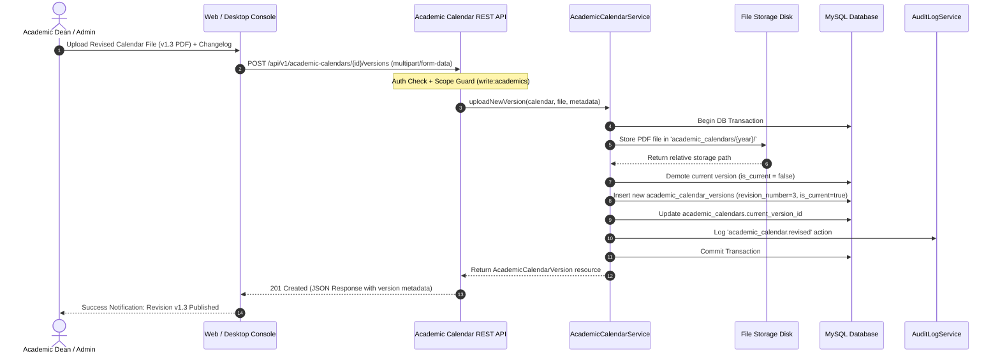
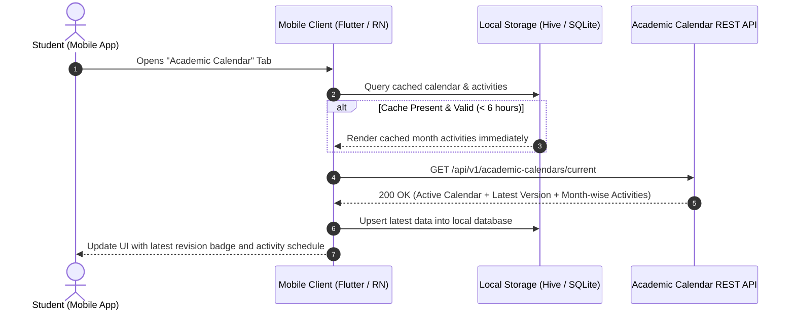

# Academic Calendar & Version Control System REST API — Enterprise Multi-Platform Integration Guide
### Comprehensive Technical Blueprint & Client Integration Specification (Mobile App, Web Portal, Desktop Client & Third-Party Automation)

---

## 1. Executive Summary & Architectural Overview

The **Academic Calendar & Version Control Module** of the **Satyendranath Tagore Civil Services Study Centre (SNTCSSC) MIS** serves as the institutional timetable and planning backbone. Every academic year, the institute formulates an exhaustive master plan mapping out month-wise institutional activities, UPSC Civil Services coaching milestones, preliminary/mains mock tests, faculty development workshops, seminar series, admission windows, statutory holidays, and semester recesses.

Because academic calendars undergo periodic amendments throughout the academic cycle (due to revised UPSC gazette notifications, government directives, and faculty schedules), this system implements an immutable, enterprise-grade **Document Version Vault**. Whenever an authorized administrator uploads an amended calendar document, the new version is established as current, while **all previous historical versions, approval records, changelogs, file signatures, and download counts are permanently preserved year-wise for compliance and historical audit**.

Engineered for seamless multi-platform consumption across **Mobile Applications (iOS & Android via Flutter / React Native)**, **Web Single-Page Applications (React, Vue, Livewire, Angular)**, **Desktop Administrative Consoles (.NET MAUI, Electron, WPF)**, and **Campus Digital Noticeboards**, this RESTful API enables real-time synchronization between central administrative planning and student/faculty personal calendars.

### Core Architectural Capabilities:
1. **Year-Wise Session Lifecycle & Single Active Calendar Enforcement:**
   - Institutional calendars are grouped by session (e.g. `2026-2027`, `2027-2028`) with automated unique code generation (`AC-2026-27`).
   - Strict single active calendar guarantee: Designating a calendar as `is_current = true` atomically updates all other records, ensuring a single source of truth across all student and faculty apps.
2. **Immutable Version Vault & Revision Control:**
   - Preserves every revision (`v1.0`, `v1.1`, `v2.0`) with SHA-256 integrity, MIME type, file byte size, and original filename.
   - Comprehensive revision metadata including changelog summary, approving authority (e.g. Governing Body, Academic Council), effective start dates, and cumulative download telemetrics.
3. **Month-Wise Institutional Activity Master:**
   - Granular activity tracking categorized into: `Academic Event`, `Admission`, `Examination`, `Mock Test`, `Holiday`, `Vacation`, `Workshop`, `Seminar`, `Faculty Development`, and `Other`.
   - Distinct target audience scoping (`All Students`, `UPSC Foundation`, `UPSC Prelims Crash`, `Faculty & Staff`, `Public / Open`).
   - Flags for confirmed vs tentative dates, physical venue or virtual webinar coordinates, and auto-generated activity tracking codes (`ACT-2026-0001`).
4. **Bidirectional Multi-Format Data Interchange:**
   - Programmatic bulk import via structured spreadsheets (Excel `.xlsx` and `.csv`).
   - Export pipelines supporting Excel `.xlsx`, `.csv`, and high-resolution **Landscape A4 PDF Booklets** generated via DomPDF with official institute seal, metadata badges, version history tables, and month-by-month activity matrices.
5. **Role-Based Access Control (RBAC) & Multi-Tenancy Security:**
   - 8 granular permissions: `academic_calendar.view`, `academic_calendar.create`, `academic_calendar.edit`, `academic_calendar.revise`, `academic_calendar.delete`, `academic_calendar.export`, `academic_calendar.import`, and `academic_calendar.download`.
   - Secure dual-channel authentication supporting HTTP Bearer Sanctum Tokens (for mobile/web users) and `X-API-KEY` header authentication with scoped permissions (`read:academics`, `write:academics`) for microservices and desktop clients.
6. **Data Integrity & Auditability:**
   - Full soft-deletion (`deleted_at`), database transactions (`DB::transaction`), and automatic audit trail records (`AuditLogService`) for all calendar creations, revisions, activity adjustments, and administrative deletions.

---

## 2. System Architecture & Sequence Flows

### 2.1 Multi-Platform Architecture



### 2.2 Calendar Revision & Document Upload Flow



### 2.3 Student Mobile App Discovery Flow



---

## 3. Authentication, Scopes & Authorization

### 3.1 Authentication Mechanisms
The API supports dual authentication protocols:

| Authentication Mode | Header Syntax | Target Audience |
| :--- | :--- | :--- |
| **Sanctum Bearer Token** | `Authorization: Bearer <personal-access-token>` | Official Mobile Apps (iOS/Android), Web SPAs |
| **Server-to-Server API Key** | `X-API-KEY: <api-key-secret>` | Digital Signage Kiosks, ERP Automations, Microservices |

### 3.2 Required Scopes & Permission Matrix

| Endpoint Action | Required API Key Scope | Required RBAC Permission |
| :--- | :--- | :--- |
| **View Calendars & Activities** | `read:academics` | `academic_calendar.view` |
| **Create Calendar Session** | `write:academics` | `academic_calendar.create` |
| **Edit Calendar Session** | `write:academics` | `academic_calendar.edit` |
| **Upload Revised Version** | `write:academics` | `academic_calendar.revise` |
| **Delete Calendar / Activity** | `write:academics` | `academic_calendar.delete` |
| **Download PDF/Revision** | `read:academics` | `academic_calendar.download` |
| **Export Activities** | `read:academics` | `academic_calendar.export` |
| **Bulk Import Activities** | `write:academics` | `academic_calendar.import` |
| **Student Self-Service View** | `read:academics` or Student Auth | N/A (Authenticated Student) |

---

## 4. Comprehensive API Reference

All API requests must include standard HTTP headers:
```http
Accept: application/json
Content-Type: application/json
```
For multipart file uploads, omit `Content-Type: application/json` so the client can set `multipart/form-data; boundary=...`.

---

### 4.1 `GET /api/v1/academic-calendars`
List and search institutional academic calendars with pagination, status, and year filters.

- **Scope:** `read:academics`
- **Query Parameters:**
  - `search` *(string, optional)*: Search by session year, code, or title (e.g. `2026`).
  - `academic_year` *(integer, optional)*: Filter by start year (e.g. `2026`).
  - `status` *(string, optional)*: `draft`, `active`, `archived`.
  - `per_page` *(integer, optional)*: Items per page (default: `15`, max: `100`).

**Response Schema (`200 OK`):**
```json
{
  "success": true,
  "data": [
    {
      "id": 1,
      "code": "AC-2026-27",
      "session_year": "2026-2027",
      "academic_year": 2026,
      "title": "Academic Calendar 2026-2027",
      "start_date": "2026-07-01",
      "end_date": "2027-06-30",
      "total_working_days": 240,
      "total_instructional_days": 190,
      "status": "active",
      "is_current": true,
      "current_version": {
        "id": 3,
        "version_code": "v1.2",
        "revision_number": 3,
        "title": "Academic Calendar 2026-2027 (Revision 2)",
        "file_name": "academic_calendar_2026_2027_v1_2.pdf",
        "file_size": 2457600,
        "file_size_formatted": "2.34 MB",
        "mime_type": "application/pdf",
        "changelog_summary": "Updated UPSC Prelims Test Series Schedule and Winter Recess dates.",
        "approved_by": "Academic Council & Director",
        "effective_date": "2026-10-15",
        "download_count": 142
      },
      "activities_count": 15,
      "versions_count": 3
    }
  ],
  "meta": {
    "current_page": 1,
    "last_page": 1,
    "total": 1
  }
}
```

---

### 4.2 `GET /api/v1/academic-calendars/current`
Get the active institutional academic calendar with its latest published version and month-wise activities.

- **Scope:** `read:academics`
- **Response Schema (`200 OK`):**
```json
{
  "success": true,
  "data": {
    "id": 1,
    "code": "AC-2026-27",
    "session_year": "2026-2027",
    "academic_year": 2026,
    "title": "Academic Calendar 2026-2027",
    "start_date": "2026-07-01",
    "end_date": "2027-06-30",
    "total_working_days": 240,
    "total_instructional_days": 190,
    "status": "active",
    "is_current": true,
    "current_version": {
      "id": 3,
      "version_code": "v1.2",
      "file_name": "academic_calendar_2026_2027_v1_2.pdf",
      "file_size_formatted": "2.34 MB",
      "changelog_summary": "Updated UPSC Prelims Test Series Schedule and Winter Recess dates.",
      "download_url": "/api/v1/academic-calendars/1/versions/3/download"
    },
    "activities": [
      {
        "id": 1,
        "activity_code": "ACT-2026-0001",
        "title": "Academic Session Commencement & Orientation Programme",
        "category": "academic_event",
        "category_label": "Academic Event",
        "start_date": "2026-07-01",
        "end_date": "2026-07-03",
        "month": 7,
        "year": 2026,
        "target_audience": "all_students",
        "venue_or_mode": "Main Auditorium (Offline & Live Stream)",
        "status": "confirmed",
        "is_tentative": false
      }
    ]
  }
}
```

---

### 4.3 `GET /api/v1/academic-calendars/{id}`
Retrieve a specific academic calendar session dossier by ID.

- **Scope:** `read:academics`
- **Response Schema (`200 OK`):** Returns the academic calendar resource including its versions and activities.

---

### 4.4 `POST /api/v1/academic-calendars`
Create a new institutional academic calendar session. Supports optional initial document upload (`multipart/form-data`).

- **Scope:** `write:academics`
- **Request Body Fields:**
  - `session_year` *(string, required)*: e.g. `"2027-2028"` (regex: `/^\d{4}-\d{4}$/`).
  - `academic_year` *(integer, required)*: e.g. `2027`.
  - `title` *(string, required)*: e.g. `"Institutional Academic Calendar 2027-2028"`.
  - `start_date` *(date, required)*: e.g. `"2027-07-01"`.
  - `end_date` *(date, required, after start_date)*: e.g. `"2028-06-30"`.
  - `total_working_days` *(integer, nullable)*: e.g. `245`.
  - `total_instructional_days` *(integer, nullable)*: e.g. `195`.
  - `status` *(string, in: draft,active,archived)*: default: `"draft"`.
  - `is_current` *(boolean, optional)*: default: `false`.
  - `calendar_file` *(file, optional)*: PDF, Word (`.doc`, `.docx`), Excel (`.xls`, `.xlsx`), max 20MB.
  - `version_code` *(string, optional)*: default: `"v1.0"`.
  - `changelog_summary` *(string, optional)*: Description of initial release.

---

### 4.5 `PUT /api/v1/academic-calendars/{id}`
Update calendar session metadata, working days, date ranges, or status.

- **Scope:** `write:academics`
- **Request Body JSON:**
```json
{
  "title": "Academic Calendar 2026-2027 (Governing Body Ratified)",
  "total_working_days": 242,
  "total_instructional_days": 192,
  "status": "active",
  "remarks": "Updated after academic senate meeting."
}
```

---

### 4.6 `DELETE /api/v1/academic-calendars/{id}`
Soft-deletes the calendar session and associated versions and activities.
> [!IMPORTANT]
> The active current calendar (`is_current = true`) cannot be deleted. You must assign another calendar as current before deleting.

- **Scope:** `write:academics`
- **Response Schema (`200 OK`):**
```json
{
  "success": true,
  "message": "Academic calendar session and related records soft-deleted successfully."
}
```

---

### 4.7 `POST /api/v1/academic-calendars/{id}/set-current`
Designates this calendar session as the single institutional active calendar across all student and faculty apps.

- **Scope:** `write:academics`
- **Response Schema (`200 OK`):**
```json
{
  "success": true,
  "message": "Academic calendar AC-2026-27 is now established as the current active institutional calendar."
}
```

---

### 4.8 `GET /api/v1/academic-calendars/{id}/versions`
Lists all historical and current document revisions in the Version Vault.

- **Scope:** `read:academics`
- **Response Schema (`200 OK`):**
```json
{
  "success": true,
  "data": [
    {
      "id": 3,
      "version_code": "v1.2",
      "revision_number": 3,
      "title": "Academic Calendar 2026-2027 (Revision 2)",
      "file_name": "academic_calendar_2026_2027_v1_2.pdf",
      "file_size": 2457600,
      "file_size_formatted": "2.34 MB",
      "mime_type": "application/pdf",
      "changelog_summary": "Updated UPSC Prelims Test Series Schedule and Winter Recess dates.",
      "approved_by": "Academic Council & Director",
      "effective_date": "2026-10-15",
      "is_current": true,
      "download_count": 142,
      "created_at": "2026-10-15T11:30:00Z"
    },
    {
      "id": 2,
      "version_code": "v1.1",
      "revision_number": 2,
      "title": "Academic Calendar 2026-2027 (Revision 1)",
      "file_name": "academic_calendar_2026_2027_v1_1.pdf",
      "file_size": 2389100,
      "file_size_formatted": "2.28 MB",
      "mime_type": "application/pdf",
      "changelog_summary": "Revised Mock Interview Schedule for batch 2026 aspirants.",
      "approved_by": "Dean of Academics",
      "effective_date": "2026-08-20",
      "is_current": false,
      "download_count": 89,
      "created_at": "2026-08-20T09:15:00Z"
    }
  ]
}
```

---

### 4.9 `POST /api/v1/academic-calendars/{id}/versions`
Uploads a revised calendar document file. Automatically demotes previous versions and preserves the audit history.

- **Scope:** `write:academics`
- **Content-Type:** `multipart/form-data`
- **Form Data Fields:**
  - `calendar_file` *(file, required)*: PDF, Word, Excel, max 20MB.
  - `version_code` *(string, optional)*: e.g. `"v2.0"` (auto-calculated if omitted).
  - `title` *(string, optional)*: Custom revision title.
  - `changelog_summary` *(string, required)*: Detailed explanation of what was amended.
  - `approved_by` *(string, nullable)*: Approving body or officer.
  - `effective_date` *(date, nullable)*: Date when this revision becomes effective.
  - `is_current` *(boolean, optional)*: default: `true`.

---

### 4.10 `GET /api/v1/academic-calendars/{id}/versions/{versionId}/download`
Streams and downloads the exact revision file binary, incrementing the version download counter.

- **Scope:** `read:academics`
- **Response:** File stream with `Content-Disposition: attachment; filename="..."`.

---

### 4.11 `GET /api/v1/academic-calendars/{id}/activities`
Query month-wise activities for this calendar session.

- **Scope:** `read:academics`
- **Query Parameters:**
  - `month` *(integer, optional)*: 1 (Jan) to 12 (Dec).
  - `year` *(integer, optional)*: e.g. `2026`.
  - `category` *(string, optional)*: `academic_event`, `admission`, `examination`, `mock_test`, `holiday`, `vacation`, `workshop`, `seminar`, `faculty_development`, `other`.
  - `audience` *(string, optional)*: `all_students`, `upsc_foundation`, `upsc_prelims_crash`, `faculty_staff`, `public`.
  - `status` *(string, optional)*: `confirmed`, `tentative`, `cancelled`.

---

### 4.12 `POST /api/v1/academic-calendars/{id}/activities`
Create a scheduled activity entry in the calendar.

- **Scope:** `write:academics`
- **Request Body JSON:**
```json
{
  "title": "All Bengal Civil Services Mock Examination (Paper I & II)",
  "category": "mock_test",
  "start_date": "2026-11-22",
  "end_date": "2026-11-22",
  "target_audience": "all_students",
  "venue_or_mode": "Examination Hall A & B (Salt Lake Campus)",
  "description": "Simulated UPSC Prelims GS + CSAT full length paper under real test conditions.",
  "status": "confirmed",
  "is_tentative": false
}
```

---

### 4.13 `PUT /api/v1/academic-calendars/{id}/activities/{activityId}`
Update an activity's dates, venue, target cohort, or status.

- **Scope:** `write:academics`
- **Request Body JSON:** Fields to update (same as creation).

---

### 4.14 `DELETE /api/v1/academic-calendars/{id}/activities/{activityId}`
Soft-deletes an activity entry with audit logging.

- **Scope:** `write:academics`

---

### 4.15 `GET /api/v1/student/academic-calendar`
Student self-service endpoint returning the active academic calendar, current downloadable revision document, and month-by-month activity schedule.

- **Scope:** Authenticated Student Session or `read:academics`

---

## 5. Multi-Platform Implementation Recipes & Code Samples

### 5.1 Flutter (Dart) — Cross-Platform Mobile Service
This client service demonstrates how a Flutter mobile app can authenticate, fetch the current academic calendar, cache it offline using Hive/SQLite, and download the revised calendar PDF to device storage.

```dart
import 'dart:convert';
import 'dart:io';
import 'package:http/http.dart' as http;
import 'package:path_provider/path_provider.dart';

class AcademicCalendarService {
  final String baseUrl;
  final String authToken;

  AcademicCalendarService({
    required this.baseUrl,
    required this.authToken,
  });

  Map<String, String> get _headers => {
        'Accept': 'application/json',
        'Authorization': 'Bearer $authToken',
      };

  /// Fetch active calendar with latest revision & activities
  Future<Map<String, dynamic>> fetchCurrentCalendar() async {
    final response = await http.get(
      Uri.parse('$baseUrl/api/v1/academic-calendars/current'),
      headers: _headers,
    );

    if (response.statusCode == 200) {
      final jsonBody = jsonDecode(response.body);
      return jsonBody['data'] as Map<String, dynamic>;
    } else {
      throw Exception('Failed to load academic calendar: ${response.body}');
    }
  }

  /// Download calendar PDF revision to device downloads directory
  Future<File> downloadCalendarVersion({
    required int calendarId,
    required int versionId,
    required String filename,
  }) async {
    final request = await http.get(
      Uri.parse('$baseUrl/api/v1/academic-calendars/$calendarId/versions/$versionId/download'),
      headers: _headers,
    );

    if (request.statusCode == 200) {
      final dir = await getApplicationDocumentsDirectory();
      final file = File('${dir.path}/$filename');
      await file.writeAsBytes(request.bodyBytes);
      return file;
    } else {
      throw Exception('Failed to download calendar revision.');
    }
  }
}
```

---

### 5.2 React Native / TypeScript — Axios Service & Hook
A complete TypeScript module for React Native or web applications.

```typescript
import axios from 'axios';

export interface AcademicActivity {
  id: number;
  activity_code: string;
  title: string;
  category: string;
  category_label: string;
  start_date: string;
  end_date: string;
  month: number;
  year: number;
  target_audience: string;
  venue_or_mode?: string;
  description?: string;
  status: 'confirmed' | 'tentative' | 'cancelled';
  is_tentative: boolean;
}

export interface AcademicCalendarVersion {
  id: number;
  version_code: string;
  revision_number: number;
  file_name: string;
  file_size_formatted: string;
  changelog_summary: string;
  approved_by?: string;
  download_url: string;
}

export interface AcademicCalendar {
  id: number;
  code: string;
  session_year: string;
  title: string;
  start_date: string;
  end_date: string;
  total_working_days: number;
  total_instructional_days: number;
  current_version: AcademicCalendarVersion;
  activities: AcademicActivity[];
}

const apiClient = axios.create({
  baseURL: 'https://mis.sntcssc.in/api/v1',
  headers: {
    Accept: 'application/json',
    'Content-Type': 'application/json',
  },
});

export const setAuthToken = (token: string) => {
  apiClient.defaults.headers.common['Authorization'] = `Bearer ${token}`;
};

export const fetchCurrentAcademicCalendar = async (): Promise<AcademicCalendar> => {
  const response = await apiClient.get<{ success: boolean; data: AcademicCalendar }>(
    '/academic-calendars/current'
  );
  return response.data.data;
};

export const fetchCalendarVersions = async (
  calendarId: number
): Promise<AcademicCalendarVersion[]> => {
  const response = await apiClient.get<{ success: boolean; data: AcademicCalendarVersion[] }>(
    `/academic-calendars/${calendarId}/versions`
  );
  return response.data.data;
};
```

---

### 5.3 C# (.NET) — Desktop Client & Noticeboard Kiosk Service
For administrative Windows applications, WPF consoles, or campus display kiosks.

```csharp
using System;
using System.IO;
using System.Net.Http;
using System.Net.Http.Headers;
using System.Text.Json;
using System.Threading.Tasks;

public class AcademicCalendarClient
{
    private readonly HttpClient _httpClient;

    public AcademicCalendarClient(string baseUrl, string apiKey)
    {
        _httpClient = new HttpClient { BaseAddress = new Uri(baseUrl) };
        _httpClient.DefaultRequestHeaders.Accept.Add(new MediaTypeWithQualityHeaderValue("application/json"));
        _httpClient.DefaultRequestHeaders.Add("X-API-KEY", apiKey);
    }

    public async Task<JsonElement> GetCurrentCalendarAsync()
    {
        var response = await _httpClient.GetAsync("/api/v1/academic-calendars/current");
        response.EnsureSuccessStatusCode();

        var content = await response.Content.ReadAsStringAsync();
        using var doc = JsonDocument.Parse(content);
        return doc.RootElement.GetProperty("data").Clone();
    }

    public async Task DownloadCalendarPdfAsync(int calendarId, int versionId, string destinationFilePath)
    {
        var response = await _httpClient.GetAsync($"/api/v1/academic-calendars/{calendarId}/versions/{versionId}/download");
        response.EnsureSuccessStatusCode();

        await using var stream = await response.Content.ReadAsStreamAsync();
        await using var fileStream = File.Create(destinationFilePath);
        await stream.CopyToAsync(fileStream);
    }
}
```

---

### 5.4 Electron / Node.js — Desktop Daemon & Signage Sync
Synchronizes current monthly activities to a local display loop every 15 minutes.

```javascript
const axios = require('axios');
const fs = require('fs');
const path = require('path');

const API_BASE = 'https://mis.sntcssc.in/api/v1';
const API_KEY = process.env.SNTCSSC_API_KEY;

async function syncAcademicCalendar() {
  try {
    const response = await axios.get(`${API_BASE}/academic-calendars/current`, {
      headers: {
        'Accept': 'application/json',
        'X-API-KEY': API_KEY,
      },
    });

    const calendar = response.data.data;
    const currentMonth = new Date().getMonth() + 1; // 1-12
    const currentYear = new Date().getFullYear();

    const monthlyActivities = calendar.activities.filter(
      (act) => act.month === currentMonth && act.year === currentYear
    );

    // Save to local cache for noticeboard renderer
    const cachePath = path.join(__dirname, 'display_calendar.json');
    fs.writeFileSync(cachePath, JSON.stringify(monthlyActivities, null, 2));

    console.log(`[Sync] Loaded ${monthlyActivities.length} activities for ${currentMonth}/${currentYear}`);
  } catch (err) {
    console.error('[Sync Error]', err.message);
  }
}

// Poll every 15 minutes
setInterval(syncAcademicCalendar, 15 * 60 * 1000);
syncAcademicCalendar();
```

---

## 6. Enterprise Recommendations & Best Practices

1. **iCalendar (.ics) / WebCal Subscription Feed:**
   - Implement an automated `.ics` feed endpoint (`GET /api/v1/academic-calendars/{id}/feed.ics`) allowing students and faculty to subscribe directly to their Google Calendar, Apple Calendar, or Microsoft Outlook. When activities are rescheduled, subscriber calendars update seamlessly.
2. **Push Notifications on Calendar Revisions:**
   - Whenever an administrator publishes a new calendar revision (`v1.2` $\rightarrow$ `v1.3`), trigger a broadcast event (`CalendarRevisionPublished`). Mobile clients can catch this event and notify students: *"Attention: Academic Calendar 2026-2027 has been updated with revised examination dates."*
3. **ETag & HTTP Conditional Requests for Bandwidth Optimization:**
   - Mobile apps and digital kiosks should include the `If-None-Match` or `If-Modified-Since` headers. The API can return `304 Not Modified` when no new revisions or activities have been posted, saving server bandwidth on cellular connections.
4. **Permanent Audit Trail & Regulatory Compliance:**
   - In accordance with Higher Education regulatory guidelines (UGC/UPSC coaching mandates), all historical versions, approval timestamps, and changelogs must remain read-only and preserved in the Document Vault indefinitely.

