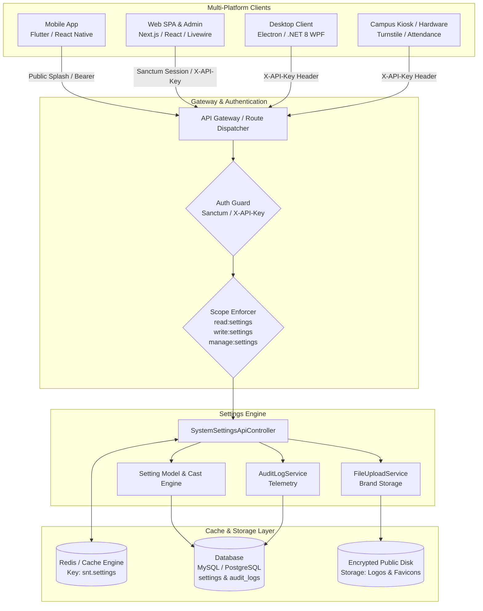
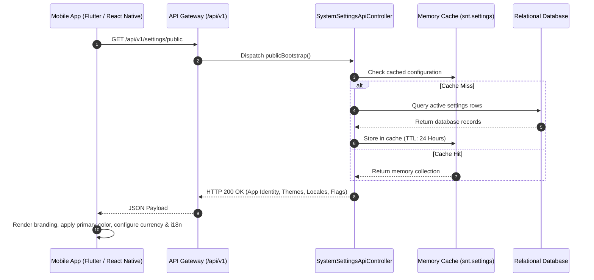
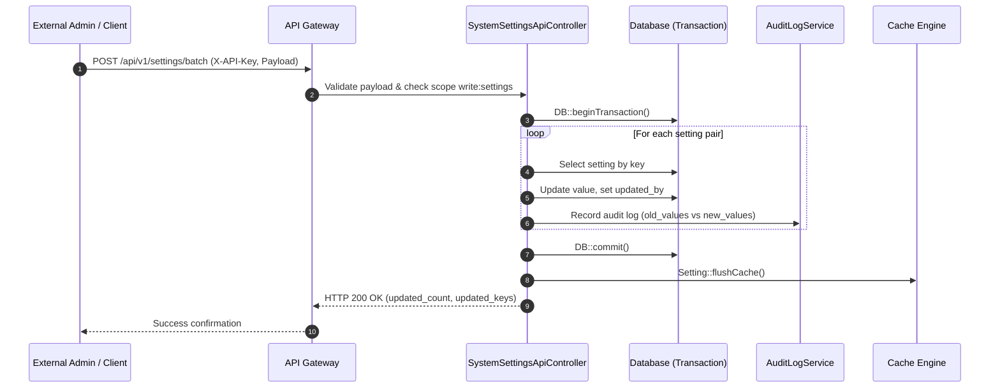
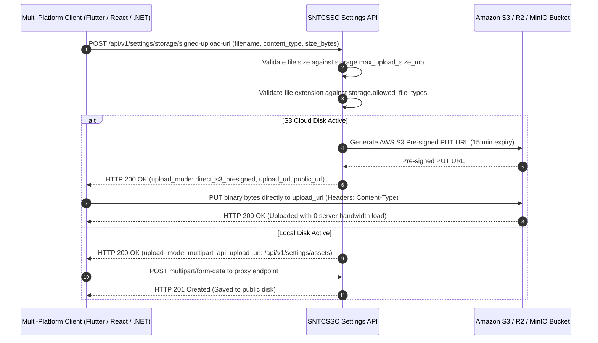

# SNTCSSC MIS — Application System Settings REST API Integration Guide
### Multi-Platform Implementation & Integration Guide (Mobile App, Web Portal, Desktop Client & Headless Microservices)

---

## 1. Executive Summary & Architecture Overview

The **Application System Settings Module** of the **Satyendranath Tagore Civil Services Study Centre (SNTCSSC) MIS** provides a centralized, robust, and future-ready configuration backbone. Designed for frictionless cross-platform integration across **Mobile Applications** (Flutter, React Native, Swift, Kotlin), **Web Applications** (Next.js, React, Vue, Livewire, Angular), **Desktop Clients** (Electron, Tauri, Windows .NET 8 WPF/MAUI), and **Backend Microservices**, this API unifies application identity, institutional branding, theming, multi-lingual localization, third-party communication gateways (SMS, Email, SMTP), payment processors, system maintenance, and operational feature flags.

### Core Architectural Highlights:
1. **Zero-Latency Public Bootstrap (`/api/v1/settings/public`):**
   - High-performance, unauthenticated (or optional API key) endpoint delivering complete application branding (name, campus, tagline, logos, favicons, primary colors), localization formats, contact information, and active module flags.
   - Purpose-built for mobile splash screen initialization, SPA bootloaders, and kiosk terminals prior to user sign-in.
2. **Granular Categorization & Group Domains:**
   - Structured grouping into 12 distinct organizational domains: `general`, `appearance`, `localization`, `system`, `email`, `sms`, `payment`, `chat`, `library`, `hostel`, `attendance`, and `seo`.
   - Supports key-value dictionary retrieval for fast client runtime lookups (`GET /api/v1/settings/groups/{group}`).
3. **Enterprise Security & Automated Secret Masking:**
   - Settings designated as `type: secret` (such as SMTP passwords, Razorpay/PhonePe salt keys, TURN credentials, and SMS API tokens) are transparently encrypted at rest using AES-256-CBC via Laravel Crypt.
   - All standard read endpoints mask secret values as `••••••••`. Unmasked decryption requires explicit administrative privileges and the `manage:settings` API scope.
4. **Atomic Transactions & Comprehensive Audit Logging:**
   - Every creation, modification, batch update, soft-delete, and restoration operates within strict database transactions (`DB::beginTransaction()`, `DB::commit()`, `DB::rollBack()`).
   - Every mutation automatically writes detailed telemetry to `audit_logs` via `AuditLogService::log()` including user ID, IP address, user-agent, prior values, and updated values.
5. **Soft Deletion & Lifecycle Management:**
   - Full support for soft-deleting custom settings with `deleted_by` attribution, trashed filtering, restoration (`/restore`), and permanent administrative force-purging (`/force`).
6. **Multi-Tiered Cache Invalidation:**
   - High-throughput Redis/File memory caching (`snt.settings`) ensures microsecond read response times.
   - Automatic cache eviction on any model save, update, delete, or explicit purge via `POST /api/v1/settings/cache/flush`.
7. **Asset Pipeline Integration:**
   - Built-in multipart file upload endpoint (`POST /api/v1/settings/assets`) powered by `FileUploadService` for dynamic logo and favicon updates with timestamped slugging and CDN URL resolution.

---

## 2. System Architecture & Sequence Flows

### 2.1 Multi-Platform Settings Architecture



### 2.2 Client Splash & Bootstrap Sequence Flow



### 2.3 Atomic Batch Settings Update Sequence Flow



---

## 3. Security, Scopes & Authorization Matrix

The Settings API implements dual authentication: **Laravel Sanctum personal tokens** for authenticated browser/mobile user sessions alongside **API Key Headers (`X-API-Key`)** for programmatic microservice integrations.

### API Scopes:

| Scope | Access Level | Description | Permitted Actions |
| :--- | :--- | :--- | :--- |
| `Public / None` | Open Access | Public bootstrap metadata for client initialization | View app name, logos, theme colors, locales, contact, and maintenance status. |
| `read:settings` | Read-Only | Read configuration catalogs, groups, and telemetry | Query settings, view group key-value dictionaries, view statistics and telemetry. |
| `write:settings` | Read & Write | Create and update settings, soft-delete, upload branding | Create custom keys, update settings, execute batch updates, soft-delete, restore, upload logo/favicon. |
| `manage:settings` | Full Management | Administrative disaster recovery, secrets, and maintenance | View unmasked secrets, force delete, flush cache, reset defaults, export/import, toggle maintenance mode, send test SMS/Email. |
| `*` | Super Admin | Unrestricted administrative bypass | Full access across all settings endpoints. |

### Required Headers:

```http
# Option A: API Key (Recommended for automated scripts, desktop clients, microservices)
X-API-Key: sntc_live_948f29d71c4a03b58e2a149c71b69d8e
Accept: application/json
Content-Type: application/json

# Option B: Bearer Token (Recommended for mobile app user sessions)
Authorization: Bearer 12|k9X8jZq4N7vLm2P...
Accept: application/json
Content-Type: application/json
```

---

## 4. Complete REST API Endpoint Reference

The module provides **31 production-grade endpoints**:

### Summary Table:

| # | HTTP Method | Endpoint Path | Required Scope | Summary Description |
| :--- | :--- | :--- | :--- | :--- |
| 1 | `GET` | `/api/v1/settings/public` | `Public` | Mobile splash & web bootstrapper (branding, themes, i18n, flags). |
| 2 | `GET` | `/api/v1/settings/bootstrap` | `Public` | Canonical alias for public bootstrap endpoint. |
| 3 | `GET` | `/api/v1/settings/bootstrap/{platform}` | `Public` | Tailored platform bootstrap (mobile, web, desktop, kiosk) with update policies, push configs, and theme tokens. |
| 4 | `POST` | `/api/v1/settings/version-check` | `Public` | Cross-platform app version verification returning update_available, update_required, download URL, and release notes. |
| 5 | `GET` | `/api/v1/settings/features` | `Public` | Categorized client feature toggles (communication, academics, facilities, payments, cloud storage, system). |
| 6 | `GET` | `/api/v1/settings/groups` | `read:settings` | Catalog of all 12 configuration groups with item counts. |
| 7 | `GET` | `/api/v1/settings/statistics` | `read:settings` | System diagnostics KPI, cache status, PHP/Laravel versions, counts. |
| 8 | `GET` | `/api/v1/settings` | `read:settings` | Search and paginate settings with group, type, and status filters. |
| 9 | `GET` | `/api/v1/settings/groups/{group}` | `read:settings` | Retrieve all settings in a group as dictionary and item collection. |
| 10 | `GET` | `/api/v1/settings/item/{key}` | `read:settings` | Fetch single setting dossier by exact key (supports dot notation). |
| 11 | `GET` | `/api/v1/settings/{key}` | `read:settings` | Alias route for single setting retrieval. |
| 12 | `POST` | `/api/v1/settings` | `write:settings` | Create a new dynamic custom system setting with validation. |
| 13 | `PUT` | `/api/v1/settings/{key}` | `write:settings` | Update setting value, label, options, or active status. |
| 14 | `POST` | `/api/v1/settings/batch` | `write:settings` | Atomically batch update multiple settings in a transaction. |
| 15 | `PUT` | `/api/v1/settings/batch` | `write:settings` | PUT alias for batch update. |
| 16 | `DELETE` | `/api/v1/settings/{key}` | `write:settings` | Safely soft delete setting with `deleted_by` audit trail. |
| 17 | `POST` | `/api/v1/settings/{key}/restore` | `write:settings` | Restore a soft-deleted setting and re-cache it. |
| 18 | `DELETE` | `/api/v1/settings/{key}/force` | `manage:settings` | Permanently purge setting from database. |
| 19 | `POST` | `/api/v1/settings/cache/flush` | `manage:settings` | Invalidate and purge `snt.settings` memory cache. |
| 20 | `POST` | `/api/v1/settings/reset` | `manage:settings` | Reset setting, group, or all settings to factory seed defaults. |
| 21 | `GET` | `/api/v1/settings/export/bundle` | `manage:settings` | Export settings as JSON bundle (secrets redacted). |
| 22 | `POST` | `/api/v1/settings/import/bundle` | `manage:settings` | Import and upsert settings from JSON array. |
| 23 | `POST` | `/api/v1/settings/assets` | `write:settings` | Upload branding asset (logo, favicon, banner) via FileUploadService. |
| 24 | `POST` | `/api/v1/settings/test-email` | `manage:settings` | Dispatch diagnostic test email using current SMTP parameters. |
| 25 | `POST` | `/api/v1/settings/test-sms` | `manage:settings` | Dispatch diagnostic test SMS using configured SMS gateway. |
| 26 | `POST` | `/api/v1/settings/maintenance` | `manage:settings` | Toggle maintenance mode, message, and IP allowlist. |
| 27 | `GET` | `/api/v1/settings/storage/overview` | `read:settings` | Real-time storage telemetry, active driver (local/S3), cloud provider, and file categorization. |
| 28 | `POST` | `/api/v1/settings/test-storage` | `manage:settings` | Live read/write/delete connection diagnostic probe on Amazon S3 or S3-compatible cloud storage. |
| 29 | `GET` | `/api/v1/settings/storage/files` | `read:settings` | Browse and paginate stored files on local public disk or remote S3 cloud bucket. |
| 30 | `DELETE` | `/api/v1/settings/storage/files` | `manage:settings` | Permanently delete an uploaded file from local or cloud storage disk with audit logging. |
| 31 | `POST` | `/api/v1/settings/storage/signed-upload-url` | `write:settings` | Pre-flight direct cloud S3 upload authorization or backend proxy endpoint resolution. |

---

## 5. Detailed Endpoint Documentation & Payloads

### 5.1 Public Bootstrap (`GET /api/v1/settings/public`)

Returns complete application metadata for cold boot initialization on mobile, web, and desktop clients without requiring authentication.

**Sample Response (`200 OK`):**
```json
{
  "success": true,
  "data": {
    "app": {
      "name": "SNT CSSC MIS",
      "site_name": "SNT CSSC",
      "tagline": "Shaping future civil servants",
      "description": "Student Management Information System for admissions and batches.",
      "campus": "Main Campus",
      "version": "1.0.0",
      "copyright": "© 2026 SNT CSSC. All rights reserved.",
      "institution": "Satyendranath Tagore Civil Services Study Centre"
    },
    "branding": {
      "logo_url": "https://mis.sntcssc.in/storage/settings/branding/site_logo_sntcssc-crest_20260823.png",
      "favicon_url": "https://mis.sntcssc.in/storage/settings/branding/site_favicon_icon_20260823.png",
      "primary_color": "#10b981",
      "theme_mode": "system",
      "sidebar_theme": "default",
      "font_family": "Inter"
    },
    "localization": {
      "locale": "en",
      "fallback_locale": "en",
      "timezone": "Asia/Kolkata",
      "date_format": "d M Y",
      "time_format": "h:i A",
      "currency_symbol": "₹",
      "currency_code": "INR",
      "number_format": "indian",
      "supported_locales": [
        { "code": "en", "name": "English", "native_name": "English", "dir": "ltr" },
        { "code": "bn", "name": "Bengali", "native_name": "বাংলা", "dir": "ltr" },
        { "code": "hi", "name": "Hindi", "native_name": "हिन्दी", "dir": "ltr" }
      ]
    },
    "contact": {
      "email": "info@sntcssc.in",
      "mobile": "+91 90000 00000",
      "phone": "033 0000 0000",
      "address": "SNT CSSC, Main Campus, Kolkata, West Bengal, India",
      "office_timing": "10:00 AM – 6:00 PM",
      "open_days": "Monday – Saturday"
    },
    "operational": {
      "maintenance_mode": false,
      "max_upload_size_mb": 10,
      "session_lifetime_minutes": 120
    },
    "features": {
      "live_chat": true,
      "voice_calls": true,
      "video_calls": true,
      "online_meetings": true,
      "study_materials": true,
      "library": true,
      "library_fines": true,
      "hostel": true,
      "examinations": true,
      "attendance_biometric": true,
      "online_payments": false,
      "offline_payments": true,
      "sms_service": false,
      "email_service": true
    }
  },
  "meta": {
    "server_time": "2026-10-31T22:30:00+05:30",
    "api_version": "v1"
  }
}
```

---

### 5.2 Platform-Specific Bootstrap (`GET /api/v1/settings/bootstrap/{platform}`)

**Required Scope:** `Public / None` (Optional API key accepted)  
**Supported Platforms:** `mobile`, `android`, `ios`, `web`, `desktop`, `windows`, `macos`, `linux`, `kiosk`

Tailored initialization endpoint that injects platform-specific operational rules, update requirements, push notification gateways, biometrics permissions, theme tokens, and deep-link schemes directly into the bootstrap payload.

**Sample Request:**
```bash
curl -X GET "https://mis.sntcssc.in/api/v1/settings/bootstrap/mobile" \
  -H "Accept: application/json"
```

**Sample Mobile Response (`200 OK`):**
```json
{
  "success": true,
  "data": {
    "app": {
      "name": "SNT CSSC MIS",
      "version": "1.0.0",
      "institution": "Satyendranath Tagore Civil Services Study Centre"
    },
    "branding": {
      "logo_url": "https://mis.sntcssc.in/storage/settings/branding/site_logo.png",
      "primary_color": "#10b981",
      "theme_mode": "system"
    },
    "platform_config": {
      "platform": "mobile",
      "min_supported_version": "1.0.0",
      "latest_version": "1.2.0",
      "force_update": false,
      "play_store_url": "https://play.google.com/store/apps/details?id=in.sntcssc.mis",
      "app_store_url": "https://apps.apple.com/app/sntcssc-mis/id123456789",
      "push_notifications": {
        "enabled": true,
        "fcm_sender_id": "49201938502"
      },
      "biometrics": {
        "fingerprint_allowed": true,
        "face_id_allowed": true
      },
      "offline_sync": {
        "cache_ttl_seconds": 3600,
        "max_offline_records": 500
      },
      "deep_link_scheme": "sntcssc://"
    }
  },
  "meta": {
    "platform": "mobile",
    "category": "mobile",
    "server_time": "2026-11-09T12:00:00+05:30",
    "api_version": "v1"
  }
}
```

---

### 5.3 Semantic Version Checking & Force Update (`POST /api/v1/settings/version-check`)

**Required Scope:** `Public / None`

Used by mobile and desktop clients on cold launch or periodic resume to verify client build compatibility. Compares client version against both the soft minimum (`min_supported_version`) and latest release (`latest_version`).

**Request Payload:**
```json
{
  "platform": "android",
  "current_version": "1.0.4",
  "build_number": 14
}
```

**Sample Response (`200 OK`):**
```json
{
  "success": true,
  "data": {
    "platform": "android",
    "current_version": "1.0.4",
    "build_number": 14,
    "min_supported_version": "1.1.0",
    "latest_version": "1.3.0",
    "update_available": true,
    "update_required": true,
    "force_update": false,
    "download_url": "https://play.google.com/store/apps/details?id=in.sntcssc.mis",
    "release_notes": "Stability enhancements, improved cloud storage support, and multi-lingual synchronization.",
    "checked_at": "2026-11-09T12:00:00+05:30"
  }
}
```

---

### 5.4 Categorized Client Feature Flags (`GET /api/v1/settings/features`)

**Required Scope:** `Public / None`

Exports structured boolean toggles for fast routing and navigation guards on mobile, web, and desktop frontends.

**Sample Response (`200 OK`):**
```json
{
  "success": true,
  "data": {
    "communication": {
      "live_chat": true,
      "voice_calls": true,
      "video_calls": true,
      "online_meetings": true,
      "sms_service": false,
      "email_service": true
    },
    "academics": {
      "courses": true,
      "batches": true,
      "study_materials": true,
      "examinations": true,
      "student_tests": true,
      "mock_interviews": true
    },
    "facilities": {
      "library": true,
      "library_fines": true,
      "hostel": true,
      "biometrics": true
    },
    "payments": {
      "online_payments": false,
      "offline_payments": true
    },
    "cloud_storage": {
      "default_disk": "s3",
      "provider": "aws",
      "direct_s3_upload": true
    },
    "system": {
      "maintenance_mode": false,
      "debug_mode": false
    }
  },
  "meta": {
    "server_time": "2026-11-09T12:00:00+05:30"
  }
}
```

---

### 5.5 Settings Groups (`GET /api/v1/settings/groups`)

**Required Scope:** `read:settings`

**Sample Response (`200 OK`):**
```json
{
  "success": true,
  "data": [
    {
      "group": "general",
      "title": "General & Institution Information",
      "description": "Institution name, campus, contact info, office timing and copyright.",
      "total_count": 15,
      "active_count": 15,
      "last_updated_at": "2026-10-29T11:50:42+05:30"
    },
    {
      "group": "appearance",
      "title": "Appearance & Theming",
      "description": "Primary accent colors, dark mode defaults, logos, and sidebar styling.",
      "total_count": 7,
      "active_count": 7,
      "last_updated_at": "2026-10-29T11:50:42+05:30"
    },
    {
      "group": "localization",
      "title": "Localization & Regional Formats",
      "description": "Default language, timezone, date/time formats, and currency settings.",
      "total_count": 8,
      "active_count": 8,
      "last_updated_at": "2026-10-29T11:50:42+05:30"
    }
  ],
  "meta": {
    "total_groups": 12,
    "server_time": "2026-10-31T22:30:00+05:30"
  }
}
```

---

### 5.3 Retrieve Group Settings (`GET /api/v1/settings/groups/{group}`)

**Required Scope:** `read:settings`

**Sample Response (`200 OK`):**
```json
{
  "success": true,
  "data": {
    "group": "appearance",
    "dictionary": {
      "appearance.primary_color": "#10b981",
      "appearance.dark_mode": "system",
      "appearance.sidebar_theme": "default",
      "appearance.font_family": "Inter",
      "appearance.logo": null,
      "appearance.icon": null
    },
    "items": [
      {
        "id": 18,
        "key": "appearance.primary_color",
        "group": "appearance",
        "type": "string",
        "label": "Primary accent color",
        "value": "#10b981",
        "is_secret": false,
        "url": null,
        "options": null,
        "status": true,
        "created_at": "2026-10-29T11:50:42+05:30",
        "updated_at": "2026-10-29T11:50:42+05:30"
      }
    ]
  },
  "meta": {
    "total_items": 6,
    "group": "appearance"
  }
}
```

---

### 5.4 Batch Update Settings (`POST /api/v1/settings/batch`)

**Required Scope:** `write:settings`

**Sample Request Body:**
```json
{
  "settings": {
    "general.site_tagline": "Empowering Future Civil Servants",
    "appearance.primary_color": "#059669",
    "localization.timezone": "Asia/Kolkata",
    "system.max_upload_size": 25
  }
}
```

**Sample Response (`200 OK`):**
```json
{
  "success": true,
  "data": {
    "updated_count": 4,
    "updated_keys": [
      "general.site_tagline",
      "appearance.primary_color",
      "localization.timezone",
      "system.max_upload_size"
    ]
  },
  "meta": {
    "message": "Successfully batch updated 4 settings.",
    "server_time": "2026-10-31T22:30:00+05:30"
  }
}
```

---

### 5.5 Asset Upload (`POST /api/v1/settings/assets`)

**Required Scope:** `write:settings`  
**Content-Type:** `multipart/form-data`

**Parameters:**
- `file` (File, required): Max 10MB (PNG, JPG, WEBP, SVG, ICO).
- `key` (string, optional): Associated setting key (e.g. `general.site_logo`). Automatically updates the setting.
- `folder` (string, optional): Subdirectory in public storage (default: `settings/branding`).

**Sample Response (`201 Created`):**
```json
{
  "success": true,
  "data": {
    "key": "general.site_logo",
    "path": "settings/branding/site_logo_crest-official_20261031_223015.png",
    "url": "https://mis.sntcssc.in/storage/settings/branding/site_logo_crest-official_20261031_223015.png",
    "original_name": "crest-official.png",
    "size_bytes": 142850,
    "mime_type": "image/png"
  },
  "meta": {
    "message": "Asset uploaded successfully."
  }
}
```

---

### 5.6 Toggle Maintenance Mode (`POST /api/v1/settings/maintenance`)

**Required Scope:** `manage:settings`

**Sample Request Body:**
```json
{
  "enabled": true,
  "message": "Routine server upgrades in progress. We will be back online at 02:00 AM.",
  "allowed_ips": ["127.0.0.1", "103.21.244.0"]
}
```

**Sample Response (`200 OK`):**
```json
{
  "success": true,
  "data": {
    "maintenance_mode": true,
    "message": "Routine server upgrades in progress. We will be back online at 02:00 AM.",
    "allowed_ips": ["127.0.0.1", "103.21.244.0"],
    "updated_at": "2026-10-31T22:30:00+05:30"
  },
  "meta": {
    "message": "Maintenance mode enabled successfully."
  }
}
```

---

### 5.7 Cloud Storage & S3 Telemetry (`GET /api/v1/settings/storage/overview`)

**Required Scope:** `read:settings`

Retrieves real-time storage disk telemetry, active driver (`public`, `s3`, `local`), configured cloud provider (`aws`, `r2`, `minio`, `wasabi`, `do_spaces`, `backblaze`, `custom`), bucket identifier, region, endpoint, CDN base URL, and categorized file count and byte breakdown.

**Sample Response (`200 OK`):**
```json
{
  "success": true,
  "data": {
    "default_disk": "s3",
    "provider": "aws",
    "provider_name": "Amazon Web Services (AWS S3)",
    "bucket": "sntcssc-production-storage",
    "region": "ap-south-1",
    "endpoint": "https://s3.ap-south-1.amazonaws.com",
    "url": "https://cdn.sntcssc.in",
    "max_upload_size_mb": 25,
    "allowed_file_types": ["pdf", "doc", "docx", "xls", "xlsx", "ppt", "pptx", "jpg", "jpeg", "png", "webp", "svg", "zip", "mp4"],
    "statistics": {
      "total_files": 4820,
      "total_size_bytes": 10485760000,
      "total_size_formatted": "9.77 GB",
      "categories": {
        "documents": { "count": 2150, "size_formatted": "4.20 GB" },
        "study_materials": { "count": 1420, "size_formatted": "3.85 GB" },
        "avatars_and_branding": { "count": 980, "size_formatted": "1.12 GB" },
        "backups": { "count": 270, "size_formatted": "600 MB" }
      }
    }
  },
  "meta": {
    "server_time": "2026-11-09T12:00:00+05:30"
  }
}
```

---

### 5.8 Cloud Storage Diagnostic Connection Probe (`POST /api/v1/settings/test-storage`)

**Required Scope:** `manage:settings`

Executes an end-to-end active probe cycle on the configured cloud storage: creates an ephemeral probe object, writes binary content, reads back and verifies checksum, tests public URL resolution, and purges the probe file. Returns measured roundtrip latency in milliseconds.

**Sample Request Body (Optional overrides for pre-flight testing):**
```json
{
  "provider": "aws",
  "bucket": "sntcssc-production-storage",
  "region": "ap-south-1"
}
```

**Sample Response (`200 OK`):**
```json
{
  "success": true,
  "data": {
    "provider": "aws",
    "provider_name": "Amazon Web Services (AWS S3)",
    "bucket": "sntcssc-production-storage",
    "region": "ap-south-1",
    "latency_ms": 142.8,
    "probe_file": ".sntcssc-probe-672fc4a19b2e4.tmp",
    "probe_url": "https://cdn.sntcssc.in/.sntcssc-probe-672fc4a19b2e4.tmp",
    "verified_at": "2026-11-09T12:00:00+05:30"
  },
  "meta": {
    "message": "Storage connection probe succeeded in 142.8ms."
  }
}
```

---

### 5.9 Storage File Explorer & Deletion (`GET` & `DELETE /api/v1/settings/storage/files`)

**Browse Files (`GET /api/v1/settings/storage/files`):**
- **Required Scope:** `read:settings`
- **Query Parameters:** `disk` (`public` or `s3`), `folder` (e.g. `materials`, `uploads`), `limit` (default 50).

**Sample Response (`200 OK`):**
```json
{
  "success": true,
  "data": {
    "disk": "s3",
    "folder": "materials/2026",
    "total_count": 2,
    "files": [
      {
        "name": "upsc-gs-paper1-syllabus.pdf",
        "path": "materials/2026/upsc-gs-paper1-syllabus.pdf",
        "size_bytes": 1048576,
        "size_formatted": "1.00 MB",
        "last_modified": "2026-11-09 10:15:20",
        "url": "https://cdn.sntcssc.in/materials/2026/upsc-gs-paper1-syllabus.pdf",
        "extension": "pdf",
        "is_image": false
      }
    ]
  }
}
```

**Delete File (`DELETE /api/v1/settings/storage/files`):**
- **Required Scope:** `manage:settings`
- **Request Body:**
```json
{
  "path": "materials/2026/upsc-gs-paper1-syllabus.pdf",
  "disk": "s3"
}
```

---

### 5.10 Pre-Flight Cloud S3 Upload Authorization (`POST /api/v1/settings/storage/signed-upload-url`)

**Required Scope:** `write:settings`

Pre-authorizes large client file uploads without proxying heavy binary data through the application web server. When S3 disk is active, returns a signed PUT URL directly to the S3 bucket with strict content-type and 15-minute expiration. For local public disk, returns the multipart proxy endpoint.

**Sample Request Body:**
```json
{
  "filename": "mains-gs-notes-2026.pdf",
  "content_type": "application/pdf",
  "size_bytes": 4194304,
  "directory": "materials"
}
```

**Sample Response for Direct S3 (`200 OK`):**
```json
{
  "success": true,
  "data": {
    "upload_mode": "direct_s3_presigned",
    "upload_url": "https://sntcssc-production-storage.s3.ap-south-1.amazonaws.com/materials/2026/11/a9f24b01-52e8-45e0-82ad-86a053cbfd32.pdf?X-Amz-Signature=...",
    "method": "PUT",
    "headers": {
      "Content-Type": "application/pdf"
    },
    "target_path": "materials/2026/11/a9f24b01-52e8-45e0-82ad-86a053cbfd32.pdf",
    "public_url": "https://cdn.sntcssc.in/materials/2026/11/a9f24b01-52e8-45e0-82ad-86a053cbfd32.pdf",
    "expires_at": "2026-11-09T12:15:00+05:30"
  }
}
```

---

## 6. Multi-Platform SDK & Implementation Guide

### 6.1 Flutter (iOS & Android) Implementation

Complete production-grade implementation for Flutter mobile apps with:
1. Splash screen bootstrap pre-fetch with cache-first fallback.
2. Semantic version checking and mandatory update dialog.
3. Dynamic theme provider using system settings accent color.
4. Direct-to-S3 pre-signed file upload.

```dart
import 'dart:convert';
import 'dart:io';
import 'package:flutter/material.dart';
import 'package:http/http.dart' as http;
import 'package:package_info_plus/package_info_plus.dart';
import 'package:shared_preferences/shared_preferences.dart';
import 'package:url_launcher/url_launcher.dart';

/// Centralized Settings & App Configuration Service
class SntcsscSettingsService extends ChangeNotifier {
  static const String baseUrl = 'https://mis.sntcssc.in/api/v1';
  static const String cacheKey = 'sntcssc_mobile_bootstrap';

  Map<String, dynamic>? _bootstrap;
  bool _isMaintenanceMode = false;
  Color _primaryColor = const Color(0xFF10B981); // Emerald default

  Map<String, dynamic>? get bootstrap => _bootstrap;
  bool get isMaintenanceMode => _isMaintenanceMode;
  Color get primaryColor => _primaryColor;
  String get appName => _bootstrap?['app']?['name'] ?? 'SNT CSSC MIS';
  String get currencySymbol => _bootstrap?['localization']?['currency_symbol'] ?? '₹';

  /// 1. Initialize Settings: Cache-First + Asynchronous Background Sync
  Future<void> initialize(BuildContext context) async {
    final prefs = await SharedPreferences.getInstance();

    // Load from local storage for instant cold launch
    final cached = prefs.getString(cacheKey);
    if (cached != null) {
      _applyBootstrap(jsonDecode(cached));
    }

    // Refresh from platform bootstrap endpoint
    try {
      final res = await http.get(
        Uri.parse('$baseUrl/settings/bootstrap/mobile'),
        headers: {'Accept': 'application/json'},
      ).timeout(const Duration(seconds: 6));

      if (res.statusCode == 200) {
        final body = jsonDecode(res.body);
        if (body['success'] == true) {
          _applyBootstrap(body['data']);
          await prefs.setString(cacheKey, jsonEncode(body['data']));
          notifyListeners();
        }
      }
    } catch (e) {
      debugPrint('Background settings refresh failed: $e');
    }

    // Run semantic version check
    if (context.mounted) {
      await checkAppVersion(context);
    }
  }

  void _applyBootstrap(Map<String, dynamic> data) {
    _bootstrap = data;
    _isMaintenanceMode = data['operational']?['maintenance_mode'] ?? false;
    final hex = data['branding']?['primary_color'];
    if (hex != null && hex is String && hex.startsWith('#')) {
      _primaryColor = Color(int.parse(hex.replaceFirst('#', '0xFF')));
    }
  }

  /// 2. Semantic Version & Mandatory Update Guard
  Future<void> checkAppVersion(BuildContext context) async {
    final packageInfo = await PackageInfo.fromPlatform();
    final platformName = Platform.isIOS ? 'ios' : 'android';

    try {
      final res = await http.post(
        Uri.parse('$baseUrl/settings/version-check'),
        headers: {
          'Accept': 'application/json',
          'Content-Type': 'application/json',
        },
        body: jsonEncode({
          'platform': platformName,
          'current_version': packageInfo.version,
          'build_number': int.tryParse(packageInfo.buildNumber),
        }),
      );

      if (res.statusCode == 200) {
        final body = jsonDecode(res.body);
        if (body['success'] == true) {
          final data = body['data'];
          final updateRequired = data['update_required'] == true;
          final updateAvailable = data['update_available'] == true;
          final downloadUrl = data['download_url'] ?? '';
          final notes = data['release_notes'] ?? 'A new version is available.';

          if ((updateRequired || updateAvailable) && context.mounted) {
            _showUpdateDialog(context, updateRequired, downloadUrl, notes);
          }
        }
      }
    } catch (e) {
      debugPrint('Version verification error: $e');
    }
  }

  void _showUpdateDialog(BuildContext context, bool isMandatory, String url, String notes) {
    showDialog(
      context: context,
      barrierDismissible: !isMandatory,
      builder: (ctx) => PopScope(
        canPop: !isMandatory,
        child: AlertDialog(
          shape: RoundedRectangleBorder(borderRadius: BorderRadius.circular(16)),
          title: Row(
            children: [
              Icon(Icons.system_update_rounded, color: _primaryColor),
              const SizedBox(width: 8),
              Text(isMandatory ? 'Critical Update Required' : 'New Update Available'),
            ],
          ),
          content: Column(
            mainAxisSize: MainAxisSize.min,
            crossAxisAlignment: CrossAxisAlignment.start,
            children: [
              Text(
                isMandatory
                    ? 'Please update to continue using SNTCSSC MIS.'
                    : 'A new version of SNTCSSC MIS is available with improvements.',
                style: const TextStyle(fontSize: 14),
              ),
              const SizedBox(height: 12),
              Container(
                padding: const EdgeInsets.all(12),
                decoration: BoxDecoration(
                  color: Colors.grey.shade100,
                  borderRadius: BorderRadius.circular(8),
                ),
                child: Text(notes, style: const TextStyle(fontSize: 12, color: Colors.black87)),
              ),
            ],
          ),
          actions: [
            if (!isMandatory)
              TextButton(
                onPressed: () => Navigator.of(ctx).pop(),
                child: const Text('Later'),
              ),
            ElevatedButton(
              style: ElevatedButton.styleFrom(backgroundColor: _primaryColor),
              onPressed: () async {
                final uri = Uri.parse(url);
                if (await canLaunchUrl(uri)) {
                  await launchUrl(uri, mode: LaunchMode.externalApplication);
                }
              },
              child: const Text('Update Now', style: TextStyle(color: Colors.white)),
            ),
          ],
        ),
      ),
    );
  }

  /// 3. Direct-to-S3 Cloud File Upload
  Future<String?> uploadFileDirect(File file, String directory, String apiKey) async {
    final fileName = file.uri.pathSegments.last;
    final size = await file.length();
    final ext = fileName.split('.').last.toLowerCase();
    final contentType = ext == 'pdf' ? 'application/pdf' : 'image/jpeg';

    // Step A: Request pre-flight authorization
    final preflightRes = await http.post(
      Uri.parse('$baseUrl/settings/storage/signed-upload-url'),
      headers: {
        'Accept': 'application/json',
        'Content-Type': 'application/json',
        'X-API-Key': apiKey,
      },
      body: jsonEncode({
        'filename': fileName,
        'content_type': contentType,
        'size_bytes': size,
        'directory': directory,
      }),
    );

    if (preflightRes.statusCode != 200) return null;
    final preflight = jsonDecode(preflightRes.body)['data'];
    final uploadMode = preflight['upload_mode'];
    final uploadUrl = preflight['upload_url'];

    // Step B: Direct PUT to S3 Bucket
    if (uploadMode == 'direct_s3_presigned') {
      final s3Res = await http.put(
        Uri.parse(uploadUrl),
        headers: {'Content-Type': contentType},
        body: await file.readAsBytes(),
      );
      if (s3Res.statusCode == 200 || s3Res.statusCode == 201) {
        return preflight['public_url'];
      }
    }

    return null;
  }
}
```

---

### 6.2 React Native / Expo (TypeScript) Implementation

```typescript
import React, { createContext, useContext, useEffect, useState } from 'react';
import { Alert, Linking, Platform } from 'react-native';
import AsyncStorage from '@react-native-async-storage/async-storage';
import axios from 'axios';

const API_BASE = 'https://mis.sntcssc.in/api/v1';
const CACHE_KEY = '@sntcssc_mobile_bootstrap';

export interface MobileBootstrap {
  app: { name: string; version: string; institution: string };
  branding: { logo_url: string; primary_color: string; theme_mode: string };
  localization: { locale: string; timezone: string; currency_symbol: string };
  platform_config: {
    min_supported_version: string;
    latest_version: string;
    force_update: boolean;
    play_store_url: string;
    app_store_url: string;
    push_notifications: { enabled: boolean; fcm_sender_id: string };
  };
  features: Record<string, boolean>;
}

export const useSettingsBootstrap = (currentVersion: string, buildNumber: number) => {
  const [bootstrap, setBootstrap] = useState<MobileBootstrap | null>(null);
  const [loading, setLoading] = useState(true);

  useEffect(() => {
    let isMounted = true;

    const loadSettings = async () => {
      // 1. Instant Cache-First Load
      const cached = await AsyncStorage.getItem(CACHE_KEY);
      if (cached && isMounted) {
        setBootstrap(JSON.parse(cached));
      }

      // 2. Fetch Network Platform Bootstrap
      try {
        const { data } = await axios.get(`${API_BASE}/settings/bootstrap/mobile`, { timeout: 6000 });
        if (data.success && isMounted) {
          setBootstrap(data.data);
          await AsyncStorage.setItem(CACHE_KEY, JSON.stringify(data.data));
        }
      } catch (err) {
        console.warn('Bootstrap network sync failed:', err);
      } finally {
        if (isMounted) setLoading(false);
      }

      // 3. Version Check
      try {
        const platform = Platform.OS === 'ios' ? 'ios' : 'android';
        const { data: ver } = await axios.post(`${API_BASE}/settings/version-check`, {
          platform,
          current_version: currentVersion,
          build_number: buildNumber,
        });

        if (ver.success && ver.data.update_required) {
          Alert.alert(
            'Critical Update Required',
            ver.data.release_notes || 'Please update the app to proceed.',
            [
              {
                text: 'Update Now',
                onPress: () => Linking.openURL(ver.data.download_url),
              },
            ],
            { cancelable: false }
          );
        }
      } catch (e) {
        console.warn('Version check failed:', e);
      }
    };

    loadSettings();
    return () => { isMounted = false; };
  }, [currentVersion, buildNumber]);

  return { bootstrap, loading };
};
```

---

### 6.3 Next.js 14+ (App Router) Web Implementation

Complete server-side bootstrap pre-fetching, dynamic CSS theme variable injection, and maintenance mode boundary in Next.js 14+:

```typescript
// app/layout.tsx
import type { Metadata } from 'next';
import { Inter } from 'next/font/google';
import './globals.css';

const inter = Inter({ subsets: ['latin'] });

async function getWebBootstrap() {
  try {
    const res = await fetch('https://mis.sntcssc.in/api/v1/settings/bootstrap/web', {
      next: { revalidate: 3600 }, // ISR Cache for 1 Hour
      headers: { Accept: 'application/json' },
    });
    if (!res.ok) throw new Error('Bootstrap failed');
    return await res.json();
  } catch (e) {
    return null;
  }
}

export async function generateMetadata(): Promise<Metadata> {
  const bootstrap = await getWebBootstrap();
  const config = bootstrap?.data?.platform_config;
  const branding = bootstrap?.data?.branding;

  return {
    title: config?.meta_title || 'SNTCSSC MIS',
    description: config?.meta_description || 'Student Management Information System',
    icons: {
      icon: branding?.favicon_url || '/favicon.ico',
      apple: branding?.logo_url || '/apple-touch-icon.png',
    },
    openGraph: {
      title: config?.meta_title,
      description: config?.meta_description,
      images: config?.og_image_url ? [config.og_image_url] : [],
    },
  };
}

export default async function RootLayout({ children }: { children: React.ReactNode }) {
  const bootstrap = await getWebBootstrap();
  const primaryColor = bootstrap?.data?.branding?.primary_color || '#10b981';
  const isMaintenance = bootstrap?.data?.operational?.maintenance_mode || false;

  if (isMaintenance) {
    return (
      <html lang="en">
        <body className="flex min-h-screen items-center justify-center bg-slate-900 text-white p-6">
          <div className="max-w-md text-center space-y-4">
            <h1 className="text-2xl font-bold">Scheduled Maintenance</h1>
            <p className="text-slate-300">SNTCSSC MIS is currently undergoing scheduled improvements. Please check back shortly.</p>
          </div>
        </body>
      </html>
    );
  }

  return (
    <html lang="en">
      <head>
        <style dangerouslySetInnerHTML={{ __html: `:root { --primary-color: ${primaryColor}; }` }} />
      </head>
      <body className={inter.className}>{children}</body>
    </html>
  );
}
```

---

### 6.4 Desktop Client: Electron & Node.js

Integrate system settings bootstrap, auto-update channel resolution, and system tray menu:

```javascript
// main.js
const { app, BrowserWindow, Menu, Tray, dialog, shell } = require('electron');
const axios = require('axios');
const path = require('path');

let tray = null;
const API_BASE = 'https://mis.sntcssc.in/api/v1';

async function verifyDesktopVersion(currentVersion) {
  try {
    const res = await axios.post(`${API_BASE}/settings/version-check`, {
      platform: process.platform === 'win32' ? 'windows' : 'macos',
      current_version: currentVersion,
    });

    if (res.data.success && res.data.data.update_required) {
      dialog.showMessageBox({
        type: 'warning',
        title: 'Critical Update Required',
        message: 'A mandatory update is required to continue using SNTCSSC Desktop.',
        buttons: ['Download Update', 'Exit'],
        defaultId: 0,
        noLink: true,
      }).then(({ response }) => {
        if (response === 0) {
          shell.openExternal(res.data.data.download_url);
        }
        app.quit();
      });
    }
  } catch (err) {
    console.warn('Desktop version check offline fallback:', err.message);
  }
}

app.whenReady().then(async () => {
  await verifyDesktopVersion(app.getVersion());
  // Setup tray and main window...
});
```

---

### 6.5 Windows Desktop .NET 8 (C# WPF / MAUI) Implementation

```csharp
using System;
using System.IO;
using System.Net.Http;
using System.Net.Http.Json;
using System.Text.Json;
using System.Text.Json.Serialization;
using System.Threading.Tasks;

namespace Sntcssc.Desktop.Services
{
    public record VersionCheckRequest(
        [property: JsonPropertyName("platform")] string Platform,
        [property: JsonPropertyName("current_version")] string CurrentVersion,
        [property: JsonPropertyName("build_number")] int? BuildNumber
    );

    public record VersionCheckResult(
        [property: JsonPropertyName("update_available")] bool UpdateAvailable,
        [property: JsonPropertyName("update_required")] bool UpdateRequired,
        [property: JsonPropertyName("latest_version")] string LatestVersion,
        [property: JsonPropertyName("download_url")] string DownloadUrl,
        [property: JsonPropertyName("release_notes")] string ReleaseNotes
    );

    public class SntcsscSettingsService
    {
        private readonly HttpClient _http;
        private const string CacheFile = "bootstrap_cache.json";

        public SntcsscSettingsService(string baseUrl = "https://mis.sntcssc.in/api/v1")
        {
            _http = new HttpClient { BaseAddress = new Uri(baseUrl) };
            _http.DefaultRequestHeaders.Add("Accept", "application/json");
        }

        public async Task<JsonElement> GetDesktopBootstrapAsync()
        {
            try
            {
                var response = await _http.GetAsync("settings/bootstrap/desktop");
                if (response.IsSuccessStatusCode)
                {
                    var json = await response.Content.ReadAsStringAsync();
                    await File.WriteAllTextAsync(CacheFile, json);
                    return JsonDocument.Parse(json).RootElement;
                }
            }
            catch
            {
                if (File.Exists(CacheFile))
                {
                    var cached = await File.ReadAllTextAsync(CacheFile);
                    return JsonDocument.Parse(cached).RootElement;
                }
            }

            throw new InvalidOperationException("Unable to load desktop bootstrap configuration.");
        }

        public async Task<VersionCheckResult?> CheckVersionAsync(string currentVersion)
        {
            var req = new VersionCheckRequest("windows", currentVersion, 1);
            var res = await _http.PostAsJsonAsync("settings/version-check", req);
            if (res.IsSuccessStatusCode)
            {
                var root = await res.Content.ReadFromJsonAsync<JsonElement>();
                var data = root.GetProperty("data");
                return JsonSerializer.Deserialize<VersionCheckResult>(data.GetRawText());
            }
            return null;
        }
    }
}
```

---

### 6.6 Direct S3 Cloud Storage Upload Integration Architecture



---

### 6.7 cURL Shell Reference

```bash
# 1. Public App Bootstrap (Generic)
curl -X GET "https://mis.sntcssc.in/api/v1/settings/public" \
  -H "Accept: application/json"

# 2. Platform Bootstrap (Mobile App)
curl -X GET "https://mis.sntcssc.in/api/v1/settings/bootstrap/mobile" \
  -H "Accept: application/json"

# 3. Platform Bootstrap (Web SPA / Next.js)
curl -X GET "https://mis.sntcssc.in/api/v1/settings/bootstrap/web" \
  -H "Accept: application/json"

# 4. Semantic Version Checking
curl -X POST "https://mis.sntcssc.in/api/v1/settings/version-check" \
  -H "Content-Type: application/json" \
  -d '{"platform":"android","current_version":"1.0.4","build_number":14}'

# 5. Client Feature Flags
curl -X GET "https://mis.sntcssc.in/api/v1/settings/features" \
  -H "Accept: application/json"

# 6. Storage Disk Overview & Telemetry
curl -X GET "https://mis.sntcssc.in/api/v1/settings/storage/overview" \
  -H "X-API-Key: sntc_live_YOUR_KEY" \
  -H "Accept: application/json"

# 7. S3 Diagnostic Connection Probe
curl -X POST "https://mis.sntcssc.in/api/v1/settings/test-storage" \
  -H "X-API-Key: sntc_live_YOUR_KEY" \
  -H "Content-Type: application/json" \
  -d '{"provider":"aws"}'

# 8. Pre-Flight Cloud S3 Signed Upload URL
curl -X POST "https://mis.sntcssc.in/api/v1/settings/storage/signed-upload-url" \
  -H "X-API-Key: sntc_live_YOUR_KEY" \
  -H "Content-Type: application/json" \
  -d '{"filename":"mains-syllabus.pdf","content_type":"application/pdf","size_bytes":1048576,"directory":"materials"}'

# 9. Atomic Batch Update
curl -X POST "https://mis.sntcssc.in/api/v1/settings/batch" \
  -H "X-API-Key: sntc_live_YOUR_KEY" \
  -H "Content-Type: application/json" \
  -d '{
    "settings": {
      "general.site_tagline": "Civil Services Guidance",
      "appearance.primary_color": "#10b981"
    }
  }'

# 10. Flush Settings Cache
curl -X POST "https://mis.sntcssc.in/api/v1/settings/cache/flush" \
  -H "X-API-Key: sntc_live_YOUR_KEY" \
  -H "Accept: application/json"
```

---

## 7. Error & Exception Handling Envelopes

All failure responses conform to the application's unified error envelope:

```json
{
  "success": false,
  "error": {
    "code": "SETTING_NOT_FOUND",
    "message": "Setting with key 'custom.invalid_key' was not found."
  }
}
```

### Standard Status Codes & Error Identifiers:

| HTTP Status | Error Code | Root Cause | Client Action |
| :--- | :--- | :--- | :--- |
| `400 Bad Request` | `INVALID_PAYLOAD` | Malformed request body or empty settings dictionary | Ensure `settings` is an object with valid key-value pairs. |
| `401 Unauthorized` | `UNAUTHENTICATED` | Missing or invalid API key / bearer token | Supply a valid active key in `X-API-Key` or `Authorization`. |
| `403 Forbidden` | `SCOPE_UNAUTHORIZED` | API key lacks required scope (`read:settings` or `write:settings`) | Grant the required scope in the Admin API Keys Manager. |
| `404 Not Found` | `SETTING_NOT_FOUND` | Specified key does not exist | Check key identifier or use `POST /api/v1/settings` to register it. |
| `422 Unprocessable`| `VALIDATION_ERROR` | Key format, enum type, or file validation failed | Check `error.details` for specific field validation failures. |
| `500 Server Error` | `SETTING_UPDATE_FAILED`| Database constraint or transaction rollback failure | Inspect server error logs and retry after fixing issue. |

---

## 8. Enterprise Recommendations & Production Checklist

1. **Client-Side Caching Strategy:**
   - Native apps should cache `/api/v1/settings/public` in device storage (`SharedPreferences` on Android, `UserDefaults` on iOS, `AsyncStorage` in React Native).
   - Display splash screens with cached branding immediately, then synchronize asynchronously in the background.
2. **WebSocket Runtime Push:**
   - When admin updates settings in the dashboard, dispatch an `AppSettingUpdated` broadcast event over Reverb/Pusher so connected mobile apps can hot-reload theme colors and logo URLs without relaunching.
3. **Secret Security:**
   - Never expose API keys with `manage:settings` to end-user public mobile builds. End-user apps must only interact with `/settings/public` or standard scoped user tokens.
4. **Automated Health Probes:**
   - Configure Kubernetes / uptime monitor HTTP probes against `/api/v1/settings/public` to ensure the application layer, cache, and database connection are responsive.

