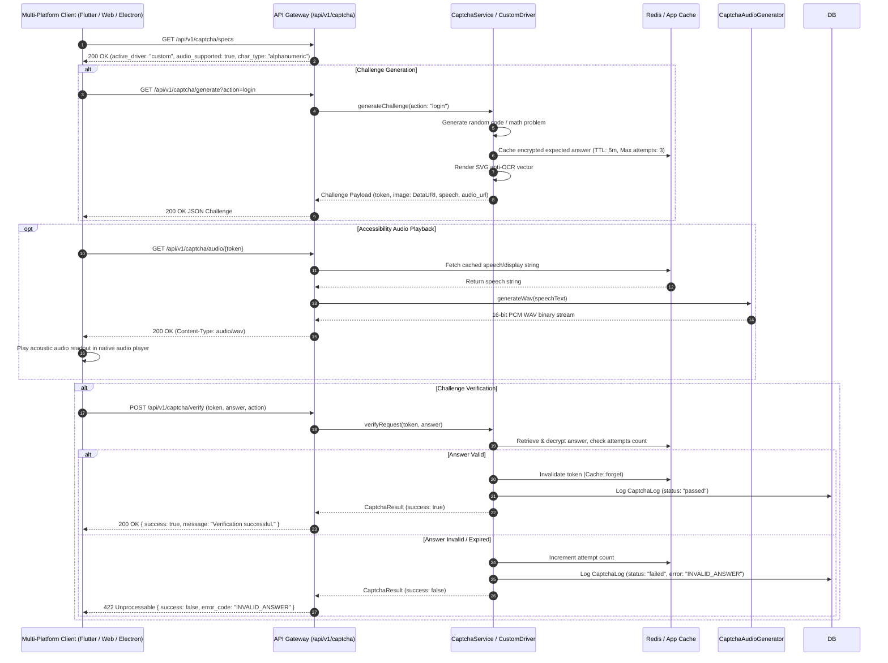

# SNTCSSC MIS — Enterprise CAPTCHA & Bot Defense REST API Integration Guide
### Multi-Platform Integration Guide (Web App, Mobile Flutter / React Native, Desktop Electron / .NET & Headless Microservices)

---

## 1. Executive Summary & Architecture Overview

The **CAPTCHA & Bot Defense Module** of the **Satyendranath Tagore Civil Services Study Centre (SNTCSSC) MIS** delivers an enterprise-grade, multi-tiered bot defense ecosystem designed to protect mission-critical touchpoints (Authentication, OTP Verification, Admissions, Contact Form, Public Inquiries, and Headless APIs) against automated credential stuffing, distributed brute-force attacks, and scraping.

Architected for cross-platform interoperability, the system supports dual-engine bot mitigation:
1. **Google reCAPTCHA Engine:** Seamless support for Google reCAPTCHA **v2 Checkbox**, **v2 Invisible**, and **v3 Score-Based Risk Analysis** with configurable domain endpoints (`www.google.com` or `www.recaptcha.net` for global CDN & mainland compliance) and customizable risk score thresholds (0.0 – 1.0).
2. **Custom Self-Hosted CAPTCHA Engine:** A zero-dependency, mathematically secured internal challenge generator producing high-contrast, anti-OCR distorted SVG vectors, multi-modal character sets (Numbers, Alphabets, Alphanumeric, Special Characters, and Arithmetic Math Challenges), cryptographically signed challenge tokens, session replay protection, and synthesized 16-bit PCM WAV audio readouts for accessibility compliance (WCAG 2.2 AA).

### Architectural Highlights:
- **Zero-Friction Client Bootstrap (`GET /api/v1/captcha/specs`):**
  A high-throughput, unauthenticated (or optionally scoped) endpoint providing mobile apps, SPAs, and desktop clients with runtime configuration (active driver, public site key, Google reCAPTCHA version, domain, custom character rules, dev autofill status, and protected actions matrix) before displaying any user interface.
- **Dynamic Challenge & Acoustic Audio Readout:**
  The server dynamically produces mathematically distorted SVG vectors alongside an acoustic synthesized audio endpoint (`GET /api/v1/captcha/audio/{token}`) streaming real-time WAV audio with dual-tone harmonics for native audio players.
- **One-Shot Token Lifecycle & Cryptographic Signing:**
  Challenges are bound to unique UUID tokens cached with AES-256 encryption. Tokens expire within configurable windows (default: 5 minutes) and are automatically invalidated upon successful verification or maximum failed retry attempts (default: 3).
- **Atomic Refresh Endpoint (`POST /api/v1/captcha/refresh`):**
  Enables clients to invalidate an expired or illegible challenge and obtain a new challenge payload in a single round-trip.
- **Developer Autofill Support (`autofill_answer`):**
  In non-production environments (`local`, `development`, `testing`, `staging`), endpoints return `autofill_answer` to streamline automated E2E integration tests (Cypress, Playwright, Pest, Flutter Driver) without disabling bot defense. In production, expected answers are strictly suppressed.
- **Normalized Auditing & Telemetry (`CaptchaLog` & `AuditLogService`):**
  Every challenge verification records structured telemetry (IP address, User-Agent, response time in ms, risk score, error code, driver, and action). High-frequency bot failures trigger automatic entries in `audit_logs`.

---

## 2. System Architecture & Sequence Flows

### 2.1 Multi-Platform Bot Defense Architecture

```mermaid
graph TD
    subgraph Client Application Ecosystem
        Web[Web Applications\nNext.js / Blade / React / Livewire]
        Mobile[Mobile Applications\nFlutter / React Native / Swift / Kotlin]
        Desktop[Desktop Applications\nElectron / .NET 8 WPF / MAUI]
        APIClient[Headless Microservices\nPython / Go / Node.js]
    end

    subgraph API Gateway & Bot Defense Guard
        GW[API Gateway / Route Dispatcher]
        Throttle[Rate Limiter\nthrottle:120,1]
        ScopeGate[API Key Scope Gate\nread:captcha | verify:captcha | manage:captcha]
    end

    subgraph Bot Defense Engine
        CaptchaCtrl[CaptchaApiController]
        CaptchaService[CaptchaService Core Engine]
        DriverFactory{Active Driver Resolver}
        CustomDriver[CustomCaptchaDriver\nSVG & Audio Engine]
        GoogleDriver[GoogleRecaptchaDriver\nv2 Checkbox / Invisible / v3 Score]
        AudioGen[CaptchaAudioGenerator\nPCM 16-bit WAV Synthesizer]
    end

    subgraph Storage & Telemetry Layer
        MemCache[(Redis / High-Speed Cache\nKey: captcha_challenge:UUID)]
        DB[(Relational Database\ncaptcha_logs & audit_logs)]
        GoogleCloud[Google reCAPTCHA Cloud\nVerify API Endpoint]
    end

    Web -->|HTTPS| GW
    Mobile -->|HTTPS| GW
    Desktop -->|HTTPS| GW
    APIClient -->|X-API-Key Header| GW

    GW --> Throttle
    Throttle --> ScopeGate
    ScopeGate --> CaptchaCtrl
    CaptchaCtrl --> CaptchaService

    CaptchaService --> DriverFactory
    DriverFactory -->|Active: custom| CustomDriver
    DriverFactory -->|Active: google| GoogleDriver

    CustomDriver --> AudioGen
    CustomDriver <--> MemCache
    GoogleDriver <--> GoogleCloud

    CaptchaService --> DB
```

### 2.2 Client Bootstrap & Challenge Sequence Flow



### 2.3 One-Click Challenge Refresh Sequence Flow

```mermaid
sequenceDiagram
    autonumber
    participant Client as Client Application
    participant GW as API Gateway (/api/v1/captcha)
    participant Cache as Redis / Memory Cache
    participant Engine as CustomCaptchaDriver

    Client->>GW: POST /api/v1/captcha/refresh { old_token: "UUID-1", action: "login" }
    GW->>Cache: Invalidate old token (Cache::forget)
    GW->>Engine: generateChallenge(action: "login")
    Engine->>Cache: Store new challenge with UUID-2
    Engine-->>GW: Return new token, SVG data URI, audio link
    GW-->>Client: 200 OK { success: true, token: "UUID-2", image: "data:image/svg+xml;base64,..." }
    Client->>Client: Re-render UI with zero page reload
```

---

## 3. Security, Scopes & Authorization Matrix

The CAPTCHA module features dual access tiers: **Public Throttled Endpoints** for end-user facing applications and **Authenticated API Key Endpoints (`X-API-Key`)** for programmatic microservices and administrative diagnostics.

### API Scopes:

| Scope | Category | Description | Permitted Endpoints |
| :--- | :--- | :--- | :--- |
| `Public / None` | Open Access | Public challenge generation, verification, audio readout & specs | `GET /specs`, `GET /generate`, `POST /verify`, `POST /refresh`, `GET /audio/{token}`, `GET /status` |
| `read:captcha` | Bot Defense & CAPTCHA | Read CAPTCHA specs, verification logs, and telemetry metrics | `GET /api/v1/captcha/specs`, `GET /api/v1/captcha/diagnostics` |
| `verify:captcha` | Bot Defense & CAPTCHA | Programmatically verify CAPTCHA challenges via headless API | `POST /api/v1/captcha/verify`, `POST /api/v1/captcha/refresh` |
| `manage:captcha` | Bot Defense & CAPTCHA | Administrative management: run diagnostics & prune verification logs | `GET /api/v1/captcha/diagnostics`, `POST /api/v1/captcha/logs/prune` |
| `*` | Super Admin | Unrestricted administrative access across all endpoints | All Bot Defense & CAPTCHA endpoints |

---

## 4. Complete API Reference

### 4.1 Client Specifications
`GET /api/v1/captcha/specs`
- **Scope:** `Public / None` or `read:captcha`
- **Description:** Returns system-wide bot defense specifications, active driver, protected actions, public Google site key, and custom driver configuration.
- **Response (200 OK):**
```json
{
  "status": "success",
  "data": {
    "enabled": true,
    "active_driver": "custom",
    "supported_drivers": ["custom", "google"],
    "protected_actions": {
      "login": true,
      "register": true,
      "forgot_password": true,
      "contact_us": true,
      "contact": true,
      "api": true
    },
    "google": {
      "version": "v2_checkbox",
      "site_key": "6LeIxAcTAAAAAJcZVRqyHh71UMIEGNQ_MXjiZKhI",
      "domain": "www.google.com",
      "score_threshold": 0.5
    },
    "custom": {
      "char_type": "alphanumeric",
      "length": 5,
      "case_sensitive": false,
      "expire_minutes": 5,
      "max_attempts": 3,
      "audio_supported": true
    },
    "client_endpoints": {
      "specs": "https://mis.sntcssc.org/api/v1/captcha/specs",
      "generate": "https://mis.sntcssc.org/api/v1/captcha/generate",
      "verify": "https://mis.sntcssc.org/api/v1/captcha/verify",
      "refresh": "https://mis.sntcssc.org/api/v1/captcha/refresh",
      "audio": "https://mis.sntcssc.org/api/v1/captcha/audio/{token}",
      "status": "https://mis.sntcssc.org/api/v1/captcha/status",
      "diagnostics": "https://mis.sntcssc.org/api/v1/captcha/diagnostics"
    },
    "environment": "production",
    "dev_autofill_enabled": false
  }
}
```

---

### 4.2 Generate Challenge
`GET /api/v1/captcha/generate`
- **Query Parameters:**
  - `action` *(optional, default: `general`)*: Action context (e.g. `login`, `register`, `forgot_password`, `contact`).
- **Response (200 OK - Custom Driver):**
```json
{
  "enabled": true,
  "driver": "custom",
  "token": "3fa85f64-5717-4562-b3fc-2c963f66afa6",
  "image": "data:image/svg+xml;base64,PHN2ZyB4bWxucz0iaHR0cDovL3d3dy53My5vcmcvMjAwMC9zdmciIHdpZHRoPSIyNDAiIGhlaWdodD0iNjAi...",
  "speech": "7 B 9 K X",
  "audio_url": "https://mis.sntcssc.org/api/v1/captcha/audio/3fa85f64-5717-4562-b3fc-2c963f66afa6",
  "type": "alphanumeric",
  "expires_at": "2026-11-06T03:30:00+05:30",
  "autofill_answer": "7B9KX" // Included only in non-production environments
}
```

---

### 4.3 Verify Challenge
`POST /api/v1/captcha/verify`
- **Headers:** `Content-Type: application/json`, `Accept: application/json`
- **Request Payload:**
```json
{
  "action": "login",
  "token": "3fa85f64-5717-4562-b3fc-2c963f66afa6",
  "answer": "7B9KX"
}
```
*(For Google reCAPTCHA, pass `"g-recaptcha-response": "TOKEN_FROM_SDK"`)*
- **Response (200 OK - Success):**
```json
{
  "success": true,
  "message": "Captcha verified successfully.",
  "score": null,
  "error_code": null,
  "driver": "custom"
}
```
- **Response (422 Unprocessable Content - Failed):**
```json
{
  "success": false,
  "message": "Incorrect security code. Please try again.",
  "score": null,
  "error_code": "INVALID_ANSWER",
  "driver": "custom"
}
```

---

### 4.4 Refresh Challenge
`POST /api/v1/captcha/refresh`
- **Request Payload:**
```json
{
  "action": "login",
  "old_token": "3fa85f64-5717-4562-b3fc-2c963f66afa6"
}
```
- **Response (200 OK):**
```json
{
  "success": true,
  "enabled": true,
  "driver": "custom",
  "token": "c7a840d2-97b4-4b5f-9e77-9df7253fa2d1",
  "image": "data:image/svg+xml;base64,PHN2ZyB4bWxucz0iaHR0cDovL3d3dy53My5vcmcvMjAwMC9zdmci...",
  "speech": "M 4 2 D Q",
  "audio_url": "https://mis.sntcssc.org/api/v1/captcha/audio/c7a840d2-97b4-4b5f-9e77-9df7253fa2d1",
  "type": "alphanumeric",
  "expires_at": "2026-11-06T03:35:00+05:30"
}
```

---

### 4.5 Acoustic Audio Readout
`GET /api/v1/captcha/audio/{token}`
- **Formats:**
  - Standard Binary Stream: Returns raw binary `Content-Type: audio/wav`.
  - JSON Metadata: Pass query param `?format=json` or `Accept: application/json` to receive Base64 WAV data URI.
- **Binary Response (200 OK):**
  - `Content-Type: audio/wav`
  - `Content-Disposition: inline; filename="captcha-challenge.wav"`
- **JSON Response (`?format=json`):**
```json
{
  "success": true,
  "token": "3fa85f64-5717-4562-b3fc-2c963f66afa6",
  "speech": "7 B 9 K X",
  "audio_base64": "data:audio/wav;base64,UklGRmYTAABXQVZFZm10IBAAAAABAAEA7QAA...",
  "mime_type": "audio/wav"
}
```

---

### 4.6 Administrative Telemetry & Diagnostics
`GET /api/v1/captcha/diagnostics`
- **Scope:** `read:captcha` or `manage:captcha`
- **Description:** Runs real-time self-tests, checks cache store health, driver latency, and returns live statistics.
- **Response (200 OK):**
```json
{
  "status": "success",
  "diagnostics": {
    "active_driver": "custom",
    "driver_healthy": true,
    "generation_latency_ms": 2.15,
    "cache_store": "redis",
    "cache_healthy": true,
    "total_diagnostics_time_ms": 5.42
  },
  "statistics": {
    "total_all_time": 4820,
    "today_total": 312,
    "today_passed": 298,
    "today_failed": 14,
    "pass_rate": 95.5,
    "avg_response_time": 42
  },
  "recent_telemetry": [
    {
      "id": 1045,
      "driver": "custom",
      "action": "login",
      "status": "passed",
      "response_time_ms": 38,
      "ip_address": "103.21.244.12",
      "created_at": "2026-11-06T02:40:12+05:30"
    }
  ]
}
```

---

### 4.7 Administrative Verification Logs Pruning
`POST /api/v1/captcha/logs/prune`
- **Scope:** `manage:captcha`
- **Request Payload:**
```json
{
  "days": 30,
  "force": false
}
```
- **Response (200 OK):**
```json
{
  "success": true,
  "message": "Successfully pruned 412 CAPTCHA logs older than 30 days.",
  "pruned_count": 412,
  "days_threshold": 30,
  "force": false
}
```

---

## 5. Multi-Platform Implementation & Integration Guide

### 5.1 Flutter Mobile Integration (Android & iOS)

```dart
import 'dart:convert';
import 'package:flutter/material.dart';
import 'package:http/http.dart' as http;
import 'package:flutter_svg/flutter_svg.dart';
import 'package:audioplayers/audioplayers.dart';

class CaptchaWidget extends StatefulWidget {
  final String action;
  final Function(String token, String answer) onCaptchaReady;

  const CaptchaWidget({Key? key, required this.action, required this.onCaptchaReady}) : super(key: key);

  @override
  _CaptchaWidgetState createState() => _CaptchaWidgetState();
}

class _CaptchaWidgetState extends State<CaptchaWidget> {
  String? _token;
  String? _svgBase64;
  String? _audioUrl;
  bool _isLoading = true;
  final TextEditingController _answerController = TextEditingController();
  final AudioPlayer _audioPlayer = AudioPlayer();

  @override
  void initState() {
    super.initState();
    _loadChallenge();
  }

  Future<void> _loadChallenge() async {
    setState(() => _isLoading = true);
    try {
      final response = await http.get(
        Uri.parse('https://mis.sntcssc.org/api/v1/captcha/generate?action=${widget.action}'),
        headers: {'Accept': 'application/json'},
      );
      if (response.statusCode == 200) {
        final data = json.decode(response.body);
        if (data['enabled'] == true) {
          setState(() {
            _token = data['token'];
            _svgBase64 = data['image'].toString().replaceFirst('data:image/svg+xml;base64,', '');
            _audioUrl = data['audio_url'];
            _isLoading = false;
          });
        }
      }
    } catch (e) {
      setState(() => _isLoading = false);
    }
  }

  Future<void> _playAudio() async {
    if (_audioUrl != null) {
      await _audioPlayer.play(UrlSource(_audioUrl!));
    }
  }

  @override
  Widget build(BuildContext context) {
    if (_isLoading) return const Center(child: CircularProgressIndicator());
    if (_token == null) return const SizedBox.shrink();

    return Column(
      crossAxisAlignment: CrossAxisAlignment.start,
      children: [
        Row(
          children: [
            Container(
              decoration: BoxDecoration(
                border: Border.all(color: Colors.grey.shade300),
                borderRadius: BorderRadius.circular(8),
              ),
              child: SvgPicture.memory(
                base64Decode(_svgBase64!),
                width: 180,
                height: 50,
              ),
            ),
            const SizedBox(width: 8),
            IconButton(
              icon: const Icon(Icons.refresh),
              tooltip: 'Refresh CAPTCHA',
              onPressed: _loadChallenge,
            ),
            IconButton(
              icon: const Icon(Icons.volume_up),
              tooltip: 'Listen Audio',
              onPressed: _playAudio,
            ),
          ],
        ),
        const SizedBox(height: 8),
        TextField(
          controller: _answerController,
          decoration: const InputDecoration(
            labelText: 'Security Verification Code',
            border: OutlineInputBorder(),
          ),
          onChanged: (val) {
            widget.onCaptchaReady(_token!, val.trim());
          },
        ),
      ],
    );
  }
}
```

---

### 5.2 React Native (iOS & Android)

```tsx
import React, { useState, useEffect } from 'react';
import { View, TextInput, TouchableOpacity, Text, StyleSheet, ActivityIndicator } from 'react-native';
import { SvgXml } from 'react-native-svg';
import Sound from 'react-native-sound';

interface CaptchaProps {
  action: string;
  onChange: (token: string, answer: string) => void;
}

export const CaptchaInput: React.FC<CaptchaProps> = ({ action, onChange }) => {
  const [token, setToken] = useState<string>('');
  const [svgXml, setSvgXml] = useState<string>('');
  const [audioUrl, setAudioUrl] = useState<string>('');
  const [answer, setAnswer] = useState<string>('');
  const [loading, setLoading] = useState<boolean>(true);

  const fetchChallenge = async () => {
    setLoading(true);
    try {
      const res = await fetch(`https://mis.sntcssc.org/api/v1/captcha/generate?action=${action}`);
      const data = await res.json();
      if (data.enabled) {
        setToken(data.token);
        // Decode base64 SVG
        const base64Content = data.image.replace('data:image/svg+xml;base64,', '');
        const decodedSvg = decodeURIComponent(escape(atob(base64Content)));
        setSvgXml(decodedSvg);
        setAudioUrl(data.audio_url);
      }
    } finally {
      setLoading(false);
    }
  };

  useEffect(() => {
    fetchChallenge();
  }, [action]);

  const playAudio = () => {
    if (!audioUrl) return;
    const sound = new Sound(audioUrl, undefined, (error) => {
      if (!error) sound.play(() => sound.release());
    });
  };

  if (loading) return <ActivityIndicator size="small" color="#0284c7" />;

  return (
    <View style={styles.container}>
      <View style={styles.captchaRow}>
        <View style={styles.svgWrapper}>
          <SvgXml xml={svgXml} width="180" height="50" />
        </View>
        <TouchableOpacity style={styles.actionBtn} onPress={fetchChallenge}>
          <Text style={styles.btnText}>↻</Text>
        </TouchableOpacity>
        <TouchableOpacity style={styles.actionBtn} onPress={playAudio}>
          <Text style={styles.btnText}>🔊</Text>
        </TouchableOpacity>
      </View>
      <TextInput
        style={styles.input}
        placeholder="Enter security code"
        value={answer}
        onChangeText={(val) => {
          setAnswer(val);
          onChange(token, val);
        }}
        autoCapitalize="none"
      />
    </View>
  );
};

const styles = StyleSheet.create({
  container: { marginVertical: 10 },
  captchaRow: { flexDirection: 'row', alignItems: 'center', marginBottom: 8 },
  svgWrapper: { borderWidth: 1, borderColor: '#e2e8f0', borderRadius: 6, overflow: 'hidden' },
  actionBtn: { marginLeft: 8, padding: 8, backgroundColor: '#f1f5f9', borderRadius: 6 },
  btnText: { fontSize: 16 },
  input: { borderWidth: 1, borderColor: '#cbd5e1', borderRadius: 6, padding: 10, fontSize: 14 }
});
```

---

### 5.3 Desktop Client (.NET 8 WPF / MAUI / C#)

```csharp
using System;
using System.IO;
using System.Net.Http;
using System.Net.Http.Json;
using System.Text.Json.Nodes;
using System.Threading.Tasks;
using System.Media;

public class CaptchaClient
{
    private readonly HttpClient _http = new() { BaseAddress = new Uri("https://mis.sntcssc.org") };

    public async Task<(string Token, string ImageUri, string AudioUrl)> GenerateChallengeAsync(string action = "login")
    {
        var response = await _http.GetFromJsonAsync<JsonObject>($"/api/v1/captcha/generate?action={action}");
        string token = response["token"]?.ToString() ?? "";
        string imageUri = response["image"]?.ToString() ?? "";
        string audioUrl = response["audio_url"]?.ToString() ?? "";

        return (token, imageUri, audioUrl);
    }

    public async Task PlayAudioReadoutAsync(string token)
    {
        var audioBytes = await _http.GetByteArrayAsync($"/api/v1/captcha/audio/{token}");
        using var stream = new MemoryStream(audioBytes);
        using var player = new SoundPlayer(stream);
        player.Play();
    }

    public async Task<bool> VerifyAsync(string token, string answer, string action = "login")
    {
        var payload = new { action, token, answer };
        var res = await _http.PostAsJsonAsync("/api/v1/captcha/verify", payload);
        return res.IsSuccessStatusCode;
    }
}
```

---

### 5.4 Headless Microservices (Python & cURL)

#### cURL Verification:
```bash
curl -X POST https://mis.sntcssc.org/api/v1/captcha/verify \
  -H "Content-Type: application/json" \
  -H "Accept: application/json" \
  -d '{
    "action": "api",
    "token": "3fa85f64-5717-4562-b3fc-2c963f66afa6",
    "answer": "7B9KX"
  }'
```

#### Python 3 (Requests):
```python
import requests

BASE_URL = "https://mis.sntcssc.org/api/v1/captcha"

def test_captcha_pipeline():
    # 1. Fetch Specs
    specs = requests.get(f"{BASE_URL}/specs").json()
    print("Active Driver:", specs["data"]["active_driver"])

    # 2. Generate Challenge
    challenge = requests.get(f"{BASE_URL}/generate?action=login").json()
    token = challenge["token"]
    print(f"Issued Challenge Token: {token}")

    # 3. Verify Challenge (In dev/test environments, autofill_answer is provided)
    answer = challenge.get("autofill_answer", "MANUAL_INPUT")
    verify_res = requests.post(f"{BASE_URL}/verify", json={
        "action": "login",
        "token": token,
        "answer": answer
    })

    print("Verification Result:", verify_res.status_code, verify_res.json())

if __name__ == "__main__":
    test_captcha_pipeline()
```

---

## 6. Security Considerations & Best Practices

1. **Replay & Timing Attack Prevention:**
   - Challenge tokens are strictly single-use. Once verified (or upon reaching 3 failed attempts), the token is immediately evicted from Redis cache.
2. **Server-Side Verification Enforcement:**
   - Form submission handlers (`login`, `register`, `contact`) must never trust client-side boolean flags. Verification must always occur on the backend via `CaptchaService::verifyRequest($request, $action)`.
3. **Secret Key Shielding:**
   - Google reCAPTCHA secret keys are stored in encrypted settings (`type: secret`) and never exposed via any client endpoint.
4. **Rate Limiting:**
   - Public CAPTCHA endpoints are protected by Laravel's throttle middleware (`120 requests per minute per IP`).
5. **Multi-Domain Google reCAPTCHA Fallback:**
   - For users connecting from restrictive firewall environments or regions where `google.com` is unreachable, admins can configure `recaptcha.net` via `captcha.google_domain` without code modifications.

---
*Document Version: 1.0.0 (Enterprise Multi-Platform Release)*  
*Maintained by: SNTCSSC MIS Core Engineering Team*

