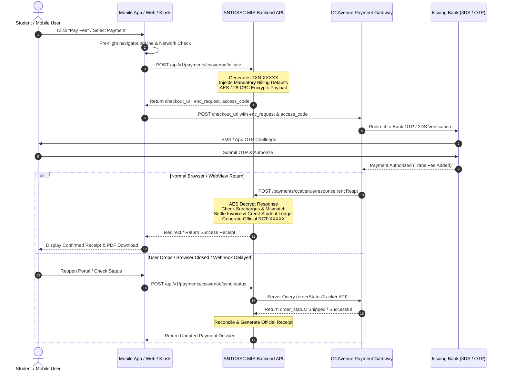

# CCAvenue Payment Gateway, Surcharge Reconciliation & Programmatic Refund API
## Enterprise Omnichannel Integration Guide (Mobile App, Web SPA, Desktop POS Kiosk)

---

## 1. Executive Summary & Architecture

The Satyendranath Tagore Civil Services Study Centre (SNTCSSC) Payment Collection System integrates **CCAvenue Web Integration Kit** using standard AES-128-CBC encryption. The omnichannel API enables seamless payment collection across:
1. **Student Mobile Apps** (Flutter / React Native WebView with deep-link redirection)
2. **Student & Public Web Portals** (Next.js, Vue, React, or server-side Blade/Livewire)
3. **Desktop POS Kiosks & Counter Terminals** (Electron, Windows C# .NET WPF/WinForms)
4. **Automated Background Telemetry & Settlement Reconcilers** (Scheduled cron & webhook daemons)

### Core Integration Principles
- **AES-128-CBC Cryptography**: Encrypted handshake with 16-byte initialization vector (`0x00` through `0x0f`) and MD5 hashed 32-character merchant working key.
- **Surcharge & Gateway Fee Bifurcation**: Fully supports gateway convenience surcharges (credit/debit cards, net banking). When a student pays ₹1,023.60 on a ₹1,000.00 tuition fee, exactly ₹1,000.00 is credited to the student ledger and invoice settled, while ₹23.60 is recorded under `gateway_fee`.
- **Underpayment & Fraud Safeguard**: If the gateway returns an amount lower than the expected demand (e.g. ₹800.00 on ₹1,000.00), the system automatically locks the transaction into `under_review` with `amount_mismatch = true` and alerts finance administrators.
- **Interrupted Session & Offline Recovery**: Pre-flight internet checks prevent initiating payments in unstable states. A 30-minute automated background daemon (`payments:sync-ccavenue-pending`) and on-demand status tracker endpoints reconcile dropped browser sessions or missing callbacks.
- **Mandatory 6-Month Penalty Billing Rule**: When CCAvenue disables the checkout billing step, banks mandate transmission of `billing_country`, `billing_tel`, and `billing_email`. If any order omits them, CCAvenue reactivates the billing page for 6 months without notice. The MIS automatically injects student profile addresses or fallback institutional defaults (`Kolkata`, `700106`, `West Bengal`, `India`).
- **Programmatic Admin Reconciliation & Refunds**: Finance controllers can reconcile pending records directly and execute full or partial refunds with automatic student ledger debits and fee invoice balance reopening.

---

## 2. Omnichannel Transaction Lifecycle (Sequence Diagram)



---

## 3. Platform Integration Blueprints

### 3.1 Flutter / React Native Mobile App Integration

Mobile apps interact with CCAvenue via a headless WebView controller:

```
[Student Mobile App]
  ├── Step 1: Pre-flight network check (`connectivity_plus`)
  ├── Step 2: Call `POST /api/v1/payments/ccavenue/initiate` with Bearer/API Key
  ├── Step 3: Render headless `WebView` pointing to returned `checkout_url`
  │           with auto-submitting POST form (`enc_request`, `access_code`)
  ├── Step 4: Intercept navigation matching `redirect_url` or `cancel_url`
  └── Step 5: Read transaction status and display receipt or retry dialog
```

#### Flutter Implementation Example

```dart
import 'package:flutter/material.dart';
import 'package:webview_flutter/webview_flutter.dart';
import 'package:http/http.dart' as http;
import 'dart:convert';

class CCAvenuePaymentScreen extends StatefulWidget {
  final int invoiceId;
  final double amount;
  final String apiKey;

  const CCAvenuePaymentScreen({required this.invoiceId, required this.amount, required this.apiKey, Key? key}) : super(key: key);

  @override
  _CCAvenuePaymentScreenState createState() => _CCAvenuePaymentScreenState();
}

class _CCAvenuePaymentScreenState extends State<CCAvenuePaymentScreen> {
  late final WebViewController _controller;
  bool _isLoading = true;

  @override
  void initState() {
    super.initState();
    _initiateCheckout();
  }

  Future<void> _initiateCheckout() async {
    final response = await http.post(
      Uri.parse('https://mis.sntcssc.in/api/v1/payments/ccavenue/initiate'),
      headers: {
        'Content-Type': 'application/json',
        'X-API-Key': widget.apiKey,
      },
      body: jsonEncode({
        'invoice_id': widget.invoiceId,
        'amount': widget.amount,
        'redirect_url': 'https://mis.sntcssc.in/payments/ccavenue/response',
        'cancel_url': 'https://mis.sntcssc.in/payments/ccavenue/cancel',
      }),
    );

    final data = jsonDecode(response.body)['data'];
    final checkoutUrl = data['checkout_url'];
    final encRequest = data['enc_request'];
    final accessCode = data['access_code'];

    final postHtml = '''
      <html>
        <body onload="document.forms[0].submit()">
          <form method="POST" action="$checkoutUrl">
            <input type="hidden" name="encRequest" value="$encRequest" />
            <input type="hidden" name="access_code" value="$accessCode" />
          </form>
        </body>
      </html>
    ''';

    _controller = WebViewController()
      ..setJavaScriptMode(JavaScriptMode.unrestricted)
      ..setNavigationDelegate(
        NavigationDelegate(
          onNavigationRequest: (request) {
            if (request.url.contains('/payments/ccavenue/response')) {
              _handlePaymentSuccess(request.url);
              return NavigationDecision.prevent;
            } else if (request.url.contains('/payments/ccavenue/cancel')) {
              _handlePaymentCancellation();
              return NavigationDecision.prevent;
            }
            return NavigationDecision.navigate;
          },
        ),
      )
      ..loadHtmlString(postHtml);

    setState(() => _isLoading = false);
  }

  void _handlePaymentSuccess(String returnUrl) {
    Navigator.pop(context, {'status': 'success', 'url': returnUrl});
  }

  void _handlePaymentCancellation() {
    Navigator.pop(context, {'status': 'cancelled'});
  }

  @override
  Widget build(BuildContext context) {
    return Scaffold(
      appBar: AppBar(title: const Text('Complete Secure Payment')),
      body: _isLoading
          ? const Center(child: CircularProgressIndicator())
          : WebViewWidget(controller: _controller),
    );
  }
}
```

---

### 3.2 Desktop POS Kiosk (C# .NET WPF / Electron)

In an admission counter kiosk, students can pay via debit/credit card or dynamic QR code:
1. Counter clerk opens student fee dossier and triggers `POST /api/v1/payments/ccavenue/initiate`.
2. Kiosk opens the CCAvenue checkout in an isolated Chromium embedded browser (`CefSharp` / Electron `BrowserWindow`).
3. Upon bank completion, the kiosk catches the redirection, prints the official physical thermal receipt with official `RCT-XXXXX` and QR verification code, and auto-settles the ledger.

---

## 4. API Reference Specifications

### 4.1 Initiate CCAvenue Checkout
Initiate payment for an existing student fee invoice or arbitrary fee demand. Encrypts payload and enforces mandatory billing fields.

- **Method**: `POST`
- **Path**: `/api/v1/payments/ccavenue/initiate`
- **Authentication**: `X-API-Key` or Sanctum Bearer Token
- **Required Scope**: `write:payments`

#### Request Parameters
| Parameter | Type | Required | Description |
|:---|:---|:---|:---|
| `invoice_id` | Integer | Conditional | ID of the student fee invoice to settle. Required if `transaction_id` omitted. |
| `transaction_id` | Integer | Conditional | ID of an existing pending `payment_transactions` record. |
| `amount` | Numeric | Optional | Amount to charge. Defaults to invoice's outstanding balance. |
| `currency` | String | Optional | 3-letter currency code (default: `INR`). |
| `redirect_url` | URL | Optional | Webhook return endpoint. Defaults to MIS CCAvenue response URL. |
| `cancel_url` | URL | Optional | Cancellation endpoint. Defaults to MIS CCAvenue cancel URL. |
| `notes` | String | Optional | Audit notes attached to the transaction record. |

#### Example Request
```bash
curl -X POST "https://mis.sntcssc.in/api/v1/payments/ccavenue/initiate" \
  -H "X-API-Key: sntc_live_948f20b38c..." \
  -H "Content-Type: application/json" \
  -d '{
    "invoice_id": 42,
    "amount": 1000.00,
    "redirect_url": "https://app.sntcssc.in/payments/callback",
    "cancel_url": "https://app.sntcssc.in/payments/cancel"
  }'
```

#### Example Response (HTTP 200)
```json
{
  "success": true,
  "data": {
    "transaction_id": 182,
    "transaction_no": "TXN-2026-00182",
    "order_id": "CC_TXN_2026_00182",
    "amount": 1000,
    "currency": "INR",
    "gateway": "ccavenue",
    "checkout_url": "https://secure.ccavenue.com/transaction/transaction.do?command=initiateTransaction",
    "access_code": "AVAB01LC32...",
    "enc_request": "c9284fa0e2193cb5...",
    "billing_data": {
      "name": "Debraj Ghosh",
      "email": "debraj@example.com",
      "tel": "9876543210",
      "address": "Salt Lake Sector V",
      "city": "Kolkata",
      "state": "West Bengal",
      "zip": "700106",
      "country": "India"
    },
    "redirect_url": "https://app.sntcssc.in/payments/callback",
    "cancel_url": "https://app.sntcssc.in/payments/cancel",
    "status": "pending"
  },
  "meta": {
    "message": "CCAvenue checkout initiated successfully."
  }
}
```

---

### 4.2 Decrypt & Process CCAvenue Callback / Webhook
Processes incoming encrypted response (`encResp`) from CCAvenue. Supports surcharge bifurcation and underpayment mismatch detection.

- **Method**: `POST`
- **Path**: `/api/v1/payments/ccavenue/callback`
- **Authentication**: Public (Whitelisted from CSRF)

#### Request Parameters
| Parameter | Type | Required | Description |
|:---|:---|:---|:---|
| `encResp` | String | Required | AES-128-CBC hexadecimal string returned by CCAvenue. |

#### Example Request
```bash
curl -X POST "https://mis.sntcssc.in/api/v1/payments/ccavenue/callback" \
  -H "Content-Type: application/json" \
  -d '{
    "encResp": "4886c852179cd45a4543c124239854db..."
  }'
```

#### Example Response — Surcharge Bifurcated (HTTP 200)
```json
{
  "success": true,
  "data": {
    "id": 182,
    "transaction_no": "TXN-2026-00182",
    "receipt_no": "RCT-2026-00095",
    "amount": 1000,
    "currency": "INR",
    "gateway": "ccavenue",
    "payment_method": "online",
    "status": "successful",
    "gateway_charged_amount": 1023.60,
    "gateway_fee": 23.60,
    "gateway_tracking_id": "312008459201",
    "gateway_bank_ref_no": "HDFC-8829104",
    "gateway_payment_mode": "Credit Card",
    "gateway_card_name": "Visa",
    "amount_mismatch": false,
    "amount_mismatch_notes": null
  },
  "meta": {
    "status": "completed",
    "message": "Payment completed and reconciled successfully."
  }
}
```

---

### 4.3 Synchronize Payment Transaction Status (Status Tracker)
Calls CCAvenue's official `orderStatusTracker` API to query the gateway for dropped, pending, or interrupted transactions.

- **Method**: `POST`
- **Path**: `/api/v1/payments/ccavenue/sync-status`
- **Authentication**: `X-API-Key` or Sanctum Bearer Token
- **Required Scope**: `read:payments,write:payments`

#### Request Parameters
| Parameter | Type | Required | Description |
|:---|:---|:---|:---|
| `transaction_identifier` | String | Required | Numeric transaction ID, `transaction_no` (e.g. `TXN-2026-00182`), or `receipt_no`. |

#### Example Request
```bash
curl -X POST "https://mis.sntcssc.in/api/v1/payments/ccavenue/sync-status" \
  -H "X-API-Key: sntc_live_948f20b38c..." \
  -H "Content-Type: application/json" \
  -d '{
    "transaction_identifier": "TXN-2026-00182"
  }'
```

#### Example Response (HTTP 200)
```json
{
  "success": true,
  "data": {
    "sync_result": {
      "success": true,
      "order_status": "Successful",
      "message": "CCAvenue confirmed payment as SUCCESSFUL. Transaction synchronized and official receipt generated."
    },
    "transaction": {
      "id": 182,
      "transaction_no": "TXN-2026-00182",
      "receipt_no": "RCT-2026-00095",
      "status": "successful",
      "gateway_bank_ref_no": "SBI_8920112"
    }
  },
  "meta": {
    "message": "CCAvenue confirmed payment as SUCCESSFUL. Transaction synchronized and official receipt generated."
  }
}
```

---

### 4.4 Programmatic Refund Execution
Executes full or partial refund for a successful payment transaction. Automatically debits the student ledger and reopens invoice balance.

- **Method**: `POST`
- **Path**: `/api/v1/payments/transactions/{identifier}/refund`
- **Authentication**: Bearer Token or Admin API Key
- **Required Permission**: `payments.refund` or Super Administrator

#### Request Parameters
| Parameter | Type | Required | Description |
|:---|:---|:---|:---|
| `amount` | Numeric | Required | Refund amount (cannot exceed eligible refundable balance). |
| `reason` | String | Required | Mandatory audit reason for refund (e.g. "Duplicate student payment"). |
| `reference_no` | String | Optional | Bank UTR or internal debit voucher reference number. |
| `attempt_gateway_api`| Boolean | Optional | Whether to dispatch CCAvenue online refund API (default: `true`). Set to `false` for manual accounts voucher. |

#### Example Request
```bash
curl -X POST "https://mis.sntcssc.in/api/v1/payments/transactions/TXN-2026-00182/refund" \
  -H "Authorization: Bearer 12|49f0a8..." \
  -H "Content-Type: application/json" \
  -d '{
    "amount": 1000.00,
    "reason": "Duplicate payment received during bank session retry.",
    "reference_no": "REF-VOUCHER-2026-44",
    "attempt_gateway_api": false
  }'
```

#### Example Response (HTTP 200)
```json
{
  "success": true,
  "data": {
    "id": 182,
    "transaction_no": "TXN-2026-00182",
    "status": "refunded",
    "refund_amount": 1000,
    "refund_reason": "Duplicate payment received during bank session retry.",
    "refund_reference_no": "REF-VOUCHER-2026-44",
    "refund_status": "processed",
    "refunded_at": "2026-11-09T22:15:00+05:30",
    "refunded_by_name": "Finance Director"
  },
  "meta": {
    "message": "Refund of ₹1,000.00 recorded successfully."
  }
}
```

---

### 4.5 Admin Manual Reconciliation & Audit Override
Allows authorized financial staff to manually override payment status against bank statement credits or chargebacks.

- **Method**: `POST`
- **Path**: `/api/v1/payments/transactions/{identifier}/reconcile`
- **Authentication**: Bearer Token or Admin API Key
- **Required Permission**: `payments.reconcile` or Super Administrator

#### Request Parameters
| Parameter | Type | Required | Description |
|:---|:---|:---|:---|
| `status` | String | Required | Target status (`completed`, `failed`, `under_review`, `cancelled`). |
| `gateway_tracking_id` | String | Optional | Gateway tracking ID confirmed by bank statement. |
| `gateway_bank_ref_no` | String | Optional | Bank reference / UTR number. |
| `gateway_payment_mode` | String | Optional | Payment mode (`Net Banking`, `Credit Card`, `UPI`). |
| `gateway_charged_amount` | Numeric | Optional | Total amount charged at gateway. |
| `gateway_fee` | Numeric | Optional | Convenience surcharge deducted by gateway. |
| `reason` | String | Required | Mandatory audit explanation for the manual override. |

---

### 4.6 Public Gateway Configuration & Billing Policies
Returns public gateway credentials, operational mode, and fallback address defaults.

- **Method**: `GET`
- **Path**: `/api/v1/payments/gateways/ccavenue/config`
- **Authentication**: `X-API-Key` or Sanctum Bearer Token

#### Example Response (HTTP 200)
```json
{
  "success": true,
  "data": {
    "gateway": "ccavenue",
    "merchant_id": "TEST_MERCHANT_999",
    "access_code": "AVAB****",
    "mode": "test",
    "checkout_url": "https://test.ccavenue.com/transaction/transaction.do?command=initiateTransaction",
    "currency": "INR",
    "billing_page_step_enabled": false,
    "six_month_penalty_warning": "If billing information step is removed by CCAvenue, backend must supply country, telephone, and email on every transaction to prevent automatic 6-month reactivation.",
    "fallback_billing_defaults": {
      "country": "India",
      "state": "West Bengal",
      "city": "Kolkata",
      "zip_code": "700106",
      "telephone": "9999999999",
      "email": "info@sntcssc.in"
    }
  }
}
```

---

### 4.7 Diagnostic AES Encryption Handshake Test
Validates that the server's working key and OpenSSL configuration can correctly encrypt and decrypt sample CCAvenue payloads.

- **Method**: `POST`
- **Path**: `/api/v1/payments/gateways/ccavenue/test-encryption`
- **Authentication**: `X-API-Key` with `write:payments`

---

## 5. Security & Production Checklist

1. **Working Key Confidentiality**: Never expose `payment.ccavenue_working_key` to mobile apps or web clients. All encryption and decryption must occur on the MIS backend server.
2. **CSRF Exemption**: Gateway callbacks (`/payments/ccavenue/response` and `/api/v1/payments/ccavenue/callback`) must be exempted from CSRF verification in `bootstrap/app.php` because external bank redirects do not contain session CSRF tokens.
3. **6-Month Penalty Prevention**: Maintain valid defaults in Admin Settings (`Payment Settings -> CCAvenue Settings`). Never allow empty `billing_country`, `billing_tel`, or `billing_email`.
4. **Scheduled Daemon**: Ensure Laravel Scheduler is running (`php artisan schedule:run`) on the server crontab to execute `payments:sync-ccavenue-pending` every 30 minutes.

