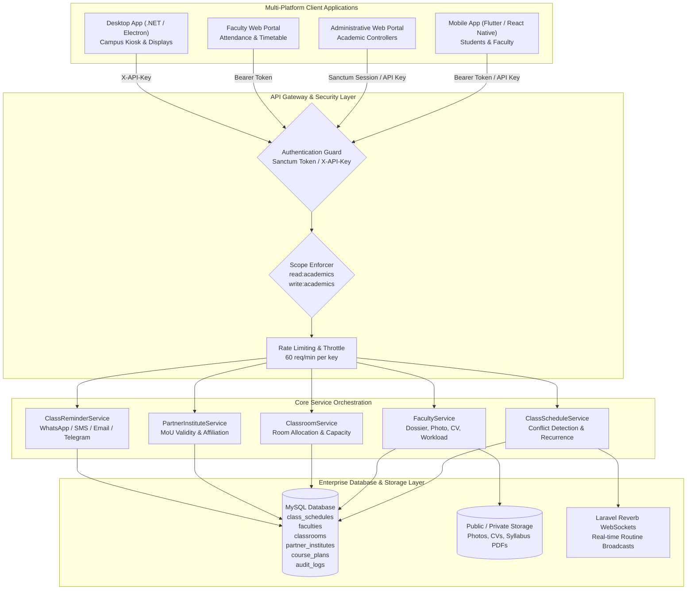
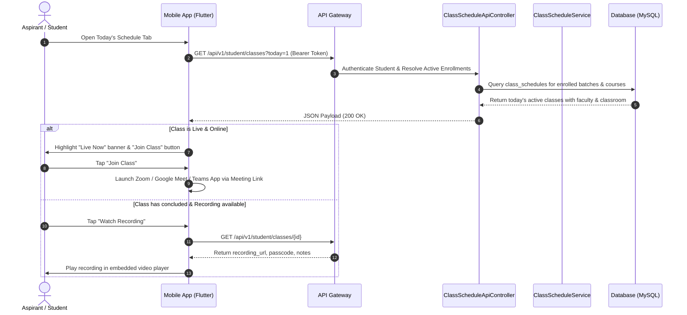

# Class Routine, Faculty Master, Course Plans, Classrooms & Partner Coaching Institutes REST API — Enterprise Multi-Platform Integration Guide
### Comprehensive Technical Blueprint & Client Integration Guide (Mobile App, Web Portal, Desktop Client & Third-Party Automation)

---

## 1. Executive Summary & Architectural Overview

The **Academic Operations, Class Routine & Faculty Master Module** of the **Satyendranath Tagore Civil Services Study Centre (SNTCSSC) MIS** delivers a scalable, future-ready RESTful API backbone. Built for friction-free integration across **Mobile Applications (iOS & Android via Flutter / React Native)**, **Web Single-Page Applications (Next.js, React, Vue, Livewire)**, **Desktop Management Clients (Electron, .NET 8 WPF/MAUI)**, and **Campus Hardware / IoT Gateways**, this system unifies curriculum planning, lecture routine scheduling, physical hall allocation, faculty dossier management, and affiliated coaching institute partnerships.

### Core Architectural Highlights:
1. **Multi-Cohort & Section-Aware Timetabling:**
   - Full support for multi-batch, multi-course, and section-specific scheduling. Lectures can be targeted to an entire batch, a specific course, or a designated classroom section.
   - Dynamic classification of sessions into `regular`, `optional`, `extra`, `revision`, and `guest_lecture`.
2. **Hybrid Delivery Modes & Meeting Platform Interoperability:**
   - Unified support for `offline`, `online`, and `hybrid` delivery modes.
   - Seamless online conferencing integration: Zoom, Google Meet, Microsoft Teams, Cisco Webex Meetings, and custom RTMP/HLS streams.
   - Secure meeting credentials: direct launch URL, Meeting ID, and Meeting Passcode.
3. **On-Demand Class Recordings Vault:**
   - Concluded sessions support cloud recording links (Zoom Cloud, Vimeo OTT, YouTube Unlisted, Google Drive, BunnyCDN) and direct internal file uploads.
   - Guarded access with recording passcodes, index timestamp notes, and availability lifecycle states (`not_available`, `processing`, `available`).
4. **Faculty Master & Workload Telemetry:**
   - Detailed teacher profiles with academic qualifications, departmental assignment, competencies/subjects, photos, and downloadable CVs.
   - Affiliation with **Partner Coaching Institutes** (e.g. Apex IAS, Vision, etc.) and contract classification (`regular`, `guest`, `visiting`, `contractual`, `adjunct`).
   - Granular workload tracking: planned lectures vs conducted classes, total teaching hours taught, completion rate, and classroom utilization.
5. **Classroom Master & Conflict Prevention:**
   - Physical room inventory with floor numbering, seating capacity, equipment checklists (Smart Board, AC, Audio/Mic, High-speed Wi-Fi, Projector, UPS/Generator backup), and course bindings.
   - Real-time room booking overlap detection preventing double-booking during single scheduling or recurring batch generation.
6. **Automated & On-Demand Multi-Channel Class Reminder Alerts:**
   - Multi-channel notification engine dispatching reminders via **WhatsApp**, **SMS**, **Email**, and **Telegram**.
   - Automated lead-time dispatching (configurable: default 60 minutes before start time) via `php artisan classes:send-reminders`.
   - On-demand instant broadcast tool allowing administrators to alert enrolled cohorts ahead of time with custom notes.
7. **Comprehensive Course Plans & Syllabus Roadmaps:**
   - Abstract curriculum planning supporting `annual`, `monthly`, `weekly`, and `custom` roadmaps.
   - Milestone targets: planned lectures vs actual conducted classes with progress percentages and downloadable syllabus document soft copies (PDF/DOC).
8. **Student & Faculty Self-Service Portals:**
   - Student self-service: personalized schedule filtered by enrolled courses/batches, "Live Now" banner, 1-click meeting join, class recording replay, and timetable PDF export.
   - Faculty self-service: personalized teaching agenda, on-demand lecture rescheduling, lecture recording submission, and class completion marking.
9. **Enterprise Reliability & Auditability:**
   - Soft deletes (`deleted_at`, `deleted_by`) across all entities with one-click restoration (`/restore`).
   - Atomic database transactions (`DB::transaction`) on all mutations.
   - Complete audit trail logging via `AuditLogService` capturing IP, user agent, actor, old values, and new values.

---

## 2. System Architecture & Sequence Flows

### 2.1 Multi-Platform Timetable & Routine Architecture



### 2.2 Student Class Routine & Live Session Join Flow



---

## 3. Authentication, Scopes & Authorization

All endpoints reside under `/api/v1` and require authenticated requests using either **API Keys** (for system-to-system, mobile backend, or kiosk integration) or **Sanctum Bearer Tokens** (for user-authenticated sessions).

### 3.1 Request Headers
| Header | Value | Description |
|---|---|---|
| `Authorization` | `Bearer sk_live_...` or `Bearer {sanctum_token}` | API Key or User Sanctum Bearer token |
| `X-API-Key` | `sk_live_...` | Dedicated API Key header alternative |
| `Accept` | `application/json` | Enforces JSON response envelope |
| `Content-Type` | `application/json` | Mandatory for POST, PUT, PATCH request bodies |

### 3.2 Permission Scopes
- `read:academics`: Required to list and inspect scheduled classes, faculties, classrooms, partner institutes, and course plans.
- `write:academics`: Required to create, update, reschedule, cancel, or soft-delete schedules, faculties, and course plans.
- `Student Auth`: Authenticated student session granting access to personal enrolled timetable (`/api/v1/student/*`).
- `Faculty Auth`: Authenticated faculty session granting access to personal assigned classes (`/api/v1/faculty/*`).

---

## 4. API Endpoints Reference

### 4.1 Class Routine & Lecture Schedules (`/api/v1/classes`)

#### 1. List Scheduled Classes
```http
GET /api/v1/classes
```
**Query Parameters:**
- `batch_id` (int, optional): Filter by batch ID.
- `course_id` (int, optional): Filter by course ID.
- `section_id` (int, optional): Filter by section ID.
- `faculty_id` (int, optional): Filter by assigned faculty member ID.
- `class_type` (string, optional): `regular`, `optional`, `extra`, `revision`, `guest_lecture`.
- `delivery_mode` (string, optional): `offline`, `online`, `hybrid`.
- `status` (string, optional): `scheduled`, `in_progress`, `completed`, `rescheduled`, `cancelled`.
- `date_from` (date `YYYY-MM-DD`, optional): Start date window.
- `date_to` (date `YYYY-MM-DD`, optional): End date window.
- `today` (bool, optional): Return only today's sessions (`today=1`).
- `upcoming` (bool, optional): Return upcoming sessions (`upcoming=1`).
- `has_recording` (bool, optional): Return sessions with recording available.
- `search` (string, optional): Search across subject, topic, code, room, or faculty name.
- `sort_by` (string, default `class_date`): `class_date`, `start_time`, `subject`, `created_at`.
- `sort_dir` (string, default `asc`): `asc`, `desc`.
- `per_page` (int, default `25`): Items per page.

**Response (200 OK):**
```json
{
  "success": true,
  "data": [
    {
      "id": 142,
      "schedule_code": "CLS-2026-00142",
      "batch_id": 1,
      "course_id": 1,
      "section_id": 2,
      "class_type": "regular",
      "class_date": "2026-11-15",
      "day_of_week": "Sunday",
      "start_time": "10:00:00",
      "end_time": "12:00:00",
      "formatted_time": "10:00 AM - 12:00 PM",
      "subject": "Modern Indian History",
      "topics": "National Movement: Non-Cooperation Movement 1920-22",
      "lecture_number": "L-18",
      "delivery_mode": "online",
      "classroom": null,
      "platform": "Zoom",
      "meeting_link": "https://zoom.us/j/9876543210",
      "meeting_id": "987 654 3210",
      "meeting_password": "UPSC2026",
      "recording_url": null,
      "recording_status": "not_available",
      "status": "scheduled",
      "faculties": [
        {
          "id": 5,
          "name": "Dr. Amit Roy",
          "faculty_code": "FAC-2026-005",
          "department": "Ancient History",
          "faculty_type": "regular"
        }
      ]
    }
  ],
  "meta": {
    "current_page": 1,
    "last_page": 4,
    "per_page": 25,
    "total": 92
  }
}
```

#### 2. Schedule New Class (Single or Recurring Batch)
```http
POST /api/v1/classes
```
**Single Class Payload:**
```json
{
  "batch_id": 1,
  "course_id": 1,
  "section_id": 2,
  "class_type": "regular",
  "class_date": "2026-11-20",
  "start_time": "10:00:00",
  "end_time": "12:00:00",
  "subject": "Indian Polity & Governance",
  "topics": "Fundamental Rights: Articles 14 to 18",
  "lecture_number": "L-12",
  "delivery_mode": "offline",
  "classroom_id": 3,
  "classroom": "Smart Lecture Hall A",
  "faculty_ids": [5]
}
```

**Recurring Routine Series Payload:**
```json
{
  "batch_id": 1,
  "course_id": 1,
  "section_id": null,
  "class_type": "regular",
  "class_date": "2026-11-01",
  "start_time": "14:00:00",
  "end_time": "16:00:00",
  "subject": "Economic & Social Development",
  "topics": "Monetary Policy & RBI Framework",
  "delivery_mode": "online",
  "platform": "Google Meet",
  "meeting_link": "https://meet.google.com/abc-defg-hij",
  "faculty_ids": [5],
  "is_recurring": true,
  "recurrence": {
    "end_date": "2026-12-31",
    "days": ["Monday", "Wednesday", "Friday"],
    "start_lecture_no": 1
  }
}
```

#### 3. Weekly Matrix / Calendar Timetable
```http
GET /api/v1/classes/calendar?batch_id=1&date_from=2026-11-01&date_to=2026-11-07
```
Returns timetable sessions grouped by calendar date and day of the week, designed for weekly grid renders in web/mobile timetable calendars.

#### 4. Reschedule Class
```http
POST /api/v1/classes/{id}/reschedule
```
```json
{
  "new_date": "2026-11-22",
  "start_time": "14:00:00",
  "end_time": "16:00:00",
  "reason": "Faculty attending state civil services symposium"
}
```

#### 5. Cancel Class
```http
POST /api/v1/classes/{id}/cancel
```
```json
{
  "reason": "Observance of National Holiday"
}
```

#### 6. Mark Class as Completed
```http
POST /api/v1/classes/{id}/complete
```
Marks session completed, recalculates course plan syllabus coverage, and updates faculty workload.

#### 7. Update Class Recording Access
```http
POST /api/v1/classes/{id}/recording
```
```json
{
  "recording_url": "https://zoom.us/rec/share/sample-access-link-2026",
  "recording_password": "Passcode2026",
  "recording_notes": "PYQ discussion from 2019 to 2025; revision on Article 19(1)(a)",
  "recording_status": "available"
}
```

#### 8. Trigger Class Reminder Alert
```http
POST /api/v1/classes/{id}/send-reminder
```
```json
{
  "channels": ["whatsapp", "email", "sms"],
  "custom_message": "Class will start strictly at 10:00 AM. Please bring your bare act."
}
```

#### 9. Export & Import Routine Timetable
- **Export:** `GET /api/v1/classes/export?format=xlsx|csv|pdf&batch_id=1`
- **Import:** `POST /api/v1/classes/import` (Multipart with `file` as `.xlsx` or `.csv`)

---

### 4.2 Faculty Master Directory & Workload (`/api/v1/faculties`)

#### 1. List Faculty Directory
```http
GET /api/v1/faculties
```
**Query Parameters:**
- `search` (string): Search by teacher name, code, email, phone, or specialization.
- `department` (string): Filter by department (e.g. `General Studies`, `History`, `Geography`, `Polity`, `Economy`).
- `partner_institute_id` (int): Filter by linked coaching institute.
- `faculty_type` (string): `regular`, `guest`, `visiting`, `contractual`, `adjunct`.
- `status` (string): `active`, `inactive`, `on_leave`.
- `with_trashed` (bool): Include soft-deleted faculties.
- `per_page` (int, default `15`): Pagination limit.

**Response (200 OK):**
```json
{
  "success": true,
  "data": [
    {
      "id": 5,
      "faculty_code": "FAC-2026-005",
      "name": "Dr. Amit Roy",
      "email": "amit.roy@sntcssc.org",
      "phone": "+919830012345",
      "designation": "Professor",
      "department": "Ancient History",
      "faculty_type": "regular",
      "faculty_type_label": "Regular Faculty",
      "partner_institute_id": 1,
      "partner_institute": {
        "id": 1,
        "name": "Apex IAS Academy",
        "code": "INST-2026-001"
      },
      "specialization": "Vedic Culture & Epigraphy",
      "qualification": "Ph.D., UGC-NET",
      "avatar_url": "https://mis.sntcssc.in/storage/faculties/photos/faculty_photo_user_1_20261101_043000.jpg",
      "cv_url": "https://mis.sntcssc.in/storage/faculties/cvs/faculty_cv_user_1_20261101_043000.pdf",
      "status": "active",
      "subjects": ["Ancient History", "Art & Culture"],
      "class_schedules_count": 34
    }
  ]
}
```

#### 2. Create Faculty Member
```http
POST /api/v1/faculties
```
Supports JSON payload or Multipart Form-Data (when uploading `photo` and `cv` files directly).
```json
{
  "name": "Prof. Sunita Sharma",
  "email": "sunita.sharma@sntcssc.org",
  "phone": "+919876500112",
  "designation": "Associate Professor",
  "department": "Geography",
  "faculty_type": "regular",
  "partner_institute_id": null,
  "specialization": "Physical & Geomorphological Geography",
  "qualification": "Ph.D. in Earth Sciences",
  "bio": "15+ years experience mentoring UPSC CSE top rankers.",
  "subjects": ["Physical Geography", "Indian Geography", "Environment & Ecology"],
  "status": "active"
}
```

#### 3. Faculty Dossier & Workload Metrics
```http
GET /api/v1/faculties/{id}
```
**Response (200 OK):**
```json
{
  "success": true,
  "data": {
    "faculty": { "id": 5, "name": "Dr. Amit Roy", "..." : "..." },
    "workload": {
      "faculty_id": 5,
      "faculty_name": "Dr. Amit Roy",
      "total_assigned_classes": 45,
      "conducted_classes": 38,
      "upcoming_classes": 5,
      "cancelled_classes": 2,
      "total_hours_taught": 76.0,
      "completion_rate": 84.4,
      "batches_taught": ["UPSC Batch A 2026-27", "WBCS Executive Cohort 2"],
      "courses_taught": ["General Studies Paper I", "Ancient History Optional"]
    },
    "recent_classes": [ "..." ]
  }
}
```

#### 4. Faculty Timetable & Schedule
```http
GET /api/v1/faculties/{id}/schedule?today=1
```
Retrieves all lectures assigned to this faculty, filterable by `today`, `upcoming`, `history`, or custom date range.

#### 5. Global Faculty Workload Leaderboard
```http
GET /api/v1/faculties/workload-stats
```
Returns a comparative workload matrix across all faculty members (assigned sessions, conducted hours, completion percentage).

#### 6. Soft Delete & Restore
- **Delete:** `DELETE /api/v1/faculties/{id}`
- **Restore:** `POST /api/v1/faculties/{id}/restore`

---

### 4.3 Comprehensive Course Plans (`/api/v1/classes/course-plans`)

#### 1. List Course Plans
```http
GET /api/v1/classes/course-plans?batch_id=1&published_only=1
```
#### 2. Publish New Course Plan
```http
POST /api/v1/classes/course-plans
```
```json
{
  "title": "UPSC CSE 2026-27 GS Foundation Annual Blueprint",
  "batch_id": 1,
  "course_id": 1,
  "plan_type": "annual",
  "academic_year": "2026-2027",
  "start_date": "2026-07-01",
  "end_date": "2027-04-30",
  "total_lectures_planned": 120,
  "topics_covered": "History (40), Polity (30), Geography (30), Economy (20)",
  "description": "Standard comprehensive foundational syllabus mapping.",
  "version": "1.0",
  "status": "published"
}
```
#### 3. Update Course Plan
```http
PUT /api/v1/classes/course-plans/{id}
```
#### 4. Syllabus Progress Tracking
```http
GET /api/v1/classes/course-plans/{id}/progress
```
**Response:**
```json
{
  "success": true,
  "data": {
    "plan_code": "CP-2026-001",
    "title": "UPSC CSE 2026-27 GS Foundation Annual Blueprint",
    "total_lectures_planned": 120,
    "conducted_lectures_count": 48,
    "scheduled_lectures_count": 32,
    "cancelled_lectures_count": 3,
    "effective_lectures_count": 80,
    "remaining_lectures": 40,
    "progress_percentage": 40.0,
    "document_url": "https://mis.sntcssc.in/storage/course_plans/documents/syllabus_2026.pdf"
  }
}
```

---

### 4.4 Student Self-Service Class Routine Portal (`/api/v1/student`)

Endpoints authenticated via the student's personal bearer token:

#### 1. Get Enrolled Classes Routine
```http
GET /api/v1/student/classes?today=1
```
**Query Filters:**
- `today=1`: Filter for lectures happening today.
- `upcoming=1`: Filter for future scheduled lectures.
- `history=1`: Concluded past lectures history.
- `recordings_only=1`: Replay archive of lectures with available recordings.
- `batch_id` / `course_id`: Filter personal routine by specific enrolled cohort.

#### 2. Student Lecture Detail & Online Join
```http
GET /api/v1/student/classes/{id}
```
Returns 1-click meeting join coordinates (Zoom/Meet/Teams), physical classroom info, recording passcode, and instructor details.

#### 3. Download My Timetable
```http
GET /api/v1/student/routine/download?format=pdf
```
Streams personalized student timetable as a formatted PDF or Excel spreadsheet.

---

### 4.5 Faculty Self-Service Operations (`/api/v1/faculty`)

Endpoints authenticated via the faculty user's personal bearer token:

#### 1. My Teaching Schedule
```http
GET /api/v1/faculty/my-schedule?upcoming=1
```
#### 2. My Profile & Workload Metrics
```http
GET /api/v1/faculty/my-profile
GET /api/v1/faculty/workload
```
#### 3. Faculty Lecture Operations
- **Upload Recording:** `POST /api/v1/faculty/classes/{id}/recording`
- **Mark Complete:** `POST /api/v1/faculty/classes/{id}/complete`
- **Request Reschedule:** `POST /api/v1/faculty/classes/{id}/reschedule`

---

## 5. Cross-Platform SDK & Implementation Guide

### 5.1 Flutter (Dart) Mobile Application Service

Below is a production-ready, clean-architecture service for student and faculty mobile applications in Flutter:

```dart
import 'dart:convert';
import 'package:http/http.dart' as http;

class ClassRoutineService {
  final String baseUrl;
  final String Function() tokenProvider;

  ClassRoutineService({
    required this.baseUrl,
    required this.tokenProvider,
  });

  Map<String, String> get _headers => {
    'Accept': 'application/json',
    'Content-Type': 'application/json',
    'Authorization': 'Bearer ${tokenProvider()}',
  };

  /// Fetch today's student routine with live sessions
  Future<List<Map<String, dynamic>>> getTodayRoutine() async {
    final uri = Uri.parse('$baseUrl/api/v1/student/classes?today=1');
    final response = await http.get(uri, headers: _headers);

    if (response.statusCode == 200) {
      final json = jsonDecode(response.body);
      return List<Map<String, dynamic>>.from(json['data'] ?? []);
    } else {
      throw Exception('Failed to load routine: ${response.statusCode}');
    }
  }

  /// Fetch class recordings vault
  Future<List<Map<String, dynamic>>> getClassRecordings({int page = 1}) async {
    final uri = Uri.parse('$baseUrl/api/v1/student/classes?recordings_only=1&page=$page');
    final response = await http.get(uri, headers: _headers);

    if (response.statusCode == 200) {
      final json = jsonDecode(response.body);
      return List<Map<String, dynamic>>.from(json['data'] ?? []);
    } else {
      throw Exception('Failed to load recordings: ${response.statusCode}');
    }
  }

  /// Get single lecture details with join link
  Future<Map<String, dynamic>> getLectureDetails(int scheduleId) async {
    final uri = Uri.parse('$baseUrl/api/v1/student/classes/$scheduleId');
    final response = await http.get(uri, headers: _headers);

    if (response.statusCode == 200) {
      final json = jsonDecode(response.body);
      return Map<String, dynamic>.from(json['data']);
    } else {
      throw Exception('Class not found or access denied.');
    }
  }

  /// Faculty action: Mark lecture completed
  Future<bool> markLectureCompleted(int scheduleId) async {
    final uri = Uri.parse('$baseUrl/api/v1/faculty/classes/$scheduleId/complete');
    final response = await http.post(uri, headers: _headers);
    return response.statusCode == 200;
  }

  /// Faculty action: Upload / link cloud recording
  Future<bool> updateRecording({
    required int scheduleId,
    required String recordingUrl,
    String? password,
    String? notes,
  }) async {
    final uri = Uri.parse('$baseUrl/api/v1/faculty/classes/$scheduleId/recording');
    final response = await http.post(
      uri,
      headers: _headers,
      body: jsonEncode({
        'recording_url': recordingUrl,
        'recording_password': password,
        'recording_notes': notes,
        'recording_status': 'available',
      }),
    );
    return response.statusCode == 200;
  }
}
```

---

### 5.2 React / Next.js (TypeScript) Hook

```typescript
import useSWR from 'swr';

interface ClassSchedule {
  id: number;
  schedule_code: string;
  subject: string;
  topics: string;
  formatted_time: string;
  delivery_mode: 'offline' | 'online' | 'hybrid';
  classroom?: string;
  platform?: string;
  meeting_link?: string;
  recording_url?: string;
  recording_status: string;
  status: string;
  faculties: Array<{ id: number; name: string; department: string }>;
}

const fetcher = (url: string) =>
  fetch(url, {
    headers: {
      Accept: 'application/json',
      Authorization: `Bearer ${localStorage.getItem('token')}`,
    },
  }).then((res) => {
    if (!res.ok) throw new Error('Network error');
    return res.json();
  });

export function useTodayRoutine() {
  const { data, error, mutate } = useSWR<{ success: boolean; data: ClassSchedule[] }>(
    '/api/v1/student/classes?today=1',
    fetcher,
    { refreshInterval: 60000 } // Auto refresh every minute
  );

  return {
    classes: data?.data ?? [],
    isLoading: !error && !data,
    isError: !!error,
    refresh: mutate,
  };
}
```

---

### 5.3 Automated Integration Verification (cURL Script)

```bash
#!/usr/bin/env bash
# SNT CSSC MIS - Class Routine & Faculty API Automated Smoke Tests

BASE_URL="http://127.0.0.1:8000"
API_KEY="sk_live_master_test_key"

echo "=== 1. Checking Active Faculty Directory ==="
curl -s -X GET "${BASE_URL}/api/v1/faculties?active_only=1" \
  -H "Accept: application/json" \
  -H "X-API-Key: ${API_KEY}" | jq .total

echo "=== 2. Scheduling Single Lecture ==="
CLASS_RESP=$(curl -s -X POST "${BASE_URL}/api/v1/classes" \
  -H "Accept: application/json" \
  -H "Content-Type: application/json" \
  -H "X-API-Key: ${API_KEY}" \
  -d '{
    "batch_id": 1,
    "course_id": 1,
    "class_type": "regular",
    "class_date": "2026-11-20",
    "start_time": "10:00:00",
    "end_time": "12:00:00",
    "subject": "Modern Indian History",
    "topics": "Swadeshi Movement 1905",
    "delivery_mode": "online",
    "platform": "Zoom",
    "meeting_link": "https://zoom.us/j/1234567890",
    "faculty_ids": [1]
  }')
CLASS_ID=$(echo $CLASS_RESP | jq .data.id)
echo "Scheduled Class ID: ${CLASS_ID}"

echo "=== 3. Marking Lecture as Completed ==="
curl -s -X POST "${BASE_URL}/api/v1/classes/${CLASS_ID}/complete" \
  -H "Accept: application/json" \
  -H "X-API-Key: ${API_KEY}" | jq .success

echo "=== 4. Updating Cloud Recording ==="
curl -s -X POST "${BASE_URL}/api/v1/classes/${CLASS_ID}/recording" \
  -H "Accept: application/json" \
  -H "Content-Type: application/json" \
  -H "X-API-Key: ${API_KEY}" \
  -d '{
    "recording_url": "https://zoom.us/rec/share/sample-link",
    "recording_password": "Passcode2026",
    "recording_notes": "Discussion on Partition of Bengal",
    "recording_status": "available"
  }' | jq .success

echo "=== Verification Completed Successfully ==="
```

---

## 6. Real-Time WebSockets (Laravel Reverb)

Client applications can subscribe to the private channels to receive instantaneous timetable changes, live class reminders, and recording publication notices without polling:

### Channels:
- **`private-classes.batch.{batchId}`**: Broadcasts when a lecture is scheduled, rescheduled, cancelled, or when a recording becomes ready.
- **`private-classes.faculty.{facultyId}`**: Broadcasts when a faculty member is assigned or reassigned to a session.

### Event Payload Sample:
```json
{
  "event": "ClassScheduleUpdated",
  "data": {
    "schedule_id": 142,
    "action": "rescheduled",
    "subject": "Modern Indian History",
    "new_date": "2026-11-22",
    "new_time": "02:00 PM - 04:00 PM",
    "reason": "Faculty attending symposium",
    "updated_at": "2026-11-01T05:00:00Z"
  }
}
```

---

## 7. Production Deployment & Security Checklist

- [x] **Rate Limiting:** Enforce standard 60 requests per minute per IP / API key.
- [x] **Database Transactions:** Every state modification wrapped inside `DB::transaction()` to ensure referential integrity between schedules and faculty pivots.
- [x] **Audit Telemetry:** Every schedule creation, update, reschedule, cancellation, and soft deletion logged in `audit_logs`.
- [x] **Soft Deletion & Restore:** Soft delete active across `class_schedules`, `faculties`, `classrooms`, `partner_institutes`, and `course_plans`.
- [x] **Conflict Detection:** Smart classroom and faculty overlap detection prior to routine instance creation.
- [x] **Syllabus Isolation:** Canceled sessions excluded from effective lecture quotas and progress bars.
- [x] **File Renaming Standard:** Photo, CV, and syllabus document uploads safely renamed with user ID and timestamp hashes (`RenamesUploads`).
