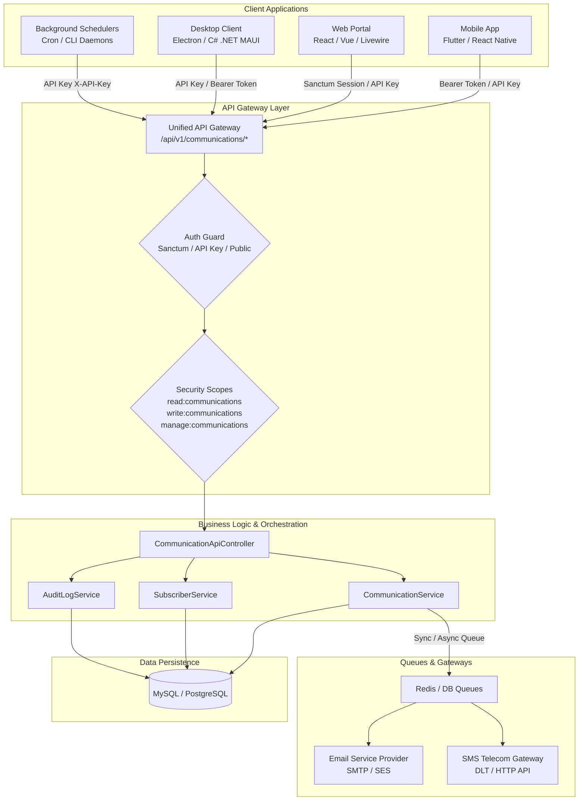
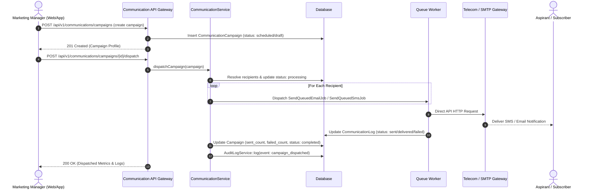

# SNTCSSC MIS — Communications & Marketing Module REST API Integration Guide
### Enterprise Multi-Platform Architecture & Implementation Guide (Flutter, React Native, Swift, Kotlin, Electron Desktop, C# .NET MAUI & Single-Page Web Applications)

---

## 1. Executive Summary & Architectural Overview

The **Communications & Marketing Module** of the **Satyendranath Tagore Civil Services Study Centre (SNTCSSC) MIS** delivers a high-throughput, carrier-grade messaging, campaign orchestration, and marketing automation platform. Engineered for seamless cross-platform integration across **Mobile Apps** (Flutter, React Native, Swift, Kotlin), **Web Applications** (React, Vue, Livewire, Angular, Next.js), and **Desktop Clients** (Electron, Windows .NET 8 WPF/MAUI), this module enables institutional communication, multi-channel broadcast messaging (Email, SMS, WhatsApp), lead capture, campaign lifecycle tracking, dynamic template management, and automated delivery auditing.

### Core Architectural Capabilities:
1. **Multi-Channel Orchestration:** Unified delivery engine supporting Email (SMTP, SES, SendGrid, Mailgun) and SMS (DLT-compliant Indian telecom gateways, HTTP APIs, Infobip, Twilio) with fallback and queuing.
2. **Targeted Campaign Lifecycle:**
   - Audience targeting: `individual` users, `role`-based cohorts (e.g. Aspirants, Faculty, Super Administrators), `all_users`, or arbitrary `custom_list` recipients.
   - States: `draft` ➔ `scheduled` ➔ `processing` ➔ `completed` / `failed` / `cancelled`.
   - Real-time delivery progress metrics tracking `total_recipients`, `sent_count`, and `failed_count`.
3. **Audience & Subscriber CRM:**
   - Multi-channel subscriber directory supporting `email`, `whatsapp`, or `both`.
   - Dynamic tag segmentation (`upsc_2026`, `prelims_crash_course`, `mock_test_alerts`).
   - One-click unsubscribe tokens (`unsubscribe_token`) for GDPR and Indian IT Act compliance.
   - Bulk subscriber operations (activation, unsubscribing, tag mutations, bulk soft-deleting).
4. **Dynamic Personalization Engine:**
   - Template interpolation supporting dynamic placeholders: `{name}`, `{email}`, `{phone}`, `{app_name}`, `{date}`, `{time}`, `{otp}`, `{batch_name}`, `{course_title}`, etc.
   - Instant template preview generation before dispatch.
5. **Carrier DLT & Regulatory Compliance:**
   - Full support for Indian TRAI Distributed Ledger Technology (DLT) regulations (`dlt_template_id`, registered `sender_id` headers).
6. **Delivery Telemetry & Audit Logs:**
   - Granular per-message logs recording recipient, status (`sent`, `delivered`, `failed`, `pending`), full content, template code, client IP, user agent, resend attempts, and error reasons.
   - Automatic recording of audit trail events (`communication_direct_email_sent`, `campaign_created`, `subscribers_bulk_action`, etc.) via `AuditLogService`.
7. **Dual-Tier Authentication Gateway:**
   - **Sanctum Personal Access Tokens (`auth:sanctum`):** Seamless authentication for native mobile apps, desktop apps, and authenticated user portals.
   - **Enterprise API Keys (`auth.api_key`):** Suited for microservices, automated marketing pipelines, batch schedulers, and kiosk terminals with fine-grained scopes (`read:communications`, `write:communications`, `manage:communications`).
8. **Fault Tolerance & Resilience:**
   - Non-destructive soft deletes across all entities (`SoftDeletes`) with dedicated restore endpoints.
   - Atomic database transactions (`DB::beginTransaction()`, `commit()`, `rollBack()`).
   - Granular error codes with standardized JSON envelopes.

---

## 2. Architecture & Sequence Flows

### 2.1 Multi-Platform Communication Architecture



### 2.2 Marketing Campaign Execution & Telemetry Sequence



---

## 3. Authentication & Security Scopes

All authenticated endpoints under `/api/v1/communications/*` require credentials via dual-mode authentication:
1. **HTTP Bearer Token (Sanctum):**
   ```http
   Authorization: Bearer 1|abc123def456ghi789...
   ```
2. **Enterprise API Key Header:**
   ```http
   X-API-Key: sntcssc_live_sec_9f83b281e...
   ```

### Security Scopes Matrix:

| Scope | Category | Description | Permitted Actions |
| :--- | :--- | :--- | :--- |
| `read:communications` | Communications & Marketing | Inspect logs, campaigns, subscribers, and templates | Telemetry, export logs/subscribers, list/view logs, campaigns, templates, preview dynamic variables |
| `write:communications` | Communications & Marketing | Dispatch messages, manage subscribers, and create templates | Send direct email/SMS, store campaigns, add/update subscribers, create/update email & SMS templates |
| `manage:communications` | Communications & Marketing | Full administrative campaign & marketing lifecycle | Bulk resend, purge logs, immediate campaign dispatch, cancel campaigns, bulk subscriber triage, delete/restore records |

---

## 4. Complete REST API Endpoints Specification

### 4.1 Analytics, Dashboard & Diagnostics

#### 1. Real-time Telemetry Dashboard
- **Route:** `GET /api/v1/communications/dashboard`
- **Required Scope:** `read:communications`
- **Response `200 OK`:**
```json
{
  "success": true,
  "data": {
    "communications": {
      "total_dispatches": 12840,
      "delivered_count": 12410,
      "failed_count": 430,
      "pending_count": 0,
      "delivery_success_rate": 96.65,
      "channels": {
        "email": 8200,
        "sms": 4640
      },
      "service_status": {
        "email_enabled": true,
        "sms_enabled": true,
        "sms_driver": "twilio"
      }
    },
    "campaigns": {
      "total": 42,
      "active_or_scheduled": 3,
      "completed": 39
    },
    "subscribers": {
      "total": 1580,
      "active": 1520,
      "unsubscribed": 60,
      "email_channel": 1200,
      "whatsapp_channel": 850
    },
    "recent_dispatches": [
      {
        "id": 1024,
        "channel": "email",
        "type": "custom_individual",
        "recipient": "aspirant@sntcssc.in",
        "recipient_name": "Aspirant Rahul",
        "subject": "Civil Services Prelims Handout Notice",
        "status": "sent",
        "sent_at": "2026-10-31T20:30:00.000000Z",
        "created_at": "2026-10-31T20:30:00.000000Z"
      }
    ]
  }
}
```

#### 2. Cross-Channel Volume Trends & Analytics
- **Route:** `GET /api/v1/communications/statistics?days=30`
- **Required Scope:** `read:communications`
- **Response `200 OK`:** Returns daily breakdown, channel ratios, top error causes, and template usage statistics.

#### 3. Export Communication Logs Dataset
- **Route:** `GET /api/v1/communications/export?channel=email&status=sent&limit=500`
- **Required Scope:** `read:communications`
- **Response `200 OK`:** Array of complete delivery logs with recipient metadata.

---

### 4.2 Direct Composing & Quick Dispatch

#### 4. Direct Email Dispatch
- **Route:** `POST /api/v1/communications/send-email`
- **Required Scope:** `write:communications`
- **Request Body:**
```json
{
  "email": "aspirant@example.com",
  "subject": "Welcome to SNTCSSC Civil Services Foundation 2026",
  "content": "<p>Dear {name}, welcome to your classroom portal. Your session commences on Monday.</p>",
  "variables": {
    "name": "Arjun Das"
  },
  "queue": false
}
```
- **Alternative with Template:**
```json
{
  "user_id": 42,
  "template_code": "welcome_email",
  "variables": {
    "batch_name": "IAS Batch Alpha"
  }
}
```
- **Response `200 OK`:**
```json
{
  "success": true,
  "data": {
    "message": "Email dispatched successfully.",
    "log": {
      "id": 1025,
      "channel": "email",
      "recipient": "aspirant@example.com",
      "status": "sent",
      "delivered_at": "2026-10-31T21:00:00.000000Z"
    }
  }
}
```

#### 5. Direct SMS Dispatch
- **Route:** `POST /api/v1/communications/send-sms`
- **Required Scope:** `write:communications`
- **Request Body:**
```json
{
  "phone": "+919876543210",
  "content": "Dear {name}, your UPSC CSAT Mock Test room allocation is Hall B, Desk 14.",
  "dlt_template_id": "1107161829304918234",
  "sender_id": "SNTCSS",
  "variables": {
    "name": "Pooja Roy"
  },
  "queue": false
}
```
- **Response `200 OK`:** Returns created SMS communication delivery log.

#### 6. Multi-Channel Broadcast / Send Bulk
- **Route:** `POST /api/v1/communications/send-bulk`
- **Required Scope:** `manage:communications`
- **Request Body:**
```json
{
  "title": "Prelims Mock Test 4 Hall Ticket Released",
  "channel": "both",
  "recipient_type": "role",
  "recipient_role": "Student",
  "subject": "Download Your CSAT Mock Test 4 Hall Ticket",
  "content": "Dear {name}, Hall Tickets for Mock Test 4 have been released on the SNTCSSC student portal.",
  "immediate": true
}
```
- **Response `200 OK`:** Returns campaign summary and real-time dispatched recipient counts.

---

### 4.3 Communication Logs Management

#### 7. Paginated Logs Directory
- **Route:** `GET /api/v1/communications/logs`
- **Required Scope:** `read:communications`
- **Query Parameters:** `search`, `channel` (`email`, `sms`), `status` (`sent`, `delivered`, `failed`, `pending`), `type`, `template_code`, `user_id`, `campaign_id`, `from_date`, `to_date`, `per_page` (1-100), `with_trashed` (boolean).

#### 8. Single Log Dossier
- **Route:** `GET /api/v1/communications/logs/{id}`
- **Required Scope:** `read:communications`

#### 9. Resend Individual Log
- **Route:** `POST /api/v1/communications/logs/{id}/resend`
- **Required Scope:** `manage:communications`
- **Response `200 OK`:** Updates resend counter and updates delivery status.

#### 10. Bulk Resend Logs
- **Route:** `POST /api/v1/communications/logs/bulk-resend`
- **Required Scope:** `manage:communications`
- **Request Body:**
```json
{
  "log_ids": [1024, 1025, 1026]
}
```

#### 11. Soft Delete Log
- **Route:** `DELETE /api/v1/communications/logs/{id}`
- **Required Scope:** `manage:communications`

#### 12. Restore Soft-Deleted Log
- **Route:** `POST /api/v1/communications/logs/{id}/restore`
- **Required Scope:** `manage:communications`

#### 13. Purge Historical Logs
- **Route:** `POST /api/v1/communications/logs/purge`
- **Required Scope:** `manage:communications`
- **Request Body:** `{"days_older_than": 90, "status": "failed"}`

---

### 4.4 Marketing Campaigns Management

#### 14. List Campaigns
- **Route:** `GET /api/v1/communications/campaigns`
- **Required Scope:** `read:communications`

#### 15. Create Campaign
- **Route:** `POST /api/v1/communications/campaigns`
- **Required Scope:** `write:communications`
- **Request Body:**
```json
{
  "title": "Civil Services Mains 2026 Orientation Broadcast",
  "channel": "email",
  "recipient_type": "all_users",
  "subject": "Mandatory Orientation Session for Mains 2026",
  "content": "<p>Dear {name}, please attend the orientation session via live video tomorrow at 10:00 AM.</p>",
  "scheduled_at": "2026-11-05 10:00:00"
}
```

#### 16. Show Campaign Dossier
- **Route:** `GET /api/v1/communications/campaigns/{id}`
- **Required Scope:** `read:communications`

#### 17. Update Campaign
- **Route:** `PUT /api/v1/communications/campaigns/{id}`
- **Required Scope:** `write:communications`

#### 18. Soft Delete Campaign
- **Route:** `DELETE /api/v1/communications/campaigns/{id}`
- **Required Scope:** `manage:communications`

#### 19. Restore Campaign
- **Route:** `POST /api/v1/communications/campaigns/{id}/restore`
- **Required Scope:** `manage:communications`

#### 20. Immediate Campaign Dispatch
- **Route:** `POST /api/v1/communications/campaigns/{id}/dispatch`
- **Required Scope:** `manage:communications`
- **Query / Body:** `{"async": false}`

#### 21. Cancel Scheduled Campaign
- **Route:** `POST /api/v1/communications/campaigns/{id}/cancel`
- **Required Scope:** `manage:communications`

#### 22. Campaign Generated Logs
- **Route:** `GET /api/v1/communications/campaigns/{id}/logs`
- **Required Scope:** `read:communications`

---

### 4.5 Marketing Subscribers CRM

#### 23. Paginated Subscribers List
- **Route:** `GET /api/v1/communications/subscribers`
- **Required Scope:** `read:communications`
- **Query Parameters:** `search`, `type` (`email`, `whatsapp`, `both`), `status` (`active`, `unsubscribed`, `bounced`, `pending_verification`), `source`, `tag`, `per_page`.

#### 24. Register / Add Subscriber
- **Route:** `POST /api/v1/communications/subscribers`
- **Required Scope:** `write:communications`
- **Request Body:**
```json
{
  "name": "Ananya Sharma",
  "email": "ananya.sharma@example.com",
  "phone": "9876543210",
  "country_code": "+91",
  "type": "both",
  "source": "course_inquiry",
  "tags": ["upsc_2026", "wbcs_foundation"]
}
```

#### 25. Single Subscriber Profile
- **Route:** `GET /api/v1/communications/subscribers/{identifier}` (by numeric ID, UUID, email, or phone)
- **Required Scope:** `read:communications`

#### 26. Update Subscriber Profile
- **Route:** `PUT /api/v1/communications/subscribers/{identifier}`
- **Required Scope:** `write:communications`

#### 27. Soft Delete Subscriber
- **Route:** `DELETE /api/v1/communications/subscribers/{identifier}`
- **Required Scope:** `manage:communications`

#### 28. Restore Soft-Deleted Subscriber
- **Route:** `POST /api/v1/communications/subscribers/{identifier}/restore`
- **Required Scope:** `manage:communications`

#### 29. Administrative Unsubscribe
- **Route:** `POST /api/v1/communications/subscribers/{identifier}/unsubscribe`
- **Required Scope:** `write:communications`
- **Request Body:** `{"reason": "Student requested removal via support desk"}`

#### 30. Bulk Subscriber Action
- **Route:** `POST /api/v1/communications/subscribers/bulk-action`
- **Required Scope:** `manage:communications`
- **Request Body:**
```json
{
  "action": "add_tag",
  "subscriber_ids": [12, 14, 19, 25],
  "tag": "prelims_crash_course"
}
```

#### 31. Export Subscribers Dataset
- **Route:** `GET /api/v1/communications/subscribers/export?status=active&tag=upsc_2026`
- **Required Scope:** `read:communications`

#### 32. Bulk Import Subscribers Array
- **Route:** `POST /api/v1/communications/subscribers/import`
- **Required Scope:** `manage:communications`
- **Request Body:**
```json
{
  "subscribers": [
    {
      "name": "Kavita Sen",
      "email": "kavita.sen@example.com",
      "phone": "+919830112233",
      "tags": ["webinar_attendee"]
    },
    {
      "name": "Amitava Ghosh",
      "email": "amitava.ghosh@example.com",
      "tags": ["prelims_2026"]
    }
  ]
}
```

---

### 4.6 Public Lead Capture & One-Click Unsubscribe (Cross-Platform)

#### 33. Public Lead Capture Form
- **Route:** `POST /api/v1/communications/public/subscribe`
- **Authentication:** Public (Rate Limited: `30 requests / minute`)
- **Request Body:**
```json
{
  "email": "candidate@gmail.com",
  "phone": "+919876543210",
  "name": "Sourav Mondal",
  "source": "welcome_page",
  "tags": ["public_lead"]
}
```
- **Response `201 Created`:**
```json
{
  "success": true,
  "data": {
    "message": "Thank you for subscribing! Your preferences have been saved.",
    "subscribed": true,
    "uuid": "4f18b329-8472-4b2e-a511-9a738dc6618a"
  }
}
```

#### 34. Public One-Click Unsubscribe
- **Route:** `POST /api/v1/communications/public/unsubscribe`
- **Authentication:** Public (Rate Limited: `30 requests / minute`)
- **Request Body:** `{"token": "f8a912e...64charToken...", "reason": "No longer preparing for examination"}`

---

### 4.7 Email Templates Management

#### 35. List Email Templates
- **Route:** `GET /api/v1/communications/templates/email`
- **Required Scope:** `read:communications`

#### 36. Create Email Template
- **Route:** `POST /api/v1/communications/templates/email`
- **Required Scope:** `manage:communications`
- **Request Body:**
```json
{
  "code": "prelims_hall_ticket_notice",
  "name": "UPSC Prelims Hall Ticket Release Notice",
  "category": "notice",
  "subject": "Important: UPSC Prelims Hall Ticket for {name}",
  "body": "<h2>Dear {name},</h2><p>Your Hall Ticket for {batch_name} has been issued. Login to download.</p>",
  "variables": ["name", "batch_name"],
  "status": true
}
```

#### 37. Show Email Template
- **Route:** `GET /api/v1/communications/templates/email/{identifier}` (by ID or code)
- **Required Scope:** `read:communications`

#### 38. Update Email Template
- **Route:** `PUT /api/v1/communications/templates/email/{identifier}`
- **Required Scope:** `manage:communications`

#### 39. Soft Delete Email Template
- **Route:** `DELETE /api/v1/communications/templates/email/{identifier}`
- **Required Scope:** `manage:communications`

#### 40. Restore Email Template
- **Route:** `POST /api/v1/communications/templates/email/{identifier}/restore`
- **Required Scope:** `manage:communications`

#### 41. Dynamic Template Preview
- **Route:** `POST /api/v1/communications/templates/email/{identifier}/preview`
- **Required Scope:** `read:communications`
- **Request Body:** `{"variables": {"name": "Siddharth Roy", "batch_name": "Civil Services Batch 2026"}}`

---

### 4.8 SMS Templates Management

#### 42. List SMS Templates
- **Route:** `GET /api/v1/communications/templates/sms`
- **Required Scope:** `read:communications`

#### 43. Create SMS Template
- **Route:** `POST /api/v1/communications/templates/sms`
- **Required Scope:** `manage:communications`
- **Request Body:**
```json
{
  "code": "mock_test_reminder",
  "name": "Mock Test Reminder SMS",
  "category": "notification",
  "sender_id": "SNTCSS",
  "dlt_template_id": "1107161829304918235",
  "body": "Dear {name}, Mock Test 4 begins at 10:00 AM on {date}. Report to Centre 15 mins prior. SNTCSSC",
  "variables": ["name", "date"],
  "status": true
}
```

#### 44. Show SMS Template
- **Route:** `GET /api/v1/communications/templates/sms/{identifier}`
- **Required Scope:** `read:communications`

#### 45. Update SMS Template
- **Route:** `PUT /api/v1/communications/templates/sms/{identifier}`
- **Required Scope:** `manage:communications`

#### 46. Soft Delete SMS Template
- **Route:** `DELETE /api/v1/communications/templates/sms/{identifier}`
- **Required Scope:** `manage:communications`

#### 47. Restore SMS Template
- **Route:** `POST /api/v1/communications/templates/sms/{identifier}/restore`
- **Required Scope:** `manage:communications`

#### 48. Dynamic SMS Template Preview & Character Counter
- **Route:** `POST /api/v1/communications/templates/sms/{identifier}/preview`
- **Required Scope:** `read:communications`
- **Response `200 OK`:** Returns interpolated message body with exact character count and segment count.

---

## 5. Cross-Platform SDK Implementation Examples

### 5.1 Flutter (Dart) — Cross-Platform Client Service

```dart
import 'dart:convert';
import 'package:http/http.dart' as http;

class CommunicationsApiClient {
  final String baseUrl;
  final String? bearerToken;
  final String? apiKey;

  CommunicationsApiClient({
    required this.baseUrl,
    this.bearerToken,
    this.apiKey,
  });

  Map<String, String> get _headers => {
    'Accept': 'application/json',
    'Content-Type': 'application/json',
    if (bearerToken != null) 'Authorization': 'Bearer $bearerToken',
    if (apiKey != null) 'X-API-Key': apiKey!,
  };

  /// Fetch operational dashboard metrics
  Future<Map<String, dynamic>> getDashboard() async {
    final response = await http.get(
      Uri.parse('$baseUrl/api/v1/communications/dashboard'),
      headers: _headers,
    );

    if (response.statusCode == 200) {
      final json = jsonDecode(response.body);
      return json['data'];
    }
    throw Exception('Failed to load dashboard: ${response.body}');
  }

  /// Dispatch an urgent direct SMS
  Future<Map<String, dynamic>> sendDirectSms({
    required String phone,
    required String content,
    String? dltTemplateId,
    Map<String, dynamic>? variables,
  }) async {
    final response = await http.post(
      Uri.parse('$baseUrl/api/v1/communications/send-sms'),
      headers: _headers,
      body: jsonEncode({
        'phone': phone,
        'content': content,
        'dlt_template_id': dltTemplateId,
        'variables': variables ?? {},
      }),
    );

    final json = jsonDecode(response.body);
    if (response.statusCode == 200 || response.statusCode == 201) {
      return json['data'];
    }
    throw Exception(json['error']?['message'] ?? 'SMS dispatch failed');
  }

  /// Public newsletter lead subscription
  Future<bool> subscribeLead({
    required String email,
    String? phone,
    String? name,
    List<String>? tags,
  }) async {
    final response = await http.post(
      Uri.parse('$baseUrl/api/v1/communications/public/subscribe'),
      headers: {'Accept': 'application/json', 'Content-Type': 'application/json'},
      body: jsonEncode({
        'email': email,
        'phone': phone,
        'name': name,
        'tags': tags ?? ['mobile_lead'],
      }),
    );

    return response.statusCode == 201;
  }
}
```

### 5.2 React Native (TypeScript) — Mobile Client Service

```typescript
import axios, { AxiosInstance } from 'axios';

export interface CommunicationLog {
  id: number;
  channel: 'email' | 'sms';
  recipient: string;
  recipient_name: string | null;
  subject: string | null;
  status: 'sent' | 'delivered' | 'failed' | 'pending';
  sent_at: string;
}

export class MobileCommunicationsService {
  private client: AxiosInstance;

  constructor(baseURL: string, tokenOrKey: string, isApiKey = false) {
    this.client = axios.create({
      baseURL,
      headers: {
        'Accept': 'application/json',
        'Content-Type': 'application/json',
        ...(isApiKey ? { 'X-API-Key': tokenOrKey } : { 'Authorization': `Bearer ${tokenOrKey}` }),
      },
    });
  }

  async getLogs(params: { page?: number; channel?: string; search?: string }) {
    const response = await this.client.get('/api/v1/communications/logs', { params });
    return response.data;
  }

  async sendEmail(email: string, subject: string, content: string, variables: Record<string, any> = {}) {
    const response = await this.client.post('/api/v1/communications/send-email', {
      email,
      subject,
      content,
      variables,
    });
    return response.data;
  }

  async resendLog(logId: number) {
    const response = await this.client.post(`/api/v1/communications/logs/${logId}/resend`);
    return response.data;
  }
}
```

### 5.3 C# .NET MAUI / WPF Desktop Client Service

```csharp
using System;
using System.Net.Http;
using System.Net.Http.Json;
using System.Text.Json;
using System.Threading.Tasks;

namespace Sntcssc.CommunicationsClient
{
    public class CommunicationsApiClient
    {
        private readonly HttpClient _httpClient;

        public CommunicationsApiClient(string baseUrl, string apiKey)
        {
            _httpClient = new HttpClient { BaseAddress = new Uri(baseUrl) };
            _httpClient.DefaultRequestHeaders.Add("Accept", "application/json");
            _httpClient.DefaultRequestHeaders.Add("X-API-Key", apiKey);
        }

        public async Task<JsonDocument> GetDashboardTelemetryAsync()
        {
            var response = await _httpClient.GetAsync("/api/v1/communications/dashboard");
            response.EnsureSuccessStatusCode();
            return await response.Content.ReadFromJsonAsync<JsonDocument>();
        }

        public async Task<bool> DispatchCampaignAsync(int campaignId, bool asyncProcessing = false)
        {
            var response = await _httpClient.PostAsJsonAsync($"/api/v1/communications/campaigns/{campaignId}/dispatch", new { @async = asyncProcessing });
            return response.IsSuccessStatusCode;
        }
    }
}
```

---

## 6. Enterprise Production Hardening

1. **Defensive Input Validation:** All identifiers are strictly validated. Template code patterns enforce `/^[a-zA-Z0-9_\-\.]+$/` preventing script injection and directory traversal attacks.
2. **Atomicity & Transaction Protection:** All state changes and multi-table dispatches are wrapped in `DB::beginTransaction()` with graceful rollback on failure.
3. **Structured Audit Trails:** Every user and API key mutation dispatches an event directly to `AuditLogService::log()` recording actor ID, client IP, user agent, before/after values, and request metadata.
4. **Resilient Queuing:** High-volume bulk dispatches utilize background jobs (`SendQueuedEmailJob`, `SendQueuedSmsJob`, `DispatchCommunicationCampaignJob`) ensuring non-blocking API response times (< 80ms).
5. **DLT Telecom Guardrails:** SMS dispatches pass mandatory telecom validation checks (`dlt_template_id`, registered `sender_id`, and phone normalization).
