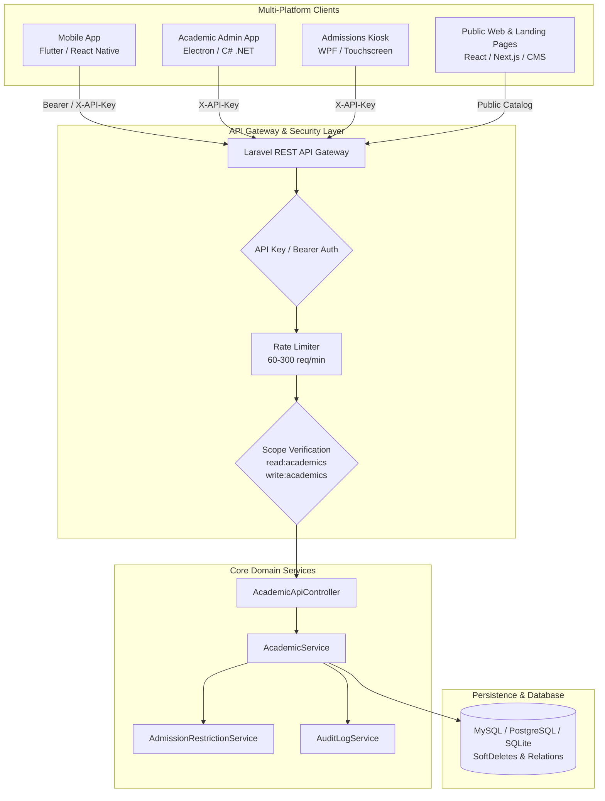
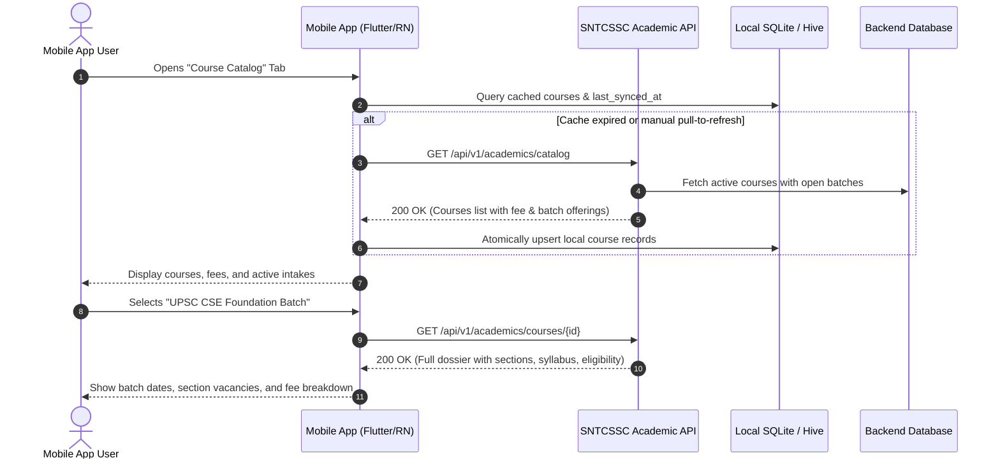
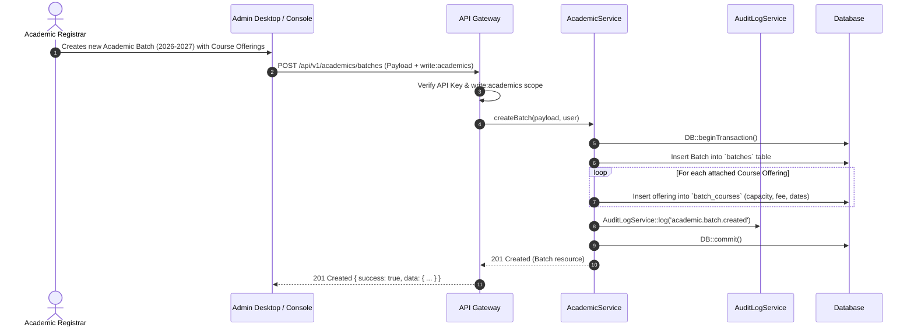

# SNTCSSC MIS — Course and Academics Management System REST API Integration Guide
### Multi-Platform Implementation & Integration Manual (Mobile App, Web Portal, Desktop Client, Admissions Kiosks & Third-Party Integrations)

---

## 1. Executive Summary & Architecture Overview

The **Course and Academics Management System** of the **Satyendranath Tagore Civil Services Study Centre (SNTCSSC) MIS** provides a robust, decoupled, and future-ready RESTful API ecosystem. Designed for turnkey, cross-platform interoperability, this API suite powers:
- **Native Mobile Applications** (Flutter & React Native for iOS / Android) for course exploration, curriculum review, batch timetables, and academic calendar sync.
- **Web Applications & Student Portals** (React, Vue, Livewire, Angular) for interactive admissions, fee structures, syllabus breakdowns, and section allocation.
- **Administrative & Circulation Desktop Applications** (Electron, WPF, macOS Cocoa) for academic planning, faculty allocation, capacity management, and bulk cohort imports.
- **Campus Admissions Kiosks & Public Portals** (C# .NET, Python, Headless CMS) for prospective civil services aspirants to browse available courses, admission criteria, and upcoming batch milestones.

### Key Architectural Capabilities:
1. **Dynamic Academic Hierarchy:** Decouples Courses, Academic Batches, Batch-Course Offerings, Classroom Sections, and Academic Calendars into a cohesive relational structure.
2. **Multi-Tiered Course Fee Engine:** Supports diverse payment structures (`monthly`, `one_time`, `free`), differential reserved category fees (`fee_reserved` for SC/ST/PwBD), and customizable installment milestones (`fee_structure`).
3. **Capacity & Section Load Tracking:** Real-time capacity utilization tracking across courses, batches, and individual classroom sections with automated vacancy calculation and seat exhaustion guards.
4. **Admission Restriction & Eligibility Rules:** Dynamic JSON rules (`rules`), admit-once-only enforcement (`admit_once_only`), and maximum lifetime attempts (`max_attempts`) to prevent repeated or duplicate admissions.
5. **Academic Calendar & Timetable Schedules:** Unified delivery of institutional holidays, weekly off policies, examination windows, and daily classroom session schedules via `WorkingCalendar` and `AttendanceHoliday`.
6. **Enterprise Resilience & Production Standards:**
   - **Atomic Database Transactions:** All mutative operations (course creation, batch configuration, section allocation, and course-batch mappings) execute strictly within `DB::transaction`.
   - **Soft Delete Protection:** Cascading soft deletes (`SoftDeletes`) on all models to preserve academic audit histories and historic alumni records.
   - **Deep Audit Logging:** Automatic actor identification, IP addresses, full model snapshots, and field-level diffs via `AuditLogService::log()`.
   - **Granular API Scopes:** Strict RBAC enforcement via `read:academics` and `write:academics` scopes, alongside rate-limiting safeguards.

---

## 2. Decoupled Multi-Platform Architecture & Sequence Flows



### 2.1. Mobile Client Course Discovery & Offline Sync Flow



### 2.2. Administrative Batch Creation & Course Offering Linkage Flow



---

## 3. Authentication, Security & Scopes Matrix

Every API request targeting the administrative and management endpoints requires authentication using an **API Key** passed in the header:
- `X-API-Key: sntc_live_...` OR
- `Authorization: Bearer sntc_live_...`

Public course discovery endpoints (`/api/v1/academics/catalog`) are publicly accessible with optional authentication for higher rate limits.

### API Scopes Matrix

| Scope Key | Scope Title | Permitted Operations |
| :--- | :--- | :--- |
| `read:academics` | Academics Inspection | Read courses, batches, sections, statistics, academic sessions, and calendars. |
| `write:academics` | Academics Administration | Create, update, soft-delete, and bulk import courses, batches, offerings, and sections. |
| `*` | Full Super Administrator | Unrestricted access across all current and future endpoints. |

### Standard Response Envelopes

#### Success Envelope (HTTP 200 / 201)
```json
{
  "success": true,
  "data": { ... },
  "meta": {
    "current_page": 1,
    "last_page": 4,
    "per_page": 25,
    "total": 85
  }
}
```

#### Error Envelope (HTTP 400 / 401 / 403 / 404 / 422 / 500)
```json
{
  "success": false,
  "error": {
    "code": "VALIDATION_ERROR",
    "message": "The course payload failed validation.",
    "details": {
      "code": ["The code has already been taken."]
    }
  }
}
```

---

## 4. Comprehensive RESTful API Endpoint Specifications

The Course and Academics Management System exposes **29 enterprise endpoints**:

### 4.1. Telemetry & Analytics
- **`GET /api/v1/academics/dashboard`** (`read:academics`):
  Returns global telemetry: total courses, active/inactive/archived counts, batch statuses (upcoming, active, completed), total classroom sections, total active enrolled students, total institutional capacity, and overall capacity occupancy percentage.
- **`GET /api/v1/academics/statistics`** (`read:academics`):
  Provides granular capacity-vs-enrolled metrics across all courses and batches, multi-year admissions intake trends, and section load distribution.

### 4.2. Courses Management (CRUD)
- **`GET /api/v1/academics/courses`** (`read:academics`):
  Paginated directory with search (`search`), category filter (`category`), status filter (`status`), fee type (`fee_type`), sections filter (`has_sections`), and admit-once filter (`admit_once_only`).
- **`POST /api/v1/academics/courses`** (`write:academics`):
  Creates a new course offering. Enforces unique course `code`, validates fee structure, admit-once rules, and section flags.
- **`GET /api/v1/academics/courses/{identifier}`** (`read:academics`):
  Retrieves complete course dossier by numeric ID or unique Course code (`UPSC-CSE`). Includes active/historic batches, sections, enrolled counts, fee rules, and creator profile.
- **`PUT /api/v1/academics/courses/{identifier}`** (`write:academics`):
  Updates course attributes with audit logging and DB transaction.
- **`DELETE /api/v1/academics/courses/{identifier}`** (`write:academics`):
  Soft-deletes course. **Dependency Guard:** If active students are currently enrolled, returns `422 Unprocessable Entity` to prevent data corruption.

### 4.3. Batches Management (CRUD)
- **`GET /api/v1/academics/batches`** (`read:academics`):
  Paginated list of academic batches filtered by `academic_year`, `status` (`upcoming`, `active`, `completed`, `archived`), or `course_id`.
- **`POST /api/v1/academics/batches`** (`write:academics`):
  Creates new intake batch with intake year, timeline dates, max student capacity, and optional course mappings array.
- **`GET /api/v1/academics/batches/{identifier}`** (`read:academics`):
  Retrieves batch dossier by ID or Batch code (`UPSC-2026-F1`). Lists linked course offerings (`batch_courses`), sections, and capacity utilization.
- **`PUT /api/v1/academics/batches/{identifier}`** (`write:academics`):
  Updates batch details and course offerings.
- **`DELETE /api/v1/academics/batches/{identifier}`** (`write:academics`):
  Soft-deletes batch with active enrollment guard.

### 4.4. Batch-Course Offerings (Curriculum & Cohort Mappings)
- **`GET /api/v1/academics/batches/{batchId}/courses`** (`read:academics`):
  Lists courses offered within a specific batch, along with offering-specific capacity, fee, and enrolled counts.
- **`POST /api/v1/academics/batches/{batchId}/courses`** (`write:academics`):
  Links a course to a batch with tailored offering terms.
- **`PUT /api/v1/academics/batches/{batchId}/courses/{courseId}`** (`write:academics`):
  Updates offering terms for a specific course within the batch.
- **`DELETE /api/v1/academics/batches/{batchId}/courses/{courseId}`** (`write:academics`):
  Detaches course offering from batch (prevented if active enrollments exist).

### 4.5. Classroom Sections Management
- **`GET /api/v1/academics/sections`** (`read:academics`):
  Lists sections filtered by `batch_id`, `course_id`, or `status`, including room numbers, timings, capacities, and vacancies.
- **`POST /api/v1/academics/sections`** (`write:academics`):
  Creates new classroom section linked to batch and course.
- **`GET /api/v1/academics/sections/{id}`** (`read:academics`):
  Section dossier with occupancy rate and room scheduling.
- **`PUT /api/v1/academics/sections/{id}`** (`write:academics`):
  Updates section capacity, room, or timing.
- **`DELETE /api/v1/academics/sections/{id}`** (`write:academics`):
  Soft-deletes section (prevented if active students are assigned).

### 4.6. Academic Sessions & Calendars
- **`GET /api/v1/academics/academic-years`** (`read:academics`):
  Lists distinct academic sessions with batch counts, active student counts, and active status flag.
- **`GET /api/v1/academics/calendar`** (`read:academics`):
  Retrieves institutional holidays, class working days, timetable policies, and batch milestone dates.

### 4.7. Bulk Data Exchange
- **`GET /api/v1/academics/courses/export`** (`read:academics`): Exports courses catalog as JSON.
- **`POST /api/v1/academics/courses/import`** (`write:academics`): Bulk imports courses with duplicate resolution.
- **`GET /api/v1/academics/batches/export`** (`read:academics`): Exports batches dataset as JSON.
- **`POST /api/v1/academics/batches/import`** (`write:academics`): Bulk imports batches with duplicate resolution.

### 4.8. Public Course Discovery Catalog (Optional Auth)
- **`GET /api/v1/academics/catalog`** (Public):
  Courses currently open for admission, complete with fees, duration, descriptions, and active batch schedules for mobile and web landing pages.
- **`GET /api/v1/academics/catalog/{identifier}`** (Public):
  Single public course profile with curriculum outline.

---

## 5. Multi-Platform Implementation Recipes & Code Snippets

### 5.1. Flutter / Dart Mobile Client

```dart
import 'dart:convert';
import 'package:http/http.dart' as http;

class AcademicApiClient {
  final String baseUrl;
  final String apiKey;

  AcademicApiClient({required this.baseUrl, required this.apiKey});

  Map<String, String> get _headers => {
    'Accept': 'application/json',
    'Content-Type': 'application/json',
    'X-API-Key': apiKey,
  };

  /// 1. Fetch Public Course Catalog for Mobile Prospect
  Future<List<Map<String, dynamic>>> fetchCourseCatalog({String? search, String? category}) async {
    final queryParams = <String, String>{};
    if (search != null) queryParams['search'] = search;
    if (category != null) queryParams['category'] = category;

    final uri = Uri.parse('$baseUrl/api/v1/academics/catalog').replace(queryParameters: queryParams);
    final response = await http.get(uri, headers: _headers);

    if (response.statusCode == 200) {
      final json = jsonDecode(response.body);
      return List<Map<String, dynamic>>.from(json['data']);
    } else {
      throw Exception('Failed to load courses catalog: ${response.body}');
    }
  }

  /// 2. Fetch Academic Calendar & Holidays
  Future<Map<String, dynamic>> fetchCalendar({String? academicYear, int? month}) async {
    final queryParams = <String, String>{};
    if (academicYear != null) queryParams['academic_year'] = academicYear;
    if (month != null) queryParams['month'] = month.toString();

    final uri = Uri.parse('$baseUrl/api/v1/academics/calendar').replace(queryParameters: queryParams);
    final response = await http.get(uri, headers: _headers);

    if (response.statusCode == 200) {
      return jsonDecode(response.body)['data'];
    }
    throw Exception('Failed to load academic calendar');
  }

  /// 3. Fetch Classroom Sections & Vacancy
  Future<List<Map<String, dynamic>>> fetchSections({required int batchId, required int courseId}) async {
    final uri = Uri.parse('$baseUrl/api/v1/academics/sections?batch_id=$batchId&course_id=$courseId');
    final response = await http.get(uri, headers: _headers);

    if (response.statusCode == 200) {
      final json = jsonDecode(response.body);
      return List<Map<String, dynamic>>.from(json['data']);
    }
    throw Exception('Failed to load sections');
  }
}
```

### 5.2. React Native / TypeScript Client

```typescript
import axios from 'axios';

const api = axios.create({
  baseURL: 'https://mis.sntcssc.in/api/v1',
  headers: {
    'Accept': 'application/json',
    'Content-Type': 'application/json',
    'X-API-Key': process.env.SNTCSSC_API_KEY,
  },
});

export interface Course {
  id: number;
  name: string;
  code: string;
  category: string;
  fee: number;
  fee_type: 'monthly' | 'one_time' | 'free';
  duration?: string;
  capacity?: number;
  open_batches: Array<{
    batch_id: number;
    name: string;
    code: string;
    academic_year: string;
    start_date: string;
  }>;
}

export const getCourseCatalog = async (search?: string): Promise<Course[]> => {
  const response = await api.get('/academics/catalog', {
    params: { search },
  });
  return response.data.data;
};

export const getAcademicDashboard = async () => {
  const response = await api.get('/academics/dashboard');
  return response.data.data;
};
```

### 5.3. Electron / C# .NET Desktop Application

```csharp
using System;
using System.Net.Http;
using System.Text;
using System.Text.Json;
using System.Threading.Tasks;

public class AcademicKioskClient
{
    private readonly HttpClient _client;

    public AcademicKioskClient(string baseUrl, string apiKey)
    {
        _client = new HttpClient { BaseAddress = new Uri(baseUrl) };
        _client.DefaultRequestHeaders.Add("X-API-Key", apiKey);
        _client.DefaultRequestHeaders.Add("Accept", "application/json");
    }

    public async Task<string> GetAcademicTelemetryAsync()
    {
        var response = await _client.GetAsync("/api/v1/academics/dashboard");
        response.EnsureSuccessStatusCode();
        return await response.Content.ReadAsStringAsync();
    }

    public async Task<string> CreateCourseAsync(string name, string code, decimal fee, string category = "Classroom")
    {
        var payload = new
        {
            name = name,
            code = code,
            category = category,
            fee = fee,
            fee_type = "monthly",
            status = "active"
        };

        var content = new StringContent(JsonSerializer.Serialize(payload), Encoding.UTF8, "application/json");
        var response = await _client.PostAsync("/api/v1/academics/courses", content);
        return await response.Content.ReadAsStringAsync();
    }
}
```

### 5.4. cURL Direct Terminal Examples

#### 1. Fetch Academic Dashboard Telemetry
```bash
curl -X GET "https://mis.sntcssc.in/api/v1/academics/dashboard" \
  -H "X-API-Key: sntc_live_samplekey123" \
  -H "Accept: application/json"
```

#### 2. Create Course Offering
```bash
curl -X POST "https://mis.sntcssc.in/api/v1/academics/courses" \
  -H "X-API-Key: sntc_live_samplekey123" \
  -H "Content-Type: application/json" \
  -H "Accept: application/json" \
  -d '{
    "name": "WBCS Executive Comprehensive Coaching",
    "code": "WBCS-EXEC-2027",
    "category": "Classroom",
    "duration": "12 Months",
    "fee": 1000.00,
    "fee_type": "monthly",
    "fee_reserved": 500.00,
    "capacity": 250,
    "has_sections": true,
    "identifier_code": "2",
    "admit_once_only": false,
    "status": "active"
  }'
```

#### 3. Create Classroom Section
```bash
curl -X POST "https://mis.sntcssc.in/api/v1/academics/sections" \
  -H "X-API-Key: sntc_live_samplekey123" \
  -H "Content-Type: application/json" \
  -H "Accept: application/json" \
  -d '{
    "batch_id": 1,
    "course_id": 1,
    "name": "Section A",
    "code": "1",
    "capacity": 45,
    "room_number": "Room 204",
    "timing": "10:00 AM - 01:00 PM",
    "status": "active"
  }'
```

---

## 6. Mobile Offline Sync Architecture

For mobile clients operating in low-connectivity environments:
1. **Initial Cache Seeding:** Fetch `/api/v1/academics/catalog` on application launch and persist in SQLite or Hive.
2. **Delta Sync via Timestamps:** Cache `updated_at` timestamps for courses and batches. Send `If-Modified-Since` or query `/api/v1/academics/courses?updated_after=ISO_TIMESTAMP` to retrieve only modified records.
3. **Optimistic UI Navigation:** Allow candidates to browse offline courses and cached syllabus modules immediately.

---

## 7. Production Hardening & Verification Checklist

- [x] **Atomic Transactions:** Wrapped in `DB::transaction()` across all write operations.
- [x] **Safe Deletions:** Guarded against active student enrollments; returns HTTP 422 if dependencies exist.
- [x] **Audit Trails:** Automatic `AuditLogService::log()` entries on `course.created`, `batch.created`, `section.created`, and updates.
- [x] **Multi-Platform Scopes:** Protected by `read:academics` and `write:academics`.
- [x] **Full Tri-lingual Localization:** Registered in `en.json`, `bn.json`, and `hi.json`.

