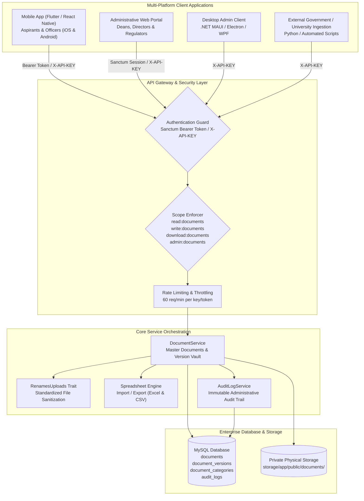
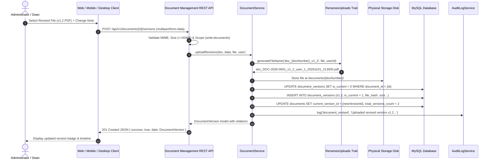
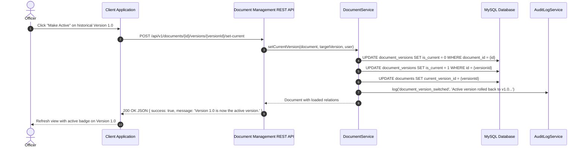

# Document Management & Version Control System REST API — Enterprise Multi-Platform Integration Guide
### Comprehensive Technical Specification & Client Integration Manual (Mobile App, Web Application, Desktop Client, & Third-Party Automation)

---

## 1. Executive Summary & Architectural Overview

The **Soft Copies Document Files Management & Version Control System** of the **Satyendranath Tagore Civil Services Study Centre (SNTCSSC) MIS** serves as the central digital repository and regulatory compliance vault for all institutional files. Across every academic and administrative cycle, educational institutes generate, ratify, and circulate diverse official documents:
- Academic Syllabi, Course Blueprints, and Curriculum Frameworks (UPSC CSE Prelims & Mains, WBCS)
- Statutory Regulations, Council Resolutions, and Government Gazette Orders
- Examination Rubrics, Model Answer Keys, and Evaluation Manuals
- Memoranda of Understanding (MoUs), Bilateral Tie-ups, and Institutional Agreements
- Audited Annual Accounts, Procurement Tenders, and Sanctioned Budgets
- Hostel Residence Bylaws, Code of Conduct, and Security Protocols
- Solved Question Compendiums, Previous Year Question (PYQ) Archives, and High-Resolution Brand Emblems

Because institutional documents evolve over time—such as annual syllabus adjustments or revised exam schedules—traditional file storage risks overwriting historical files or losing auditability. This module solves that challenge by providing **Immutable Multi-Version Archival**:
1. **Single Source of Truth:** Every master document points to an active current version (`is_current = true`), while all previous revisions (`v1.0`, `v1.1`, `v2.0`...) remain permanently archived with checksums, changelogs, and original filenames.
2. **Instant Multi-Version Retrieval:** Historical versions can be reviewed and downloaded at any time.
3. **Audit-Logged Rollback:** Authorized administrators can roll back the current active pointer to any past revision with full traceability.
4. **Standardized Renaming via `RenamesUploads`:** Files are securely stored with uniform timestamped, user-stamped identifiers preventing collisions and directory traversal.
5. **Cross-Platform Readiness:** Designed for consumption across iOS/Android mobile apps (Flutter, React Native), responsive web portals (React, Vue, Livewire), and desktop administrative consoles (.NET MAUI, Electron).

---

## 2. Multi-Platform System Architecture



---

## 3. Sequence Flows

### 3.1 Uploading a Revised Document Version



### 3.2 Rollback / Switching Active Version



---

## 4. Authentication, API Keys & Scopes

The Document Management API supports two authentication mechanisms:
1. **HTTP Bearer Token (Laravel Sanctum):** Recommended for mobile applications and authenticated web portal users.
2. **API Key Header (`X-API-KEY`):** Recommended for backend integrations, desktop administrative consoles, and automated scripts.

### Required Header Specification:
```http
X-API-KEY: sntc_live_9f82c0e14a72d4...
Accept: application/json
```

### Scopes Matrix:

| Scope | Category | Granted Capabilities |
| :--- | :--- | :--- |
| `read:documents` | Read | Query document directory, statistics, categories, versions, and metadata. |
| `write:documents` | Write | Create documents, upload revisions, update metadata, and create categories. |
| `download:documents` | Download | Stream/download physical version files (latest or historical). |
| `admin:documents` | Admin | Soft-delete, restore, rollback active version, and bulk spreadsheet import. |
| `*` | Super Admin | Unrestricted administrative access across all endpoints. |

---

## 5. Endpoints Reference

### Base URL:
`/api/v1/documents`

---

### 5.1 List Documents
- **Method:** `GET`
- **Path:** `/api/v1/documents`
- **Scope:** `read:documents`
- **Query Parameters:**
  - `q` *(string, optional)*: Search term matching title, document number, purpose, tags, or description.
  - `category_id` *(int, optional)*: Filter by category ID.
  - `department` *(string, optional)*: Filter by department (`Academics`, `Administration`, `Examinations`, etc.).
  - `file_type` *(string, optional)*: Filter by extension (`pdf`, `docx`, `xlsx`, `zip`, etc.).
  - `access_level` *(string, optional)*: `public`, `internal`, `confidential`, `restricted`.
  - `status` *(string, optional)*: `published`, `draft`, `archived`.
  - `sort_by` *(string, optional)*: `id`, `document_number`, `title`, `total_versions_count`, `total_downloads_count`, `created_at`. Default `id`.
  - `sort_order` *(string, optional)*: `asc` or `desc`. Default `desc`.
  - `per_page` *(int, optional)*: 1 to 100. Default 15.

#### Sample Response (`200 OK`):
```json
{
  "success": true,
  "data": [
    {
      "id": 1,
      "document_number": "DOC-2026-0001",
      "title": "Annual UPSC Mains Foundation Syllabus 2026-27",
      "purpose": "Curriculum Guidance & Syllabus Reference",
      "document_category_id": 1,
      "department": "Academics",
      "tags": ["syllabus", "upsc", "mains", "2026"],
      "access_level": "public",
      "status": "published",
      "total_versions_count": 2,
      "total_downloads_count": 142,
      "current_version_id": 2,
      "current_version": {
        "id": 2,
        "version_number": "1.1",
        "version_title": "Revised CSAT & Ethics Module",
        "file_type": "pdf",
        "mime_type": "application/pdf",
        "file_size": 2457600,
        "formatted_file_size": "2.34 MB",
        "original_file_name": "UPSC_Mains_Syllabus_2026_Rev1.1.pdf",
        "change_summary": "Incorporated updated CSAT analytical reasoning syllabus."
      },
      "category": {
        "id": 1,
        "name": "Academic Circulars & Syllabi",
        "icon": "graduation-cap",
        "color": "blue"
      }
    }
  ],
  "meta": {
    "current_page": 1,
    "last_page": 1,
    "per_page": 15,
    "total": 1
  }
}
```

---

### 5.2 Real-Time Statistics & Telemetry
- **Method:** `GET`
- **Path:** `/api/v1/documents/statistics`
- **Scope:** `read:documents`

#### Sample Response (`200 OK`):
```json
{
  "success": true,
  "data": {
    "total_documents": 28,
    "total_versions": 64,
    "total_downloads": 1890,
    "total_storage_bytes": 145892300,
    "storage_formatted": "139.13 MB",
    "categories_count": 8,
    "file_types": [
      { "file_type": "pdf", "count": 38 },
      { "file_type": "docx", "count": 12 },
      { "file_type": "xlsx", "count": 8 },
      { "file_type": "zip", "count": 6 }
    ]
  }
}
```

---

### 5.3 List Categories Taxonomy
- **Method:** `GET`
- **Path:** `/api/v1/documents/categories`
- **Scope:** `read:documents`

#### Sample Response (`200 OK`):
```json
{
  "success": true,
  "data": [
    {
      "id": 1,
      "name": "Academic Circulars & Syllabi",
      "slug": "academic-circulars-syllabi",
      "description": "Curriculum blueprints, session syllabi, and academic regulations.",
      "icon": "graduation-cap",
      "color": "blue",
      "documents_count": 14
    }
  ]
}
```

---

### 5.4 Create Category Taxonomy
- **Method:** `POST`
- **Path:** `/api/v1/documents/categories`
- **Scope:** `write:documents` or `admin:documents`
- **Headers:** `Content-Type: application/json`

#### Request Payload:
```json
{
  "name": "Annual Accreditation Reports",
  "description": "Institutional NAAC and state administrative performance reviews.",
  "icon": "clipboard-check",
  "color": "emerald",
  "display_order": 9
}
```

#### Sample Response (`201 Created`):
```json
{
  "success": true,
  "message": "Document category created successfully.",
  "data": {
    "id": 9,
    "name": "Annual Accreditation Reports",
    "slug": "annual-accreditation-reports",
    "icon": "clipboard-check",
    "color": "emerald",
    "display_order": 9,
    "is_active": true
  }
}
```

---

### 5.5 Get Document Details & Complete Revision History
- **Method:** `GET`
- **Path:** `/api/v1/documents/{id}`
- **Scope:** `read:documents`

#### Sample Response (`200 OK`):
```json
{
  "success": true,
  "data": {
    "id": 1,
    "document_number": "DOC-2026-0001",
    "title": "Annual UPSC Mains Foundation Syllabus 2026-27",
    "purpose": "Curriculum Guidance",
    "total_versions_count": 2,
    "current_version_id": 2,
    "versions": [
      {
        "id": 2,
        "version_number": "1.1",
        "revision_sequence": 2,
        "version_title": "Revised CSAT & Ethics Module",
        "file_type": "pdf",
        "file_size": 2457600,
        "formatted_file_size": "2.34 MB",
        "file_hash": "a1b2c3d4e5f67890abcdef1234567890abcdef1234567890abcdef1234567890",
        "change_summary": "Updated CSAT analytical reasoning syllabus.",
        "is_current": true,
        "download_count": 48,
        "created_at": "2026-11-01T14:30:00Z"
      },
      {
        "id": 1,
        "version_number": "1.0",
        "revision_sequence": 1,
        "version_title": "Initial Approved Release",
        "file_type": "pdf",
        "file_size": 2100000,
        "formatted_file_size": "2.00 MB",
        "file_hash": "fe01ab89cd4567890abcdef1234567890abcdef1234567890abcdef1234567890",
        "change_summary": "Initial document creation and upload.",
        "is_current": false,
        "download_count": 94,
        "created_at": "2026-10-15T09:00:00Z"
      }
    ]
  }
}
```

---

### 5.6 Upload New Document (Multipart Form)
- **Method:** `POST`
- **Path:** `/api/v1/documents`
- **Scope:** `write:documents`
- **Headers:** `Content-Type: multipart/form-data`
- **Form Fields:**
  - `file` *(binary file, required)*: PDF, Word, Excel, PPT, Image, Zip (max 50 MB).
  - `title` *(string, required)*: Document name/title.
  - `purpose` *(string, optional)*: Objective of the document.
  - `document_category_id` *(int, optional)*: Foreign key to category.
  - `department` *(string, optional)*: Department name.
  - `access_level` *(string, optional)*: `public`, `internal`, `confidential`, `restricted`. Default `internal`.
  - `status` *(string, optional)*: `published`, `draft`, `archived`. Default `published`.
  - `version_number` *(string, optional)*: Initial version code (e.g. `1.0`).
  - `version_title` *(string, optional)*: Headline for version (e.g. `Initial Approved Edition`).
  - `change_summary` *(string, optional)*: Initial revision note.
  - `effective_date` *(date string YYYY-MM-DD, optional)*.

#### Sample Response (`201 Created`):
```json
{
  "success": true,
  "message": "Document uploaded and registered successfully.",
  "data": {
    "id": 29,
    "document_number": "DOC-2026-0029",
    "title": "State Civil Services Ethics & Integrity Guidelines",
    "total_versions_count": 1,
    "current_version_id": 65,
    "current_version": {
      "id": 65,
      "version_number": "1.0",
      "original_file_name": "Ethics_Guidelines_2026.pdf",
      "file_type": "pdf",
      "formatted_file_size": "1.15 MB"
    }
  }
}
```

---

### 5.7 Upload Revised File Version
- **Method:** `POST`
- **Path:** `/api/v1/documents/{id}/versions`
- **Scope:** `write:documents`
- **Headers:** `Content-Type: multipart/form-data`
- **Form Fields:**
  - `file` *(binary file, required)*: Revised file (max 50 MB).
  - `version_number` *(string, required)*: Next version number (e.g. `1.1` or `2.0`).
  - `change_summary` *(string, required)*: Explanation of changes made.
  - `version_title` *(string, optional)*: Revision headline.
  - `change_description` *(string, optional)*: Extended changelog.
  - `effective_date` *(date string YYYY-MM-DD, optional)*.

#### Sample Response (`201 Created`):
```json
{
  "success": true,
  "message": "Revised version 1.1 uploaded successfully. Historical versions preserved.",
  "data": {
    "id": 66,
    "document_id": 29,
    "version_number": "1.1",
    "revision_sequence": 2,
    "version_title": "Updated Case Studies Module",
    "original_file_name": "Ethics_Guidelines_v1.1_Revised.pdf",
    "file_type": "pdf",
    "file_size": 1350000,
    "formatted_file_size": "1.29 MB",
    "is_current": true,
    "download_count": 0
  }
}
```

---

### 5.8 Rollback / Switch Active Version
- **Method:** `POST`
- **Path:** `/api/v1/documents/{id}/versions/{versionId}/set-current`
- **Scope:** `admin:documents` or `write:documents`

#### Sample Response (`200 OK`):
```json
{
  "success": true,
  "message": "Version 1.0 is now the active version.",
  "data": {
    "id": 29,
    "document_number": "DOC-2026-0029",
    "current_version_id": 65
  }
}
```

---

### 5.9 Download Document File
- **Latest / Active Version:** `GET /api/v1/documents/{id}/download`
- **Specific Historical Version:** `GET /api/v1/documents/{id}/versions/{versionId}/download`
- **Scope:** `download:documents` or `read:documents`
- **Response:** Binary file stream with original filename in `Content-Disposition` header.

---

### 5.10 Bulk Import Documents via Spreadsheet
- **Method:** `POST`
- **Path:** `/api/v1/documents/import`
- **Scope:** `admin:documents` or `write:documents`
- **Headers:** `Content-Type: multipart/form-data`
- **Form Fields:** `file` (Excel `.xlsx` or `.csv`, max 10 MB).

#### Sample Response (`200 OK`):
```json
{
  "success": true,
  "message": "Successfully imported 12 documents.",
  "data": {
    "imported": 12,
    "errors": []
  }
}
```

---

### 5.11 Export Documents Register
- **Method:** `GET`
- **Path:** `/api/v1/documents/export?format=csv` *(or format=xlsx or format=json)*
- **Scope:** `read:documents`

---

## 6. Multi-Platform Client Code Implementation Examples

### 6.1 cURL (CLI & Shell Automation)

```bash
# 1. Fetch real-time document repository telemetry
curl -X GET "https://mis.sntcssc.gov.in/api/v1/documents/statistics" \
  -H "X-API-KEY: sntc_live_your_api_key_here" \
  -H "Accept: application/json"

# 2. Upload a new document with initial file (v1.0)
curl -X POST "https://mis.sntcssc.gov.in/api/v1/documents" \
  -H "X-API-KEY: sntc_live_your_api_key_here" \
  -H "Accept: application/json" \
  -F "file=@/path/to/Syllabus_2026.pdf" \
  -F "title=UPSC Civil Services Foundation Syllabus 2026" \
  -F "purpose=Academic Guidance" \
  -F "department=Academics" \
  -F "access_level=public" \
  -F "version_number=1.0" \
  -F "change_summary=Initial approved edition upload"

# 3. Upload a revised version file (v1.1)
curl -X POST "https://mis.sntcssc.gov.in/api/v1/documents/1/versions" \
  -H "X-API-KEY: sntc_live_your_api_key_here" \
  -H "Accept: application/json" \
  -F "file=@/path/to/Syllabus_2026_v1.1.pdf" \
  -F "version_number=1.1" \
  -F "change_summary=Updated Mains optional papers list"

# 4. Download latest active document file
curl -X GET "https://mis.sntcssc.gov.in/api/v1/documents/1/download" \
  -H "X-API-KEY: sntc_live_your_api_key_here" \
  -OJ
```

---

### 6.2 Flutter / Dart (iOS & Android Mobile Applications)

```dart
import 'dart:io';
import 'package:http/http.dart' as http;
import 'dart:convert';

class DocumentApiService {
  static const String baseUrl = 'https://mis.sntcssc.gov.in/api/v1';
  final String apiKey;

  DocumentApiService({required this.apiKey});

  Map<String, String> get _headers => {
    'X-API-KEY': apiKey,
    'Accept': 'application/json',
  };

  /// Query documents with search and category filters
  Future<List<dynamic>> getDocuments({String? query, int? categoryId}) async {
    final uri = Uri.parse('$baseUrl/documents').replace(queryParameters: {
      if (query != null && query.isNotEmpty) 'q': query,
      if (categoryId != null) 'category_id': categoryId.toString(),
    });

    final response = await http.get(uri, headers: _headers);
    if (response.statusCode == 200) {
      final json = jsonDecode(response.body);
      return json['data'] as List<dynamic>;
    }
    throw Exception('Failed to load documents: ${response.statusCode}');
  }

  /// Upload revised file version
  Future<Map<String, dynamic>> uploadRevision({
    required int documentId,
    required File file,
    required String versionNumber,
    required String changeSummary,
  }) async {
    final uri = Uri.parse('$baseUrl/documents/$documentId/versions');
    final request = http.MultipartRequest('POST', uri)
      ..headers.addAll(_headers)
      ..fields['version_number'] = versionNumber
      ..fields['change_summary'] = changeSummary
      ..files.add(await http.MultipartFile.fromPath('file', file.path));

    final streamedResponse = await request.send();
    final response = await http.Response.fromStream(streamedResponse);

    if (response.statusCode == 201) {
      return jsonDecode(response.body)['data'] as Map<String, dynamic>;
    }
    throw Exception('Failed to upload revision: ${response.body}');
  }

  /// Download document file bytes
  Future<List<int>> downloadActiveDocument(int documentId) async {
    final uri = Uri.parse('$baseUrl/documents/$documentId/download');
    final response = await http.get(uri, headers: _headers);

    if (response.statusCode == 200) {
      return response.bodyBytes;
    }
    throw Exception('Download failed: ${response.statusCode}');
  }
}
```

---

### 6.3 React Native / TypeScript (Mobile iOS & Android)

```typescript
import axios from 'axios';

const api = axios.create({
  baseURL: 'https://mis.sntcssc.gov.in/api/v1',
  headers: {
    'X-API-KEY': 'sntc_live_your_api_key_here',
    'Accept': 'application/json',
  },
});

export interface DocumentItem {
  id: number;
  document_number: string;
  title: string;
  purpose?: string;
  department?: string;
  total_versions_count: number;
  current_version?: {
    id: number;
    version_number: string;
    original_file_name: string;
    formatted_file_size: string;
    file_type: string;
  };
}

export const fetchDocuments = async (query?: string): Promise<DocumentItem[]> => {
  const response = await api.get('/documents', { params: { q: query } });
  return response.data.data;
};

export const uploadDocumentRevision = async (
  documentId: number,
  fileUri: string,
  fileName: string,
  fileType: string,
  versionNumber: string,
  changeSummary: string
) => {
  const formData = new FormData();
  formData.append('version_number', versionNumber);
  formData.append('change_summary', changeSummary);
  formData.append('file', {
    uri: fileUri,
    name: fileName,
    type: fileType,
  } as any);

  const response = await api.post(`/documents/${documentId}/versions`, formData, {
    headers: { 'Content-Type': 'multipart/form-data' },
  });
  return response.data;
};

export const rollbackActiveVersion = async (documentId: number, versionId: number) => {
  const response = await api.post(`/documents/${documentId}/versions/${versionId}/set-current`);
  return response.data;
};
```

---

### 6.4 Python (Backend Data Ingestion & Automation Scripts)

```python
import requests

BASE_URL = "https://mis.sntcssc.gov.in/api/v1"
API_KEY = "sntc_live_your_api_key_here"

headers = {
    "X-API-KEY": API_KEY,
    "Accept": "application/json"
}

def upload_new_document(file_path: str, title: str, purpose: str, department: str = "Academics"):
    url = f"{BASE_URL}/documents"
    with open(file_path, "rb") as f:
        files = {"file": (file_path.split("/")[-1], f)}
        data = {
            "title": title,
            "purpose": purpose,
            "department": department,
            "access_level": "internal",
            "version_number": "1.0",
            "change_summary": "Initial programmatic document upload"
        }
        res = requests.post(url, headers=headers, data=data, files=files)
        res.raise_for_status()
        return res.json()["data"]

def download_latest_document(document_id: int, save_path: str):
    url = f"{BASE_URL}/documents/{document_id}/download"
    res = requests.get(url, headers=headers, stream=True)
    res.raise_for_status()
    with open(save_path, "wb") as f:
        for chunk in res.iter_content(chunk_size=8192):
            f.write(chunk)
    print(f"Document {document_id} saved to {save_path}")

# Example invocation
if __name__ == "__main__":
    doc = upload_new_document("CSE_Mains_Plan_2026.pdf", "Civil Services Mains Strategy 2026", "Study Blueprint")
    print(f"Created Document: {doc['document_number']} (ID: {doc['id']})")
    download_latest_document(doc['id'], "downloaded_mains_plan.pdf")
```

---

### 6.5 C# / .NET MAUI & WPF (Windows Desktop Application)

```csharp
using System;
using System.IO;
using System.Net.Http;
using System.Net.Http.Headers;
using System.Text.Json;
using System.Threading.Tasks;

public class DocumentApiClient
{
    private readonly HttpClient _httpClient;

    public DocumentApiClient(string apiKey)
    {
        _httpClient = new HttpClient { BaseAddress = new Uri("https://mis.sntcssc.gov.in/api/v1/") };
        _httpClient.DefaultRequestHeaders.Add("X-API-KEY", apiKey);
        _httpClient.DefaultRequestHeaders.Accept.Add(new MediaTypeWithQualityHeaderValue("application/json"));
    }

    public async Task<string> GetRepositoryStatisticsAsync()
    {
        var response = await _httpClient.GetAsync("documents/statistics");
        response.EnsureSuccessStatusCode();
        return await response.Content.ReadAsStringAsync();
    }

    public async Task<string> UploadRevisionAsync(int documentId, string filePath, string versionNumber, string changeSummary)
    {
        using var form = new MultipartFormDataContent();
        using var fileStream = File.OpenRead(filePath);
        using var fileContent = new StreamContent(fileStream);

        form.Add(fileContent, "file", Path.GetFileName(filePath));
        form.Add(new StringContent(versionNumber), "version_number");
        form.Add(new StringContent(changeSummary), "change_summary");

        var response = await _httpClient.PostAsync($"documents/{documentId}/versions", form);
        response.EnsureSuccessStatusCode();
        return await response.Content.ReadAsStringAsync();
    }

    public async Task DownloadActiveDocumentAsync(int documentId, string destinationFilePath)
    {
        var response = await _httpClient.GetAsync($"documents/{documentId}/download");
        response.EnsureSuccessStatusCode();
        await using var fs = new FileStream(destinationFilePath, FileMode.Create, FileAccess.Write, FileShare.None);
        await response.Content.CopyToAsync(fs);
    }
}
```

---

### 6.6 Electron / Node.js (Cross-Platform Desktop Client)

```javascript
const axios = require('axios');
const fs = require('fs');
const FormData = require('form-data');

const client = axios.create({
  baseURL: 'https://mis.sntcssc.gov.in/api/v1',
  headers: {
    'X-API-KEY': 'sntc_live_your_api_key_here',
    'Accept': 'application/json',
  },
});

async function uploadDocument(filePath, title, purpose) {
  const form = new FormData();
  form.append('file', fs.createReadStream(filePath));
  form.append('title', title);
  form.append('purpose', purpose);
  form.append('version_number', '1.0');
  form.append('change_summary', 'Uploaded via Desktop Electron App');

  const response = await client.post('/documents', form, {
    headers: form.getHeaders(),
  });
  return response.data;
}

async function downloadVersion(documentId, versionId, outputPath) {
  const response = await client.get(`/documents/${documentId}/versions/${versionId}/download`, {
    responseType: 'stream',
  });
  const writer = fs.createWriteStream(outputPath);
  response.data.pipe(writer);

  return new Promise((resolve, reject) => {
    writer.on('finish', resolve);
    writer.on('error', reject);
  });
}

module.exports = { uploadDocument, downloadVersion };
```

---

## 7. Security Best Practices & Governance

1. **Cryptographic Integrity (SHA-256):** Every physical file upload computes an immutable SHA-256 hash stored in `file_hash`. Client applications can verify file integrity post-download.
2. **Standardized Renaming via `RenamesUploads`:** Filenames are sanitized and stamped with `{type}_user_{id}_{timestamp}.{ext}`, preventing file overwrite attacks and directory traversal vulnerabilities.
3. **MIME Type Whitelisting:** Strictly enforces institutional extensions: `.pdf`, `.doc`, `.docx`, `.xls`, `.xlsx`, `.csv`, `.ppt`, `.pptx`, `.jpg`, `.jpeg`, `.png`, `.webp`, `.zip`, `.rar`, `.7z`, `.tar`, `.gz`, `.txt`, `.rtf`. Executable extensions (`.exe`, `.php`, `.sh`, `.bat`) are immediately rejected.
4. **Permanent Audit Logs:** All creation, revision, rollback, metadata modification, download, soft-delete, and restoration actions are recorded in `audit_logs` with actor details, timestamps, and IP addresses via `AuditLogService`.
5. **Soft Delete Archival:** Deleting a document does not delete files from disk; records are marked with `deleted_at` and can be restored using `POST /api/v1/documents/{id}/restore`.

