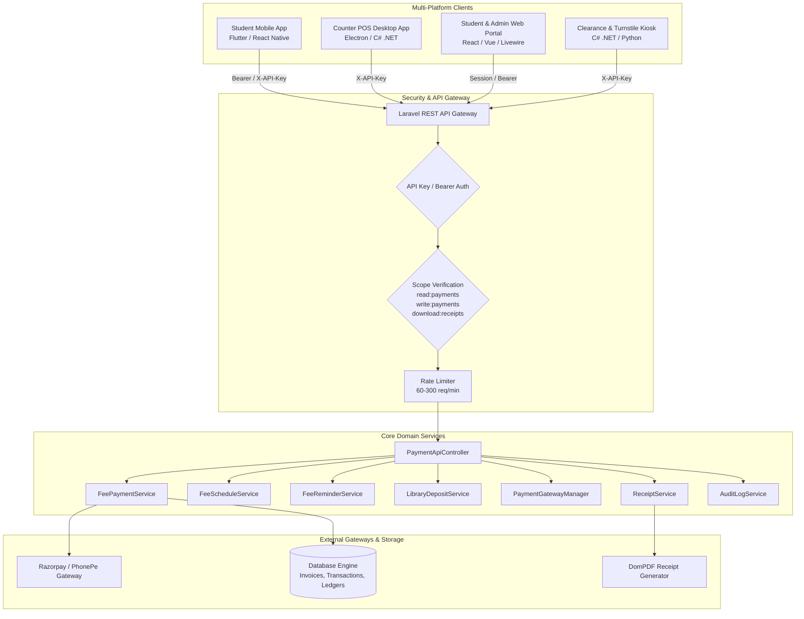
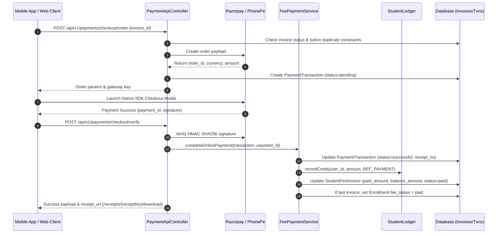

# SNTCSSC MIS — Fee & Payment Collection System REST API Integration Guide
### Multi-Platform Implementation & Integration Manual (Student Mobile App, Web Portal, Desktop Counter POS, Campus Kiosks & Bank Reconciliation)

---

## 1. Executive Summary & Architecture Overview

The **Fee and Payment Collection System** of the **Satyendranath Tagore Civil Services Study Centre (SNTCSSC) MIS** delivers an enterprise-grade, highly resilient, and future-ready RESTful financial API ecosystem. Architected specifically for cross-platform interoperability, this API suite decouples financial operations from frontend views and provides turnkey integration across:
- **Student Native Mobile Applications** (Flutter & React Native for iOS / Android) for checking monthly tuition fee dues, viewing detailed invoice breakdowns, executing instant UPI / NetBanking / Card payments via payment gateways, submitting offline bank transaction references with proof slips, and downloading verified PDF receipts.
- **Web Applications & Student Self-Service Portals** (React, Vue, Livewire, Angular) for student fee statements, personal running financial ledgers, and seamless online checkout modals.
- **Administrative & Counter POS Desktop Applications** (Electron & C# .NET) for counter cashiers and accounts officers to record direct counter payments (Cash, POS Terminal Card, Cheque, Demand Draft, Counter UPI), generate instant receipts, manage fee types, dispatch fee reminders, and adjust invoice balances.
- **Campus Turnstiles, Library Gateways & Verification Kiosks** (C# .NET, Python, Touchscreen Kiosks) for verifying real-time student institutional clearance (`/api/v1/payments/students/{id}/clearance`) across tuition, library deposits/fines, hostel rent, and examination fees before granting campus entry, issuing admit cards, or approving course completions.
- **Bank Settlement & Accounting Reconciliations** for automating bank statement UTR matching against pending offline submissions and streaming structured financial audits.

### Key Architectural Capabilities:
1. **Dynamic Multi-Tiered Fee Catalog:** Configurable fee types (`tuition`, `admission`, `library_security`, `examination`, `id_card_replacement`, `fine`, `miscellaneous`) supporting varying billing cycles (`monthly`, `one_time`, `quarterly`, `yearly`, `weekly`) and refundable deposit tracking.
2. **Automated Batch Scheduling & Concession Pricing Engine:** Initiates cohort-wide monthly billing schedules that automatically generate individual student invoices while dynamically applying social category concessions (General UR ₹1000/mo vs Reserved SC/ST/OBC ₹500/mo) based on verified `student_profiles.category`.
3. **Double-Entry Student Financial Ledgers:** Immutable ledger auditing where every invoice creation posts an automated debit entry (`StudentLedger::ENTRY_DEBIT`), and every verified payment, waiver, or adjustment posts a corresponding credit entry (`StudentLedger::ENTRY_CREDIT`) maintaining a real-time running liability balance.
4. **Strict Tuition Payment Integrity:** Enforces the institutional constraint that a student may only pay tuition fees once per academic month, preventing accidental duplicate billing across concurrent channels.
5. **Decoupled Online Gateway Integration:** Pre-configured support for **Razorpay**, **PhonePe**, **CCAvenue**, and **Offline Gateway** with HMAC signature verification and webhook settlement.
6. **Enterprise Resilience & Production Standards:**
   - **Atomic Database Transactions:** All mutative financial operations execute strictly within `DB::transaction`, guaranteeing zero orphaned records or state desynchronization.
   - **Soft Delete Safeguards (`SoftDeletes`):** Preserves complete historical audit trails. Enforces active dependency guards (`ACTIVE_DEPENDENCY_PREVENTED` and `INVOICE_DELETE_DENIED`) preventing deletion of fee types, schedules, or invoices that have collected transactions.
   - **Comprehensive Audit Trails:** Automatic actor identification, IP addresses, full model snapshots, and field-level diffs via `AuditLogService::log()`.
   - **Granular API Scopes:** Strict RBAC enforcement via `read:payments`, `write:payments`, and `download:receipts` scopes.

---

## 2. Decoupled Multi-Platform Architecture & Sequence Flows



### 2.1 Online Checkout & Settlement Sequence Flow



---

## 3. Security, Authentication & Granular Scope Governance

All Fee & Payment API requests must be authenticated via either:
1. **API Key Header:** `X-API-Key: sntc_live_...`
2. **Bearer Token:** `Authorization: Bearer sntc_live_...`
3. **Session Authentication:** Authenticated student / staff web sessions for self-service portal endpoints.

### API Scopes:
| Scope | Permission Level | Description |
| :--- | :--- | :--- |
| `read:payments` | Read-Only | Browse fee types, schedules, invoices, transactions, ledgers, and student clearance statuses. |
| `write:payments` | Read/Write | Initiate schedules, issue invoices, record counter collections, verify offline slips, approve/disburse deposit refunds, and run bank reconciliations. |
| `download:receipts` | Stream/Binary | Stream or download official printable PDF fee receipts and tax invoices. |

---

## 4. Complete API Endpoints Catalog (43 Endpoints)

| Method | Endpoint Path | Required Scope | Primary Purpose |
| :--- | :--- | :--- | :--- |
| `GET` | `/api/v1/payments/dashboard` | `read:payments` | Executive telemetry: total collected, pending balance, overdue counts, monthly revenue trends. |
| `GET` | `/api/v1/payments/statistics` | `read:payments` | Granular analytics: collections by fee type, course, batch, caste concession, and ledgers. |
| `GET` | `/api/v1/payments/fee-types` | `read:payments` | List fee types with category, frequency, default amount, and refundable flags. |
| `POST` | `/api/v1/payments/fee-types` | `write:payments` | Create a new institutional fee type. |
| `GET` | `/api/v1/payments/fee-types/{id}` | `read:payments` | Single fee type dossier with attached schedules and invoices count. |
| `PUT` | `/api/v1/payments/fee-types/{id}` | `write:payments` | Update fee type attributes, amount, or status. |
| `DELETE` | `/api/v1/payments/fee-types/{id}` | `write:payments` | Soft delete fee type (blocked if active schedules or invoices exist). |
| `GET` | `/api/v1/payments/schedules` | `read:payments` | Search and paginate cohort fee schedules by batch, course, or period. |
| `POST` | `/api/v1/payments/schedules` | `write:payments` | Initiate batch fee schedule; generates student invoices with category concession & ledger debits. |
| `GET` | `/api/v1/payments/schedules/{id}` | `read:payments` | Schedule dossier with targeted students count, invoice breakdown, and total collected. |
| `POST` | `/api/v1/payments/schedules/{id}/reminders` | `write:payments` | Bulk dispatch reminders (database, SMS, email) for pending schedule invoices. |
| `POST` | `/api/v1/payments/schedules/{id}/revert` | `write:payments` | Revert uncollected invoices for schedule and reverse ledger liability entries. |
| `DELETE` | `/api/v1/payments/schedules/{id}` | `write:payments` | Delete uncollected schedule and associated invoices. |
| `GET` | `/api/v1/payments/invoices` | `read:payments` | Search, filter, and paginate student fee invoices. |
| `POST` | `/api/v1/payments/invoices` | `write:payments` | Issue an individual ad-hoc invoice for a student with automatic ledger debit. |
| `GET` | `/api/v1/payments/invoices/{identifier}` | `read:payments` | Single invoice profile with student info, course, breakdown, and payments list. |
| `PUT` | `/api/v1/payments/invoices/{identifier}` | `write:payments` | Update invoice due date, discount, late fee, or remarks with ledger adjustment. |
| `POST` | `/api/v1/payments/invoices/{identifier}/cancel` | `write:payments` | Cancel unpaid/partial invoice and credit/release student ledger liability. |
| `DELETE` | `/api/v1/payments/invoices/{identifier}` | `write:payments` | Soft delete uncollected invoice (blocked if payments exist). |
| `POST` | `/api/v1/payments/invoices/{identifier}/remind` | `write:payments` | Send reminder notification for a specific invoice. |
| `GET` | `/api/v1/payments/transactions` | `read:payments` | Search, filter, and paginate payment transactions across methods and statuses. |
| `POST` | `/api/v1/payments/transactions/collect` | `write:payments` | Direct manual/counter fee collection (Cash, POS Card, Cheque, DD, UPI, NEFT) with instant receipt. |
| `POST` | `/api/v1/payments/transactions/offline` | `write:payments` | Submit offline payment slip with bank UTR reference for administrative review. |
| `POST` | `/api/v1/payments/transactions/{id}/verify` | `write:payments` | Review and approve or decline offline student payment submission. |
| `GET` | `/api/v1/payments/transactions/{identifier}` | `read:payments` | Single transaction profile by ID, transaction number, or receipt number. |
| `GET` | `/api/v1/payments/transactions/{identifier}/receipt` | `read:payments,download:receipts` | Stream or download official PDF payment receipt. |
| `GET` | `/api/v1/payments/receipts/{receiptNo}/download` | `Optional API Key` | Direct streaming download of printable PDF receipt. |
| `POST` | `/api/v1/payments/checkout/order` | `read:payments,write:payments` | Initiate online gateway payment order (Razorpay / PhonePe / CCAvenue). |
| `POST` | `/api/v1/payments/checkout/verify` | `write:payments` | Verify and settle online gateway payment callback / webhook. |
| `GET` | `/api/v1/payments/my-invoices` | `read:payments / Student Auth` | Authenticated student's fee invoices feed. |
| `GET` | `/api/v1/payments/my-transactions` | `read:payments / Student Auth` | Authenticated student's payment history and receipts. |
| `GET` | `/api/v1/payments/my-ledger` | `read:payments / Student Auth` | Authenticated student's personal running ledger statement. |
| `POST` | `/api/v1/payments/my-offline-payment` | `write:payments / Student Auth` | Student self-submits offline bank reference and transaction slip. |
| `GET` | `/api/v1/payments/ledgers` | `read:payments` | System-wide student ledgers log (debits, credits, adjustments). |
| `GET` | `/api/v1/payments/students/{studentId}/ledger` | `read:payments` | Comprehensive financial ledger statement for a specific student. |
| `GET` | `/api/v1/payments/students/{studentId}/clearance` | `read:payments` | Student financial clearance check across tuition, library, hostel, exam dues. |
| `GET` | `/api/v1/payments/library-deposits` | `read:payments` | Query library security deposits by status (active, refund_requested, approved, refunded). |
| `POST` | `/api/v1/payments/library-deposits` | `write:payments` | Record direct library security deposit on admission. |
| `POST` | `/api/v1/payments/library-deposits/{id}/request-refund` | `write:payments` | Request deposit refund with student bank account details. |
| `POST` | `/api/v1/payments/library-deposits/{id}/approve-refund` | `write:payments` | Staff approval of library deposit refund (requires librarian clearance). |
| `POST` | `/api/v1/payments/library-deposits/{id}/reject-refund` | `write:payments` | Staff rejection of refund with reason notes. |
| `POST` | `/api/v1/payments/library-deposits/{id}/disburse` | `write:payments` | Record bank UTR disbursement reference and settle deposit. |
| `GET` | `/api/v1/payments/export` | `read:payments` | Export transactions dataset as structured JSON. |
| `POST` | `/api/v1/payments/reconciliation/import` | `write:payments` | Bulk reconcile transactions against bank settlement UTR feed. |

---

## 5. Detailed Endpoint Contracts & JSON Specifications

### 5.1. Counter Payment Collection (Cash / POS Terminal / Cheque / DD)
- **Endpoint:** `POST /api/v1/payments/transactions/collect`
- **Scope:** `write:payments`
- **Request Payload:**
```json
{
  "student_identifier": "STU-2026-0042",
  "invoice_id": 14,
  "amount": 1000.00,
  "payment_method": "cash",
  "remarks": "Received at administrative counter desk",
  "period_month": 11,
  "period_year": 2026
}
```
- **Response Payload (201 Created):**
```json
{
  "success": true,
  "data": {
    "id": 105,
    "transaction_no": "TXN-2026-00105",
    "receipt_no": "REC-2026-00089",
    "receipt_url": "http://localhost:8000/api/v1/payments/receipts/REC-2026-00089/download",
    "invoice_id": 14,
    "invoice_no": "INV-2026-00014",
    "student_id": "STU-2026-0042",
    "student_name": "Sourav Mukherjee",
    "amount": 1000.00,
    "currency": "INR",
    "gateway": "offline",
    "payment_method": "cash",
    "status": "successful",
    "is_offline": true,
    "offline_reference_id": "COUNTER-20261031153000",
    "offline_payment_date": "2026-10-31",
    "user_remarks": "Received at administrative counter desk",
    "admin_remarks": "Direct manual payment recorded by staff User #1",
    "verified_at": "2026-10-31T15:30:00+05:30",
    "created_at": "2026-10-31T15:30:00+05:30"
  },
  "meta": {
    "message": "Payment collected successfully. Receipt No: REC-2026-00089"
  }
}
```

### 5.2. Student Financial Clearance Verification
- **Endpoint:** `GET /api/v1/payments/students/{studentId}/clearance`
- **Scope:** `read:payments`
- **Response Payload (When Cleared - 200 OK):**
```json
{
  "success": true,
  "data": {
    "student": {
      "id": 42,
      "student_id": "STU-2026-0042",
      "name": "Sourav Mukherjee",
      "email": "sourav@example.com"
    },
    "is_cleared": true,
    "total_outstanding_amount": 0.00,
    "dues_breakdown": [],
    "clearance_token": "a1b2c3d4e5f6...",
    "verified_at": "2026-10-31T15:35:00+05:30"
  }
}
```
- **Response Payload (When Dues Exist - 200 OK):**
```json
{
  "success": true,
  "data": {
    "student": {
      "id": 42,
      "student_id": "STU-2026-0042",
      "name": "Sourav Mukherjee",
      "email": "sourav@example.com"
    },
    "is_cleared": false,
    "total_outstanding_amount": 1500.00,
    "dues_breakdown": [
      {
        "module": "tuition",
        "description": "Unpaid Academic Tuition Fees",
        "amount": 1000.00,
        "invoices_count": 1
      },
      {
        "module": "library",
        "description": "Unpaid Library Overdue Fines",
        "amount": 500.00
      }
    ],
    "clearance_token": null,
    "verified_at": "2026-10-31T15:35:00+05:30"
  }
}
```

---

## 6. Multi-Platform Implementation & Code Samples

### 6.1. Mobile Application (Flutter / Dart)
```dart
import 'dart:convert';
import 'package:http/http.dart' as http;

class SntcsscPaymentService {
  final String baseUrl;
  final String apiKey;

  SntcsscPaymentService({required this.baseUrl, required this.apiKey});

  Map<String, String> get _headers => {
    'Content-Type': 'application/json',
    'Accept': 'application/json',
    'X-API-Key': apiKey,
  };

  // 1. Fetch Student Invoices
  Future<List<dynamic>> getMyInvoices() async {
    final res = await http.get(Uri.parse('$baseUrl/payments/my-invoices'), headers: _headers);
    if (res.statusCode == 200) {
      return jsonDecode(res.body)['data'];
    }
    throw Exception('Failed to load invoices');
  }

  // 2. Initiate Online Payment Order
  Future<Map<String, dynamic>> createCheckoutOrder(int invoiceId, {String gateway = 'razorpay'}) async {
    final res = await http.post(
      Uri.parse('$baseUrl/payments/checkout/order'),
      headers: _headers,
      body: jsonEncode({'invoice_id': invoiceId, 'gateway': gateway}),
    );
    if (res.statusCode == 200) {
      return jsonDecode(res.body)['data'];
    }
    throw Exception('Failed to create checkout order');
  }

  // 3. Submit Offline UPI / NEFT Payment Slip
  Future<Map<String, dynamic>> submitOfflinePayment({
    required int invoiceId,
    required double amount,
    required String referenceId,
    required String paymentDate,
    String? remarks,
  }) async {
    final res = await http.post(
      Uri.parse('$baseUrl/payments/my-offline-payment'),
      headers: _headers,
      body: jsonEncode({
        'invoice_id': invoiceId,
        'amount': amount,
        'payment_method': 'upi',
        'offline_reference_id': referenceId,
        'offline_payment_date': paymentDate,
        'user_remarks': remarks,
      }),
    );
    return jsonDecode(res.body);
  }
}
```

### 6.2. Desktop Counter Cash Register (C# .NET)
```csharp
using System;
using System.Net.Http;
using System.Text;
using System.Text.Json;
using System.Threading.Tasks;

public class SntcsscPosClient
{
    private readonly HttpClient _http;

    public SntcsscPosClient(string baseUrl, string apiKey)
    {
        _http = new HttpClient { BaseAddress = new Uri(baseUrl) };
        _http.DefaultRequestHeaders.Add("X-API-Key", apiKey);
        _http.DefaultRequestHeaders.Add("Accept", "application/json");
    }

    // Direct Cash / POS Terminal Collection
    public async Task<string> CollectPaymentAsync(string studentId, int invoiceId, decimal amount, string method)
    {
        var payload = new
        {
            student_identifier = studentId,
            invoice_id = invoiceId,
            amount = amount,
            payment_method = method,
            remarks = "POS Counter Collection"
        };

        var content = new StringContent(JsonSerializer.Serialize(payload), Encoding.UTF8, "application/json");
        var res = await _http.PostAsync("/api/v1/payments/transactions/collect", content);
        res.EnsureSuccessStatusCode();

        var body = await res.Content.ReadAsStringAsync();
        using var doc = JsonDocument.Parse(body);
        return doc.RootElement.GetProperty("data").GetProperty("receipt_no").GetString();
    }
}
```

---

## 7. Error Handling & Standardized Status Codes

| Error Code | HTTP Status | Description | Recommended Client Action |
| :--- | :---: | :--- | :--- |
| `API_KEY_MISSING` | `401` | No `X-API-Key` or Bearer token provided in headers. | Prompt administrator or mobile app configuration. |
| `INSUFFICIENT_SCOPE` | `403` | API key lacks `read:payments` or `write:payments`. | Request elevated scopes in Developer Console. |
| `INVOICE_NOT_FOUND` | `404` | Specified invoice ID or number does not exist. | Verify invoice identifier. |
| `DUPLICATE_TUITION_INVOICE` | `409` | Tuition invoice already exists for this student and month. | Prevent duplicate monthly fee creation. |
| `INVOICE_ALREADY_PAID` | `400` | Attempting to checkout or modify an already paid invoice. | Advise student that payment is already completed. |
| `ACTIVE_DEPENDENCY_PREVENTED`| `409` | Cannot delete fee type because active invoices/schedules exist. | Deactivate status instead of deleting. |
| `INVOICE_DELETE_DENIED` | `422` | Invoice cannot be deleted because payments are linked to it. | Cancel or waive invoice instead of deleting. |

