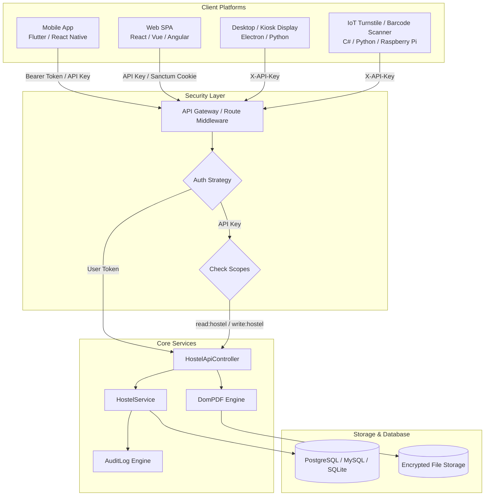
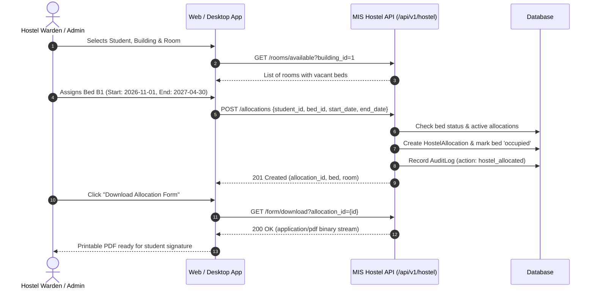
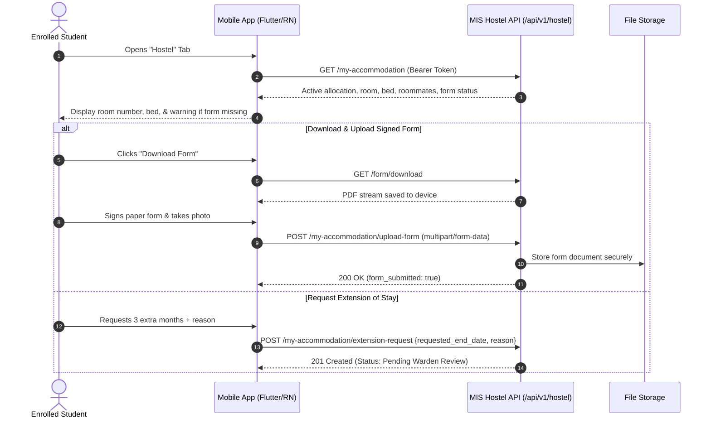
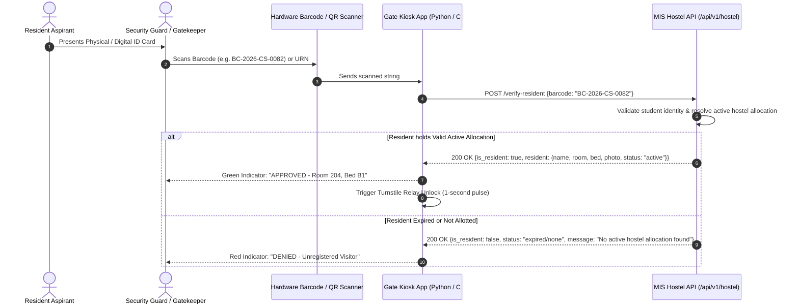
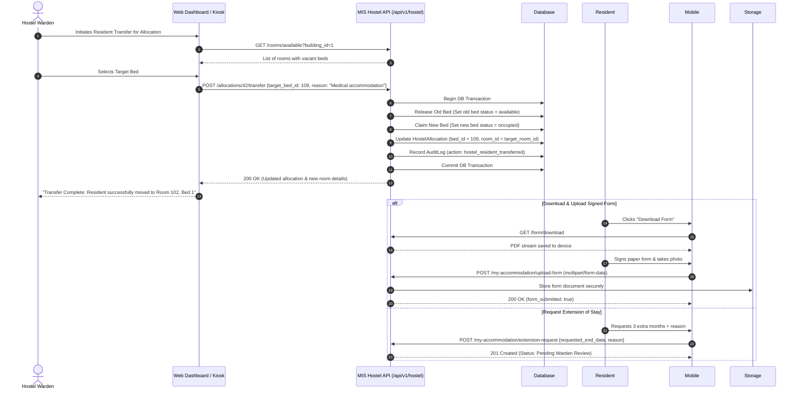

# SNTCSSC MIS — Hostel Management REST API Integration Guide
### Multi-Platform Implementation & Integration Guide (Mobile, Web, Desktop & IoT Kiosks)

---

## 1. Executive Summary & Architecture Overview

The **Hostel Management Module** of the **Satyendranath Tagore Civil Services Study Centre (SNTCSSC) MIS** provides an end-to-end RESTful API surface designed to support multi-platform client applications. Whether developing a **Cross-Platform Mobile App** (Flutter / React Native), a **Web Application / Admin Dashboard** (React / Vue / Angular SPA), a **Desktop Kiosk / Digital Signage Application** (Electron / Tauri / Python), or an external ERP integration, this API provides structured, decoupled, and secure access to all hostel operations.

### Key Capabilities:
1. **Real-Time Visual Room Board:** Inspect interactive room occupancy, bed vacancies, gender segregation, and amenity breakdowns across all buildings and floors.
2. **End-to-End Allocation Lifecycle:** Room booking, check-in, extension of stay, inter-room transfer, vacating, and physical compliance tracking.
3. **IoT Gatekeeper & Turnstile Verification:** Instant barcode, QR code, and URN verification for campus security gates, lobby kiosks, and entry turnstiles.
4. **Student Self-Service Portal:** Enable residents to check room details, discover roommates, download their pre-filled PDF allocation form, upload counter-signed physical forms, and submit stay extension requests.
5. **Caretaker & Warden Directory:** Operational contact directory, shift assignments, and single-click emergency support access.
6. **Warden Operations & Bed Maintenance:** Review extension requests with single-click approvals, mark physical forms verified, flag beds under maintenance or refurbishment, and query expiring stays.
7. **Dynamic Document Generation:** Stream official PDF hostel allocation forms on-the-fly with institutional watermarks and student biodata.
8. **Analytical & Compliance Auditing:** Occupancy metrics, document compliance percentages, and predictive stay-expiry analytics.

---

## 2. Architecture & Sequence Flows



### 2.1. Administrative Bed Allocation Sequence



### 2.2. Resident Mobile Self-Service & Stay Extension Flow



### 2.3. Gatekeeper Barcode / QR Resident Verification Sequence (IoT Gate & Kiosk)



### 2.4. Inter-Room Resident Transfer Sequence



---

## 3. Authentication & Authorization

All requests to `/api/v1/hostel/*` must be authenticated using one of two supported authentication mechanisms:

### 3.1. Authentication Strategies

| Strategy | Header Syntax | Target Clients | Permitted Actions |
| :--- | :--- | :--- | :--- |
| **API Key** | `X-Api-Key: sntc_live_...`<br>*or* `Authorization: Bearer sntc_live_...` | Server-to-server, Web Admin, Kiosks, Desktop Apps | Full administrative operations based on provisioned scopes |
| **Resident Token (Sanctum)** | `Authorization: Bearer <sanctum_personal_token>` | Official Mobile App, Student Portal SPA | Limited strictly to resident's own accommodation (`/my-accommodation/*`) |

### 3.2. API Key Scopes Reference

When creating an API Key in the MIS Admin Panel (`/admin/api-keys`), assign the appropriate scopes:

| Scope | Description | Allowed Endpoints |
| :--- | :--- | :--- |
| `read:hostel` | Read-only access to buildings, rooms, visual board, allocations, policies, and reports. | `GET /dashboard`, `GET /visual-board`, `GET /buildings`, `GET /rooms`, `GET /allocations`, `GET /policies`, `GET /reports/*` |
| `write:hostel` | Mutating actions: creating/updating rooms, assigning allocations, vacating, extending, reviewing requests. | `POST /buildings`, `PUT /buildings/*`, `DELETE /buildings/*`, `POST /rooms`, `POST /allocations`, `POST /allocations/*/vacate`, `POST /extension-requests/*/review` |
| `download:hostel_forms` | Permission to generate and stream pre-filled PDF allocation forms. | `GET /form/download` |
| `*` | Full Super Administrator wild-card access. | All endpoints |

---

## 4. Standard Response Envelope & Error Codes

### 4.1. Success Envelope (`200 OK`, `201 Created`)

```json
{
  "success": true,
  "data": { ... },
  "message": "Operation completed successfully.",
  "meta": {
    "total": 45,
    "page": 1,
    "per_page": 15
  }
}
```

### 4.2. Error Envelope (`400`, `401`, `403`, `404`, `422`)

```json
{
  "success": false,
  "error_code": "RESOURCE_NOT_FOUND",
  "message": "The requested room does not exist or has been deleted.",
  "errors": {
    "room_id": ["Selected room is invalid."]
  }
}
```

### 4.3. Error Code Catalog

| HTTP Status | Error Code (`error_code`) | Description / Resolution |
| :--- | :--- | :--- |
| `401 Unauthorized` | `API_KEY_MISSING` | No `X-Api-Key` or `Authorization` header was supplied. |
| `401 Unauthorized` | `API_KEY_INVALID` | The supplied API key was revoked, expired, or invalid. |
| `401 Unauthorized` | `UNAUTHENTICATED` | User session or bearer token expired. |
| `403 Forbidden` | `INSUFFICIENT_SCOPE` | Key lacks the required scope (e.g. `write:hostel` needed for mutation). |
| `403 Forbidden` | `STUDENT_NOT_LINKED` | Resident endpoint called by a user without an active `StudentProfile`. |
| `404 Not Found` | `NO_ACTIVE_ALLOCATION` | Resident does not currently hold an active hostel room bed. |
| `404 Not Found` | `RESOURCE_NOT_FOUND` | Specified Building, Room, Bed, or Allocation ID does not exist. |
| `422 Unprocessable` | `BED_OCCUPIED` | The selected bed is already allocated to another resident. |
| `422 Unprocessable` | `ROOM_FULL` | All beds in the chosen room are occupied. |
| `422 Unprocessable` | `EXTENSIONS_NOT_ALLOWED` | Institutional policy disallows extensions for this hostel category. |
| `422 Unprocessable` | `MAX_EXTENSIONS_EXCEEDED`| The student has already reached the maximum allowed extensions (e.g. 2). |
| `422 Unprocessable` | `PENDING_REQUEST_EXISTS` | An extension request is already awaiting warden review. |

---

## 5. Complete REST API Endpoints Specification

Base URL: `https://mis.sntcssc.in/api/v1/hostel` (or `http://localhost:8000/api/v1/hostel` for local development).

---

### Module 1: Dashboard & Visual Board

#### 1.1. Get Hostel Dashboard Overview
Retrieve global statistical summaries for wardens and administrative dashboards.
- **Method:** `GET`
- **Endpoint:** `/dashboard`
- **Required Scope:** `read:hostel`
- **Sample Request:**
```bash
curl -X GET "https://mis.sntcssc.in/api/v1/hostel/dashboard" \
  -H "X-Api-Key: sntc_live_your_key_here" \
  -H "Accept: application/json"
```
- **Sample Response (`200 OK`):**
```json
{
  "success": true,
  "data": {
    "statistics": {
      "total_buildings": 2,
      "total_floors": 6,
      "total_rooms": 30,
      "total_beds": 60,
      "occupied_beds": 42,
      "available_beds": 18,
      "occupancy_rate_percent": 70.0,
      "active_allocations": 42,
      "pending_extension_requests": 3,
      "missing_physical_forms": 8
    },
    "policies": {
      "max_stay_months": 12,
      "allow_extensions": true,
      "max_extensions": 2,
      "require_physical_form": true
    }
  }
}
```

---

#### 1.2. Get Live Visual Room Board
Retrieve a hierarchical tree of Buildings &rarr; Floors &rarr; Rooms &rarr; Beds &rarr; Residents for interactive floor plans, digital kiosks, or graphical boards.
- **Method:** `GET`
- **Endpoint:** `/visual-board`
- **Query Parameters:**
  - `building_id` *(optional, integer)*: Filter by specific building.
  - `gender` *(optional, string)*: Filter rooms by gender segregation (`male`, `female`, `coed`).
- **Required Scope:** `read:hostel`
- **Sample Request:**
```bash
curl -X GET "https://mis.sntcssc.in/api/v1/hostel/visual-board?building_id=1" \
  -H "X-Api-Key: sntc_live_your_key_here" \
  -H "Accept: application/json"
```
- **Sample Response (`200 OK`):**
```json
{
  "success": true,
  "data": [
    {
      "id": 1,
      "name": "Main Boys Hostel",
      "code": "MBH-01",
      "gender": "male",
      "floors": [
        {
          "id": 1,
          "name": "Ground Floor",
          "floor_number": 0,
          "rooms": [
            {
              "id": 101,
              "room_number": "101",
              "capacity": 2,
              "occupied_beds_count": 1,
              "available_beds_count": 1,
              "status": "available",
              "beds": [
                {
                  "id": 201,
                  "bed_number": "Bed-A",
                  "status": "occupied",
                  "resident": {
                    "allocation_id": 55,
                    "student_id": 12,
                    "name": "Niladri Das",
                    "enrollment_number": "SNTC-2026-0042",
                    "course": "UPSC Civil Services 2026",
                    "allocated_from": "2026-10-01",
                    "allocated_until": "2027-04-30",
                    "form_submitted": true
                  }
                },
                {
                  "id": 202,
                  "bed_number": "Bed-B",
                  "status": "available",
                  "resident": null
                }
              ]
            }
          ]
        }
      ]
    }
  ]
}
```

---

### Module 2: Buildings & Floors Management

#### 2.1. List Buildings
- **Method:** `GET`
- **Endpoint:** `/buildings`
- **Query Parameters:** `search` *(string)*, `gender` *(string)*, `is_active` *(boolean)*.
- **Required Scope:** `read:hostel`
- **Sample Response (`200 OK`):**
```json
{
  "success": true,
  "data": [
    {
      "id": 1,
      "name": "Tagore Bhavan (Boys Hostel)",
      "code": "TB-01",
      "gender": "male",
      "total_floors": 3,
      "total_rooms": 18,
      "total_beds": 36,
      "occupied_beds": 24,
      "available_beds": 12,
      "is_active": true
    }
  ]
}
```

#### 2.2. Create Building
- **Method:** `POST`
- **Endpoint:** `/buildings`
- **Required Scope:** `write:hostel`
- **Request Body (`application/json`):**
```json
{
  "name": "Sister Nivedita Bhavan",
  "code": "SNB-02",
  "gender": "female",
  "address": "Salt Lake Sector V, Kolkata, WB - 700091",
  "description": "Girls hostel wing with 24/7 security and biometric turnstiles.",
  "is_active": true
}
```
- **Response (`201 Created`):** Returns newly created building object with generated ID.

#### 2.3. Update Building
- **Method:** `PUT`
- **Endpoint:** `/buildings/{id}`
- **Required Scope:** `write:hostel`
- **Response (`200 OK`):** Updated building payload.

#### 2.4. Delete Building
- **Method:** `DELETE`
- **Endpoint:** `/buildings/{id}`
- **Required Scope:** `write:hostel`
- **Response (`200 OK`):**
```json
{
  "success": true,
  "message": "Building successfully removed."
}
```
*(Note: Buildings with active resident allocations cannot be deleted. The API returns `422 Unprocessable Entity`).*

---

### Module 3: Rooms & Beds Inventory

#### 3.1. List Rooms
- **Method:** `GET`
- **Endpoint:** `/rooms`
- **Query Parameters:** `building_id`, `floor_id`, `status` (`available`, `occupied`, `maintenance`), `room_type` (`single`, `double`, `triple`, `dormitory`), `page`, `per_page`.
- **Required Scope:** `read:hostel`

#### 3.2. Create Room & Auto-Generate Beds
- **Method:** `POST`
- **Endpoint:** `/rooms`
- **Required Scope:** `write:hostel`
- **Request Body (`application/json`):**
```json
{
  "building_id": 1,
  "floor_id": 2,
  "room_number": "204",
  "room_type": "double",
  "capacity": 2,
  "monthly_fee": 1500.00,
  "amenities": ["Air Conditioner", "Attached Bathroom", "Study Desks"],
  "generate_beds": true,
  "bed_prefix": "Bed-"
}
```
- **Response (`201 Created`):** Returns the room along with its generated child `beds` (`Bed-A`, `Bed-B`).

#### 3.3. Get Available Rooms Directory
Retrieve all rooms that have one or more vacant beds, with building, floor, amenities, and available bed details.
- **Method:** `GET`
- **Endpoint:** `/rooms/available`
- **Query Parameters:**
  - `building_id` *(optional, integer)*: Filter by building.
  - `floor_id` *(optional, integer)*: Filter by floor.
  - `room_type` *(optional, string)*: Filter by room type (`single`, `double`, `triple`, `dormitory`).
- **Required Scope:** `read:hostel` (or public resident view)
- **Sample Response (`200 OK`):**
```json
{
  "success": true,
  "data": [
    {
      "id": 14,
      "room_number": "204",
      "room_type": "double",
      "capacity": 2,
      "occupied_beds_count": 1,
      "available_beds_count": 1,
      "building": {
        "id": 1,
        "name": "Tagore Bhavan",
        "gender": "male"
      },
      "available_beds": [
        {
          "id": 28,
          "bed_number": "Bed-B",
          "status": "available"
        }
      ]
    }
  ]
}
```

#### 3.4. Update Bed Maintenance Status
Change a bed's status (e.g. flag for maintenance, reserve for VIP cohort, or restore to available). Automatically updates the parent room status.
- **Method:** `POST`
- **Endpoint:** `/beds/{id}/status`
- **Required Scope:** `write:hostel`
- **Request Body (`application/json`):**
```json
{
  "status": "maintenance",
  "notes": "Electrical fixture and study desk repair"
}
```
- **Response (`200 OK`):**
```json
{
  "success": true,
  "data": {
    "id": 28,
    "bed_number": "Bed-B",
    "status": "maintenance",
    "room_id": 14,
    "notes": "Electrical fixture and study desk repair"
  },
  "message": "Bed status updated successfully."
}
```

---

### Module 4: Allocations & Resident Lifecycle

#### 4.1. List Allocations
- **Method:** `GET`
- **Endpoint:** `/allocations`
- **Query Parameters:** `search`, `status` (`active`, `extended`, `vacated`, `cancelled`), `building_id`, `form_submitted` (`true`/`false`), `page`.
- **Required Scope:** `read:hostel`

#### 4.2. Create Bed Allocation (Check-In)
- **Method:** `POST`
- **Endpoint:** `/allocations`
- **Required Scope:** `write:hostel`
- **Request Body (`application/json`):**
```json
{
  "student_id": 42,
  "bed_id": 105,
  "start_date": "2026-11-01",
  "end_date": "2027-04-30",
  "remarks": "Allocated for UPSC Prelims 2027 residential cohort."
}
```
- **Response (`201 Created`):**
```json
{
  "success": true,
  "data": {
    "id": 88,
    "student_id": 42,
    "student_name": "Rohan Sen",
    "bed_id": 105,
    "room_number": "103",
    "building_name": "Tagore Bhavan",
    "start_date": "2026-11-01",
    "end_date": "2027-04-30",
    "status": "active",
    "form_submitted": false
  },
  "message": "Bed successfully allocated to student."
}
```

#### 4.3. Extend Stay Duration (Admin / Warden Action)
- **Method:** `POST`
- **Endpoint:** `/allocations/{id}/extend`
- **Required Scope:** `write:hostel`
- **Request Body:**
```json
{
  "new_end_date": "2027-07-31",
  "reason": "Mains examination preparation extension."
}
```
- **Response (`200 OK`):** Updated allocation with status `extended`.

#### 4.4. Vacate Bed (Check-Out)
- **Method:** `POST`
- **Endpoint:** `/allocations/{id}/vacate`
- **Required Scope:** `write:hostel`
- **Request Body:**
```json
{
  "vacate_date": "2027-05-01",
  "reason": "Course completed and room keys surrendered."
}
```
- **Response (`200 OK`):** Marks allocation as `vacated`, sets `vacated_at`, and releases the bed status back to `available`.

#### 4.5. Verify Physical Form Submission
- **Method:** `POST`
- **Endpoint:** `/allocations/{id}/verify-form`
- **Required Scope:** `write:hostel`
- **Request Body:**
```json
{
  "form_submitted": true,
  "remarks": "Original signed copy with parent signature verified by Warden."
}
```
- **Response (`200 OK`):** Returns updated compliance status.

#### 4.6. Inter-Room / Bed Resident Transfer
Reassign an active resident to a different bed in the same or another hostel building. Safely executes inside a database transaction, restores the old bed to `available`, claims the target bed as `occupied`, logs an `AuditLog` entry, and updates allocation records.
- **Method:** `POST`
- **Endpoint:** `/allocations/{id}/transfer`
- **Required Scope:** `write:hostel`
- **Request Body (`application/json`):**
```json
{
  "target_bed_id": 48,
  "reason": "Relocated to ground floor due to temporary physical injury."
}
```
- **Response (`200 OK`):**
```json
{
  "success": true,
  "data": {
    "allocation_id": 88,
    "student_name": "Rohan Sen",
    "old_bed_id": 105,
    "new_bed_id": 48,
    "new_room_number": "102",
    "new_building_name": "Tagore Bhavan",
    "transferred_at": "2026-10-29T10:30:00Z"
  },
  "message": "Resident successfully transferred to Room 102 (Bed B2)."
}
```

---

### Module 5: Extension Requests Workflow

#### 5.1. List Extension Requests
- **Method:** `GET`
- **Endpoint:** `/extension-requests`
- **Query Parameters:** `status` (`pending`, `approved`, `rejected`), `page`.
- **Required Scope:** `read:hostel`

#### 5.2. Review Extension Request (Approve / Reject)
- **Method:** `POST`
- **Endpoint:** `/extension-requests/{id}/review`
- **Required Scope:** `write:hostel`
- **Request Body:**
```json
{
  "action": "approve",
  "remarks": "Approved after verifying attendance & conduct records."
}
```
- **Response (`200 OK`):**
```json
{
  "success": true,
  "data": {
    "request_id": 14,
    "status": "approved",
    "new_end_date": "2027-07-31"
  },
  "message": "Extension request approved successfully."
}
```

---

### Module 6: Resident Personal Portal (Student Self-Service)

These endpoints are designed specifically for student mobile apps and authenticated student web portals. Authentication can be performed via Sanctum Bearer token or API key on behalf of the resident.

#### 6.1. Get Current Accommodation Details
- **Method:** `GET`
- **Endpoint:** `/my-accommodation`
- **Authentication:** Resident Sanctum Bearer Token or `X-Api-Key`
- **Sample Response (`200 OK`):**
```json
{
  "success": true,
  "data": {
    "allocation": {
      "id": 55,
      "status": "active",
      "start_date": "2026-10-01",
      "end_date": "2027-04-30",
      "days_remaining": 184,
      "form_submitted": true,
      "form_submitted_at": "2026-10-05T10:15:00Z"
    },
    "room": {
      "room_number": "101",
      "room_type": "double",
      "building_name": "Tagore Bhavan",
      "floor_name": "1st Floor",
      "amenities": ["AC", "Attached Bath"]
    },
    "bed": {
      "bed_number": "Bed-A"
    },
    "roommates": [
      {
        "bed_number": "Bed-B",
        "name": "Abhishek Roy",
        "course": "WBCS Executive Batch 2026",
        "joined_date": "2026-10-03"
      }
    ]
  }
}
```

#### 6.2. Submit Extension Request (Student)
- **Method:** `POST`
- **Endpoint:** `/my-accommodation/extension-request`
- **Request Body:**
```json
{
  "requested_end_date": "2027-06-30",
  "reason": "Preparing for UPSC CSE Prelims mock exam series."
}
```
- **Response (`201 Created`):** Request submitted for warden review.

#### 6.3. Upload Signed Physical Form
- **Method:** `POST`
- **Endpoint:** `/my-accommodation/upload-form`
- **Content-Type:** `multipart/form-data`
- **Form Data:**
  - `form_document`: *(file, binary, pdf/jpeg/png, max 5MB)*
- **Response (`200 OK`):**
```json
{
  "success": true,
  "message": "Physical form uploaded successfully and submitted for caretaker verification."
}
```

#### 6.4. Get Roommates Directory
Retrieve current roommates occupying beds in the resident's allocated room.
- **Method:** `GET`
- **Endpoint:** `/my-accommodation/roommates`
- **Authentication:** Resident Sanctum Bearer Token or `X-Api-Key`
- **Sample Response (`200 OK`):**
```json
{
  "success": true,
  "data": [
    {
      "bed_number": "Bed-B",
      "name": "Abhishek Roy",
      "course": "WBCS Executive Batch 2026",
      "urn": "URN-2026-WB-0014",
      "joined_date": "2026-10-03"
    }
  ]
}
```

---

### Module 7: Policies & Official Forms

#### 7.1. Download Pre-Filled Allocation Form (PDF Stream)
Generate and stream the institutional PDF hostel form with barcode, candidate photo, terms, and counter-signature lines.
- **Method:** `GET`
- **Endpoint:** `/form/download`
- **Query Parameters:**
  - `allocation_id` *(optional for students, defaults to active allocation)*
- **Required Scope:** `download:hostel_forms`
- **Headers:** `Accept: application/pdf`
- **Response (`200 OK`):** Direct binary stream (`Content-Type: application/pdf`, `Content-Disposition: attachment; filename="Hostel_Allocation_Form_SNTC-2026-0042.pdf"`).

#### 7.2. Public Accommodations Catalog
Publicly accessible directory for prospective students and applicants showing hostel infrastructure, room configurations, available spaces, and fee rules.
- **Method:** `GET`
- **Endpoint:** `/catalog`
- **Authentication:** Public (No scope or key required)
- **Sample Response (`200 OK`):**
```json
{
  "success": true,
  "data": {
    "buildings": [
      {
        "id": 1,
        "name": "Tagore Bhavan",
        "gender": "male",
        "total_rooms": 20,
        "available_rooms": 6,
        "available_beds": 12
      }
    ],
    "policies": {
      "max_stay_months": 12,
      "allow_extensions": true,
      "security_deposit_refundable": true
    }
  }
}
```

---

### Module 8: Analytical & Compliance Reports

#### 8.1. Occupancy Analytics
- **Method:** `GET`
- **Endpoint:** `/reports/occupancy`
- **Required Scope:** `read:hostel`
- **Response Sample:**
```json
{
  "success": true,
  "data": {
    "total_capacity": 60,
    "total_occupied": 42,
    "total_vacant": 18,
    "occupancy_percentage": 70.0,
    "breakdown_by_building": [
      {
        "building_id": 1,
        "building_name": "Tagore Bhavan",
        "capacity": 36,
        "occupied": 24,
        "occupancy_percentage": 66.7
      }
    ]
  }
}
```

#### 8.2. Compliance Auditing (Missing Forms)
- **Method:** `GET`
- **Endpoint:** `/reports/compliance`
- **Required Scope:** `read:hostel`
- **Response Sample:**
```json
{
  "success": true,
  "data": {
    "total_active_residents": 42,
    "forms_verified": 34,
    "forms_pending": 8,
    "compliance_rate_percent": 80.95,
    "non_compliant_residents": [
      {
        "student_id": 19,
        "name": "Subham Mukherjee",
        "room_number": "104",
        "allocated_since": "2026-10-01",
        "days_unverified": 27
      }
    ]
  }
}
```

---

### Module 9: Gatekeeper Barcode, QR & URN Resident Verification (IoT Gate & Kiosk)

Designed specifically for campus security checkpoints, entrance kiosks, and automated turnstiles. Verifies whether an incoming student is an authorized resident holding a valid, active hostel room allocation.

#### 9.1. Verify Resident Access
- **Method:** `POST`
- **Endpoint:** `/verify-resident`
- **Required Scope:** `read:hostel` (or Bearer Token)
- **Request Body (`application/json`):** Provide at least one identifier:
```json
{
  "barcode": "BC-2026-CS-0082"
}
```
*or by student URN:*
```json
{
  "urn": "URN-2026-CS-0082"
}
```
- **Response for Active Resident (`200 OK`):**
```json
{
  "success": true,
  "is_resident": true,
  "message": "Valid resident identified.",
  "resident": {
    "student_id": 42,
    "name": "Rohan Sen",
    "urn": "URN-2026-CS-0082",
    "room_number": "204",
    "bed_number": "Bed-A",
    "building_name": "Tagore Bhavan",
    "allocation_status": "active",
    "valid_until": "2027-04-30",
    "hard_copy_submitted": true
  }
}
```
- **Response for Non-Resident / Inactive (`200 OK`):**
```json
{
  "success": false,
  "is_resident": false,
  "message": "No active hostel allocation found for this student.",
  "resident": {
    "student_id": 99,
    "name": "Priya Sharma",
    "urn": "URN-2026-CS-0099",
    "allocation_status": "none"
  }
}
```

---

### Module 10: Caretakers Directory & Operational Management

Enables warden management and emergency contact publication for on-duty hostel caretakers.

#### 10.1. List Caretakers
- **Method:** `GET`
- **Endpoint:** `/caretakers`
- **Query Parameters:** `building_id`, `is_active` (`true`/`false`).
- **Required Scope:** `read:hostel`
- **Sample Response (`200 OK`):**
```json
{
  "success": true,
  "data": [
    {
      "id": 1,
      "name": "Bimal Roy",
      "phone": "+91 98301 23456",
      "email": "caretaker.tagore@sntcssc.in",
      "assigned_building": "Tagore Bhavan",
      "shift": "day",
      "is_active": true
    }
  ]
}
```

#### 10.2. Create Caretaker Profile
- **Method:** `POST`
- **Endpoint:** `/caretakers`
- **Required Scope:** `write:hostel`
- **Request Body (`application/json`):**
```json
{
  "building_id": 1,
  "name": "Amitava Ghosh",
  "phone": "+91 98312 98765",
  "email": "caretaker.amitava@sntcssc.in",
  "shift": "night",
  "is_active": true
}
```
- **Response (`201 Created`):** Returns the newly created caretaker model.

#### 10.3. Update Caretaker Profile
- **Method:** `PUT`
- **Endpoint:** `/caretakers/{id}`
- **Required Scope:** `write:hostel`
- **Request Body (`application/json`):** Editable fields (`phone`, `email`, `shift`, `is_active`, `building_id`).

#### 10.4. Delete Caretaker Profile (Soft Delete)
- **Method:** `DELETE`
- **Endpoint:** `/caretakers/{id}`
- **Required Scope:** `write:hostel`
- **Response (`200 OK`):**
```json
{
  "success": true,
  "message": "Caretaker record removed successfully."
}
```

---

## 6. Multi-Platform Integration Recipes & Code Samples

### 6.1. Mobile Application — Flutter / Dart

Create a reusable `HostelApiService` in your Flutter project:

```dart
import 'dart:convert';
import 'dart:io';
import 'package:http/http.dart' as http;
import 'package:path_provider/path_provider.dart';

class HostelApiService {
  final String baseUrl;
  final String authToken; // User Sanctum Token or API Key

  HostelApiService({
    required this.baseUrl,
    required this.authToken,
  });

  Map<String, String> get _headers => {
        'Accept': 'application/json',
        'Authorization': 'Bearer $authToken',
      };

  /// 1. Fetch current resident's room & roommates
  Future<Map<String, dynamic>> getMyAccommodation() async {
    final response = await http.get(
      Uri.parse('$baseUrl/api/v1/hostel/my-accommodation'),
      headers: _headers,
    );

    if (response.statusCode == 200) {
      final json = jsonDecode(response.body);
      return json['data'];
    } else {
      throw Exception('Failed to load accommodation: ${response.body}');
    }
  }

  /// 2. Request Extension of Stay
  Future<bool> requestExtension({
    required DateTime requestedEndDate,
    required String reason,
  }) async {
    final formattedDate = requestedEndDate.toIso8601String().split('T').first;
    final response = await http.post(
      Uri.parse('$baseUrl/api/v1/hostel/my-accommodation/extension-request'),
      headers: {..._headers, 'Content-Type': 'application/json'},
      body: jsonEncode({
        'requested_end_date': formattedDate,
        'reason': reason,
      }),
    );

    return response.statusCode == 201;
  }

  /// 3. Download Pre-Filled Allocation Form PDF to Local Storage
  Future<File> downloadAllocationFormPdf() async {
    final response = await http.get(
      Uri.parse('$baseUrl/api/v1/hostel/form/download'),
      headers: {
        'Authorization': 'Bearer $authToken',
        'Accept': 'application/pdf',
      },
    );

    if (response.statusCode == 200) {
      final dir = await getApplicationDocumentsDirectory();
      final file = File('${dir.path}/hostel_allocation_form.pdf');
      await file.writeAsBytes(response.bodyBytes);
      return file;
    } else {
      throw Exception('Failed to download PDF form.');
    }
  }

  /// 4. Upload Signed Form Photo / Scan
  Future<bool> uploadSignedForm(File formFile) async {
    final request = http.MultipartRequest(
      'POST',
      Uri.parse('$baseUrl/api/v1/hostel/my-accommodation/upload-form'),
    );

    request.headers.addAll({
      'Accept': 'application/json',
      'Authorization': 'Bearer $authToken',
    });

    request.files.add(
      await http.MultipartFile.fromPath(
        'form_document',
        formFile.path,
      ),
    );

    final streamedResponse = await request.send();
    final response = await http.Response.fromStream(streamedResponse);
    return response.statusCode == 200;
  }

  /// 5. Verify Resident at Gate Scanner (Barcode / URN)
  Future<Map<String, dynamic>> verifyResident({String? barcode, String? urn}) async {
    final response = await http.post(
      Uri.parse('$baseUrl/api/v1/hostel/verify-resident'),
      headers: {..._headers, 'Content-Type': 'application/json'},
      body: jsonEncode({
        if (barcode != null) 'barcode': barcode,
        if (urn != null) 'urn': urn,
      }),
    );
    return jsonDecode(response.body);
  }

  /// 6. Inter-Room / Bed Resident Transfer (Warden Operation)
  Future<Map<String, dynamic>> transferResident({
    required int allocationId,
    required int targetBedId,
    String? reason,
  }) async {
    final response = await http.post(
      Uri.parse('$baseUrl/api/v1/hostel/allocations/$allocationId/transfer'),
      headers: {..._headers, 'Content-Type': 'application/json'},
      body: jsonEncode({
        'target_bed_id': targetBedId,
        'reason': reason ?? 'Resident transfer requested',
      }),
    );
    return jsonDecode(response.body);
  }

  /// 7. Update Bed Status (Maintenance / Available)
  Future<Map<String, dynamic>> updateBedStatus({
    required int bedId,
    required String status,
    String? notes,
  }) async {
    final response = await http.post(
      Uri.parse('$baseUrl/api/v1/hostel/beds/$bedId/status'),
      headers: {..._headers, 'Content-Type': 'application/json'},
      body: jsonEncode({
        'status': status,
        if (notes != null) 'notes': notes,
      }),
    );
    return jsonDecode(response.body);
  }
}
```

---

### 6.2. Web SPA — React / TypeScript + Axios

```typescript
import axios, { AxiosInstance } from 'axios';

export interface RoomBed {
  id: number;
  bed_number: string;
  status: 'available' | 'occupied' | 'maintenance';
  resident?: {
    allocation_id: number;
    student_id: number;
    name: string;
    course: string;
  } | null;
}

export interface HostelRoom {
  id: number;
  room_number: string;
  room_type: string;
  capacity: number;
  occupied_beds_count: number;
  available_beds_count: number;
  beds: RoomBed[];
}

export interface BuildingFloor {
  id: number;
  name: string;
  floor_number: number;
  rooms: HostelRoom[];
}

export interface VisualBoardBuilding {
  id: number;
  name: string;
  code: string;
  gender: 'male' | 'female' | 'coed';
  floors: BuildingFloor[];
}

export class HostelWebClient {
  private api: AxiosInstance;

  constructor(baseURL: string, apiKey: string) {
    this.api = axios.create({
      baseURL: `${baseURL}/api/v1/hostel`,
      headers: {
        'X-Api-Key': apiKey,
        'Accept': 'application/json',
        'Content-Type': 'application/json',
      },
    });
  }

  // Fetch Live Visual Room Board
  async getVisualBoard(buildingId?: number): Promise<VisualBoardBuilding[]> {
    const response = await this.api.get<{ success: boolean; data: VisualBoardBuilding[] }>(
      '/visual-board',
      { params: { building_id: buildingId } }
    );
    return response.data.data;
  }

  // Allocate a student to an available bed
  async allocateResident(payload: {
    student_id: number;
    bed_id: number;
    start_date: string;
    end_date: string;
    remarks?: string;
  }) {
    const response = await this.api.post('/allocations', payload);
    return response.data;
  }

  // Vacate a resident
  async vacateResident(allocationId: number, vacateDate: string, reason?: string) {
    const response = await this.api.post(`/allocations/${allocationId}/vacate`, {
      vacate_date: vacateDate,
      reason,
    });
    return response.data;
  }

  // Inter-room / bed transfer
  async transferResident(allocationId: number, targetBedId: number, reason?: string) {
    const response = await this.api.post(`/allocations/${allocationId}/transfer`, {
      target_bed_id: targetBedId,
      reason,
    });
    return response.data;
  }

  // Verify resident at gate scanner
  async verifyResident(barcodeOrUrn: string) {
    const payload = barcodeOrUrn.startsWith('BC') || barcodeOrUrn.length > 12
      ? { barcode: barcodeOrUrn }
      : { urn: barcodeOrUrn };
    const response = await this.api.post('/verify-resident', payload);
    return response.data;
  }
}
```

---

### 6.3. Desktop / Digital Signage Display — Python 3

For hostel entrance lobby kiosks, reception monitors, or security desk dashboards:

```python
import time
import requests

API_ENDPOINT = "https://mis.sntcssc.in/api/v1/hostel/visual-board"
API_KEY = "sntc_live_your_kiosk_key"

def fetch_and_display_occupancy():
    headers = {
        "X-Api-Key": API_KEY,
        "Accept": "application/json"
    }

    try:
        response = requests.get(API_ENDPOINT, headers=headers, timeout=10)
        response.raise_for_status()
        buildings = response.json().get("data", [])

        print("=" * 60)
        print("  SNTCSSC HOSTEL MANAGEMENT - LIVE OCCUPANCY DISPLAY")
        print("=" * 60)

        for building in buildings:
            print(f"\nBuilding: {building['name']} [{building['gender'].upper()}]")
            for floor in building.get("floors", []):
                print(f"  Floor: {floor['name']}")
                for room in floor.get("rooms", []):
                    occupied = room['occupied_beds_count']
                    total = room['capacity']
                    status_badge = "[FULL]" if occupied == total else f"[{total - occupied} VACANT]"
                    print(f"    Room {room['room_number']:<6} | Beds: {occupied}/{total} {status_badge}")
        
    except requests.exceptions.RequestException as e:
        print(f"Error updating board: {e}")

if __name__ == "__main__":
    # Poll and refresh every 60 seconds
    while True:
        fetch_and_display_occupancy()
        time.sleep(60)
```

---

### 6.4. IoT Turnstile Barcode Scanner & Relay Daemon — Python 3 (Raspberry Pi / Kiosk)

For automated turnstiles and gate relays connected to a USB/HID barcode reader:

```python
import requests
import json

GATE_API_URL = "https://mis.sntcssc.in/api/v1/hostel/verify-resident"
API_KEY = "sntc_live_gate_turnstile_key"

def unlock_turnstile_relay(resident_info):
    """Simulates hardware GPIO relay trigger to unlatch turnstile mechanism."""
    print(f"[TURNSTILE UNLOCKED] Welcome, {resident_info['name']}! Room: {resident_info['room_number']}")

def on_barcode_scanned(scanned_code: str):
    headers = {
        "X-Api-Key": API_KEY,
        "Content-Type": "application/json",
        "Accept": "application/json"
    }
    
    payload = {"barcode": scanned_code}
    try:
        response = requests.post(GATE_API_URL, headers=headers, json=payload, timeout=3)
        data = response.json()
        
        if data.get("is_resident") is True:
            unlock_turnstile_relay(data.get("resident", {}))
        else:
            print(f"[ACCESS DENIED] Code: {scanned_code} - {data.get('message')}")
            
    except requests.exceptions.RequestException as e:
        print(f"[GATE ERROR] API unreachable: {e}")

if __name__ == "__main__":
    print("Hostel Turnstile Daemon initialized. Ready for scans...")
    while True:
        try:
            barcode = input("Scan Barcode: ").strip()
            if barcode:
                on_barcode_scanned(barcode)
        except (KeyboardInterrupt, EOFError):
            break
```

---

## 7. Production Readiness & Security Best Practices

1. **Keep Secret Keys Confidential:** Never commit `sntc_live_` API keys to public Git repositories or frontend client bundles. In mobile and single-page web applications, authenticate users with their personal login credentials via Laravel Sanctum to obtain short-lived scoped Bearer tokens.
2. **IP Whitelisting for Desktop Kiosks:** When installing continuous digital signage kiosks at hostel receptions, restrict the corresponding API Key in the Admin Panel to the hostel's static broadband IP address.
3. **MIME Type Validation on File Uploads:** Uploaded physical compliance forms are restricted by the server to valid PDF or image documents (`pdf`, `jpg`, `jpeg`, `png`) up to 5 MB. Ensure client applications downsample high-resolution smartphone camera pictures before transmitting.
4. **Rate Limiting & Caching:** By default, API keys are governed by per-minute rate limits configured in the MIS admin dashboard (typically 120–300 requests/minute). Cache static building and floor metadata locally on the client and invalidate on state mutations.
5. **PDF Binary Handling:** When streaming forms from `/api/v1/hostel/form/download`, ensure HTTP clients preserve binary responses (`responseType: 'blob'` in Axios, `Uint8List` / `response.bodyBytes` in Flutter).

---

## 8. Summary Checklist for Integrators

| Check | Item | Status |
| :---: | :--- | :---: |
| [x] | Generate API Key with `read:hostel`, `write:hostel`, and `download:hostel_forms` scopes. | Required |
| [x] | Configure Base URL (`https://mis.sntcssc.in/api/v1/hostel`). | Required |
| [x] | Pass authentication headers (`X-Api-Key` or `Authorization: Bearer <token>`). | Required |
| [x] | Handle standard error envelope (`error_code`, `message`, `errors`). | Required |
| [x] | Validate file size (&le; 5MB) on physical form upload. | Required |
| [x] | Implement auto-refresh / polling for Digital Signage & Visual Boards. | Recommended |
