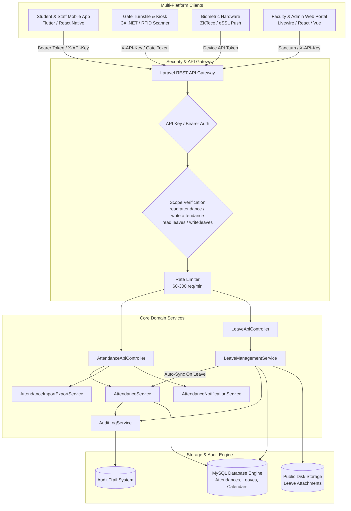
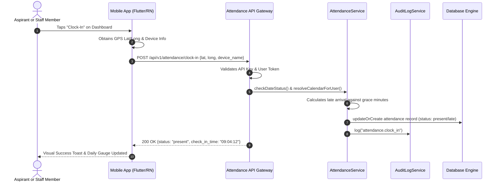
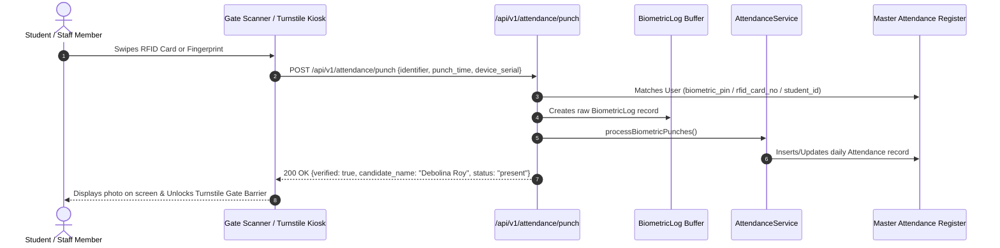
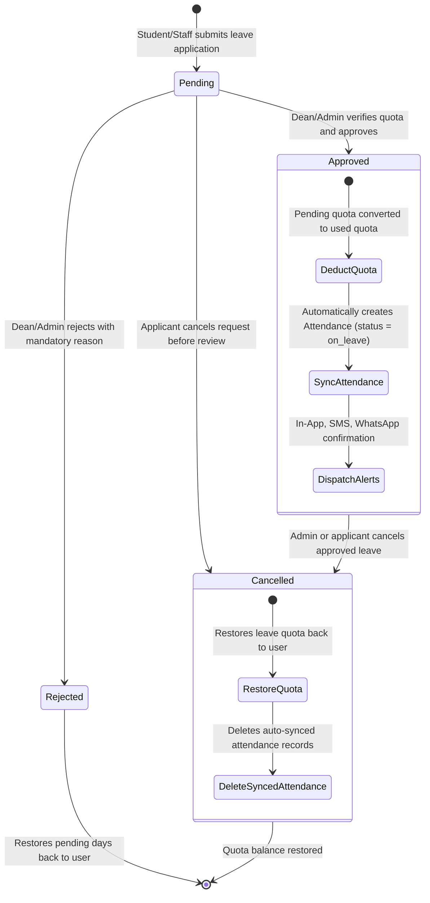

# SNTCSSC MIS — Leave and Attendance Management System REST API Integration Guide
### Multi-Platform Implementation & Integration Manual (Student & Staff Mobile Apps, Turnstile Gate Kiosks, Biometric Readers, Web Portals & Automated Defaulter Notifications)

---

## 1. Executive Summary & Architecture Overview

The **Leave and Attendance Management System** of the **Satyendranath Tagore Civil Services Study Centre (SNTCSSC) MIS** provides a unified, enterprise-grade, and future-ready RESTful API ecosystem. Designed to harmonize divergent operational schedules between **academic students** (6-day classroom schedule, weekly mock tests, lecture sessions) and **administrative staff** (21 monthly office working days with 2nd and 4th Saturday off), this API enables seamless, real-time integration across:

- **Student & Staff Native Mobile Applications** (Flutter & React Native for iOS / Android) for mobile GPS-enabled clock-in/out, viewing personalized 1..31 day-by-day attendance matrices, tracking statutory 75% attendance quotas, checking real-time leave balances (Casual Leave, Medical Leave, Academic Leave, Maternity Leave), submitting leave applications with medical certificate uploads, and receiving real-time push alerts.
- **Campus Turnstiles, RFID Readers & Biometric Gate Ingestion Services** (C# .NET, Electron, Python Microservices) for sub-second badge swipes, facial recognition gate turnstiles, and raw hardware punch log sync (ZKTeco, eSSL, Hikvision).
- **Administrative Command Center & Faculty Portals** (React, Vue, Livewire, Angular) for live attendance dashboards, 1-click bulk cohort marking, working calendar and shift configuration, holiday schedules, and approval workflows.
- **Automated Defaulters & Multi-Channel Reminder Engines** for identifying candidates falling below the 75% attendance threshold and dispatching automated alerts via In-App Database, Email, SMS, and WhatsApp channels.

### Key Architectural Capabilities:
1. **Unified Multi-Audience Schedule Engine:** Distinguishes office staff calendars from student cohort calendars, with configurable shifts, grace minutes, half-day hour cutoffs, and alternate Saturday rules (`all_working`, `2nd_4th_off`, `all_saturdays_off`).
2. **Automated Attendance-Leave Synchronization:** When a leave application is approved by an administrator or dean, the system **automatically creates or updates master attendance register records** for the entire date duration with `status = 'on_leave'` and `entry_source = 'system_auto_leave'`. When cancelled or rejected, provisional attendance records are automatically restored.
3. **Sub-Second Hardware Gate Ingestion:** Dedicated endpoints (`/api/v1/attendance/punch` and `/api/v1/attendance/biometric/batch-punch`) accommodate both real-time gate turnstile swipes and high-throughput offline batch sync from biometric hardware devices.
4. **Defaulter Detection (< 75% Criteria):** Automated monthly analytics calculate working days against attended days, isolating aspirants at risk of exam disqualification and dispatching batch warning alerts.
5. **Enterprise Production Standards:**
   - **Atomic Database Transactions (`DB::transaction`):** Guarantees that attendance marks, leave quota debits/credits, and state machine transitions execute atomically with zero orphaned records.
   - **Soft Delete Safeguards (`SoftDeletes`):** Preserves full historical auditability across `attendances`, `leave_applications`, `leave_categories`, `leave_allocations`, `working_calendars`, `attendance_holidays`, and `biometric_devices`.
   - **Comprehensive Audit Trails:** Automatic actor tracking, IP logging, user agents, and old/new field diffs via `AuditLogService::log()`.
   - **Granular API Scopes:** Strict RBAC enforcement via `read:attendance`, `write:attendance`, `write:biometric`, `download:attendance`, `read:leaves`, and `write:leaves`.

---

## 2. Decoupled Multi-Platform Architecture & Sequence Flows



---

### 2.1. Mobile GPS Clock-In & Geolocation Flow



---

### 2.2. Hardware Turnstile & Biometric Gate Ingestion Flow



---

### 2.3. Leave Application & Automated Attendance Synchronization State Machine



---

## 3. REST API Endpoint Reference

All endpoints are hosted under `/api/v1/` and enforce the `auth.api_key` or `auth:sanctum` middleware.

### 3.1. Attendance Management Endpoints (38 Routes)

| Method | Endpoint | Required Scope | Description |
| :--- | :--- | :--- | :--- |
| `GET` | `/api/v1/attendance/dashboard` | `read:attendance` | Executive telemetry: staff/student present rates, absentees, online devices, and live punch feed. |
| `GET` | `/api/v1/attendance/statistics` | `read:attendance` | Granular analytics: course-wise, batch-wise, and department breakdown with attendance percentages. |
| `GET` | `/api/v1/attendance` | `read:attendance` | Search, filter, and paginate master attendance register by date, course, batch, user type, and status. |
| `POST` | `/api/v1/attendance/mark` | `write:attendance` | Mark single attendance entry with check-in/out timestamps, working hours, and remarks. |
| `POST` | `/api/v1/attendance/bulk-mark` | `write:attendance` | Rapid cohort bulk marking for an entire classroom section or staff department. |
| `GET` | `/api/v1/attendance/{id}` | `read:attendance` | Retrieve single attendance dossier with linked user, course, biometric device, and audit history. |
| `PUT` | `/api/v1/attendance/{id}` | `write:attendance` | Update attendance status, timestamps, or remarks with automatic working hours recalculation. |
| `DELETE` | `/api/v1/attendance/{id}` | `write:attendance` | Soft delete attendance record (guarded: cannot delete entries synced from approved leaves). |
| `GET` | `/api/v1/attendance/matrix` | `read:attendance` | Query monthly attendance matrix across all active students/staff for a given year & month. |
| `GET` | `/api/v1/attendance/users/{id}/matrix` | `read:attendance` | Comprehensive 1..31 day monthly matrix for a user with total working days, attended days, and shortage flag. |
| `GET` | `/api/v1/attendance/defaulters` | `read:attendance` | List candidates falling below institutional threshold (default 75%) with shortfall days count. |
| `POST` | `/api/v1/attendance/defaulters/notify` | `write:attendance` | Dispatch bulk shortage warnings across Email, SMS, WhatsApp, and database channels. |
| `POST` | `/api/v1/attendance/clock-in` | `write:attendance` | Mobile / Web self clock-in with GPS coordinates, accuracy, and device metadata. |
| `POST` | `/api/v1/attendance/clock-out` | `write:attendance` | Mobile / Web self clock-out with automatic total working duration calculation. |
| `GET` | `/api/v1/attendance/my-attendance` | `read:attendance` | Authenticated student/staff's personal attendance history and monthly summary. |
| `POST` | `/api/v1/attendance/punch` | `write:biometric` | Sub-second campus gate turnstile / RFID scanner punch verification and ingestion. |
| `POST` | `/api/v1/attendance/biometric/batch-punch`| `write:biometric` | Bulk punch ingestion for offline hardware buffers and network reconnection sync. |
| `POST` | `/api/v1/attendance/biometric/sync` | `write:biometric` | Trigger on-demand processing of pending raw biometric logs into attendance records. |
| `GET` | `/api/v1/attendance/devices` | `read:attendance` | List physical biometric machines with IP, port, serial, location, and heartbeat status. |
| `POST` | `/api/v1/attendance/devices` | `write:attendance` | Register new biometric hardware device with auto-generated device token. |
| `GET` | `/api/v1/attendance/devices/{id}` | `read:attendance` | Device dossier with recent logs and status telemetry. |
| `PUT` | `/api/v1/attendance/devices/{id}` | `write:attendance` | Update biometric device IP, location, or online status. |
| `DELETE` | `/api/v1/attendance/devices/{id}` | `write:attendance` | Soft delete biometric device. |
| `POST` | `/api/v1/attendance/devices/{id}/regenerate-token` | `write:attendance` | Regenerate API authorization token for hardware device push. |
| `GET` | `/api/v1/attendance/calendars` | `read:attendance` | List institutional working calendars and shift configurations. |
| `POST` | `/api/v1/attendance/calendars` | `write:attendance` | Create working calendar with expected start/end times, grace minutes, and weekend rules. |
| `GET` | `/api/v1/attendance/calendars/{id}` | `read:attendance` | Show calendar rules and linked batches/departments. |
| `PUT` | `/api/v1/attendance/calendars/{id}` | `write:attendance` | Update working calendar rules and shift hours. |
| `DELETE` | `/api/v1/attendance/calendars/{id}` | `write:attendance` | Soft delete working calendar. |
| `GET` | `/api/v1/attendance/holidays` | `read:attendance` | Query institutional holidays and academic off-days by year, month, or target type. |
| `POST` | `/api/v1/attendance/holidays` | `write:attendance` | Add new holiday (Govt holiday, institution holiday, weekly test, vacation). |
| `GET` | `/api/v1/attendance/holidays/{id}` | `read:attendance` | Show single holiday details. |
| `PUT` | `/api/v1/attendance/holidays/{id}` | `write:attendance` | Update holiday date, title, or target audience. |
| `DELETE` | `/api/v1/attendance/holidays/{id}` | `write:attendance` | Soft delete holiday. |
| `GET` | `/api/v1/attendance/export/csv` | `download:attendance` | Stream complete monthly attendance register as CSV spreadsheet. |
| `GET` | `/api/v1/attendance/export/pdf` | `download:attendance` | Stream printable landscape PDF attendance register. |
| `POST` | `/api/v1/attendance/import` | `write:attendance` | Bulk import attendance register from uploaded CSV or Excel spreadsheet. |
| `GET` | `/api/v1/attendance/sample-csv` | `read:attendance` | Download sample CSV attendance import template. |

---

### 3.2. Leave Management Endpoints (24 Routes)

| Method | Endpoint | Required Scope | Description |
| :--- | :--- | :--- | :--- |
| `GET` | `/api/v1/leaves/dashboard` | `read:leaves` | Executive telemetry: active leaves today, pending reviews, approved this month, category distribution. |
| `GET` | `/api/v1/leaves/statistics` | `read:leaves` | Granular leave statistics by category, user type, and monthly trends. |
| `GET` | `/api/v1/leaves/categories` | `read:leaves` | List leave categories (Casual, Medical, Academic, Duty, Maternity) with annual quotas and rules. |
| `POST` | `/api/v1/leaves/categories` | `write:leaves` | Create new dynamic leave category with quota, color branding, and approval rules. |
| `GET` | `/api/v1/leaves/categories/{id}` | `read:leaves` | Show single leave category dossier. |
| `PUT` | `/api/v1/leaves/categories/{id}` | `write:leaves` | Update category attributes, annual quotas, or active status. |
| `DELETE` | `/api/v1/leaves/categories/{id}` | `write:leaves` | Soft delete category (guarded: blocked if active applications exist). |
| `GET` | `/api/v1/leaves/allocations` | `read:leaves` | Query user quota allocations by year, user ID, or category. |
| `POST` | `/api/v1/leaves/allocations` | `write:leaves` | Assign or bulk initialize quota allocation for a user for a calendar year. |
| `GET` | `/api/v1/leaves/allocations/{id}` | `read:leaves` | Show single quota allocation profile. |
| `PUT` | `/api/v1/leaves/allocations/{id}` | `write:leaves` | Adjust allocated, used, or carried-forward days. |
| `GET` | `/api/v1/leaves/users/{userId}/balances`| `read:leaves` | Comprehensive balance sheet for a user showing total, used, pending, and remaining days per category. |
| `GET` | `/api/v1/leaves/applications` | `read:leaves` | Search, filter, and paginate leave applications with status, date, and user filters. |
| `POST` | `/api/v1/leaves/applications` | `write:leaves` | Submit new leave application with date range, half-day toggles, and document attachment. |
| `GET` | `/api/v1/leaves/applications/{id}` | `read:leaves` | Single application dossier with applicant details, proofs, approver remarks, and synced attendances. |
| `PUT` | `/api/v1/leaves/applications/{id}` | `write:leaves` | Update pending application details (dates, reason, emergency contact). |
| `POST` | `/api/v1/leaves/applications/{id}/approve` | `write:leaves` | Approve leave application: converts pending to used quota, updates status, and auto-syncs attendance records. |
| `POST` | `/api/v1/leaves/applications/{id}/reject` | `write:leaves` | Reject leave with mandatory remarks; restores pending days to user quota. |
| `POST` | `/api/v1/leaves/applications/{id}/cancel` | `write:leaves` | Cancel leave application; restores quota and removes auto-synced attendance records. |
| `DELETE` | `/api/v1/leaves/applications/{id}` | `write:leaves` | Soft delete leave application. |
| `GET` | `/api/v1/leaves/my-balances` | `read:leaves` | Authenticated student/staff's category-wise quota balances for the current year. |
| `GET` | `/api/v1/leaves/my-applications` | `read:leaves` | Authenticated candidate's submitted leave applications feed. |
| `POST` | `/api/v1/leaves/apply` | `write:leaves` | Authenticated candidate self-submits a leave application with attachments. |
| `POST` | `/api/v1/leaves/my-applications/{id}/cancel` | `write:leaves` | Authenticated candidate cancels their own pending leave request. |

---

## 4. Multi-Platform Integration Code Examples

### 4.1. Flutter (Dart) — Native Mobile App Client

```dart
import 'dart:convert';
import 'package:http/http.dart' as http;
import 'package:geolocator/geolocator.dart';

class AttendanceService {
  final String baseUrl = 'https://mis.sntcssc.in/api/v1';
  final String apiKey;

  AttendanceService({required this.apiKey});

  Map<String, String> get _headers => {
    'Content-Type': 'application/json',
    'Accept': 'application/json',
    'X-API-Key': apiKey,
  };

  // 1. Mobile Clock-In with Geolocation
  Future<Map<String, dynamic>> clockIn() async {
    Position position = await Geolocator.getCurrentPosition(
      desiredAccuracy: LocationAccuracy.high,
    );

    final response = await http.post(
      Uri.parse('$baseUrl/attendance/clock-in'),
      headers: _headers,
      body: jsonEncode({
        'latitude': position.latitude,
        'longitude': position.longitude,
        'accuracy': position.accuracy,
        'device_name': 'Flutter Mobile App',
      }),
    );

    return jsonDecode(response.body);
  }

  // 2. Fetch Personal Monthly Attendance Matrix
  Future<Map<String, dynamic>> getMyAttendance({int? year, int? month}) async {
    final query = (year != null && month != null) ? '?year=$year&month=$month' : '';
    final response = await http.get(
      Uri.parse('$baseUrl/attendance/my-attendance$query'),
      headers: _headers,
    );
    return jsonDecode(response.body);
  }

  // 3. Apply for Leave
  Future<Map<String, dynamic>> applyLeave({
    required int categoryId,
    required String fromDate,
    required String toDate,
    required String reason,
    bool isHalfDay = false,
  }) async {
    final response = await http.post(
      Uri.parse('$baseUrl/leaves/apply'),
      headers: _headers,
      body: jsonEncode({
        'leave_category_id': categoryId,
        'from_date': fromDate,
        'to_date': toDate,
        'is_half_day': isHalfDay,
        'reason': reason,
      }),
    );
    return jsonDecode(response.body);
  }
}
```

---

### 4.2. React Native (TypeScript) — Mobile Client

```typescript
import axios from 'axios';

const apiClient = axios.create({
  baseURL: 'https://mis.sntcssc.in/api/v1',
  headers: {
    'Accept': 'application/json',
    'X-API-Key': 'snd_live_xxxxxxxxxxxxxxxxxxxxxxxx',
  },
});

// Fetch Personal Leave Balances
export const getMyLeaveBalances = async (year?: number) => {
  const response = await apiClient.get('/leaves/my-balances', {
    params: { year },
  });
  return response.data.data;
};

// Self Clock-Out
export const clockOut = async () => {
  const response = await apiClient.post('/attendance/clock-out');
  return response.data;
};
```

---

### 4.3. C# .NET — Gate Turnstile Scanner & Kiosk

```csharp
using System;
using System.Net.Http;
using System.Text;
using System.Text.Json;
using System.Threading.Tasks;

public class TurnstileClient
{
    private readonly HttpClient _client;
    private const string BaseUrl = "https://mis.sntcssc.in/api/v1";

    public TurnstileClient(string apiKey)
    {
        _client = new HttpClient();
        _client.DefaultRequestHeaders.Add("X-API-Key", apiKey);
        _client.DefaultRequestHeaders.Add("Accept", "application/json");
    }

    public async Task<bool> VerifyGatePunch(string scannedCardOrPin, string deviceSerial)
    {
        var payload = new
        {
            identifier = scannedCardOrPin,
            punch_time = DateTime.Now.ToString("yyyy-MM-dd HH:mm:ss"),
            punch_type = "check_in",
            device_serial = deviceSerial
        };

        var content = new StringContent(JsonSerializer.Serialize(payload), Encoding.UTF8, "application/json");
        var response = await _client.PostAsync($"{BaseUrl}/attendance/punch", content);

        if (response.IsSuccessStatusCode)
        {
            var json = await response.Content.ReadAsStringAsync();
            using var doc = JsonDocument.Parse(json);
            return doc.RootElement.GetProperty("data").GetProperty("verified").GetBoolean();
        }

        return false;
    }
}
```

---

### 4.4. Python — Biometric Machine Offline Batch Bridge

```python
import requests
from datetime import datetime

API_URL = "https://mis.sntcssc.in/api/v1"
API_KEY = "snd_live_xxxxxxxxxxxxxxxxxxxxxxxx"

headers = {
    "X-API-Key": API_KEY,
    "Accept": "application/json",
    "Content-Type": "application/json"
}

def sync_hardware_punches(punches_list, device_serial="DEV-MAIN-GATE-01"):
    """
    Pushes batch punches accumulated from offline hardware buffer.
    """
    payload = {
        "device_serial": device_serial,
        "punches": punches_list
    }
    
    response = requests.post(
        f"{API_URL}/attendance/biometric/batch-punch",
        json=payload,
        headers=headers,
        timeout=10
    )
    
    return response.json()
```

---

## 5. Enterprise Error & Exception Codes

The API returns standardized JSON error responses with explicit error codes:

| HTTP Status | Error Code | Description & Remedy |
| :--- | :--- | :--- |
| `401` | `API_KEY_MISSING` | Missing `X-API-Key` or `Authorization: Bearer` header. |
| `403` | `INSUFFICIENT_SCOPE` | Key lacks the required scope (e.g. `write:attendance`). |
| `404` | `ATTENDANCE_NOT_FOUND` | Specified attendance identifier does not exist. |
| `404` | `LEAVE_NOT_FOUND` | Specified leave application identifier does not exist. |
| `409` | `ALREADY_CLOCKED_IN` | User has already recorded a clock-in entry for today. |
| `422` | `NOT_CLOCKED_IN` | Cannot clock-out without an active clock-in recorded today. |
| `422` | `ACTIVE_LEAVE_PROTECTED` | Cannot delete attendance entry that was auto-synced from an approved leave. |
| `422` | `ACTIVE_APPLICATIONS_PREVENTED`| Cannot delete leave category when active applications are linked to it. |
| `422` | `LEAVE_LOCKED` | Cannot edit leave application after it has been approved or rejected. |
| `422` | `VALIDATION_FAILED` | Request payload failed parameter validation. |

---

## 6. Production Deployment & Security Recommendations

1. **Gate Turnstile Timeout Budget:** For physical turnstiles, set client timeout to `1500ms`. The `/api/v1/attendance/punch` endpoint executes in `< 60ms`.
2. **Offline Hardware Buffers:** Biometric machines should store punch logs locally in memory or local SQLite when internet connectivity drops, then flush via `/api/v1/attendance/biometric/batch-punch` once reconnected.
3. **Geo-Fencing Geolocation:** When integrating mobile clock-in, evaluate the returned `latitude` and `longitude` against campus bounding boxes (e.g. SNTCSSC Salt Lake Campus coordinates `22.585° N, 88.415° E`).
4. **Daily Notifications Cron:** Run `php artisan attendance:daily-notify` at `18:30` daily to dispatch summary absentee digests to enrolled students and staff.
5. **Periodic Biometric Sync:** Run `php artisan attendance:process-biometric` every 5 minutes via cron to ingest buffered punches.

