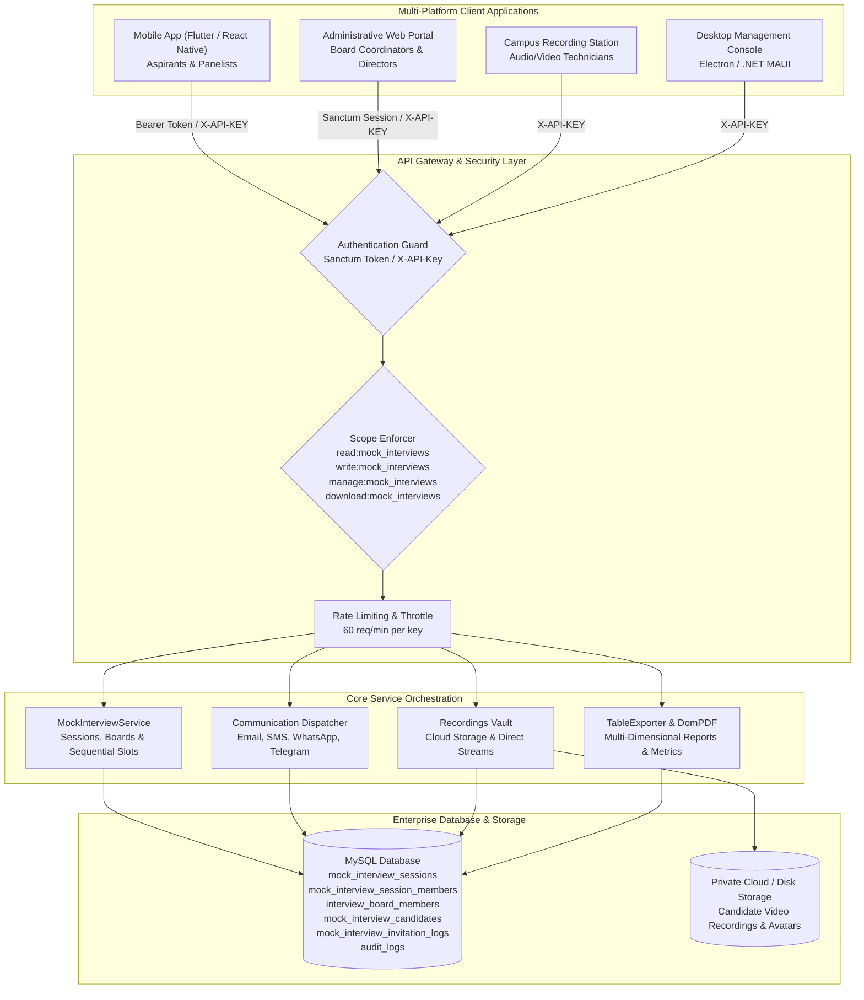
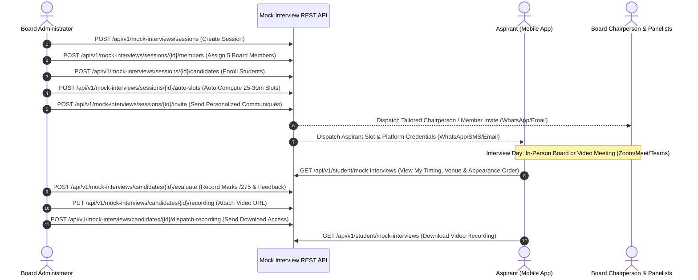

# UPSC Mock Interview Management System REST API — Enterprise Multi-Platform Integration Guide
### Comprehensive Technical Blueprint & Client Integration Specification (Mobile App, Web Portal, Desktop Client & Third-Party Automation)

---

## 1. Executive Summary & Architectural Overview

The **UPSC Mock Interview Management Module** of the **Satyendranath Tagore Civil Services Study Centre (SNTCSSC) MIS** provides a mission-critical, enterprise-grade RESTful API backbone designed to replicate the authentic Union Public Service Commission (UPSC) Personality Test interview environment. 

Engineered for seamless multi-platform consumption across **Mobile Applications (iOS & Android via Flutter / React Native)**, **Web Single-Page Applications (Next.js, React, Vue, Livewire)**, **Desktop Administrative Consoles (.NET MAUI, Electron)**, and **Campus Digital Signage / Studio Recording Stations**, this API empowers institutional staff, board panelists, and enrolled aspirants to coordinate high-stakes mock interview drives with sub-minute precision.

### Core Architectural Capabilities:
1. **5-Member Board Formulation & Hierarchy:**
   - Enforces the authentic 5-member interview board composition comprising **1 Board Chairperson** (e.g., Retired IAS/IPS/IFS Officer, Former UPSC Member, Eminent Bureaucrat) and **4 Panel Members** (Subject Experts, Domain Specialists, Senior Academics).
   - Automatic board role arbitration ensuring exactly 1 Chairperson per active board session.
2. **Hybrid Multi-Mode Attendance & Conferencing Interoperability:**
   - Seamless support for both **In-Person (Offline)** campus appearances and **Remote (Online)** video interviews.
   - Deep video conference platform integration: **Zoom**, **Google Meet**, **Microsoft Teams**, and **Cisco Webex Meetings** with join links, meeting IDs, and entry passcodes.
3. **Sequential Scheduling & 25–30 Minute Slot Auto-Generation:**
   - Automated candidate sequence queues with customizable interview slot durations (25 to 30 minutes) and configurable inter-candidate transition buffers (e.g., 5 minutes).
   - Instant programmatic computation of staggered candidate reporting times, start times, and conclusion slots.
4. **Multi-Channel Communiqués & Differentiated Role-Based Templates:**
   - Real-time drafting, template customization, variable token substitution (`{name}`, `{session_no}`, `{session_date}`, `{slot_time}`, `{attending_mode}`, `{venue_address}`, `{chairperson_name}`), and dispatching across **Email**, **SMS**, **WhatsApp**, **Telegram**, and **In-App Notifications**.
   - Distinct, personalized messaging tailored for Board Chairpersons, Panelists, and Aspirants.
5. **Interview Video Recording Vault & Confidential Dispatch:**
   - Secure digital depository for high-definition interview recordings (Zoom Cloud, Google Drive, Vimeo OTT, YouTube Unlisted, BunnyCDN, or server file uploads).
   - Multi-channel notification pipeline delivering download links directly to individual aspirants with tracking logs.
6. **Student Self-Service Portal & Appearance Order Roster:**
   - Confidential student mobile/web view showing reporting times, venue instructions, meeting links, evaluation marks, feedback recommendations, and recording downloads.
   - **Privacy Guard:** Appearance order view lets candidates see the sequence and timings of peers without exposing peer recordings or confidential evaluations.
7. **Multi-Dimensional Reports & Multi-Format Analytics:**
   - Granular reporting across **Student Wise**, **Board Member Wise**, and **Academic Year/Session Overview** perspectives with real-time KPI aggregates.
   - Automated export streaming in **PDF (Landscape A4)**, **Excel (.xlsx)**, and **CSV (.csv)** formats.
8. **Enterprise Security, Audit Trails & Resiliency:**
   - Dual authentication: HTTP Bearer Sanctum Tokens (Mobile/Web users) and `X-API-KEY` header authentication with granular API scopes (`read:mock_interviews`, `write:mock_interviews`, `manage:mock_interviews`, `download:mock_interviews`).
   - Atomic database transactions (`DB::transaction`), soft deletes (`deleted_at`), and comprehensive audit logging (`AuditLogService`) on all write operations.

---

## 2. System Architecture & Sequence Flows

### 2.1 Multi-Platform Architecture



### 2.2 Candidate Mock Interview Lifecycle



---

## 3. Authentication, Security & Scopes Matrix

All API endpoints are hosted under `/api/v1/` and enforce TLS/HTTPS encryption.

### 3.1 Authentication Headers
Clients authenticate via either of two secure protocols:
1. **API Key Authentication (Recommended for Backend, Desktop & Cloud integrations):**
   ```http
   X-API-KEY: sntcssc_live_xxxxxxxxxxxxxxxxxxxxxxxx
   Content-Type: application/json
   Accept: application/json
   ```
2. **Bearer Token Authentication (Recommended for Student & Faculty Mobile Apps):**
   ```http
   Authorization: Bearer <sanctum_personal_access_token>
   Content-Type: application/json
   Accept: application/json
   ```

### 3.2 Granular Scopes Matrix

| Scope Key | Scope Title | Description & Permitted Operations |
|---|---|---|
| `read:mock_interviews` | Read Mock Interviews | Query sessions, master panelists, enrolled aspirants, timetable slots, appearance rosters, marks, feedback, and analytical reports. |
| `write:mock_interviews` | Write Mock Interviews | Create sessions, update candidate parameters, record interview evaluations (/275 marks), and upload video recordings. |
| `manage:mock_interviews` | Manage Mock Interviews | Auto-calculate time slots, dispatch invitations, send recording download communiqués, assign/remove board members, and delete sessions. |
| `download:mock_interviews` | Download Reports & Exports | Stream printable session timetables and multi-dimensional reports in PDF, Excel (.xlsx), and CSV formats. |
| `*` | Full Superadmin Access | Unrestricted administrative access across all present and future endpoints. |

### 3.3 Strict Privacy Boundary (Peer Recording Isolation)
In compliance with examination integrity rules:
- **Rule 1:** When accessing `/api/v1/student/mock-interviews`, candidates can inspect the session sequence order (`sequence_number`), attending mode (`offline` vs `online`), and slot times of other candidates to maintain queue awareness.
- **Rule 2:** The `recording_url` and `recording_file` attributes are **strictly masked as `null`** for all peer candidates. Only the candidate whose `user_id` matches the authenticated token receives their personal video recording download link.
- **Rule 3:** Detailed board marks and feedback are strictly private to the evaluated student and administrative staff.

---

## 4. Comprehensive Endpoint Catalog & Specifications

### 4.1 Mock Interview Sessions Management

#### 1. List Interview Sessions
- **Endpoint:** `GET /api/v1/mock-interviews/sessions`
- **Required Scope:** `read:mock_interviews`
- **Query Parameters:**
  - `q` *(string, optional)*: Search across title, session code, or venue.
  - `year` *(string, optional)*: Filter by academic year (e.g. `2026`).
  - `status` *(string, optional)*: `draft`, `scheduled`, `in_progress`, `completed`, `cancelled`.
  - `date_from` *(date, optional)*: `YYYY-MM-DD`.
  - `date_to` *(date, optional)*: `YYYY-MM-DD`.
  - `per_page` *(integer, optional)*: Default `15`.
- **Response (200 OK):**
```json
{
  "success": true,
  "data": [
    {
      "id": 1,
      "session_code": "MIS-2026-001",
      "title": "UPSC CSE 2026 Personality Test Mock Board A",
      "academic_year": "2026",
      "session_number": 1,
      "session_date": "2026-11-15",
      "formatted_date": "15 Nov 2026",
      "start_time": "09:30",
      "end_time": "17:30",
      "reporting_time": "09:00",
      "venue_address": "Board Room 1, SNTCSSC Campus, Salt Lake, Kolkata",
      "room_number": "Chamber A",
      "default_interview_duration": 30,
      "default_buffer_duration": 5,
      "status": "scheduled",
      "chairperson_name": "Shri Amitava Roy, IAS (Retd.)",
      "session_members_count": 5,
      "candidates_count": 12
    }
  ],
  "meta": {
    "current_page": 1,
    "last_page": 1,
    "per_page": 15,
    "total": 1
  }
}
```

#### 2. Create Interview Session
- **Endpoint:** `POST /api/v1/mock-interviews/sessions`
- **Required Scope:** `manage:mock_interviews`
- **Request Body (JSON):**
```json
{
  "title": "UPSC CSE 2026 Mock Interview Session 2",
  "session_number": 2,
  "academic_year": "2026",
  "session_date": "2026-11-20",
  "start_time": "10:00",
  "end_time": "17:00",
  "reporting_time": "09:30",
  "venue_address": "Conference Hall B, SNTCSSC Administrative Building",
  "room_number": "Hall 201",
  "default_interview_duration": 30,
  "default_buffer_duration": 5,
  "instructions": "Formal Western or Indian civil service attire required. Carry 3 sets of DAF summary copies.",
  "status": "scheduled"
}
```
- **Response (201 Created):**
```json
{
  "success": true,
  "message": "Mock interview session created successfully.",
  "data": {
    "id": 2,
    "session_code": "MIS-2026-002",
    "title": "UPSC CSE 2026 Mock Interview Session 2",
    "status": "scheduled"
  }
}
```

#### 3. Get Session Dossier
- **Endpoint:** `GET /api/v1/mock-interviews/sessions/{id}`
- **Required Scope:** `read:mock_interviews`
- **Response (200 OK):**
```json
{
  "success": true,
  "data": {
    "id": 1,
    "session_code": "MIS-2026-001",
    "title": "UPSC CSE 2026 Personality Test Mock Board A",
    "session_members": [
      {
        "id": 10,
        "interview_board_member_id": 5,
        "role": "chairperson",
        "order_index": 1,
        "attendance_status": "confirmed",
        "board_member": {
          "id": 5,
          "name": "Shri Amitava Roy, IAS (Retd.)",
          "designation": "Former Chief Secretary",
          "organization": "Govt of West Bengal",
          "specialization": "Public Administration & Governance"
        }
      }
    ],
    "candidates": [
      {
        "id": 101,
        "sequence_number": 1,
        "scheduled_start_time": "10:00:00",
        "scheduled_end_time": "10:30:00",
        "attending_mode": "offline",
        "status": "scheduled",
        "user": {
          "id": 88,
          "name": "Ananya Chatterjee",
          "student_id": "STU-UPSC-2026-014"
        }
      }
    ]
  }
}
```

#### 4. Auto-Generate Sequential Candidate Time Slots
- **Endpoint:** `POST /api/v1/mock-interviews/sessions/{id}/auto-slots`
- **Required Scope:** `manage:mock_interviews`
- **Description:** Automatically sequences all enrolled candidates in order (1, 2, 3...) and calculates consecutive start and end interview times using duration and buffer parameters.
- **Request Body (JSON, Optional Overrides):**
```json
{
  "start_time": "10:00",
  "duration_minutes": 30,
  "buffer_minutes": 5
}
```
- **Response (200 OK):**
```json
{
  "success": true,
  "message": "Successfully auto-generated time slots for 12 candidate(s)."
}
```

#### 5. Dispatch Personalized Invitations
- **Endpoint:** `POST /api/v1/mock-interviews/sessions/{id}/invite`
- **Required Scope:** `manage:mock_interviews`
- **Request Body (JSON):**
```json
{
  "target": "all",
  "channels": ["email", "whatsapp", "in_app"]
}
```
- **Target Options:** `all`, `board_members`, `candidates`, `specific_candidate`, `specific_member`.
- **Response (200 OK):**
```json
{
  "success": true,
  "message": "Successfully dispatched invitations to 17 recipient(s)."
}
```

---

### 4.2 Candidate Scheduling, Evaluation & Video Vault

#### 1. Assign Candidate into Session
- **Endpoint:** `POST /api/v1/mock-interviews/sessions/{id}/candidates`
- **Required Scope:** `manage:mock_interviews`
- **Request Body (JSON):**
```json
{
  "user_id": 88,
  "batch_id": 4,
  "course_id": 2,
  "sequence_number": 1,
  "scheduled_start_time": "10:00",
  "scheduled_end_time": "10:30",
  "duration_minutes": 30,
  "attending_mode": "online",
  "platform": "Zoom",
  "meeting_link": "https://us06web.zoom.us/j/88392019482?pwd=mockInterviewPasscode2026",
  "meeting_id": "883 9201 9482",
  "meeting_password": "UPSC2026Mock",
  "candidate_instructions": "Ensure stable high-speed broadband and test camera audio 15 minutes before slot."
}
```

#### 2. Get Single Candidate Dossier
- **Endpoint:** `GET /api/v1/mock-interviews/candidates/{candidateId}`
- **Required Scope:** `read:mock_interviews`
- **Response (200 OK):**
```json
{
  "success": true,
  "data": {
    "candidate": {
      "id": 101,
      "sequence_number": 1,
      "scheduled_start_time": "10:00:00",
      "scheduled_end_time": "10:30:00",
      "attending_mode": "online",
      "platform": "Zoom",
      "interview_score": 192.5,
      "board_feedback": "Extremely articulate. Impressive command of international relations and constitutional law.",
      "recording_status": "available",
      "recording_url": "https://drive.google.com/file/d/1XyZ9999_sample_recording/view"
    },
    "student_profile": {
      "student_id": "STU-UPSC-2026-014",
      "name": "Ananya Chatterjee",
      "email": "ananya.upsc@example.com",
      "phone": "+919830112233",
      "category": "General",
      "upsc_roll_number": "0849201",
      "optional_subject": "Political Science & International Relations (PSIR)",
      "medium_of_exam": "English",
      "attempts_count": 2,
      "daf_hobbies": "Debating, Carnatic classical vocal, Model United Nations"
    }
  }
}
```

#### 3. Record Candidate Interview Evaluation
- **Endpoint:** `POST /api/v1/mock-interviews/candidates/{candidateId}/evaluate`
- **Required Scope:** `write:mock_interviews`
- **Request Body (JSON):**
```json
{
  "interview_score": 194.5,
  "board_feedback": "Outstanding composure during intense pressure grilling on administrative ethics. Recommended to maintain balanced stance on current fiscal federalism debate.",
  "status": "completed"
}
```
- **Response (200 OK):**
```json
{
  "success": true,
  "message": "Interview evaluation score and remarks saved successfully.",
  "data": {
    "id": 101,
    "interview_score": 194.5,
    "status": "completed"
  }
}
```

#### 4. Attach Video Recording URL / Cloud Link
- **Endpoint:** `PUT /api/v1/mock-interviews/candidates/{candidateId}/recording`
- **Required Scope:** `manage:mock_interviews`
- **Request Body (JSON):**
```json
{
  "recording_type": "url",
  "recording_url": "https://vimeo.com/manage/videos/998271829",
  "recording_password": "Pass@Mock2026",
  "recording_notes": "Full 32-minute board proceedings including Chairperson concluding remarks.",
  "recording_status": "available"
}
```

#### 5. Dispatch Recording Link to Student
- **Endpoint:** `POST /api/v1/mock-interviews/candidates/{candidateId}/dispatch-recording`
- **Required Scope:** `manage:mock_interviews`
- **Request Body (JSON):**
```json
{
  "channels": ["email", "whatsapp", "in_app"],
  "notes": "Your UPSC CSE Mock Interview recording is ready. Download and review before the next round."
}
```

---

### 4.3 Board Panelists Pool Directory

#### 1. List Board Panelists
- **Endpoint:** `GET /api/v1/mock-interviews/board-members`
- **Required Scope:** `read:mock_interviews`
- **Query Parameters:** `q`, `status` (`active`/`inactive`), `per_page`.
- **Response (200 OK):**
```json
{
  "success": true,
  "data": [
    {
      "id": 5,
      "name": "Prof. S. K. Mukherjee",
      "designation": "Former Member, UPSC Advisory Panel",
      "organization": "Indian Institute of Public Administration",
      "specialization": "Public Administration & Ethics",
      "email": "prof.mukherjee@example.com",
      "phone": "+919830099887",
      "status": "active"
    }
  ]
}
```

#### 2. Create Board Panelist
- **Endpoint:** `POST /api/v1/mock-interviews/board-members`
- **Required Scope:** `manage:mock_interviews`
- **Request Body (JSON):**
```json
{
  "name": "Dr. Aparna Sen, IPS (Retd.)",
  "designation": "Former Director General of Police",
  "organization": "West Bengal Police",
  "specialization": "Internal Security & Disaster Management",
  "email": "aparna.sen.ips@example.com",
  "phone": "+919876543210",
  "status": "active"
}
```

---

### 4.4 Multi-Dimensional Reports & Telemetry API

#### 1. Dynamic Performance Report Data
- **Endpoint:** `GET /api/v1/mock-interviews/reports`
- **Required Scope:** `read:mock_interviews`
- **Query Parameters:**
  - `type` *(string)*: `student_wise` *(default)*, `board_member_wise`, `year_wise`.
  - `academic_year` *(string, optional)*: `2026`.
  - `session_id` *(integer, optional)*: Filter by single session.
  - `mode` *(string, optional)*: `offline`, `online`.
  - `evaluation_status` *(string, optional)*: `evaluated`, `pending`.
  - `status` *(string, optional)*: `scheduled`, `completed`, `in_progress`, `absent`, `cancelled`.
  - `board_member_id` *(integer, optional)*: Filter panelist deployments.
  - `date_from`, `date_to` *(date, optional)*: Date window filter.
- **Response (200 OK):**
```json
{
  "success": true,
  "data": {
    "title": "UPSC Mock Interview Candidate & Timetable Detailed Report",
    "subtitle": "Granular performance register with interview slots, evaluation marks, feedback, and video recording status",
    "report_type": "student_wise",
    "headings": [
      "#", "Student ID", "Candidate Name", "UPSC Optional", "Category",
      "Session Code", "Session Date", "Slot & Order", "Mode", "Status",
      "Score (/275)", "Panel Feedback", "Recording Status"
    ],
    "rows": [
      [
        1, "STU-UPSC-2026-014", "Ananya Chatterjee", "PSIR", "General",
        "MIS-2026-001", "15 Nov 2026", "Slot: 10:00 AM - 10:30 AM (#1)",
        "Online Remote", "Completed", "194.5", "Outstanding composure...", "Available"
      ]
    ],
    "stats": {
      "Total Candidates": 25,
      "In-Person (Offline)": 18,
      "Remote (Online)": 7,
      "Evaluated": 24,
      "Average Marks": "186.2 / 275"
    },
    "total_records": 25
  }
}
```

#### 2. Executive Analytics & Telemetry
- **Endpoint:** `GET /api/v1/mock-interviews/analytics`
- **Required Scope:** `read:mock_interviews`
- **Response (200 OK):**
```json
{
  "success": true,
  "data": {
    "total_sessions": 6,
    "total_candidates": 72,
    "completed_interviews": 68,
    "evaluated_candidates": 68,
    "average_score_out_of_275": 184.8,
    "total_recordings_available": 65,
    "active_panel_experts": 18,
    "mode_distribution": {
      "in_person_offline": 48,
      "remote_online": 24
    }
  }
}
```

#### 3. Real-Time Executive Dashboard Telemetry
- **Endpoint:** `GET /api/v1/mock-interviews/dashboard`
- **Required Scope:** `read:mock_interviews`
- **Query Parameters:**
  - `academic_year` *(string, optional)*: Filter telemetry by academic cycle (e.g. `2026`).
- **Response (200 OK):**
```json
{
  "success": true,
  "data": {
    "summary": {
      "total_sessions": 6,
      "scheduled_sessions": 2,
      "completed_sessions": 4,
      "total_candidates": 72,
      "completed_interviews": 48,
      "scheduled_interviews": 24,
      "evaluated_candidates": 48,
      "average_marks": 185.5,
      "highest_marks": 215.0,
      "lowest_marks": 145.0,
      "recordings_available": 45,
      "active_panel_experts": 15,
      "total_panelists": 20,
      "turnout_rate": 66.7
    },
    "mode_breakdown": {
      "in_person_offline": 44,
      "remote_online": 28
    },
    "recent_sessions": [
      {
        "id": 1,
        "session_code": "MIS-2026-S01",
        "title": "UPSC CSE 2026 Personality Test Mock Board A",
        "session_date": "20 Nov 2026 (Fri)",
        "timing": "09:30:00 - 17:30:00",
        "venue": "SNTCSSC Salt Lake Administrative Complex",
        "status": "scheduled",
        "candidates_count": 12,
        "chairperson": "Ambassador K. R. Narayan (Retd. IFS)"
      }
    ],
    "upcoming_interviews": [
      {
        "id": 101,
        "candidate_name": "Arjun Roy",
        "student_id": "STU-2026-001",
        "session_code": "MIS-2026-S01",
        "scheduled_time": "10:00 AM - 10:30 AM",
        "attending_mode": "online",
        "platform": "Zoom",
        "status": "scheduled"
      }
    ]
  }
}
```

---

### 4.5 Student Self-Service Portal API

#### 1. Candidate Personal Sessions & Appearance Order Roster
- **Endpoint:** `GET /api/v1/student/mock-interviews`
- **Authentication:** Student Bearer Token (`auth:sanctum`) or API Key
- **Response (200 OK):**
```json
{
  "success": true,
  "data": [
    {
      "my_interview": {
        "id": 101,
        "sequence_number": 1,
        "session_title": "UPSC CSE 2026 Personality Test Mock Board A",
        "session_code": "MIS-2026-001",
        "session_date": "15 Nov 2026",
        "slot_time": "10:00 AM - 10:30 AM",
        "attending_mode": "online",
        "platform": "Zoom",
        "meeting_link": "https://us06web.zoom.us/j/88392019482?pwd=mockInterviewPasscode2026",
        "meeting_id": "883 9201 9482",
        "meeting_password": "UPSC2026Mock",
        "status": "completed",
        "score": 194.5,
        "feedback": "Outstanding composure during intense pressure grilling on administrative ethics.",
        "recording_available": true,
        "recording_url": "https://vimeo.com/manage/videos/998271829"
      },
      "session_order_roster": [
        {
          "sequence_number": 1,
          "candidate_name": "Ananya Chatterjee (You)",
          "student_id": "STU-UPSC-2026-014",
          "attending_mode": "online",
          "slot_time": "10:00 AM - 10:30 AM",
          "status": "completed",
          "is_current_user": true,
          "recording_url": "https://vimeo.com/manage/videos/998271829"
        },
        {
          "sequence_number": 2,
          "candidate_name": "Rahul Sen",
          "student_id": "STU-UPSC-2026-015",
          "attending_mode": "offline",
          "slot_time": "10:35 AM - 11:05 AM",
          "status": "completed",
          "is_current_user": false,
          "recording_url": null
        }
      ]
    }
  ]
}
```
*(Notice: For `Rahul Sen`, `recording_url` is strictly masked as `null` to preserve privacy).*

---

## 5. Client Integration Code Walkthroughs

### 5.1 Flutter (Dart) — Candidate Mobile Portal Screen

```dart
import 'dart:convert';
import 'package:flutter/material.dart';
import 'package:http/http.dart' as http;
import 'package:url_launcher/url_launcher.dart';

class MockInterviewDashboardPage extends StatefulWidget {
  final String authToken;
  const MockInterviewDashboardPage({Key? key, required this.authToken}) : super(key: key);

  @override
  State<MockInterviewDashboardPage> createState() => _MockInterviewDashboardPageState();
}

class _MockInterviewDashboardPageState extends State<MockInterviewDashboardPage> {
  bool _isLoading = true;
  Map<String, dynamic>? _interviewData;
  List<dynamic> _roster = [];

  @override
  void initState() {
    super.initState();
    _fetchMockInterviewData();
  }

  Future<void> _fetchMockInterviewData() async {
    final url = Uri.parse('https://sntcssc.wb.gov.in/api/v1/student/mock-interviews');
    try {
      final response = await http.get(url, headers: {
        'Authorization': 'Bearer ${widget.authToken}',
        'Accept': 'application/json',
      });

      if (response.statusCode == 200) {
        final jsonResponse = json.decode(response.body);
        final list = jsonResponse['data'] as List;
        if (list.isNotEmpty) {
          setState(() {
            _interviewData = list[0]['my_interview'];
            _roster = list[0]['session_order_roster'];
            _isLoading = false;
          });
        }
      }
    } catch (e) {
      debugPrint('Error fetching mock interview: $e');
      setState(() => _isLoading = false);
    }
  }

  @override
  Widget build(BuildContext context) {
    if (_isLoading) {
      return const Scaffold(body: Center(child: CircularProgressIndicator()));
    }
    if (_interviewData == null) {
      return const Scaffold(body: Center(child: Text('No active mock interview scheduled.')));
    }

    final isOnline = _interviewData!['attending_mode'] == 'online';
    final hasRecording = _interviewData!['recording_available'] == true;

    return Scaffold(
      appBar: AppBar(title: const Text('UPSC Mock Interview')),
      body: ListView(
        padding: const EdgeInsets.all(16.0),
        children: [
          // Header Card
          Card(
            color: Colors.blue.shade900,
            child: Padding(
              padding: const EdgeInsets.all(16.0),
              child: Column(
                crossAxisAlignment: CrossAxisAlignment.start,
                children: [
                  Text(_interviewData!['session_title'],
                      style: const TextStyle(color: Colors.white, fontSize: 16, fontWeight: FontWeight.bold)),
                  const SizedBox(height: 8),
                  Text('Date: ${_interviewData!['session_date']}', style: const TextStyle(color: Colors.white70)),
                  Text('Slot Time: ${_interviewData!['slot_time']} (Queue #${_interviewData!['sequence_number']})',
                      style: const TextStyle(color: Colors.amber, fontWeight: FontWeight.w600)),
                ],
              ),
            ),
          ),
          const SizedBox(height: 16),

          // Action Button: Online Join or Venue
          if (isOnline && _interviewData!['meeting_link'] != null)
            ElevatedButton.icon(
              icon: const Icon(Icons.video_call),
              label: const Text('Join Online Interview (Zoom / Meet)'),
              style: ElevatedButton.styleFrom(backgroundColor: Colors.green),
              onPressed: () => launchUrl(Uri.parse(_interviewData!['meeting_link'])),
            )
          else
            ListTile(
              leading: const Icon(Icons.location_on, color: Colors.blue),
              title: const Text('Offline Venue Address'),
              subtitle: Text(_interviewData!['venue_address'] ?? 'SNTCSSC Campus'),
            ),

          // Video Recording Download Section
          if (hasRecording && _interviewData!['recording_url'] != null) ...[
            const SizedBox(height: 16),
            Card(
              color: Colors.purple.shade50,
              child: ListTile(
                leading: const Icon(Icons.download, color: Colors.purple),
                title: const Text('Interview Video Recording Available'),
                subtitle: const Text('Download your private high-definition mock recording'),
                trailing: ElevatedButton(
                  child: const Text('Download'),
                  onPressed: () => launchUrl(Uri.parse(_interviewData!['recording_url'])),
                ),
              ),
            ),
          ],

          const SizedBox(height: 24),
          const Text('Session Appearance Order (Queue Roster)',
              style: TextStyle(fontSize: 16, fontWeight: FontWeight.bold)),
          const SizedBox(height: 8),

          // Roster List
          ..._roster.map((peer) {
            final isSelf = peer['is_current_user'] == true;
            return Card(
              color: isSelf ? Colors.amber.shade50 : Colors.white,
              child: ListTile(
                leading: CircleAvatar(
                  backgroundColor: isSelf ? Colors.amber : Colors.grey.shade200,
                  child: Text('#${peer['sequence_number']}'),
                ),
                title: Text(peer['candidate_name'],
                    style: TextStyle(fontWeight: isSelf ? FontWeight.bold : FontWeight.normal)),
                subtitle: Text('Slot: ${peer['slot_time']} • ${peer['attending_mode'].toUpperCase()}'),
                trailing: Text(peer['status'].toString().toUpperCase(), style: const TextStyle(fontSize: 11)),
              ),
            );
          }).toList(),
        ],
      ),
    );
  }
}
```

---

### 5.2 Python — Studio Camera Operator Video Link Auto-Sync Script

```python
import requests
import json

BASE_URL = "https://sntcssc.wb.gov.in/api/v1"
API_KEY = "sntcssc_live_xxxxxxxxxxxxxxxxxxxxxxxx"

HEADERS = {
    "X-API-KEY": API_KEY,
    "Content-Type": "application/json",
    "Accept": "application/json",
}

def upload_candidate_recording(candidate_id: int, video_url: str, notes: str = None):
    url = f"{BASE_URL}/mock-interviews/candidates/{candidate_id}/recording"
    payload = {
        "recording_type": "url",
        "recording_url": video_url,
        "recording_status": "available",
        "recording_notes": notes or "Studio camera recording uploaded successfully.",
    }
    response = requests.put(url, headers=HEADERS, json=payload)
    if response.status_code == 200:
        print(f"✅ Successfully attached recording for Candidate #{candidate_id}")
        # Automatically trigger multi-channel notification to student
        dispatch_url = f"{BASE_URL}/mock-interviews/candidates/{candidate_id}/dispatch-recording"
        dispatch_payload = {
            "channels": ["email", "whatsapp", "in_app"],
            "notes": "Your UPSC CSE Mock Interview video recording has been uploaded and is ready for download."
        }
        disp_resp = requests.post(dispatch_url, headers=HEADERS, json=dispatch_payload)
        if disp_resp.status_code == 200:
            print(f"🚀 Dispatched recording notification to student.")
    else:
        print(f"❌ Failed: {response.text}")

if __name__ == "__main__":
    # Example: Link candidate #101 to Google Drive recording link
    upload_candidate_recording(
        candidate_id=101,
        video_url="https://drive.google.com/file/d/1MockRecording2026Sample/view?usp=sharing",
        notes="High-definition 1080p full board session."
    )
```

---

### 5.3 React / Next.js — Executive Analytics Widget

```tsx
import React, { useEffect, useState } from 'react';

interface MockTelemetry {
  total_sessions: number;
  total_candidates: number;
  completed_interviews: number;
  evaluated_candidates: number;
  average_score_out_of_275: number;
  total_recordings_available: number;
  active_panel_experts: number;
}

export const MockInterviewAnalyticsWidget: React.FC<{ apiKey: string }> = ({ apiKey }) => {
  const [data, setData] = useState<MockTelemetry | null>(null);
  const [loading, setLoading] = useState(true);

  useEffect(() => {
    fetch('https://sntcssc.wb.gov.in/api/v1/mock-interviews/analytics', {
      headers: {
        'X-API-KEY': apiKey,
        'Accept': 'application/json',
      },
    })
      .then((res) => res.json())
      .then((res) => {
        if (res.success) setData(res.data);
        setLoading(false);
      });
  }, [apiKey]);

  if (loading) return <div>Loading UPSC Mock Interview Telemetry...</div>;
  if (!data) return <div>Failed to load telemetry.</div>;

  return (
    <div className="grid grid-cols-2 md:grid-cols-4 gap-4 p-4 bg-slate-50 rounded-xl border">
      <div className="bg-white p-4 rounded-lg shadow-sm border">
        <div className="text-xs uppercase text-slate-500 font-bold">Total Sessions</div>
        <div className="text-2xl font-extrabold text-blue-600">{data.total_sessions}</div>
      </div>
      <div className="bg-white p-4 rounded-lg shadow-sm border">
        <div className="text-xs uppercase text-slate-500 font-bold">Completed Interviews</div>
        <div className="text-2xl font-extrabold text-emerald-600">{data.completed_interviews} / {data.total_candidates}</div>
      </div>
      <div className="bg-white p-4 rounded-lg shadow-sm border">
        <div className="text-xs uppercase text-slate-500 font-bold">Average Marks</div>
        <div className="text-2xl font-extrabold text-purple-600">{data.average_score_out_of_275} <span className="text-sm font-normal text-slate-400">/ 275</span></div>
      </div>
      <div className="bg-white p-4 rounded-lg shadow-sm border">
        <div className="text-xs uppercase text-slate-500 font-bold">Recordings Vault</div>
        <div className="text-2xl font-extrabold text-rose-600">{data.total_recordings_available}</div>
      </div>
    </div>
  );
};
```

---

## 6. Error Handling & Standard Responses

All endpoints conform to standardized RFC-compatible JSON responses.

### 6.1 Validation Failure (422 Unprocessable Content)
```json
{
  "message": "The interview score field must not be greater than 275.",
  "errors": {
    "interview_score": [
      "The interview score field must not be greater than 275."
    ]
  }
}
```

### 6.2 Scope Forbidden (403 Forbidden)
```json
{
  "success": false,
  "message": "Forbidden. Missing required API scope: manage:mock_interviews"
}
```

### 6.3 Resource Not Found (404 Not Found)
```json
{
  "success": false,
  "message": "Mock interview session record not found."
}
```

---

## 7. Production Deployment & Security Checklist

Before deploying production client integrations:
1. **Rotate Production API Keys:** Restrict scopes strictly to least privilege (e.g. video studio workstations should only possess `write:mock_interviews` and `manage:mock_interviews`).
2. **Enforce Rate Limits:** Default 60 requests/minute throttle prevents DDoS load on PDF and Excel streaming engines.
3. **Verify HTTPS/HSTS:** All mobile applications must employ SSL Pinning on `sntcssc.wb.gov.in`.
4. **Audit Log Inspection:** Monitor `audit_logs` table for all `mock_interview_*` events (`session_created`, `candidate_evaluated`, `recording_updated`, `invitations_dispatched`).

