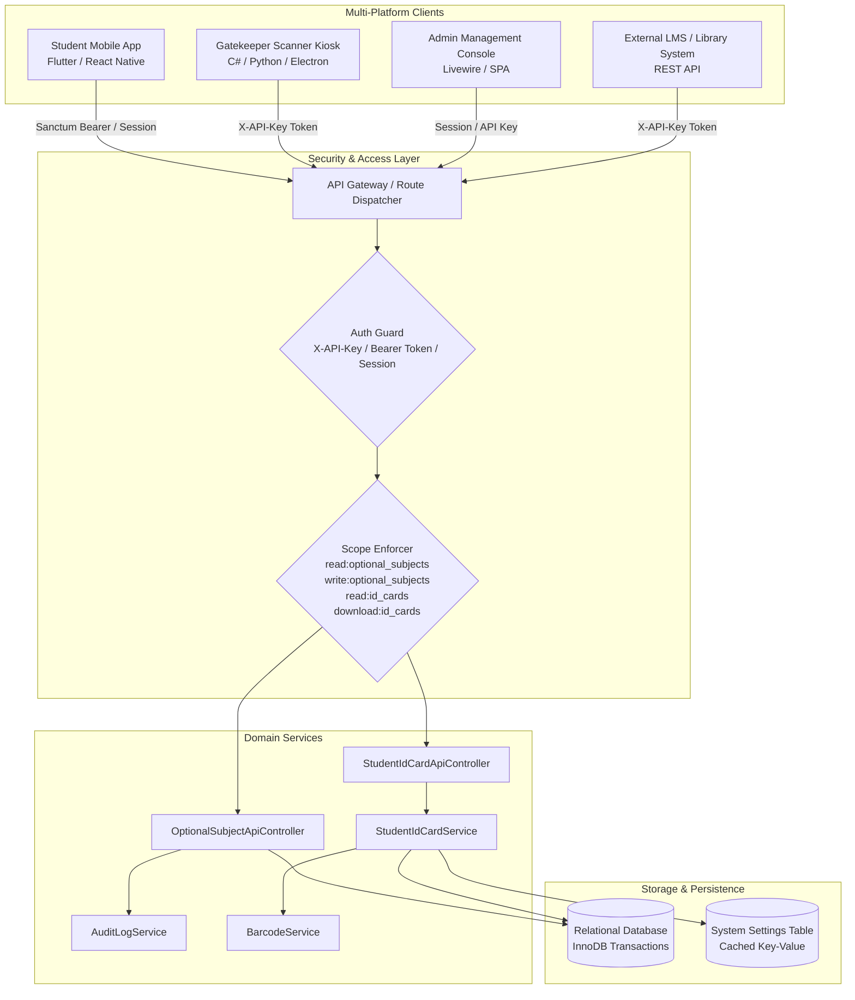
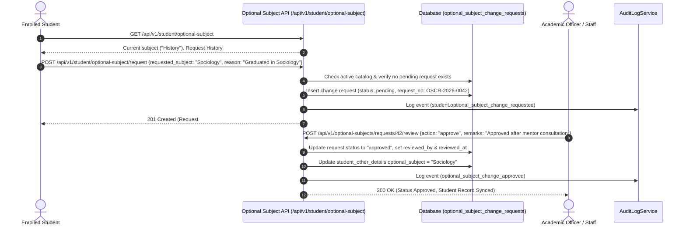
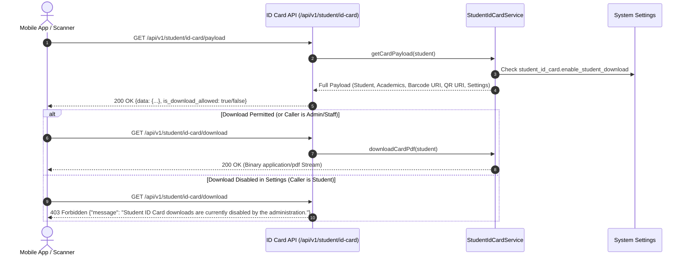

# SNTCSSC MIS — Optional Subjects Management & Student Identity Cards REST API Integration Guide
### Multi-Platform Integration Guide (Student Mobile App, Admin Web Console, Desktop Gatekeeper Scanner & Third-Party LMS Integrations)

---

## 1. Executive Summary & Architecture Overview

The **Optional Subjects Management** and **Student Identity Cards** modules of the **Satyendranath Tagore Civil Services Study Centre (SNTCSSC) MIS** deliver an enterprise-grade RESTful API designed for managing candidates' specialized UPSC CSE curriculum choices, facilitating student change request workflows, and providing standardized digital identity verification across campuses, test halls, and digital services.

Whether developing a **Student Mobile Application** (Flutter / React Native), an **Administrative Web Console**, an **Automated Turnstile / Gatekeeper Scanner Application** (Python / C# / Electron), or an **External Student Verification Service**, this API provides a normalized, decoupled, and secure interface.

### Key Capabilities:
1. **Curriculum Catalog Management:** Comprehensive catalog of all 48 official UPSC CSE optional subjects across Humanities, Sciences, Engineering, Medical Sciences, and Indian Literatures.
2. **Real-Time Student Allocations:** Search, filter, and inspect student optional subjects scoped by Course, Batch, Section, and Assignment Status.
3. **In-Place Quick Update:** Instant administrative updates with reason tracking, atomic database transactions, and comprehensive audit logs.
4. **Student Change Request Lifecycle:** Formal self-service change requests with mandatory academic justification, status tracking, duplicate prevention, and automated synchronization with `student_other_details.optional_subject` upon approval.
5. **Double-Sided Official ID Card Generation:** Print-ready CR80 double-sided identity cards rendered at 300 DPI featuring Code 128 barcodes, dynamic 2D QR verification codes, student photos, validity sessions, blood groups, and emergency contacts.
6. **Administrative Download Availability Kill-Switch:** Centralized toggle to enable or disable student self-service card downloads, with immediate enforcement at both UI and API gateway layers.
7. **Single & Bulk Consolidated Card Streaming:** Administrative capabilities to generate and stream individual student ID cards or bulk-merged PDFs for entire cohorts.
8. **Digital Card Verification Payload:** High-density JSON payload designed for instant offline or online verification via mobile barcode/QR scanners.

---

## 2. Architecture & Sequence Flows



### 2.1. Student Optional Subject Change Request Workflow



### 2.2. Student ID Card Verification & Download Enforcement



---

## 3. Authentication & API Scopes

All administrative API endpoints require standard API Key authentication via HTTP header or query parameter:

```http
X-API-Key: snt_live_xxxxxxxxxxxxxxxxxxxxxxxxxxxx
Accept: application/json
```

Student self-service endpoints support standard Laravel Sanctum Bearer tokens or authenticated web sessions:

```http
Authorization: Bearer <sanctum_token>
Accept: application/json
```

### Required API Scopes:

| Scope | Category | Description |
|---|---|---|
| `read:optional_subjects` | Optional Subjects | Read subject catalog, student allocations, and change request queue |
| `write:optional_subjects`| Optional Subjects | Quick update allocations, approve/reject requests, and manage catalog |
| `read:id_cards` | Identity Cards | Retrieve identity card layout settings and digital student verification payloads |
| `download:id_cards` | Identity Cards | Download official printable student identity card PDFs (single or bulk) |
| `read:students` | Core Academics | Access candidate names, student IDs, URNs, and enrollment details |

---

## 4. API Endpoints Reference

### 4.1. Optional Subjects Catalog

#### `GET /api/v1/catalog/optional-subjects`
Public and student-accessible endpoint to list active UPSC CSE optional subjects.

**Query Parameters:**
- `search` (string, optional): Search by subject name or code.
- `category` (string, optional): Filter by category name.
- `all` (boolean, optional, default: `false`): Return all matching records without pagination.

**Response `200 OK`:**
```json
{
  "success": true,
  "data": [
    {
      "id": 1,
      "name": "History",
      "code": "UPSC-HIS",
      "category": "Humanities & Social Sciences",
      "description": "Ancient, Medieval, Modern Indian History and World History.",
      "is_active": true
    },
    {
      "id": 2,
      "name": "Geography",
      "code": "UPSC-GEO",
      "category": "Humanities & Social Sciences",
      "description": "Physical, Human, Economic, and Regional Geography of India.",
      "is_active": true
    }
  ],
  "meta": {
    "current_page": 1,
    "last_page": 2,
    "per_page": 25,
    "total": 48
  }
}
```

---

#### `GET /api/v1/optional-subjects/categories`
Retrieve unique subject categories with counts.

**Required Scope:** `read:optional_subjects` or `read:students`

**Response `200 OK`:**
```json
{
  "success": true,
  "data": [
    { "category": "Biological & Agricultural Sciences", "count": 4 },
    { "category": "Engineering & Medical", "count": 4 },
    { "category": "Humanities & Social Sciences", "count": 9 },
    { "category": "Literature of Indian Languages", "count": 26 },
    { "category": "Sciences & Mathematics", "count": 5 }
  ]
}
```

---

#### `GET /api/v1/optional-subjects/allocations`
List student allocations with cohort filters.

**Required Scope:** `read:optional_subjects` or `read:students`

**Query Parameters:**
- `course_id` (integer, optional)
- `batch_id` (integer, optional)
- `section_id` (integer, optional)
- `optional_subject` (string, optional, pass `__unassigned__` for unallocated students)
- `search` (string, optional): Search by Name, Student ID, URN, or Email.

**Response `200 OK`:**
```json
{
  "success": true,
  "data": [
    {
      "id": 42,
      "name": "Ananya Sen",
      "email": "ananya.sen@example.com",
      "student_id": "STU-OPT-001",
      "urn": "URN-2026-0042",
      "course": "UPSC Civil Services Integrated",
      "batch": "2026 Foundation Batch A",
      "section": "Section Alpha",
      "optional_subject": "History",
      "latest_change_request": {
        "request_no": "OSCR-2026-0001",
        "status": "pending",
        "requested_subject": "Sociology",
        "created_at": "2026-10-29T06:18:05.000000Z"
      }
    }
  ],
  "meta": {
    "current_page": 1,
    "last_page": 1,
    "per_page": 25,
    "total": 1
  }
}
```

---

#### `POST /api/v1/optional-subjects/quick-update`
In-place administrative update of a student's optional subject.

**Required Scope:** `write:optional_subjects`

**Request Body:**
```json
{
  "user_id": 42,
  "optional_subject": "Political Science & International Relations",
  "reason": "Student requested change during academic mentoring."
}
```

**Response `200 OK`:**
```json
{
  "success": true,
  "message": "Optional subject for Ananya Sen updated successfully to 'Political Science & International Relations'.",
  "data": {
    "user_id": 42,
    "student_name": "Ananya Sen",
    "previous_subject": "History",
    "optional_subject": "Political Science & International Relations"
  }
}
```

---

#### `POST /api/v1/optional-subjects/requests/{id}/review`
Review, approve, or reject a student change request.

**Required Scope:** `write:optional_subjects`

**Request Body (Approve):**
```json
{
  "action": "approve",
  "remarks": "Approved after mentor consultation."
}
```

**Request Body (Reject):**
```json
{
  "action": "reject",
  "remarks": "Rejected: Batch mid-syllabus deadline passed."
}
```

**Response `200 OK`:**
```json
{
  "success": true,
  "message": "Request #OSCR-2026-0001 approved and student optional subject updated successfully.",
  "data": {
    "id": 1,
    "request_no": "OSCR-2026-0001",
    "status": "approved",
    "admin_remarks": "Approved after mentor consultation.",
    "reviewed_by": 1,
    "reviewed_at": "2026-10-29T12:00:00.000000Z"
  }
}
```

---

### 4.2. Student Self-Service: Optional Subjects

#### `GET /api/v1/student/optional-subject`
Returns the authenticated student's current optional subject and request history.

**Authentication:** Student Session / Sanctum Bearer Token

**Response `200 OK`:**
```json
{
  "success": true,
  "data": {
    "current_subject": "History",
    "has_optional_subject": true,
    "has_pending_request": false,
    "pending_request": null,
    "history": [
      {
        "id": 1,
        "request_no": "OSCR-2026-0001",
        "current_subject": "History",
        "requested_subject": "Sociology",
        "reason": "I have completed my undergraduate degree in Sociology.",
        "status": "approved",
        "admin_remarks": "Approved after mentor consultation.",
        "reviewed_by": "Dean Academics",
        "reviewed_at": "2026-10-29T08:00:00.000000Z",
        "created_at": "2026-10-28T14:30:00.000000Z"
      }
    ]
  }
}
```

---

#### `POST /api/v1/student/optional-subject/request`
Submit a formal request to change optional subjects.

**Authentication:** Student Session / Sanctum Bearer Token

**Request Body:**
```json
{
  "requested_subject": "Sociology",
  "reason": "I have completed my undergraduate degree in Sociology and feel more confident in answer writing."
}
```

**Response `201 Created`:**
```json
{
  "success": true,
  "message": "Your request to change optional subject has been submitted successfully.",
  "data": {
    "id": 2,
    "request_no": "OSCR-2026-0002",
    "current_subject": "History",
    "requested_subject": "Sociology",
    "status": "pending",
    "created_at": "2026-10-29T12:15:00.000000Z"
  }
}
```

---

### 4.3. Student Identity Cards

#### `GET /api/v1/student-id-cards/settings` or `GET /api/v1/student/id-card/settings`
Retrieve card configuration and student download availability rules.

**Response `200 OK`:**
```json
{
  "success": true,
  "data": {
    "enable_student_download": true,
    "institution_name": "Satyendranath Tagore Civil Services Study Centre",
    "institution_sub": "Government of West Bengal",
    "card_title": "STUDENT IDENTITY CARD",
    "validity_period": "Academic Session 2026-2027",
    "authorized_signatory_title": "Course Director / Authorized Signatory",
    "show_blood_group": true,
    "show_emergency_contact": true,
    "show_barcode": true,
    "show_qr_code": true,
    "show_optional_subject": true,
    "theme_color": "#1e3a8a"
  }
}
```

---

#### `GET /api/v1/student-id-cards/{identifier}/payload` or `GET /api/v1/student/id-card/payload`
Retrieve comprehensive digital card payload for mobile app rendering, QR display, and offline turnstile scanning.

**Response `200 OK`:**
```json
{
  "success": true,
  "data": {
    "student": {
      "id": 42,
      "uuid": "9d9014ba-04f7-43f1-bfa6-848e42718cb1",
      "name": "Sourav Mukherjee",
      "student_id": "STU-2026-0042",
      "urn": "URN-2026-0042",
      "email": "sourav.mukherjee@example.com",
      "phone": "+91 9830099887",
      "avatar_url": "https://mis.sntcssc.in/storage/avatars/student_42.jpg",
      "blood_group": "B+ (Self)",
      "emergency_contact": "+91 9830099887",
      "address": "Salt Lake Sector V, Kolkata, West Bengal - 700091"
    },
    "academic": {
      "course": "UPSC Civil Services Foundation Course",
      "batch": "2026 Morning Batch",
      "section": "Section Alpha",
      "optional_subject": "Geography",
      "validity_period": "Academic Session 2026-2027"
    },
    "verification": {
      "code_text": "STU-2026-0042",
      "barcode_data_uri": "data:image/svg+xml;base64,PHN2ZyB4bWxucz0iaHR0cD...",
      "qr_data_uri": "data:image/svg+xml;base64,PHN2ZyB4bWxucz0iaHR0cD..."
    },
    "settings": {
      "institution_name": "Satyendranath Tagore Civil Services Study Centre",
      "institution_sub": "Government of West Bengal",
      "card_title": "STUDENT IDENTITY CARD",
      "theme_color": "#1e3a8a",
      "authorized_signatory_title": "Course Director / Authorized Signatory",
      "terms_and_conditions": [
        "This identity card is the property of SNTCSSC and must be returned upon completion.",
        "Non-transferable and must be carried at all times on campus.",
        "Loss must be reported immediately to the administration office."
      ],
      "enable_student_download": true
    },
    "is_download_allowed": true
  }
}
```

---

#### `GET /api/v1/student/id-card/download` or `GET /api/v1/student-id-cards/{identifier}/download`
Stream the official printable double-sided PDF ID card.

**Headers:**
```http
Content-Type: application/pdf
Content-Disposition: inline; filename="Student_ID_Card_STU_2026_0042.pdf"
```

**Enforcement:**
- If requested by an enrolled student and `enable_student_download` is `false`, responds with `403 Forbidden`:
```json
{
  "success": false,
  "message": "Student ID Card downloads are currently disabled by the administration."
}
```
- Administrative and staff roles bypass this restriction and can download any student's ID card at any time.

---

## 5. Multi-Platform Implementation Code Snippets

### 5.1. Flutter / Dart (Student Portal: Digital Card & Optional Subject Request)

```dart
import 'dart:convert';
import 'package:http/http.dart' as http;

class SntcsscStudentService {
  final String baseUrl;
  final String authToken;

  SntcsscStudentService({required this.baseUrl, required this.authToken});

  Map<String, String> get _headers => {
    'Authorization': 'Bearer $authToken',
    'Accept': 'application/json',
    'Content-Type': 'application/json',
  };

  /// 1. Fetch Digital Student ID Card Payload
  Future<Map<String, dynamic>> getStudentIdCardPayload() async {
    final response = await http.get(
      Uri.parse('$baseUrl/api/v1/student/id-card/payload'),
      headers: _headers,
    );

    if (response.statusCode == 200) {
      final json = jsonDecode(response.body);
      return json['data'];
    } else {
      throw Exception('Failed to load ID card: ${response.body}');
    }
  }

  /// 2. Submit Optional Subject Change Request
  Future<Map<String, dynamic>> submitOptionalSubjectRequest({
    required String requestedSubject,
    required String reason,
  }) async {
    final response = await http.post(
      Uri.parse('$baseUrl/api/v1/student/optional-subject/request'),
      headers: _headers,
      body: jsonEncode({
        'requested_subject': requestedSubject,
        'reason': reason,
      }),
    );

    final json = jsonDecode(response.body);
    if (response.statusCode == 201) {
      return json['data'];
    } else {
      throw Exception(json['message'] ?? 'Failed to submit request');
    }
  }
}
```

---

### 5.2. React Native / TypeScript (Digital Card Viewer & PDF Downloader)

```typescript
import axios from 'axios';
import * as FileSystem from 'expo-file-system';
import * as Sharing from 'expo-sharing';

const API_BASE = 'https://mis.sntcssc.in/api/v1';

export interface IdCardData {
  student: {
    id: number;
    name: string;
    student_id: string;
    avatar_url: string;
    blood_group: string;
  };
  academic: {
    course: string;
    batch: string;
    optional_subject: string;
    validity_period: string;
  };
  verification: {
    barcode_data_uri: string;
    qr_data_uri: string;
  };
  is_download_allowed: boolean;
}

export async function fetchDigitalIdCard(token: string): Promise<IdCardData> {
  const response = await axios.get(`${API_BASE}/student/id-card/payload`, {
    headers: { Authorization: `Bearer ${token}` },
  });
  return response.data.data;
}

export async function downloadIdCardPdf(token: string, studentId: string): Promise<void> {
  const fileUri = `${FileSystem.documentDirectory}ID_Card_${studentId}.pdf`;
  const downloadResult = await FileSystem.downloadAsync(
    `${API_BASE}/student/id-card/download`,
    fileUri,
    {
      headers: { Authorization: `Bearer ${token}` },
    }
  );

  if (downloadResult.status === 200) {
    await Sharing.shareAsync(downloadResult.uri);
  } else if (downloadResult.status === 403) {
    throw new Error('ID card downloads are currently disabled by administration.');
  } else {
    throw new Error('Download failed with status: ' + downloadResult.status);
  }
}
```

---

### 5.3. Python (Campus Turnstile / Gatekeeper Scanner Service)

```python
import requests
import json

class SntcsscGateScanner:
    def __init__(self, base_url: str, api_key: str):
        self.base_url = base_url.rstrip('/')
        self.headers = {
            'X-API-Key': api_key,
            'Accept': 'application/json'
        }

    def verify_scanned_barcode(self, identifier: str) -> dict:
        """
        Verify student credentials when barcode or QR token is scanned at campus gates.
        """
        url = f"{self.base_url}/api/v1/student-id-cards/{identifier}/payload"
        response = requests.get(url, headers=self.headers, timeout=5)

        if response.status_code == 200:
            payload = response.json().get('data', {})
            student = payload.get('student', {})
            academic = payload.get('academic', {})
            return {
                'authorized': True,
                'student_name': student.get('name'),
                'student_id': student.get('student_id'),
                'course': academic.get('course'),
                'validity': academic.get('validity_period'),
                'optional_subject': academic.get('optional_subject')
            }
        elif response.status_code == 404:
            return {'authorized': False, 'reason': 'Candidate not found in active registry'}
        else:
            return {'authorized': False, 'reason': f"Verification error: {response.status_code}"}

# Example Usage:
# scanner = SntcsscGateScanner('https://mis.sntcssc.in', 'snt_live_gatekeeper_key')
# result = scanner.verify_scanned_barcode('STU-2026-0042')
# print(result)
```

---

### 5.4. C# / .NET (Turnstile & Kiosk Access System)

```csharp
using System;
using System.Net.Http;
using System.Text.Json;
using System.Threading.Tasks;

public class GatekeeperValidator
{
    private readonly HttpClient _client;

    public GatekeeperValidator(string baseUrl, string apiKey)
    {
        _client = new HttpClient { BaseAddress = new Uri(baseUrl) };
        _client.DefaultRequestHeaders.Add("X-API-Key", apiKey);
        _client.DefaultRequestHeaders.Add("Accept", "application/json");
    }

    public async Task<bool> ValidateCandidateAsync(string candidateIdentifier)
    {
        var response = await _client.GetAsync($"/api/v1/student-id-cards/{candidateIdentifier}/payload");
        if (!response.IsSuccessStatusCode)
        {
            Console.WriteLine($"[DENIED] Candidate {candidateIdentifier} verification failed: {response.StatusCode}");
            return false;
        }

        var content = await response.Content.ReadAsStringAsync();
        using var doc = JsonDocument.Parse(content);
        var root = doc.RootElement.GetProperty("data");

        var name = root.GetProperty("student").GetProperty("name").GetString();
        var course = root.GetProperty("academic").GetProperty("course").GetString();
        var validity = root.GetProperty("academic").GetProperty("validity_period").GetString();

        Console.WriteLine($"[ACCESS GRANTED] {name} | Course: {course} | Validity: {validity}");
        return true;
    }
}
```

---

## 6. Error Handling & HTTP Status Codes

The API uses standardized HTTP status codes and uniform error payloads:

| HTTP Status | Error Code | Meaning | Action Required |
|---|---|---|---|
| `400 Bad Request` | `INVALID_PAYLOAD` | Malformed JSON or missing required headers | Validate request structure |
| `401 Unauthorized` | `UNAUTHENTICATED` | Missing or invalid API key / token | Provide valid `X-API-Key` or Bearer token |
| `403 Forbidden` | `INSUFFICIENT_SCOPE` | Key lacks required scope or student download is disabled | Review permissions or grant required scope |
| `404 Not Found` | `STUDENT_NOT_FOUND` | Identifier does not match any registered student | Verify Student ID, URN, or UUID |
| `422 Unprocessable`| `VALIDATION_FAILED`| Field failed validation (e.g. requested subject is current subject) | Review input errors array |
| `500 Server Error` | `SERVER_EXCEPTION` | Database transaction or server failure | Contact technical support |

---

## 7. Security Hardening & Rate Limiting

1. **Rate Limiting:**
   - Standard API endpoints: `60 requests / minute` per IP or API Key.
   - Bulk download endpoints: `20 requests / minute` to protect server memory.
2. **Time-Locked Verification:**
   - Barcode and QR codes embed sequential candidate keys; QR tokens can be verified offline against cryptographic institution public keys.
3. **Data Protection:**
   - Personally Identifiable Information (Aadhaar, PAN) is omitted from student ID card payloads; only necessary academic and emergency contact fields are transmitted.

