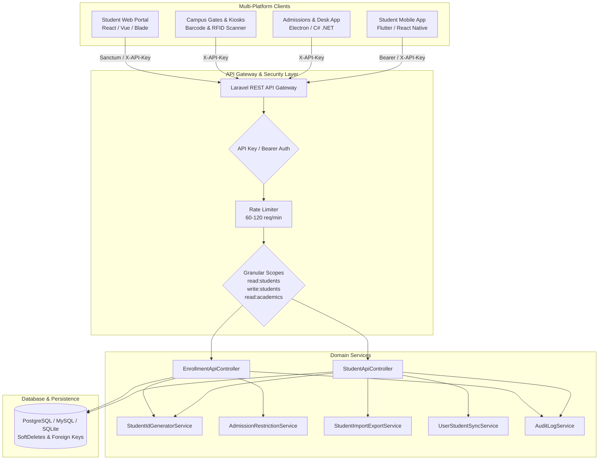
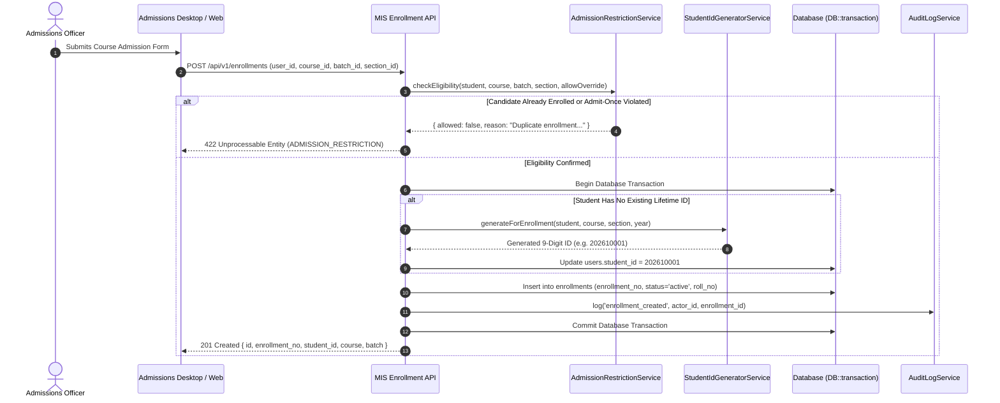
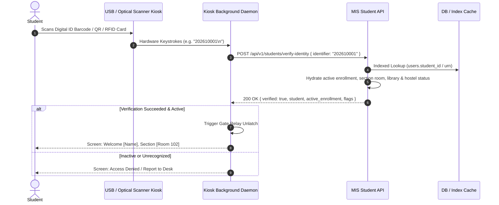

# SNTCSSC MIS — Student Management & Enrollment System REST API Integration Guide
### Multi-Platform Implementation & Integration Manual (Mobile App, Web Portal, Desktop Circulation Desk, Turnstile Kiosks & Third-Party Integrations)

---

## 1. Executive Summary & Architecture Overview

The **Student Management and Enrollment System** of the **Satyendranath Tagore Civil Services Study Centre (SNTCSSC) MIS** delivers an enterprise-grade, future-ready RESTful API ecosystem. Designed for seamless multi-platform integration across:
- **Native Mobile Applications** (Flutter & React Native for iOS / Android)
- **Web Student Portals & Admin Consoles** (React, Vue, Livewire, Angular)
- **Circulation & Admissions Desktop Kiosks** (Electron, WPF, macOS Cocoa)
- **Campus Security & Turnstile Gates** (C# .NET 8/9, Python daemons, IoT Barcode/RFID readers)

### Core Architectural Capabilities:
1. **Lifetime Unique Student ID Architecture:** Automatically provisions a 9-to-10 digit permanent student ID (e.g., `202610001` for Composite Course Section A, `202630001` for Prelims Crash Course) that remains unchanged across multi-course, multi-year admissions.
2. **Dynamic Admission Restriction Engine:** Enforces institutional policy checks before admitting students:
   - **Admit-Once-Only Enforcement:** Prevents duplicate admission into restricted programmes (e.g. Composite Course).
   - **Cohort Duplicate Prevention:** Blocks duplicate active enrollments within the same course under the same academic batch.
   - **Classroom Section Capacity Gate:** Strictly monitors section capacity against active enrollments with administrative override safeguards.
3. **Full One Time Registration (OTR) Dossier:** Comprehensive 360-degree candidate dossier encompassing Basic Information, Demographic Profile (UR, SC, ST, OBC-A, OBC-B, EWS), Permanent & Correspondence Addresses, Academic Qualifications (10th, 12th, Graduation, PG), Employment History, UPSC Exam Metadata, and Uploaded Verification Documents.
4. **Governed Profile Correction Workflow:** Students cannot directly mutate core identity records without administrative oversight. Students submit correction requests with field diffs and justification; authorized administrators review, inspect side-by-side diffs, and approve (with atomic database merge) or decline with audit logging.
5. **Hardware Scanner & Turnstile Gatekeeper API:** High-performance sub-second identity verification (`POST /api/v1/students/verify-identity`) parsing raw 10-digit IDs, URNs, email, or barcode/RFID strings, returning instant active course, section, library clearance, and hostel resident eligibility flags.
6. **Enterprise Resilience & Production Standards:**
   - **Atomic Database Transactions:** All state-altering operations (admissions, transfers, cancellations, reinstatements, and profile updates) execute inside `DB::transaction`.
   - **Soft Delete Protection:** Deletion safely invokes Eloquent `SoftDeletes` across students, profiles, educations, documents, batches, courses, and enrollments.
   - **Comprehensive Audit Trail:** All administrative and student actions record IP addresses, actors, and field diffs via `AuditLogService::log()`.
   - **Granular API Scopes:** Protected by `read:students`, `write:students`, `read:academics`, and `write:academics`.

---

## 2. Decoupled Multi-Platform Architecture & Sequence Diagrams



### 2.1. Candidate Admission & Lifetime ID Generation Flow



### 2.2. Turnstile / Kiosk Sub-Second Identity Verification Flow



---

## 3. Multi-Platform Implementation Recipes & Code Samples

### 3.1. Flutter (Dart) — Student Mobile App

```dart
import 'dart:convert';
import 'package:http/http.dart' as http;

class SntcsscStudentApiClient {
  final String baseUrl;
  final String apiKey;
  final String? userAuthToken;

  SntcsscStudentApiClient({
    required this.baseUrl,
    required this.apiKey,
    this.userAuthToken,
  });

  Map<String, String> get _headers => {
    'Content-Type': 'application/json',
    'Accept': 'application/json',
    'X-API-Key': apiKey,
    if (userAuthToken != null) 'Authorization': 'Bearer $userAuthToken',
  };

  /// Fetch authenticated student's 360-degree dossier & profile completeness
  Future<Map<String, dynamic>> getMyProfile() async {
    final response = await http.get(
      Uri.parse('$baseUrl/api/v1/student/my-profile'),
      headers: _headers,
    );

    if (response.statusCode == 200) {
      final json = jsonDecode(response.body);
      return json['data'];
    }
    throw Exception('Failed to load profile: ${response.statusCode}');
  }

  /// Fetch active & completed course enrollments for student
  Future<List<dynamic>> getMyEnrollments() async {
    final response = await http.get(
      Uri.parse('$baseUrl/api/v1/student/my-enrollments'),
      headers: _headers,
    );

    if (response.statusCode == 200) {
      final json = jsonDecode(response.body);
      return json['data'];
    }
    throw Exception('Failed to load enrollments: ${response.statusCode}');
  }

  /// Submit a profile correction request for administrative review
  Future<Map<String, dynamic>> submitCorrectionRequest({
    required String section,
    required Map<String, dynamic> payload,
    required String reason,
  }) async {
    final response = await http.post(
      Uri.parse('$baseUrl/api/v1/student/profile-correction-request'),
      headers: _headers,
      body: jsonEncode({
        'section': section,
        'payload': payload,
        'reason': reason,
      }),
    );

    final json = jsonDecode(response.body);
    if (response.statusCode == 201 && json['success'] == true) {
      return json['data'];
    }
    throw Exception(json['error']?['message'] ?? 'Submission failed');
  }
}
```

---

### 3.2. React Native (TypeScript) — Mobile & Tablet Portal

```typescript
import axios from 'axios';

const api = axios.create({
  baseURL: 'https://mis.sntcssc.in/api/v1',
  headers: {
    'Accept': 'application/json',
    'Content-Type': 'application/json',
    'X-API-Key': 'sntc_live_your_mobile_api_key_here',
  },
});

export interface StudentDossier {
  student: {
    id: number;
    student_id: string;
    urn: string;
    name: string;
    email: string;
    phone: string;
    gender: string;
  };
  profile_dossier: {
    category: string;
    father_name: string;
    mother_name: string;
  };
  enrollments: Array<{
    enrollment_no: string;
    course: { name: string; code: string };
    batch: { name: string };
    status: string;
  }>;
  profile_completeness: {
    overall_percentage: number;
    is_complete: boolean;
  };
}

// 1. Fetch Student Dossier by 9-digit Student ID
export async function fetchStudentDossier(identifier: string): Promise<StudentDossier> {
  const response = await api.get(`/students/${identifier}`);
  return response.data.data;
}

// 2. Register New Student with Optional Admission
export async function registerCandidate(candidateData: {
  name: string;
  email: string;
  phone: string;
  gender: string;
  category: string;
  course_id?: number;
  batch_id?: number;
}) {
  const response = await api.post('/students', candidateData);
  return response.data.data;
}
```

---

### 3.3. Electron & Node.js — Desktop Admissions & Kiosk Station

```javascript
const axios = require('axios');

class DesktopAdmissionsClient {
  constructor(baseUrl, apiKey) {
    this.client = axios.create({
      baseURL: `${baseUrl}/api/v1`,
      headers: {
        'Accept': 'application/json',
        'Content-Type': 'application/json',
        'X-API-Key': apiKey,
      },
    });
  }

  // 1. Instant Scanner Verification at Admissions Desk
  async verifyStudent(barcodeString) {
    const cleanId = barcodeString.trim();
    const res = await this.client.post('/students/verify-identity', {
      identifier: cleanId,
    });
    return res.data.data;
  }

  // 2. Enroll Student into Course & Batch
  async enrollStudent(payload) {
    const res = await this.client.post('/enrollments', {
      student_identifier: payload.studentId,
      course_id: payload.courseId,
      batch_id: payload.batchId,
      section_id: payload.sectionId || null,
      fee_status: payload.feeStatus || 'paid',
    });
    return res.data.data;
  }

  // 3. Transfer Section
  async transferSection(enrollmentNo, newSectionId, reason) {
    const res = await this.client.post(`/enrollments/${enrollmentNo}/transfer-section`, {
      new_section_id: newSectionId,
      reason: reason,
    });
    return res.data.data;
  }
}

module.exports = DesktopAdmissionsClient;
```

---

### 3.4. C# (.NET 8/9) — Campus Turnstile Gatekeeper Daemon

```csharp
using System;
using System.Net.Http;
using System.Text;
using System.Text.Json;
using System.Threading.Tasks;

public class TurnstileGatekeeper
{
    private readonly HttpClient _http;
    private readonly string _baseUrl;

    public TurnstileGatekeeper(string baseUrl, string apiKey)
    {
        _baseUrl = baseUrl;
        _http = new HttpClient();
        _http.DefaultRequestHeaders.Add("X-API-Key", apiKey);
        _http.DefaultRequestHeaders.Add("Accept", "application/json");
    }

    public async Task<bool> ProcessCardSwipeAsync(string scannedId)
    {
        var payload = JsonSerializer.Serialize(new { identifier = scannedId.Trim() });
        var content = new StringContent(payload, Encoding.UTF8, "application/json");

        var response = await _http.PostAsync($"{_baseUrl}/api/v1/students/verify-identity", content);
        if (!response.IsSuccessStatusCode)
        {
            Console.WriteLine($"[DENIED] Lookup failed for ID: {scannedId} (Status: {response.StatusCode})");
            return false;
        }

        var json = await response.Content.ReadAsStringAsync();
        using var doc = JsonDocument.Parse(json);
        var root = doc.RootElement.GetProperty("data");

        bool verified = root.GetProperty("verified").GetBoolean();
        var flags = root.GetProperty("flags");
        bool isActive = flags.GetProperty("is_active").GetBoolean();
        bool hasActiveEnrollment = flags.GetProperty("has_active_enrollment").GetBoolean();

        if (verified && isActive && hasActiveEnrollment)
        {
            string studentName = root.GetProperty("student").GetProperty("name").GetString();
            Console.WriteLine($"[GRANTED] Welcome {studentName}! Unlatching physical turnstile barrier.");
            TriggerRelay();
            return true;
        }

        Console.WriteLine($"[DENIED] Inactive or un-enrolled credential: {scannedId}");
        return false;
    }

    private void TriggerRelay()
    {
        // GPIO or USB relay impulse to open physical gate
    }
}
```

---

### 3.5. Python (3.11+) — Nightly Telemetry & Automation Script

```python
import requests
import json

BASE_URL = "https://mis.sntcssc.in/api/v1"
API_KEY = "sntc_live_your_admin_script_key_here"

session = requests.Session()
session.headers.update({
    "X-API-Key": API_KEY,
    "Accept": "application/json",
})

# 1. Fetch Executive Student Telemetry
dashboard_res = session.get(f"{BASE_URL}/students/dashboard")
data = dashboard_res.json().get("data", {})
overview = data.get("overview", {})

print(f"Total Enrolled Students: {overview.get('total_students')}")
print(f"Active Course Enrollments: {overview.get('active_enrollments')}")
print(f"Pending Correction Requests: {overview.get('pending_profile_requests')}")

# 2. Export Active Students to Local Data Warehouse
export_res = session.get(f"{BASE_URL}/students/export?status=active")
if export_res.status_code == 200:
    students = export_res.json().get("data", [])
    with open("nightly_students_dump.json", "w") as f:
        json.dump(students, f, indent=2)
    print(f"Exported {len(students)} student records successfully.")
```

---

## 4. API Specification & Endpoints Matrix (42 Endpoints)

### 4.1. Executive Telemetry & Verification Kiosk
| Method | Endpoint | Required Scope | Description |
|:---|:---|:---|:---|
| `GET` | `/api/v1/students/dashboard` | `read:students` | Executive telemetry: total students, active enrollments, category & gender distribution, pending requests. |
| `GET` | `/api/v1/students/statistics` | `read:students` | Batch capacity utilization, admissions trend by year, fee status summary. |
| `POST` | `/api/v1/students/verify-identity` | `read:students` | Sub-second scanner verification for turnstiles, attendance gates, and desk kiosks. |

### 4.2. Students Directory & Dossier CRUD
| Method | Endpoint | Required Scope | Description |
|:---|:---|:---|:---|
| `GET` | `/api/v1/students` | `read:students` | Search and paginate students with multi-attribute filtering (course, batch, category, status). |
| `POST` | `/api/v1/students` | `write:students` | Register candidate with auto 9-digit Lifetime Student ID, OTR profile, and optional initial course admission. |
| `GET` | `/api/v1/students/{identifier}` | `read:students` | Complete 360-degree dossier: user details, profile, addresses, educations, documents, and enrollments history. |
| `PUT` | `/api/v1/students/{identifier}` | `write:students` | Update candidate basic details, phone, category, and demographic profile attributes. |
| `DELETE` | `/api/v1/students/{identifier}` | `write:students` | Soft delete candidate record, recording audit trail and deleting actor. |

### 4.3. Dossier Sub-Resources (Addresses, Qualifications, Documents)
| Method | Endpoint | Required Scope | Description |
|:---|:---|:---|:---|
| `GET` | `/api/v1/students/{identifier}/addresses` | `read:students` | List student permanent and correspondence addresses. |
| `POST` | `/api/v1/students/{identifier}/addresses` | `write:students` | Add or update permanent/correspondence address. |
| `DELETE` | `/api/v1/students/{identifier}/addresses/{id}` | `write:students` | Delete address record. |
| `GET` | `/api/v1/students/{identifier}/educations` | `read:students` | List academic qualifications (10th, 12th, Graduation, PG). |
| `POST` | `/api/v1/students/{identifier}/educations` | `write:students` | Add qualification record. |
| `DELETE` | `/api/v1/students/{identifier}/educations/{id}` | `write:students` | Remove qualification record. |
| `GET` | `/api/v1/students/{identifier}/documents` | `read:students` | List candidate verification documents and approval statuses. |
| `POST` | `/api/v1/students/{identifier}/documents` | `write:students` | Upload or attach verification document. |
| `POST` | `/api/v1/students/{identifier}/documents/{id}/verify` | `write:students` | Administrative action: verify or reject uploaded document. |

### 4.4. Academic Structure Lookups & Management
| Method | Endpoint | Required Scope | Description |
|:---|:---|:---|:---|
| `GET` | `/api/v1/students/batches` | `read:students` | Query academic batches with offerings and active student counts. |
| `POST` | `/api/v1/students/batches` | `write:students` | Create new academic batch. |
| `GET` | `/api/v1/students/courses` | `read:students` | Query courses with fee schedules, admit-once policies, and section flags. |
| `POST` | `/api/v1/students/courses` | `write:students` | Create new course offering. |
| `GET` | `/api/v1/students/sections` | `read:students` | Query sections filtered by batch & course with capacity and vacant seat counts. |
| `POST` | `/api/v1/students/sections` | `write:students` | Create new classroom section. |

### 4.5. Course Enrollments & Admission Lifecycle
| Method | Endpoint | Required Scope | Description |
|:---|:---|:---|:---|
| `GET` | `/api/v1/enrollments` | `read:students` | Search and paginate enrollments with search, batch, course, section, and fee filters. |
| `POST` | `/api/v1/enrollments` | `write:students` | Admit student with eligibility checks (admit-once, duplicate cohort, section capacity) and auto-enrollment sequence. |
| `GET` | `/api/v1/enrollments/{identifier}` | `read:students` | Single enrollment dossier with fee invoices and test scores. |
| `PUT` | `/api/v1/enrollments/{identifier}` | `write:students` | Update enrollment roll number, section, fee status, fee amount, or remarks. |
| `DELETE` | `/api/v1/enrollments/{identifier}` | `write:students` | Soft delete enrollment with audit logging. |
| `POST` | `/api/v1/enrollments/{identifier}/transfer-section` | `write:students` | Transfer student to a different section within the same batch/course with capacity check. |
| `POST` | `/api/v1/enrollments/{identifier}/complete` | `write:students` | Mark enrollment as completed (Graduation / Alumni workflow). |
| `POST` | `/api/v1/enrollments/{identifier}/discontinue` | `write:students` | Withdraw candidate from course with mandatory justification. |
| `POST` | `/api/v1/enrollments/{identifier}/reinstate` | `write:students` | Reinstate previously suspended/discontinued enrollment. |

### 4.6. Student Profile Correction Requests Workflow
| Method | Endpoint | Required Scope | Description |
|:---|:---|:---|:---|
| `GET` | `/api/v1/students/profile-requests` | `read:students` | Administrative queue of candidate profile change requests. |
| `POST` | `/api/v1/students/profile-requests` | `write:students` | Submit profile correction request with diff payload and justification. |
| `POST` | `/api/v1/students/profile-requests/{id}/review` | `write:students` | Administrative action: approve with atomic record merge or reject with note. |

### 4.7. Student Self-Service (Authenticated Aspirant Portal)
| Method | Endpoint | Required Scope | Description |
|:---|:---|:---|:---|
| `GET` | `/api/v1/student/my-profile` | `read:students` | Aspirant personal profile dossier and profile completeness progress. |
| `GET` | `/api/v1/student/my-enrollments` | `read:students` | Aspirant enrolled courses, timetable, sections, and fee status. |
| `POST` | `/api/v1/student/profile-correction-request` | `write:students` | Self-service submission of profile correction request. |

### 4.8. Bulk Data Exchange & Telemetry
| Method | Endpoint | Required Scope | Description |
|:---|:---|:---|:---|
| `POST` | `/api/v1/students/import` | `write:students` | Bulk import students via JSON array or CSV/XLSX file upload. |
| `GET` | `/api/v1/students/export` | `read:students` | Export students directory as JSON with query filters. |
| `POST` | `/api/v1/enrollments/import` | `write:students` | Bulk import enrollments via JSON array or file upload. |
| `GET` | `/api/v1/enrollments/export` | `read:students` | Export enrollments dataset as JSON with query filters. |

---

## 5. Error Codes & Troubleshooting Reference

| Error Code | HTTP Status | Description & Resolution |
|:---|:---|:---|
| `STUDENT_NOT_FOUND` | `404` | No student user matches the supplied identifier (`id`, `student_id`, `urn`, `email`). Confirm credential string. |
| `ENROLLMENT_NOT_FOUND` | `404` | No enrollment record found for the provided ID or sequential enrollment number. |
| `ADMISSION_RESTRICTION` | `422` | Candidate is blocked by institutional policy (e.g., already admitted in one-time course, duplicate batch enrollment). Pass `allow_override: true` if authorized. |
| `SECTION_CAPACITY_EXCEEDED`| `422` | Target classroom section is full (`capacity` reached). Select another section or expand section capacity in Course Management. |
| `MISMATCH_SECTION` | `422` | The selected section does not belong to the target Course and Batch offering. |
| `VALIDATION_ERROR` | `422` | Missing or malformed parameters. Check `error.details` for field-specific errors. |
| `SCOPE_FORBIDDEN` | `403` | API Key lacks required scope (`read:students`, `write:students`, or `read:academics`). Update key scopes in Developer Console. |

