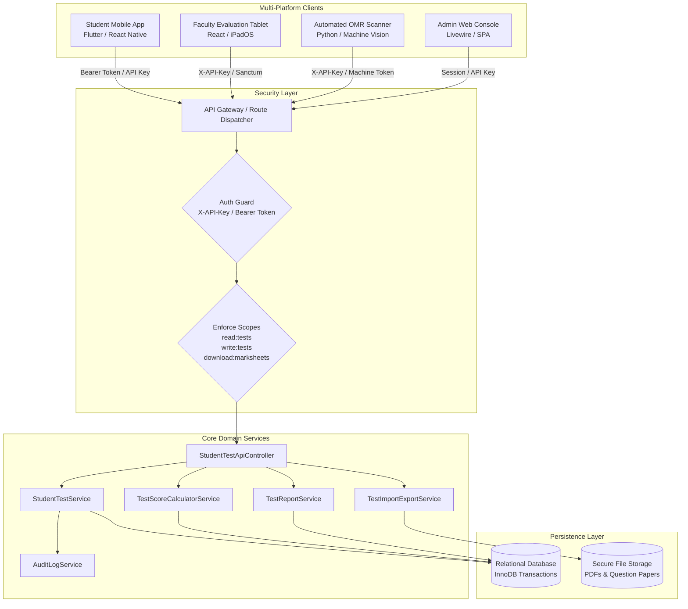
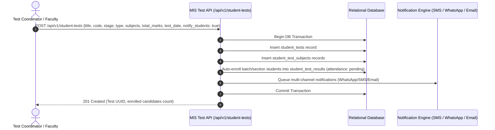
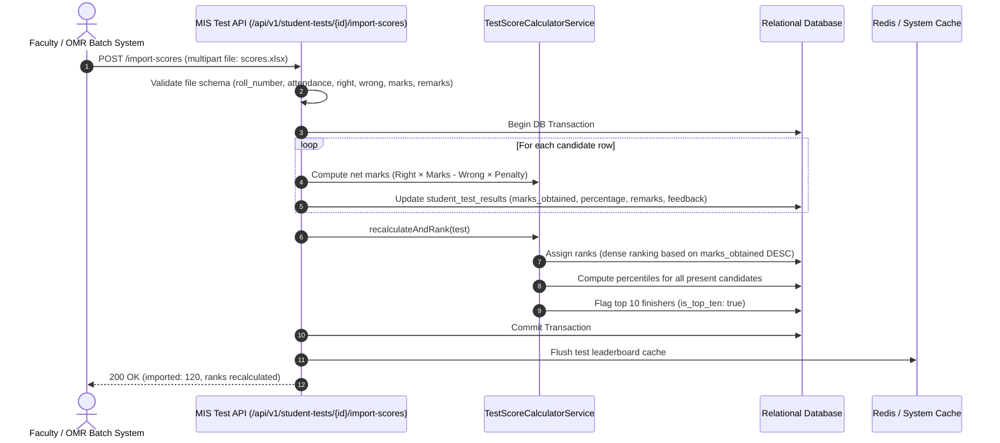

# SNTCSSC MIS — Student Tests & Examinations Performance REST API Integration Guide
### Multi-Platform Implementation & Integration Guide (Student Mobile App, Faculty Grading Tablets, Admin Web Console, Desktop Kiosks & Automated OMR Scoring Services)

---

## 1. Executive Summary & Architecture Overview

The **Student Tests & Examinations Performance Management Module** of the **Satyendranath Tagore Civil Services Study Centre (SNTCSSC) MIS** delivers an enterprise-grade RESTful API designed specifically for the rigorous preparation, monitoring, and evaluation of **UPSC Civil Services Examination (CSE)** and state civil service aspirants.

Whether developing a **Student Mobile App** (Flutter / React Native), a **Faculty Grading Tablet Application**, an **Automated OMR Scanner Integration** (Python / OpenCV), a **Desktop Hall of Fame Display Kiosk** (Electron / C#), or a **Web Analytics Portal**, this API provides a fully normalized, decoupled, and secure interface.

### Key Capabilities:
1. **Comprehensive Examination Series:** Full support for both **Prelims (Objective / MCQ)** and **Mains (Descriptive, Essay, Answer Writing)**, sectional tests, full-length mock examinations, live tests, and class tests.
2. **Composite Multi-Subject Papers:** Schedule examinations featuring multiple subjects (e.g. General Studies 50 questions + CSAT 50 questions = composite 100 questions) with individual subject marks and negative penalties.
3. **Automated UPSC Negative Marking Engine:** Strict application of the standard UPSC 1/3rd penalty:
   - **General Studies Paper I (GS I):** +2.00 marks per correct response, -0.66 marks penalty per incorrect response.
   - **CSAT Paper II (GS II):** +2.50 marks per correct response, -0.83 marks penalty per incorrect response ($\ge 33\%$ / 66.67 marks qualifying threshold).
4. **Instant Merit Ranking & Percentile Generation:** Instant recalculation of batch merit ranks and percentiles upon score entry or bulk upload.
5. **Hall of Fame & Dynamic Leaderboards:** Configurable top rankers showcase (`RANK #1 • TOPPER`, `🥈 RANK #2 • RUNNER-UP`, `🥉 RANK #3 • 2ND RUNNER-UP`) celebrating student achievements.
6. **Multi-Format Bulk Ingestion & Export:** Automated bulk score ingestion supporting `.csv` and `.xlsx` files with 12 distinct data attributes (including evaluators, remarks, and feedback).
7. **Tamper-Proof Digital Marksheet PDFs:** Instant generation and streaming of official candidate marksheet PDFs complete with question breakdown, faculty guidance, and percentile standings.
8. **Section & Turnout Analytics:** Deep insights into attendance consistency, 100% attendees, zero-turnout students, and comparative batch/section metrics.

---

## 2. Architecture & Sequence Flows



### 2.1. Test Creation & Student Notification Sequence Flow



### 2.2. Score Ingestion, Negative Marking & Ranking Sequence Flow



---

## 3. UPSC Scoring Mechanics & Formulations

The scoring engine implements exact standards matching the Union Public Service Commission Civil Services Examination:

### 3.1. General Studies Paper I (GS Paper I)
$$\text{Net Marks} = (\text{Right Answers} \times 2.00) - (\text{Wrong Answers} \times 0.6667)$$
- **Total Questions:** 100
- **Maximum Marks:** 200
- **Negative Marking Penalty:** $1/3^{\text{rd}}$ of 2.00 = 0.66 marks
- **Unattempted Questions:** 0.00 marks (no penalty)
- **Nature of Paper:** Counts towards Prelims Merit Cut-off

### 3.2. CSAT / General Studies Paper II (GS Paper II)
$$\text{Net Marks} = (\text{Right Answers} \times 2.50) - (\text{Wrong Answers} \times 0.8333)$$
- **Total Questions:** 80
- **Maximum Marks:** 200
- **Negative Marking Penalty:** $1/3^{\text{rd}}$ of 2.50 = 0.83 marks
- **Unattempted Questions:** 0.00 marks (no penalty)
- **Nature of Paper:** Qualifying only (requires $\ge 33\%$ / 66.67 marks to qualify for evaluation of GS Paper I)

### 3.3. Relative Percentile Formula
$$\text{Percentile} = \left( \frac{\text{Count of candidates with Marks} < \text{Candidate Marks}}{\text{Total Present Candidates} - 1} \right) \times 100$$

---

## 4. Authentication, Security & Required Scopes

Requests to the Student Tests API require standard HTTP authentication headers.

### 4.1. Supported Authentication Methods

| Auth Method | Header Format | Use Case |
| :--- | :--- | :--- |
| **API Key Header** | `X-API-Key: sntc_live_...` | Desktop Kiosks, OMR systems, Automated Evaluators, Microservices |
| **Sanctum Bearer Token** | `Authorization: Bearer <token>` | Mobile Apps (Flutter, React Native), Web SPA User Sessions |

### 4.2. API Scopes Matrix

| Scope Key | Scope Name | Permitted Actions |
| :--- | :--- | :--- |
| `read:tests` | Read Tests & Analytics | Browse tests, view results, query leaderboards, access participation stats |
| `write:tests` | Manage Tests & Scores | Create tests, schedule exams, record marks, upload CSV/Excel scores |
| `download:marksheets`| Download Documents | Stream official PDF marksheets, export performance dossiers |
| `*` | Full Administrative Access | Unrestricted access across all endpoints |

---

## 5. RESTful Endpoint Catalog (13 Endpoints)

All API URLs are rooted at `/api/v1/student-tests`.

### 5.1. Summary Endpoint Table

| # | HTTP Method | Endpoint Path | Required Scope | Short Description |
| :-: | :--- | :--- | :--- | :--- |
| 1 | `GET` | `/dashboard` | `read:tests` | High-level executive KPI metrics, stage distributions, and recent achievers |
| 2 | `GET` | `/` | `read:tests` | Search, filter, and paginate tests with course/batch associations |
| 3 | `POST` | `/` | `write:tests` | Schedule a new mock test with stages, multi-subjects, and schedule |
| 4 | `GET` | `/rankers` | `read:tests` | Global aggregate Hall of Fame across all completed examinations |
| 5 | `GET` | `/my-tests` | `read:tests` | Authenticated student's attended examinations, scores, and trajectory |
| 6 | `GET` | `/participation-stats`| `read:tests` | Student attendance consistency (100% attendees, zero attendees, max/least) |
| 7 | `GET` | `/results/{resultId}/marksheet` | `read:tests` | Candidate marksheet details, evaluator logs, and PDF download link |
| 8 | `GET` | `/{identifier}` | `read:tests` | Detailed test dossier, subject-wise breakdown, and question papers |
| 9 | `GET` | `/{identifier}/results`| `read:tests` | Candidate results roster with roll numbers, scores, and ranks |
| 10 | `POST` | `/{identifier}/results`| `write:tests` | Bulk score recording with instant rank and percentile recalculation |
| 11 | `POST` | `/{identifier}/import-scores` | `write:tests` | Multipart file upload (.csv, .xlsx) for automated bulk score ingestion |
| 12 | `GET` | `/{identifier}/leaderboard` | `read:tests` | Test-specific Top Rankers (Podium & Featured Achievers) |
| 13 | `GET` | `/{identifier}/section-comparison` | `read:tests` | Section-by-section turnout, average score, and pass rate analysis |

---

## 6. Detailed Request & Response Schemas

### 6.1. Executive Dashboard (`GET /api/v1/student-tests/dashboard`)

#### Response (`200 OK`):
```json
{
  "success": true,
  "summary": {
    "total_tests": 42,
    "completed_tests": 38,
    "upcoming_tests": 4,
    "total_evaluations": 3480,
    "attended_count": 3120,
    "absent_count": 360,
    "overall_attendance_rate": 89.7,
    "average_score_percentage": 58.42,
    "overall_pass_rate": 78.5
  },
  "distribution": {
    "by_stage": {
      "prelims": 28,
      "mains": 14
    },
    "by_type": {
      "mcq": 28,
      "descriptive": 8,
      "essay": 4,
      "answer_writing": 2
    }
  },
  "recent_tests": [
    {
      "id": 12,
      "uuid": "8b5f3a12-78d1-4e12-b912-32a188f6c123",
      "code": "UPSC-MOCK-GS1-05",
      "title": "UPSC CSE Prelims Mock 05 — General Studies Paper I",
      "stage": "prelims",
      "type": "mcq",
      "total_marks": 200,
      "test_date": "2026-10-25",
      "course": "UPSC Civil Services Integrated Foundation",
      "batch": "Apex Batch 2026-27"
    }
  ],
  "top_achievers": [
    {
      "rank": 1,
      "student_id": 105,
      "student_name": "Ananya Mukherjee",
      "student_avatar": "https://sntcssc.in/storage/avatars/user-105.jpg",
      "roll_number": "SNTC-2026-0042",
      "total_marks": 1782.5,
      "average_percentage": 82.45,
      "tests_count": 12
    }
  ]
}
```

---

### 6.2. Create Examination (`POST /api/v1/student-tests`)

#### Request Body (`application/json`):
```json
{
  "title": "UPSC Prelims Mock 06 — Composite GS & CSAT",
  "code": "UPSC-MOCK-COMP-06",
  "batch_id": 1,
  "course_id": 1,
  "section_id": null,
  "test_stage": "prelims",
  "test_type": "mcq",
  "test_for": "full_length_test",
  "test_number": 6,
  "total_marks": 200,
  "pass_marks": 66.67,
  "total_questions": 100,
  "marks_per_question": 2.0,
  "negative_marking_ratio": 0.3333,
  "mode": "offline",
  "test_date": "2026-11-05",
  "start_time": "10:00",
  "end_time": "12:00",
  "duration_minutes": 120,
  "venue_room": "Auditorium Hall A",
  "notify_students": true,
  "notification_channels": ["sms", "whatsapp", "email"],
  "subjects": [
    {
      "subject_name": "General Studies Paper I",
      "subject_code": "GS-I",
      "questions_count": 50,
      "max_marks": 100,
      "marks_per_question": 2.0,
      "negative_marking": 0.66
    },
    {
      "subject_name": "CSAT Quantitative & Logical Aptitude",
      "subject_code": "CSAT-II",
      "questions_count": 50,
      "max_marks": 100,
      "marks_per_question": 2.0,
      "negative_marking": 0.66
    }
  ]
}
```

#### Response (`201 Created`):
```json
{
  "success": true,
  "message": "Examination successfully scheduled and registered.",
  "data": {
    "id": 15,
    "uuid": "45d1fe68-23bb-40a2-a9b0-9df61a29381e",
    "code": "UPSC-MOCK-COMP-06",
    "title": "UPSC Prelims Mock 06 — Composite GS & CSAT",
    "status": "scheduled",
    "total_marks": 200,
    "test_date": "2026-11-05"
  }
}
```

---

### 6.3. Bulk Score Ingestion (`POST /api/v1/student-tests/{id}/import-scores`)

#### Form Data (`multipart/form-data`):
- `file`: `scores_completed.xlsx` (Supported: `.csv`, `.xlsx`, `.xls`)

#### Required/Supported Columns in File:
| Header | Description | Format / Example |
| :--- | :--- | :--- |
| `roll_number` | Candidate Institute Roll No | `SNTC-2026-001` (Required) |
| `student_name` | Full Name | `Sourav Ganguly` (Reference) |
| `email` | Registered Email | `sourav@example.com` (Fallback) |
| `attendance_status` | Attendance Flag | `present` / `absent` / `disqualified` |
| `right_answers` | Correct count | `74` (MCQ only) |
| `wrong_answers` | Incorrect count | `18` (MCQ only) |
| `blank_answers` | Unattempted count | `8` (Optional, auto-computed) |
| `marks_obtained` | Direct score override | `136.12` (Descriptive / Override) |
| `remarks` | Mentor observation | `"Excellent conceptual clarity in Polity"` |
| `feedback` | Printed on marksheet | `"Improve speed on reading comprehension"` |
| `evaluated_by` | Faculty Name/ID | `"Dr. Subir Sen"` |
| `evaluated_at` | Timestamp | `2026-10-28 15:30` |

#### Response (`200 OK`):
```json
{
  "success": true,
  "message": "120 candidate scores ingested successfully. Merit ranks, percentiles, and standings recalculated.",
  "imported_count": 120,
  "errors": [],
  "test_code": "UPSC-MOCK-COMP-06"
}
```

---

### 6.4. Test Leaderboard (`GET /api/v1/student-tests/{identifier}/leaderboard?limit=10`)

#### Response (`200 OK`):
```json
{
  "success": true,
  "test": {
    "id": 12,
    "uuid": "8b5f3a12-78d1-4e12-b912-32a188f6c123",
    "code": "UPSC-MOCK-GS1-05",
    "title": "UPSC CSE Prelims Mock 05 — General Studies Paper I",
    "course": "UPSC Civil Services Integrated Foundation",
    "batch": "Apex Batch 2026-27",
    "total_marks": 200,
    "test_date": "2026-10-25"
  },
  "limit": 10,
  "leaderboard": [
    {
      "rank": 1,
      "student_id": 105,
      "student_name": "Ananya Mukherjee",
      "student_avatar": "https://sntcssc.in/storage/avatars/user-105.jpg",
      "roll_number": "SNTC-2026-0042",
      "section": "Apex Section A",
      "marks_obtained": 154.68,
      "total_marks": 200,
      "percentage": 77.34,
      "percentile": 100.0,
      "right_answers": 82,
      "wrong_answers": 14,
      "is_passed": true
    },
    {
      "rank": 2,
      "student_id": 112,
      "student_name": "Debanjan Roy",
      "student_avatar": "https://sntcssc.in/storage/avatars/user-112.jpg",
      "roll_number": "SNTC-2026-0089",
      "section": "Apex Section B",
      "marks_obtained": 148.02,
      "total_marks": 200,
      "percentage": 74.01,
      "percentile": 98.9,
      "right_answers": 78,
      "wrong_answers": 12,
      "is_passed": true
    },
    {
      "rank": 3,
      "student_id": 98,
      "student_name": "Priyanka Mondal",
      "student_avatar": "https://sntcssc.in/storage/avatars/user-98.jpg",
      "roll_number": "SNTC-2026-0017",
      "section": "Apex Section A",
      "marks_obtained": 142.70,
      "total_marks": 200,
      "percentage": 71.35,
      "percentile": 97.8,
      "right_answers": 76,
      "wrong_answers": 14,
      "is_passed": true
    }
  ]
}
```

---

### 6.5. Section Comparison (`GET /api/v1/student-tests/{identifier}/section-comparison`)

#### Response (`200 OK`):
```json
{
  "success": true,
  "test": {
    "id": 12,
    "code": "UPSC-MOCK-GS1-05",
    "title": "UPSC CSE Prelims Mock 05 — General Studies Paper I",
    "total_marks": 200
  },
  "sections": [
    {
      "section_id": 1,
      "section_name": "Section A (Morning)",
      "section_code": "SEC-A",
      "enrolled_count": 60,
      "attended_count": 58,
      "absent_count": 2,
      "attendance_rate": 96.7,
      "avg_marks": 118.42,
      "avg_percentage": 59.21,
      "highest_marks": 154.68,
      "pass_rate": 84.5
    },
    {
      "section_id": 2,
      "section_name": "Section B (Evening)",
      "section_code": "SEC-B",
      "enrolled_count": 60,
      "attended_count": 54,
      "absent_count": 6,
      "attendance_rate": 90.0,
      "avg_marks": 112.18,
      "avg_percentage": 56.09,
      "highest_marks": 148.02,
      "pass_rate": 79.6
    }
  ]
}
```

---

### 6.6. Candidate Marksheet Dossier (`GET /api/v1/student-tests/results/{resultId}/marksheet`)

#### Response (`200 OK`):
```json
{
  "success": true,
  "result": {
    "id": 842,
    "attendance_status": "present",
    "roll_number": "SNTC-2026-0042",
    "section": "Section A",
    "right_answers": 82,
    "wrong_answers": 14,
    "blank_answers": 4,
    "marks_obtained": 154.68,
    "total_marks": 200,
    "percentage": 77.34,
    "rank": 1,
    "percentile": 100.0,
    "is_top_ten": true,
    "is_passed": true,
    "remarks": "Exceptional analysis in Modern History and Indian Polity.",
    "feedback": "Maintain consistency. Revise Macroeconomics fiscal concepts.",
    "evaluated_by": "Prof. S. Sengupta",
    "evaluated_at": "2026-10-26T16:00:00+05:30",
    "download_pdf_url": "https://sntcssc.in/tests/results/842/marksheet"
  },
  "candidate": {
    "id": 105,
    "name": "Ananya Mukherjee",
    "email": "ananya.m@example.com",
    "avatar_url": "https://sntcssc.in/storage/avatars/user-105.jpg"
  },
  "test": {
    "id": 12,
    "code": "UPSC-MOCK-GS1-05",
    "title": "UPSC CSE Prelims Mock 05 — General Studies Paper I",
    "stage": "prelims",
    "type": "mcq",
    "total_marks": 200,
    "pass_marks": 66.67,
    "total_questions": 100,
    "marks_per_question": 2.0,
    "negative_marking_ratio": 0.3333,
    "test_date": "2026-10-25",
    "course": "UPSC Integrated Foundation",
    "batch": "Apex Batch 2026-27"
  }
}
```

---

## 7. Multi-Platform SDK Integration Snippets

### 7.1. Flutter (Dart) — Student App Performance & Leaderboard Client

```dart
import 'dart:convert';
import 'package:http/http.dart' as http;

class SntcsscTestApiClient {
  final String baseUrl;
  final String apiKey;

  SntcsscTestApiClient({
    this.baseUrl = 'https://sntcssc.in/api/v1',
    required this.apiKey,
  });

  Map<String, String> get _headers => {
    'X-API-Key': apiKey,
    'Accept': 'application/json',
  };

  /// 1. Fetch Student's Attended Examinations & Trajectory
  Future<Map<String, dynamic>> getMyTests() async {
    final response = await http.get(
      Uri.parse('$baseUrl/student-tests/my-tests'),
      headers: _headers,
    );
    if (response.statusCode == 200) {
      return jsonDecode(response.body);
    }
    throw Exception('Failed to load student tests: ${response.statusCode}');
  }

  /// 2. Fetch Top Rankers / Leaderboard for a Test
  Future<List<dynamic>> getLeaderboard(String testIdentifier, {int limit = 10}) async {
    final response = await http.get(
      Uri.parse('$baseUrl/student-tests/$testIdentifier/leaderboard?limit=$limit'),
      headers: _headers,
    );
    if (response.statusCode == 200) {
      final data = jsonDecode(response.body);
      return data['leaderboard'] as List<dynamic>;
    }
    throw Exception('Failed to load leaderboard: ${response.statusCode}');
  }

  /// 3. Fetch Full Candidate Marksheet Dossier
  Future<Map<String, dynamic>> getMarksheet(int resultId) async {
    final response = await http.get(
      Uri.parse('$baseUrl/student-tests/results/$resultId/marksheet'),
      headers: _headers,
    );
    if (response.statusCode == 200) {
      return jsonDecode(response.body);
    }
    throw Exception('Failed to fetch marksheet: ${response.statusCode}');
  }
}
```

---

### 7.2. React Native (TypeScript) — Mobile Test Hub Service

```typescript
import axios from 'axios';

const api = axios.create({
  baseURL: 'https://sntcssc.in/api/v1/student-tests',
  headers: {
    'Accept': 'application/json',
    'X-API-Key': 'sntc_live_YOUR_API_KEY_HERE',
  },
});

export interface LeaderboardRanker {
  rank: number;
  student_id: number;
  student_name: string;
  student_avatar: string | null;
  roll_number: string;
  marks_obtained: number;
  percentage: number;
  percentile: number | null;
}

export const StudentTestService = {
  // Fetch executive test dashboard
  async getDashboard() {
    const res = await api.get('/dashboard');
    return res.data;
  },

  // Fetch test leaderboard
  async getTestLeaderboard(testIdentifier: string, limit = 10): Promise<LeaderboardRanker[]> {
    const res = await api.get(`/${testIdentifier}/leaderboard`, { params: { limit } });
    return res.data.leaderboard;
  },

  // Global aggregate Hall of Fame
  async getGlobalRankers(limit = 10) {
    const res = await api.get('/rankers', { params: { limit } });
    return res.data.rankers;
  },

  // Section comparison
  async getSectionComparison(testIdentifier: string) {
    const res = await api.get(`/${testIdentifier}/section-comparison`);
    return res.data.sections;
  },
};
```

---

### 7.3. Python — Automated OMR Scanner & Score Ingestion Script

```python
import requests

BASE_URL = "https://sntcssc.in/api/v1/student-tests"
API_KEY = "sntc_live_YOUR_API_KEY_HERE"

session = requests.Session()
session.headers.update({
    "X-API-Key": API_KEY,
    "Accept": "application/json"
})

def upload_omr_results(test_code: str, excel_file_path: str):
    """Upload completed OMR evaluations to the SNTCSSC MIS test engine."""
    endpoint = f"{BASE_URL}/{test_code}/import-scores"
    with open(excel_file_path, "rb") as f:
        files = {
            "file": (excel_file_path, f, "application/vnd.openxmlformats-officedocument.spreadsheetml.sheet")
        }
        res = session.post(endpoint, files=files)
        
    if res.status_code == 200:
        data = res.json()
        print(f"Ingestion successful! Ingested: {data['imported_count']} candidates.")
    else:
        print(f"Error ({res.status_code}):", res.json())

def get_live_podium(test_code: str):
    """Fetch Top 3 Toppers after scoring."""
    res = session.get(f"{BASE_URL}/{test_code}/leaderboard?limit=3")
    data = res.json()
    for r in data.get("leaderboard", []):
        print(f"Rank #{r['rank']}: {r['student_name']} ({r['roll_number']}) — {r['marks_obtained']} Marks ({r['percentage']}%)")

if __name__ == "__main__":
    upload_omr_results("UPSC-MOCK-GS1-05", "omr_batch_evaluated.xlsx")
    get_live_podium("UPSC-MOCK-GS1-05")
```

---

### 7.4. Electron / Node.js — Hall of Fame Kiosk Display Worker

```javascript
const axios = require('axios');

const client = axios.create({
  baseURL: 'https://sntcssc.in/api/v1/student-tests',
  headers: {
    'X-API-Key': process.env.SNTCSSC_KIOSK_API_KEY,
    'Accept': 'application/json',
  },
});

async function refreshKioskRankers() {
  try {
    const res = await client.get('/rankers?limit=10');
    console.log(`[Kiosk] Received ${res.data.total_featured} Hall of Fame rankers.`);
    return res.data.rankers;
  } catch (err) {
    console.error('[Kiosk Error]', err.response?.data || err.message);
    return [];
  }
}

module.exports = { refreshKioskRankers };
```

---

### 7.5. cURL Terminal Commands

```bash
# 1. Executive Test Dashboard
curl -X GET "https://sntcssc.in/api/v1/student-tests/dashboard" \
  -H "X-API-Key: sntc_live_YOUR_KEY" \
  -H "Accept: application/json"

# 2. Query Test-Specific Leaderboard (Top 10)
curl -X GET "https://sntcssc.in/api/v1/student-tests/UPSC-MOCK-GS1-05/leaderboard?limit=10" \
  -H "X-API-Key: sntc_live_YOUR_KEY" \
  -H "Accept: application/json"

# 3. Ingest Evaluated Candidate Scores File
curl -X POST "https://sntcssc.in/api/v1/student-tests/UPSC-MOCK-GS1-05/import-scores" \
  -H "X-API-Key: sntc_live_YOUR_KEY" \
  -H "Accept: application/json" \
  -F "file=@/path/to/scores.xlsx"

# 4. Section Comparative Breakdown
curl -X GET "https://sntcssc.in/api/v1/student-tests/UPSC-MOCK-GS1-05/section-comparison" \
  -H "X-API-Key: sntc_live_YOUR_KEY" \
  -H "Accept: application/json"

# 5. Fetch Candidate Marksheet Dossier
curl -X GET "https://sntcssc.in/api/v1/student-tests/results/842/marksheet" \
  -H "X-API-Key: sntc_live_YOUR_KEY" \
  -H "Accept: application/json"
```

---

## 8. Error Codes & Troubleshooting

| HTTP Status | Error Code | Description / Resolution |
| :---: | :--- | :--- |
| `401 Unauthorized` | `UNAUTHENTICATED` | Missing or invalid `X-API-Key` or `Authorization` header. Verify key prefix (`sntc_live_` or `sntc_test_`). |
| `403 Forbidden` | `INSUFFICIENT_SCOPE` | Key lacks the required scope (e.g. `write:tests` for score uploads). Grant scope in API Keys manager. |
| `404 Not Found` | `TEST_NOT_FOUND` | Test code or UUID does not exist. Check `code` parameter. |
| `422 Unprocessable` | `INVALID_FILE_SCHEMA` | Uploaded CSV/Excel file is missing mandatory headers like `roll_number` or `attendance_status`. |
| `429 Too Many Req` | `RATE_LIMIT_EXCEEDED` | Request threshold (60 calls/min) exceeded. Check `Retry-After` header. |
| `500 Server Error` | `CALCULATION_EXCEPTION` | Unexpected failure in rank recalculation. Check server logs under `storage/logs/laravel.log`. |

---

*Document Version: 1.0.0 — Satyendranath Tagore Civil Services Study Centre (SNTCSSC) MIS API Core Architecture*

