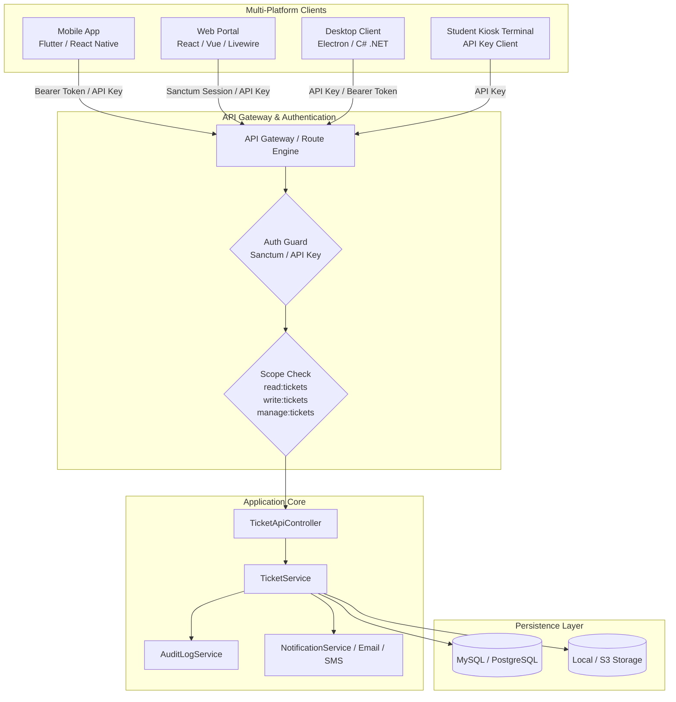
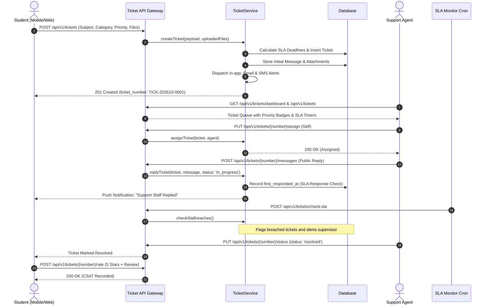

# SNTCSSC MIS — Support Tickets & Helpdesk System REST API Integration Guide
### Multi-Platform Enterprise Implementation Guide (Flutter, React Native, iOS Swift, Android Kotlin, Electron Desktop, C# .NET MAUI & Web Applications)

---

## 1. Executive Summary & Architecture Overview

The **Support Tickets & Helpdesk Module** of the **Satyendranath Tagore Civil Services Study Centre (SNTCSSC) MIS** delivers a high-concurrency, mission-critical customer support and ticketing platform. Engineered for cross-platform integration across **Mobile Apps** (Flutter, React Native, Swift, Kotlin), **Web Applications** (Vue, React, Livewire, Next.js), and **Desktop Clients** (Electron, Windows .NET 8 WPF/MAUI), this module powers student query resolution, grievance redressal, multi-tier staff triage, automated SLA tracking, rich communication threads, and customer satisfaction audits.

### Core Architectural Capabilities:
1. **Multi-Channel Ticket Ingestion:** Ingest support requests from mobile apps, web student portals, email gateways, automated administrative scripts, and external integrations (`source: 'mobile_app' | 'portal' | 'api' | 'email' | 'desktop_app'`).
2. **SLA Engine & Breach Monitoring:**
   - Granular SLA deadlines calculated dynamically on ticket creation based on category baseline hours (`sla_response_hours`, `sla_resolution_hours`) and priority multipliers (Urgent: 0.25x, High: 0.5x, Medium: 1.0x, Low: 1.5x).
   - Automated detection of first-response and resolution breaches with instant staff alert notifications.
3. **Threaded Messaging & Internal Staff Collaboration:**
   - Public replies visible to students and agents.
   - Internal staff notes (`internal_note`) cryptographically segregated and accessible only to authorized support personnel.
   - System timeline event markers tracking state transitions, agent reassignments, and priority shifts.
4. **Rich Attachment Storage & Defensive Security:**
   - Multi-file attachments (images, PDFs, spreadsheets up to 25MB).
   - Server-side extension whitelisting and MIME validation.
   - Authenticated stream proxy (`/api/v1/tickets/attachments/{id}/download`) preventing public discovery of underlying storage paths.
5. **Canned Responses & Macros:** Pre-formatted response templates with dynamic placeholder injection (`{user_name}`, `{ticket_number}`, `{ticket_subject}`, `{category}`, `{agent_name}`, `{app_name}`) for instantaneous resolution.
6. **Customer Satisfaction (CSAT) Audits:** Post-resolution 5-star rating and qualitative feedback collection.
7. **Dual Authentication Gateway:**
   - **Sanctum Personal Access Tokens (`auth:sanctum`):** Ideal for student mobile apps, web single-page apps, and authenticated desktop apps.
   - **Enterprise API Keys (`auth.api_key`):** Suited for kiosk terminals, desktop daemons, and microservices with granular scopes (`read:tickets`, `write:tickets`, `manage:tickets`).
8. **Enterprise Telemetry & Soft Deletes:** Atomic database transactions (`DB::beginTransaction()`), non-destructive soft deletions (`SoftDeletes`), and structured audit logging (`AuditLogService::log()`).

---

## 2. System Architecture & Sequence Flows

### 2.1 Multi-Platform Communication Architecture



### 2.2 Ticket Lifecycle & SLA Escalation Sequence



---

## 3. Security, Authentication & Scope Matrix

Requests must supply an authorization header. The system supports both Sanctum user tokens and institutional API keys:

### 3.1 Authentication Headers

| Method | Header | Example | Description |
| :--- | :--- | :--- | :--- |
| **User Bearer Token** | `Authorization: Bearer <token>` | `Bearer 12\|AbCdEfGhIj...` | Issued upon user login via Sanctum. |
| **Enterprise API Key** | `X-API-Key: <key>` | `X-API-Key: sntc_live_9f83...` | Machine-to-machine integrations or kiosk systems. |
| **Platform Header** | `X-Platform: <os>` | `X-Platform: flutter_android` | Optional diagnostic platform identifier. |

### 3.2 Granular Security Scopes

| Scope Identifier | Label | Allowed Operations |
| :--- | :--- | :--- |
| `read:tickets` | Read Tickets & Telemetry | Query dashboard KPI stats, search tickets, retrieve ticket conversation messages, view categories and canned responses, download attachments. |
| `write:tickets` | Submit & Reply to Tickets | Create new tickets, post public replies, update ticket details, submit satisfaction ratings, upload attachments. |
| `manage:tickets` | Full Support Administration | Assign tickets to agents, transition status (including on-hold/closed), change priority, post internal staff notes, soft delete & restore tickets, manage categories and canned responses, bulk triage, and trigger SLA breach audits. |
| `*` | Full Master Access | Unrestricted administrative control across all ticketing endpoints. |

---

## 4. Complete RESTful API Reference (31 Endpoints)

Base URL: `https://your-domain.edu/api/v1`

### 4.1 Analytics, Dashboard & Diagnostics

#### `GET /api/v1/tickets/dashboard`
Returns real-time operational KPI counts, active status tallies, urgent queue count, SLA breach summary, and recent activity.
- **Scope:** `read:tickets`
- **Response `200 OK`:**
```json
{
  "success": true,
  "data": {
    "counts": {
      "total": 142,
      "active": 28,
      "open": 14,
      "in_progress": 10,
      "pending_user": 3,
      "on_hold": 1,
      "resolved": 98,
      "closed": 16,
      "urgent_high": 5
    },
    "sla": {
      "response_breaches": 2,
      "resolution_breaches": 1,
      "total_breaches": 3
    },
    "satisfaction": {
      "average": 4.85,
      "total_ratings": 64
    },
    "categories": [
      {
        "id": 1,
        "name": "Admissions & Batch Enrollment",
        "slug": "admissions",
        "color_badge": "blue",
        "icon": "user-check",
        "default_priority": "medium",
        "tickets_count": 48
      }
    ],
    "recent_activity": [
      {
        "id": 12,
        "ticket_number": "TICK-202610-0012",
        "uuid": "8bfa2e9a-5f33-41ec-b08e-17fa008899aa",
        "subject": "Unable to access Civil Services Mock Test 4",
        "status": "in_progress",
        "priority": "high",
        "category_id": 2,
        "last_reply_at": "2026-10-31T22:45:00.000000Z"
      }
    ]
  }
}
```

#### `GET /api/v1/tickets/statistics`
Returns detailed analytical breakdowns across priority distributions, status ratios, origin channels, monthly volume trends, and satisfaction scores.
- **Scope:** `read:tickets`
- **Response `200 OK`:**
```json
{
  "success": true,
  "data": {
    "priorities": { "urgent": 6, "high": 22, "medium": 85, "low": 29 },
    "statuses": { "open": 14, "in_progress": 10, "resolved": 98, "closed": 16 },
    "sources": { "mobile_app": 72, "portal": 54, "api": 16 },
    "monthly_trend": { "2026-05": 18, "2026-06": 24, "2026-07": 32, "2026-10": 45 },
    "ratings": { "5_stars": 52, "4_stars": 8, "3_stars": 3, "2_stars": 1, "1_star": 0 }
  }
}
```

#### `GET /api/v1/tickets/export`
Exports filtered tickets as a clean JSON dataset suitable for BI reporting or Excel migration.
- **Scope:** `read:tickets`
- **Query Params:** `status`, `priority`, `category_id`

#### `POST /api/v1/tickets/check-sla`
Scans all active tickets against response and resolution milestone deadlines, marks breaches, logs security audits, and dispatches escalation emails.
- **Scope:** `manage:tickets`
- **Response `200 OK`:**
```json
{
  "success": true,
  "data": {
    "newly_breached_count": 2,
    "audited_at": "2026-10-31T23:30:00Z"
  },
  "meta": {
    "message": "SLA scan complete. 2 new breaches flagged and alerted."
  }
}
```

---

### 4.2 Ticket Categories & SLA Management

#### `GET /api/v1/tickets/categories`
Lists all active categories with SLA parameters and ticket metrics.
- **Scope:** `read:tickets`
- **Response `200 OK`:**
```json
{
  "success": true,
  "data": [
    {
      "id": 1,
      "name": "Hostel & Accommodation",
      "slug": "hostel",
      "description": "Room allocations, bed changes, and warden requests",
      "icon": "home",
      "color_badge": "emerald",
      "default_priority": "medium",
      "sla_response_hours": 12,
      "sla_resolution_hours": 48,
      "default_assigned_user_id": 4,
      "is_active": true,
      "tickets_count": 31
    }
  ]
}
```

#### `POST /api/v1/tickets/categories`
Creates a new support ticket category.
- **Scope:** `manage:tickets`
- **Payload:**
```json
{
  "name": "Library Circulation & Books",
  "slug": "library-books",
  "description": "Book issue renewals, overdue fine inquiries, and missing textbook requests",
  "icon": "book-open",
  "color_badge": "cyan",
  "default_priority": "medium",
  "sla_response_hours": 24,
  "sla_resolution_hours": 72
}
```

#### `GET /api/v1/tickets/categories/{id}` | `PUT /api/v1/tickets/categories/{id}` | `DELETE /api/v1/tickets/categories/{id}`
Standard REST operations for category management. Note: Deleting a category with active tickets is prevented defensively with code `422 CATEGORY_IN_USE`.

---

### 4.3 Canned Responses & Macros

#### `GET /api/v1/tickets/canned-responses`
List active canned responses and snippet shortcuts.
- **Scope:** `read:tickets`
- **Response `200 OK`:**
```json
{
  "success": true,
  "data": [
    {
      "id": 1,
      "title": "Study Material Download Assistance",
      "shortcut": "/download-help",
      "category_id": 2,
      "content": "Dear {user_name},\n\nPlease navigate to Study Materials tab on your mobile app and ensure you have an active network connection. Your ticket #{ticket_number} remains open until verified.\n\nRegards,\n{agent_name}\n{app_name}",
      "is_active": true
    }
  ]
}
```

#### `POST /api/v1/tickets/canned-responses` | `PUT ...` | `DELETE ...`
CRUD endpoints for canned macros.
- **Scope:** `manage:tickets`

---

### 4.4 Master Ticket Query & Self-Service

#### `GET /api/v1/tickets`
Paginated ticket search and filtering.
- **Scope:** `read:tickets`
- **Query Parameters:**
  - `search` (string): Searches ticket number, subject, description, submitter name/email.
  - `status` (string): `open`, `in_progress`, `pending_user`, `on_hold`, `resolved`, `closed`, `active`.
  - `priority` (string): `low`, `medium`, `high`, `urgent`.
  - `category_id` (int): Filter by category.
  - `assigned_to_user_id` (int|string): User ID or `'unassigned'`.
  - `sla` (string): `'breached'`, `'response_breached'`, `'resolution_breached'`, `'due_today'`.
  - `date_from`, `date_to` (date: `YYYY-MM-DD`).
  - `sort_by` (`last_reply_at`, `created_at`, `priority`), `sort_direction` (`asc`, `desc`).
  - `per_page` (int, default: 15, max: 100).

#### `GET /api/v1/tickets/my-tickets`
Dedicated student self-service endpoint returning only tickets owned by the authenticated caller.
- **Scope:** `read:tickets`
- **Response `200 OK`:** Paginated ticket list with unread counters and badge colors.

---

### 4.5 Ticket Creation & Dossier Retrieval

#### `POST /api/v1/tickets`
Creates a support ticket, generates a unique formatted ticket number (e.g. `TICK-202610-0001`), creates the initial thread message, attaches uploaded files, calculates SLA milestones, logs audit trails, and dispatches in-app and email alerts.
- **Scope:** `write:tickets`
- **Content-Type:** `multipart/form-data` or `application/json`
- **Payload:**
```json
{
  "subject": "Payment transaction failed for UPSC Optional Course",
  "description": "I transferred INR 2,500 via UPI on 30th October (Ref: UPI-9876543210), but my fee receipt was not generated in the portal.",
  "category_id": 3,
  "priority": "high",
  "source": "mobile_app"
}
```
*(Optionally include binary files under `attachments[]`)*

- **Response `201 Created`:**
```json
{
  "success": true,
  "data": {
    "id": 14,
    "ticket_number": "TICK-202610-0014",
    "uuid": "7c823019-3f04-4e2b-a320-c9a8b1d2e3f4",
    "subject": "Payment transaction failed for UPSC Optional Course",
    "status": "open",
    "priority": "high",
    "source": "mobile_app",
    "first_response_due_at": "2026-11-01T11:30:00.000000Z",
    "resolution_due_at": "2026-11-02T23:30:00.000000Z",
    "created_at": "2026-10-31T23:30:00.000000Z"
  },
  "meta": {
    "message": "Support ticket created successfully.",
    "ticket_number": "TICK-202610-0014"
  }
}
```

#### `GET /api/v1/tickets/{identifier}`
Retrieves complete ticket dossier, full conversation thread, and attachments.
- **Scope:** `read:tickets`
- **Identifier:** Supports numeric ID (`14`), UUID (`7c823019-...`), or Ticket Number (`TICK-202610-0014`).
- **Security Guard:** Regular students only receive public replies; internal staff notes are defensively filtered out.

---

### 4.6 Lifecycle & Agent Triage Actions

#### `PUT /api/v1/tickets/{identifier}/status`
Transitions ticket status and logs timeline event.
- **Scope:** `write:tickets`
- **Payload:**
```json
{
  "status": "resolved",
  "reason": "Payment verified and receipt RCPT-2026-0812 synced to user portal."
}
```

#### `PUT /api/v1/tickets/{identifier}/priority`
Alters ticket priority (Staff only).
- **Scope:** `manage:tickets`
- **Payload:** `{ "priority": "urgent" }`

#### `PUT /api/v1/tickets/{identifier}/assign`
Assigns or reassigns ticket to an agent.
- **Scope:** `manage:tickets`
- **Payload:** `{ "assigned_to_user_id": 5 }` *(or `null` to unassign)*

#### `POST /api/v1/tickets/{identifier}/messages`
Posts a response to the ticket thread. Supports public reply or staff internal note.
- **Scope:** `write:tickets`
- **Content-Type:** `multipart/form-data` or `application/json`
- **Payload:**
```json
{
  "message": "We have re-verified your UPI transaction with the bank. Your course access is now enabled.",
  "type": "public_reply",
  "new_status": "resolved"
}
```

#### `DELETE /api/v1/tickets/{identifier}/messages/{messageId}`
Soft-deletes a message from the thread.
- **Scope:** `manage:tickets`

#### `POST /api/v1/tickets/{identifier}/rate`
Records student satisfaction feedback (1 to 5 stars).
- **Scope:** `write:tickets`
- **Payload:**
```json
{
  "rating": 5,
  "feedback": "Super fast response! The finance team resolved my issue within 2 hours."
}
```

#### `POST /api/v1/tickets/{identifier}/attachments`
Attaches supplementary binary documents or screenshots to an open ticket.
- **Scope:** `write:tickets`

#### `GET /api/v1/tickets/attachments/{attachmentId}/download`
Secure stream download of ticket attachment with access verification.
- **Scope:** `read:tickets`

#### `POST /api/v1/tickets/bulk-action`
Batch operations across an array of ticket IDs.
- **Scope:** `manage:tickets`
- **Payload:**
```json
{
  "action": "status",
  "ticket_ids": [14, 15, 18],
  "value": "closed"
}
```
*(Actions supported: `'status'`, `'priority'`, `'assign'`, `'delete'`)*

#### `DELETE /api/v1/tickets/{identifier}` | `POST /api/v1/tickets/{identifier}/restore`
Soft-deletes or restores a ticket with audit logging.
- **Scope:** `write:tickets` (delete), `manage:tickets` (restore).

---

## 5. Multi-Platform Implementation SDKs & Step-by-Step Code Examples

### 5.1 Flutter / Dart Implementation (Mobile iOS & Android)

```dart
import 'dart:io';
import 'package:dio/dio.dart';

class TicketApiClient {
  final Dio _dio;

  TicketApiClient({required String baseUrl, required String authToken})
      : _dio = Dio(BaseOptions(
          baseUrl: baseUrl,
          headers: {
            'Authorization': 'Bearer $authToken',
            'Accept': 'application/json',
            'X-Platform': 'flutter_${Platform.operatingSystem}',
          },
          connectTimeout: const Duration(seconds: 15),
          receiveTimeout: const Duration(seconds: 15),
        ));

  /// 1. Fetch Student My Tickets
  Future<List<Map<String, dynamic>>> getMyTickets({String status = 'active'}) async {
    final response = await _dio.get(
      '/api/v1/tickets/my-tickets',
      queryParameters: {'status': status},
    );
    if (response.statusCode == 200 && response.data['success'] == true) {
      return List<Map<String, dynamic>>.from(response.data['data']);
    }
    throw Exception('Failed to load tickets: ${response.data['error']?['message']}');
  }

  /// 2. Create Support Ticket with Multipart Attachments
  Future<Map<String, dynamic>> createTicket({
    required String subject,
    required String description,
    required int categoryId,
    String priority = 'medium',
    List<File> attachments = const [],
  }) async {
    final formData = FormData.fromMap({
      'subject': subject,
      'description': description,
      'category_id': categoryId,
      'priority': priority,
      'source': 'mobile_app',
    });

    for (var file in attachments) {
      final fileName = file.path.split('/').last;
      formData.files.add(MapEntry(
        'attachments[]',
        await MultipartFile.fromFile(file.path, filename: fileName),
      ));
    }

    final response = await _dio.post('/api/v1/tickets', data: formData);
    return response.data['data'];
  }

  /// 3. Reply to Ticket
  Future<Map<String, dynamic>> postReply({
    required String ticketNumber,
    required String message,
    List<File> attachments = const [],
  }) async {
    final formData = FormData.fromMap({
      'message': message,
      'type': 'public_reply',
    });

    for (var file in attachments) {
      formData.files.add(MapEntry(
        'attachments[]',
        await MultipartFile.fromFile(file.path),
      ));
    }

    final response = await _dio.post(
      '/api/v1/tickets/$ticketNumber/messages',
      data: formData,
    );
    return response.data['data'];
  }

  /// 4. Submit Satisfaction Rating
  Future<bool> rateTicket({
    required String ticketNumber,
    required int rating,
    String? feedback,
  }) async {
    final response = await _dio.post(
      '/api/v1/tickets/$ticketNumber/rate',
      data: {'rating': rating, 'feedback': feedback},
    );
    return response.statusCode == 200;
  }
}
```

---

### 5.2 React Native / TypeScript Implementation

```typescript
import axios, { AxiosInstance } from 'axios';

export interface TicketItem {
  id: number;
  ticket_number: string;
  subject: string;
  status: 'open' | 'in_progress' | 'pending_user' | 'on_hold' | 'resolved' | 'closed';
  priority: 'low' | 'medium' | 'high' | 'urgent';
  category?: { name: string; color_badge: string };
  last_reply_at: string;
  messages_count: number;
}

export class HelpdeskApi {
  private client: AxiosInstance;

  constructor(baseURL: string, token: string) {
    this.client = axios.create({
      baseURL,
      headers: {
        Authorization: `Bearer ${token}`,
        Accept: 'application/json',
        'X-Platform': 'react_native',
      },
    });
  }

  async getMyTickets(): Promise<TicketItem[]> {
    const res = await this.client.get<{ success: boolean; data: TicketItem[] }>(
      '/api/v1/tickets/my-tickets'
    );
    return res.data.data;
  }

  async getTicketDossier(identifier: string) {
    const res = await this.client.get(`/api/v1/tickets/${identifier}`);
    return res.data.data;
  }

  async replyToTicket(identifier: string, message: string) {
    const res = await this.client.post(`/api/v1/tickets/${identifier}/messages`, {
      message,
      type: 'public_reply',
    });
    return res.data.data;
  }
}
```

---

### 5.3 Windows .NET 8 (C# WPF / MAUI / Desktop)

```csharp
using System;
using System.Net.Http;
using System.Net.Http.Headers;
using System.Text;
using System.Text.Json;
using System.Threading.Tasks;

public class SntcsscTicketClient
{
    private readonly HttpClient _http;

    public SntcsscTicketClient(string baseUrl, string apiKey)
    {
        _http = new HttpClient { BaseAddress = new Uri(baseUrl) };
        _http.DefaultRequestHeaders.Add("X-API-Key", apiKey);
        _http.DefaultRequestHeaders.Accept.Add(new MediaTypeWithQualityHeaderValue("application/json"));
    }

    public async Task<string> GetDashboardTelemetryAsync()
    {
        var response = await _http.GetAsync("/api/v1/tickets/dashboard");
        response.EnsureSuccessStatusCode();
        return await response.Content.ReadAsStringAsync();
    }

    public async Task<bool> UpdateTicketStatusAsync(string ticketNumber, string status, string reason)
    {
        var payload = JsonSerializer.Serialize(new { status, reason });
        var content = new StringContent(payload, Encoding.UTF8, "application/json");

        var response = await _http.PutAsync($"/api/v1/tickets/{ticketNumber}/status", content);
        return response.IsSuccessStatusCode;
    }
}
```

---

### 5.4 Electron / Node.js Implementation

```typescript
import axios from 'axios';

const api = axios.create({
  baseURL: 'https://mis.sntcssc.edu/api/v1',
  headers: {
    'X-API-Key': process.env.SNTCSSC_API_KEY,
    Accept: 'application/json',
  },
});

// Admin desktop app ticket assignment
export async function assignTicket(ticketNumber: string, agentUserId: number) {
  const { data } = await api.put(`/tickets/${ticketNumber}/assign`, {
    assigned_to_user_id: agentUserId,
  });
  return data.data;
}
```

---

### 5.5 Python Automation & Triage Script

```python
import requests

API_URL = "https://mis.sntcssc.edu/api/v1"
API_KEY = "sntc_live_sample_key_12345"

headers = {
    "X-API-Key": API_KEY,
    "Accept": "application/json",
    "Content-Type": "application/json"
}

def audit_sla_breaches():
    res = requests.post(f"{API_URL}/tickets/check-sla", headers=headers)
    if res.status_code == 200:
        data = res.json()
        print(f"SLA Audit Complete: {data['data']['newly_breached_count']} tickets escalated.")
    else:
        print("SLA audit failed:", res.text)

if __name__ == "__main__":
    audit_sla_breaches()
```

---

### 5.6 cURL CLI Integration Recipes

```bash
# 1. Inspect Ticket Dashboard
curl -X GET "https://mis.sntcssc.edu/api/v1/tickets/dashboard" \
  -H "X-API-Key: sntc_live_api_key_abc123" \
  -H "Accept: application/json"

# 2. Create a Ticket
curl -X POST "https://mis.sntcssc.edu/api/v1/tickets" \
  -H "X-API-Key: sntc_live_api_key_abc123" \
  -H "Content-Type: application/json" \
  -d '{
    "subject": "Missing Lecture Notes for UPSC GS Paper 2",
    "description": "Please upload the revised Polity handouts discussed in todays lecture.",
    "category_id": 1,
    "priority": "medium",
    "source": "api"
  }'

# 3. Post Agent Reply
curl -X POST "https://mis.sntcssc.edu/api/v1/tickets/TICK-202610-0001/messages" \
  -H "X-API-Key: sntc_live_api_key_abc123" \
  -H "Content-Type: application/json" \
  -d '{
    "message": "The notes have been uploaded to the Study Materials portal.",
    "type": "public_reply",
    "new_status": "resolved"
  }'
```

---

## 6. Defensive Error Envelopes & Response Codes

All responses follow a consistent, standardized envelope:

### Success Format (`200 OK`, `201 Created`):
```json
{
  "success": true,
  "data": { ... },
  "meta": { "total": 100, "message": "Success notification" }
}
```

### Error Format (`4xx`, `5xx`):
```json
{
  "success": false,
  "error": {
    "code": "TICKET_NOT_FOUND",
    "message": "Ticket 'TICK-999' was not found.",
    "details": { ... }
  }
}
```

### Common HTTP Error Matrix:
| Code | Error Code | Description |
| :--- | :--- | :--- |
| `401` | `API_KEY_MISSING` / `UNAUTHENTICATED` | API Key header or Sanctum bearer token is missing or expired. |
| `403` | `INSUFFICIENT_SCOPE` / `FORBIDDEN` | Missing required scope or user lacks permission to access this ticket. |
| `404` | `TICKET_NOT_FOUND` | Specified ID, UUID, or Ticket Number does not exist. |
| `422` | `VALIDATION_FAILED` | Invalid input payload parameters or file MIME type rejected. |
| `422` | `CATEGORY_IN_USE` | Cannot delete category with linked active tickets. |
| `500` | `EXECUTION_EXCEPTION` | Server exception during transaction (automatically rolled back). |

---

## 7. Operational Best Practices for Production Deployment

1. **SLA Automation Cron:** Add an hourly scheduled task calling `POST /api/v1/tickets/check-sla` or dispatching `TicketService::checkSlaBreaches()` to ensure timely escalation warnings.
2. **File Size Limits:** Ensure Nginx or reverse proxy configuration (`client_max_body_size 30M;`) allows attachments up to 25MB.
3. **Internal Note Privacy:** Never reveal `internal_note` message payloads to student clients. The API controller strictly enforces this check at the Eloquent query layer.
4. **Audit Logs:** Every status change, assignment, reply, file upload, soft delete, and restore action is permanently recorded in the institutional security audit logs.

